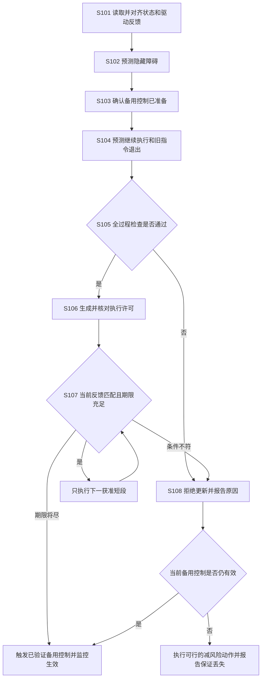

# 专利交底书 A：一种考虑待执行指令的遮挡场景移动平台短段执行许可与备用控制切换方法

> 撰写依据：[专利交底书模板及注意事项](../template.md)。重写日期：2026-10-19。
> 建议类型：发明专利；以方法和控制系统为主要交底对象，电子设备、存储介质形式由代理人据实整理。
> 本文为供研发与代理人讨论的设计草案。尚未完成本方案的软件、仿真或实机验证；算例不是测试结果，不承诺安全认证或专利授权。
> 发明人、申请人、实际研发形成日期和已公开情况：待根据真实记录填写。
> 历史材料：[原交底书](01_patent_a_occlusion_handover_certificate_disclosure_20261015.md)、[通俗技术详解](01_patent_a_sources_and_technical_principles_20261015.md)。本文独立描述方案，不要求先阅读历史材料。

## 一、本发明解决的技术问题是：

### 1.1 现有技术的缺点及产生原因

移动平台在货架盲角或遮挡路口行驶时，已有方案通过预测隐藏人车的位置、检查备用停车动作，限制原计划的继续执行。但是，规划检查与底盘执行之间存在时间差。对于未将实际待执行指令和备用控制生效反馈纳入检查的实现，仍存在以下问题：

1. **真正开始制动时的状态可能超出检查依据。** 原因是检查按当前速度或预定切换时刻计算，而驱动器已接受的旧指令尚未执行完。切换决定发出后，旧加速输入可能继续提高速度，使实际停车距离大于检查值。
2. **检查通过的结果可能被用于已经变化的执行条件。** 原因是检查和启用之间，指令批次、执行进度或备用控制版本发生变化；仅检查轨迹编号或消息发送成功，不能确认驱动器将按原计算条件执行。
3. **许可的剩余可用时间可能被高估。** 原因是采用与本次运动无关的固定超时，或收到消息后重新起算完整有效期，没有扣除实际通信消耗和监督等待时间，也没有反映旧指令内容造成的接管状态变化。

上述不足限定于第二部分分析的具体实现条件，不表示所有已有备用控制方法都忽略时延或执行状态。

### 1.2 针对上述缺点的发明目的及技术问题

本发明的目的，是使遮挡场景下原计划的继续执行范围，与驱动器实际未完成的输入、备用控制真正生效时的状态以及当前障碍预测相一致。

具体要解决的技术问题是：**在规划与驱动异步执行、旧指令不能立即取消的条件下，如何确定原计划还能执行多长一段，并保证该检查结果只在相应执行条件和期限内使用。**

### 1.3 针对上述缺点能够达到的技术效果

| 对应缺点 | 本发明的技术处理及其作用 | 对应技术效果 |
| --- | --- | --- |
| 第 1 项：接管状态估计偏差 | 把实际待执行输入及其执行时间范围纳入继续执行、等待切换和备用控制的联合预测 | 将旧加速等输入引起的额外位移、速度变化计入判断，减少由漏算该阶段引起的错误放行 |
| 第 2 项：检查条件与实际执行不符 | 将许可绑定到指令批次、允许进度及备用控制准备状态，并在启用和执行时核对反馈 | 拒绝在条件已改变时继续使用旧检查结果，阻止不匹配的原计划和备用控制组合进入执行 |
| 第 3 项：期限被不当延长 | 根据本次预测确定绝对最迟决定时刻，不因收包或更新失败重新计时 | 使传输和等待时间实际消耗许可余量，避免在原检查覆盖时间之外继续追加原计划 |

这些效果以输入、误差、时延和障碍范围覆盖实际情况为条件，不表示任意情况下都能避免碰撞。具体实施和验证方法分别见第三、七部分；尚无本案实测改善比例。

## 二、详细介绍技术背景，并描述已有的与本发明最相近似的实现方案。

### 2.1 技术背景

低速地面移动机器人通常由环境传感器、状态估计器、规划器、轨迹检查模块、跟踪控制器和底盘驱动器组成。传感与估计提供障碍及位置、速度，规划器提出动作，检查模块决定是否接受，控制器产生电机输入，驱动器执行并反馈。在遮挡环境中，还需估计隐藏人车的可能占用，并预留停车或避让能力。

规划、通信和驱动执行存在时间差，驱动器也可能保存尚未完成的旧指令。因此，决定切换到备用控制，不等于底盘已开始执行备用动作。

### 2.2 现有技术方案及缺点

**主要方案。** gatekeeper [A-R1] 在规划器和跟踪控制器之间检查候选运动：先预测原计划执行一段，再接上备用控制，检查途中约束和终端状态；通过后保存为已确认轨迹，无新方案时沿用旧轨迹。论文第五部分及算法 1 已给出切换时长搜索，并考虑估计及跟踪误差。OcclusionCBF [A-R2] 进一步预测隐藏动态障碍占用，检查备用运动；US11407409B2 [A-R3] 已检查轨迹时效、当前状态和可执行性。黑盒 Simplex [A-R4] 也有主备运行时切换机制，本轮仅核读其摘要。

**针对本案场景的缺点。** 将上述方法用于存在不可立即替换输入的驱动器时，若预测未包含旧输入及其退出时间，会低估接管速度和位移；若启用前未核对指令批次、进度和备用准备状态，检查结果可能用于已变化条件；若收包后重新起算许可时间，还可能超出原检查期限。这些不足只针对缺少相应接口处理的实现，不表示已有方法普遍忽略时延，也不将备用预测或倒计时本身视为创新。文献出处、日期和核读范围见第七部分 [A-R1]～[A-R4]。

## 三、本发明技术方案的详细阐述（核心的重点内容）：

### 3.1 适用条件和输入输出

主实施例为平整地面、低速差速机器人，装有激光雷达或深度传感器、轮速与惯性传感器。需有经标定的位置与速度误差、车体及载荷外形、制动响应、轮速与轮加速度限制。

必须能够获得待执行指令记录，或者由驱动接口的已知行为建立覆盖全部可能输入的保守范围。两者都不能获得时，不生成带完整检查结论的许可。

输入为观测、当前状态范围、原计划、备用控制及驱动反馈。输出为下一小段原计划的执行许可、触发备用控制的决定，或“不批准、条件失效”的具体原因。

### 3.2 图 1：结构组成与连接关系

| 标号及名称 | 实现方式及作用 |
| --- | --- |
| A101 观测时间对齐模块 | 保存传感器采集时间及同步误差，把状态和障碍转换到同一局部坐标系和单调时钟 |
| A102 隐藏障碍预测模块 | 区分已看清空闲、已占用和未知空间；从遮挡入口传播隐藏人车可能位置 |
| A103 原计划生成模块 | 复用现有规划器输出有限时长的位置、速度和输入候选；不能直接向驱动器旁路发指令 |
| A104 驱动反馈适配模块 | 读取指令批次、执行进度、未完成输入、备用控制准备及生效状态；将驱动专有接口转为统一记录 |
| A105 全过程检查模块 | 依次计算原计划、旧指令退出及备用控制运动，检查约束和所覆盖的时间段 |
| A106 执行许可管理模块 | 生成和核对许可、按绝对时刻到期、拒绝不匹配更新；控制周期内运行，不依赖规划线程及时返回 |
| A107 指令选择模块 | 作为唯一软件驱动入口，在原计划获准短段与备用控制之间选择；拒绝不合批次的迟到指令 |
| A108 底盘驱动模块 | 执行电机控制、输出真实反馈并保留独立硬件保护；软件许可不替代急停等独立功能 |

### 3.3 图 2：处理流程及分支

图中的“只执行下一获准短段”等为动作，不是新增部件；所有 S101～S108 在以下逐项说明。

### 3.4 S101：取得实际执行条件，而不是只取规划器希望输出的命令

每次检查取得以下记录：

| 记录 | 至少包含的内容 | 核对方法 |
| --- | --- | --- |
| 观测记录 | 标识、采集时间、坐标版本、障碍及误差范围 | 拒绝未来时间戳、过期或时钟关系不明的记录 |
| 平台条件 | 外形和载荷、模型、输入大小及变化限制、制动能力、版本 | 更换载荷或能力下降后不得沿用旧版本 |
| 待执行指令记录 | 记录标识、指令批次、执行进度、指令内容及可能执行区间、不可取消部分 | 以驱动确认内容为准；读取后新增输入也须处于约定范围 |
| 备用控制确认 | 控制规则标识、版本、已装载状态、允许启用区间、确认时间 | 发送成功不等于接收方已准备好 |
| 实际反馈 | 位置/速度范围、实际输入或跟踪误差、批次/进度、生效状态 | 反馈年龄需计入预测；缺失超过界限视为无法继续核对 |

选择检查起点 $t_d$，将较早状态按已知输入传播到该时刻。观测年龄也从真实采集时间计算，不以消息收到时间代替。时钟同步误差只计入一次。

### 3.5 S102：构造隐藏人车在未来可能占到的空间

用传感器射线和障碍边缘确定遮挡入口。对每个入口，给出可能初始位置范围，并根据对象类别采用经声明的速度、加速度上界。没有对象类别依据时使用覆盖仍合理类别的范围，而不是默认只有慢行人。

一种不利用方向信息的保守扩张半径为：

$$
r_q(t)=v_{q,\max}(t-t_o)+\tfrac12 a_{q,\max}(t-t_o)^2.
$$

$t_o$ 是观测时刻；$v_{q,\max}$、$a_{q,\max}$ 单位分别为 m/s、m/s²；$r_q$ 单位为 m。将初始范围向外扩张 $r_q$，再计入目标尺寸及初始误差，得到障碍占用范围 $\mathcal O_q(t)$。所有入口和已检测障碍取并集 $\mathcal O(t)$。

仅在观测确实覆盖且质量有效时，才允许删除已经证实为空的区域。若新观测使占用范围扩大，先重新检查当前许可，不因“有新数据”自动续期。

### 3.6 S103：确定可实现的备用控制及结束状态

主实施例选用沿已确认通道受限减速的反馈控制，同时把线速度和转动速度降低到规定容差内。停止位置必须处于冲突区外；控制器须能在要求的保持时段内防止滑移或溜车。

机器人状态取 $x=[p_x,p_y,\psi,v,\omega]$，输入取线加速度 $a$ 和角加速度 $\alpha$：

$$
\dot p_x=v\cos\psi,\quad \dot p_y=v\sin\psi,\quad
\dot\psi=\omega,\quad \dot v=a,\quad \dot\omega=\alpha.
$$

$p_x,p_y$ 为位置（m），$\psi$ 为朝向（rad），$v$ 为线速度（m/s），$\omega$ 为转动速度（rad/s）。轮距 $W$、轮半径 $R$ 下：

$$
\dot\phi_R=(v+W\omega/2)/R,\qquad
\dot\phi_L=(v-W\omega/2)/R.
$$

同时检查左右轮速度、加速度、力矩以及底层速度控制响应。只把 $v$ 和 $\omega$ 分别限幅，不足以保证两轮都能实现。

将已准备的备用控制规则记为 $\pi_b$。对一个可能接管状态范围，通过带扰动范围的时间步传播，检查直到停止及要求的保持时间内，全部可能状态是否满足轮端、空间和结束条件。也可预先用相同模型建立保守查表集合 $\mathcal K_b(t)$，表示“时刻 $t$ 使用本备用控制能够处理的状态”；在线仍须按本次障碍裁剪，不能仅查一张没有障碍信息的表。

若只验证到停车，则结论也只到停车；不能把“速度为零”当成永远不会被移动障碍撞击的证明。

### 3.7 S104：分别计算三个阶段

对候选继续执行时长 $h$，按下列阶段预测：

1. **继续原计划阶段**：$t_d$ 至 $t_d+h$，使用拟批准的输入及跟踪误差范围。
2. **等待切换阶段**：从决定切换到备用控制真正起作用，使用待执行指令记录和驱动器响应范围。旧加速指令不能替换成零输入。
3. **备用控制阶段**：从第二阶段每一种可能结束状态出发，执行 $\pi_b$，直到满足停止及保持要求。

等待切换的时间上界记为 $\tau_h$。计算、总线、驱动响应和抖动是否已包含在该上界中，须形成不重叠的预算表。已经在起点传播的观测年龄不再加一次；循环监督迟到预算与作出决定后的响应时间也不能重复计算。

时间步模型为 $x_{k+1}=f(x_k,u_k,w_k)$，$w_k$ 表示经标定扰动范围。每一步对全部允许状态、输入和扰动求外包范围。可用区间传播、具有误差余量的可达表或经验证的集合计算；只从一个初始值仿真一次，不能替代范围检查。

所有阶段都使用同一绝对时刻的障碍预测。矩形机身、伸出的货箱和旋转时经过的空间均计入；若已将障碍按机身形状膨胀，就不要又无说明重复加入同一机身尺寸。

### 3.8 S105：判定候选时长并覆盖采样之间

令 $\mathcal R_{\rm old}(t;h)$ 为前两个阶段的可能状态，$\mathcal R_{\rm end}(h)$ 为真正接管时的可能状态。候选通过须满足：

$$
\operatorname{Body}(\mathcal R_{\rm old}(t;h))\cap\mathcal O(t)=\varnothing,
\qquad
\mathcal R_{\rm end}(h)\subseteq\mathcal K_b(t_d+h+\tau_h).
$$

第一项表示切换前的机身范围与同一时刻的障碍不重叠；第二项表示所有接管状态均能由备用控制处理。若接管时间在区间内变化，应对该区间内的实际接管时间一并检查，不能只检查最晚时间的一个状态点。

从 $h=0$ 起，按控制周期整数倍逐个检查。若某一候选失败，不再批准跨过该失败点的更长原计划，即使后来某一点可能可行。这是本实现为允许中途切换所作的保守限制，不是一般 gatekeeper 的全局最长时长结论。

对两次时间采样之间，采用连续碰撞检查，或按已标定的线速度、角速度及误差变化界扩大整段机身范围；切换时间的抖动区间也纳入计算。无法覆盖的间隔不获准。不能假设可行性必随 $h$ 单调后直接二分。

设最后连续通过的网格时长为 $h_{\rm pass}$，监督周期及其迟到预算为 $\delta_s$，设置最迟决定时刻：

$$
D=t_d+h_{\rm pass}-\delta_s.
$$

若 $h_{\rm pass}<\delta_s$，不批准正时长的继续执行，但仍可使用 $h=0$ 检查通过的立即备用控制。$\tau_h$ 已在第二阶段计算，不再从 $D$ 重复扣除。

### 3.9 S106：生成许可，并在真正启用时再次核对

许可至少包含：原计划、备用控制、观测和待执行指令记录标识；平台、外形和坐标版本；允许的指令批次、执行进度区间和输入范围；允许初态及后续状态范围；备用控制确认；$D$；检查终止时刻及结论类型。

许可先进入待启用状态，再由 A106 读取最新反馈。执行进度允许按预测向前推进，并不要求与检查时完全不动；但必须仍落在许可覆盖的范围内。若新增指令、备用控制重载、载荷变化或时限消耗使条件不匹配，则拒绝启用并记录原因。

启用新许可与切换指令批次在同一软件控制边界完成；这只保证软件选择一致，不表示旧物理输入立即消失。首次启动无有效许可时不追加移动指令；是否能原地保持仍由平台条件决定。

### 3.10 S107：逐周期执行和触发备用控制

A106 每周期先检查实际状态和驱动反馈，再决定下一动作：

- 条件匹配，且下一次最晚监督时刻不迟于 $D$：只向 A107 提交下一获准短段。
- 下一次最晚监督时刻将迟于 $D$，或当前已到 $D$：现在触发备用控制，禁止继续追加原计划。
- 已触发备用控制：监督其在 $\tau_h$ 内实际生效，并检查真实输入和状态仍被计算范围覆盖。

规划器未更新时，$D$ 继续按原时钟接近，不能刷新旧消息或仅换时间戳续期。备用控制结束后，必须取得新的全过程检查结果才能恢复原计划。

### 3.11 S108：拒绝、失效和异常处理

| 异常 | 处理及记录 |
| --- | --- |
| 仅新规划计算超时，旧许可条件仍成立 | 保留旧许可剩余时间，到期前触发其备用控制 |
| 许可标识、批次、执行进度或准备确认不匹配 | 不启用新许可；只有旧许可及旧备用控制仍满足当前条件时才继续使用 |
| 新障碍超出预测、制动能力下降或载荷外形变化 | 立即撤销旧结论，重新检查当前可行行为；不得默认旧备用控制仍安全 |
| 时钟关系不明、反馈过旧、实际切换超过时限 | 标记保证丢失，启动独立底盘保护及当前可行的减风险控制，上报具体原因 |
| 任何候选均不能停止或避让 | 记录无可行解，不输出“安全停车成功”类结论 |

### 3.12 实施例：相同时延、不同待执行指令产生不同许可

以下为假设参数的直线必要条件演示。机器人宽 0.60 m、长 0.80 m；以机身前沿到冲突边界的净距离计，剩余 1.50 m。速度 1.20 m/s，保证减速度 0.80 m/s²，等待切换上界 0.15 s，位置误差及附加余量共 0.20 m，监督预算 0.02 s。

**情形一：等待切换期间保持原速度。**

$$
d_{\rm switch+stop}=1.20\times0.15+
\frac{1.20^2}{2\times0.80}+0.20=1.28\ {\rm m}.
$$

决定切换前最多还可匀速等待 $(1.50-1.28)/1.20=0.18333$ s。以 0.02 s 网格检查，最后通过时长 0.18 s；扣监督预算后，最迟决定时刻为起点后 0.16 s。

| 起点后时刻 | 事件及距离 |
| --- | --- |
| 0.16 s | 最迟决定切换，已前进 0.192 m |
| 0.31 s | 最坏开始制动，等待切换又前进 0.180 m |
| 1.81 s | 制动完成，再前进 0.900 m；累计 1.272 m，加余量为 1.472 m |

**情形二：决定后 0.15 s 内，驱动器还会执行 $+0.30$ m/s² 加速。**

决定前仍匀速是本例的特定假设，须以真实驱动时间关系验证。等待切换距离为 0.183375 m，制动开始速度为 1.245 m/s，随后停车距离为 0.968765625 m。含余量的切换及停车需求为 1.352140625 m。

因此决定前允许等待的上限约为 0.123216 s；网格时长取 0.12 s，扣监督预算后仅准许到 0.10 s 作出决定。若仍沿用情形一的 0.16 s，需求为 $0.192+1.352140625=1.544140625$ m，超过剩余距离。

本例说明指令内容对物理结果有作用，不只是增加管理字段。两种情形仍须检查隐藏行人的运动、二维外形、角速度及保持时段，不能由直线算式直接批准真实机器人通行。

### 3.13 部署方式

可在既有导航规划器与底盘之间增加 A104～A107，复用原传感器和跟踪器。先以不控制机器人的记录模式回放数据，再做闭环仿真、真实控制硬件接入测试和低速封闭场地试验。

许可计算可比控制监督低频，但控制监督必须有单独可监督的计算预算。选择任何机器人软件中间件都不自动获得硬实时保证；需要测量目标硬件上的完整处理时序并配置超时处理。

## 四、本发明的关键点和欲保护点是：

按重要性排序，供代理人结合进一步检索取舍：

1. **实际待执行输入参与未来接管状态计算**：从驱动确认而非规划期望取得旧输入及执行时间范围，联合预测继续原计划、切换过渡与备用控制，并由检查结果限制获准短段。
2. **检查条件与真实执行状态绑定**：许可关联指令批次、允许进度及输入范围、备用控制准备确认，启用和执行过程中均以驱动反馈核对；不匹配则取消继续执行资格。
3. **许可续期与物理切换闭环**：新许可未通过启用核对时不延长期限，旧期限继续消耗；到期前触发已准备的备用控制，并检查实际生效而非仅发送成功。
4. **具体实施限制**：绝对决定时刻、完整停车/保持时域、采样间覆盖以及差速机器人轮端耦合与旋转载荷检查，可作为从属限定。

不单独请求保护“有备用控制”“最大执行时长”“时间戳或版本号”。上述组合是否足以区别现有技术，仍未确认；系统保护点应限定相同数据与控制关系，而不是只有模块名称。

## 五、与第二部分所属的最好的现有技术相比，本发明的优点：

以第二部分的 gatekeeper [A-R1] 为主要对比，并结合遮挡预测及轨迹验证方案。针对底层存在不可取消指令、且原检查未与该驱动状态绑定的部署，本发明具有以下优点：

1. **接管判断与实际待执行输入相符。** 将旧指令引起的速度和位移变化纳入全过程预测，因此不会因假定立即切换而漏算这部分停车需求。第三部分两种队列算例说明，相同时延下可据此给出不同的最迟决定时刻。
2. **检查结果不被用于不匹配的执行条件。** 启用和执行时核对指令批次、进度及备用控制确认，条件改变就停止使用原许可，从而阻止基于旧队列或旧备用控制的动作被继续放行。
3. **许可期限反映实际消耗的时间。** 按绝对时刻监督且更新失败不续期，因此通信和计算等待不会被重新计成可用运动时间。

上述优点以第三部分声明的模型、误差和响应条件成立为前提，属于技术关系推导，尚无本案性能提升统计。

## 六、针对第三部分中的技术方案，是否还有别的替代方案？

1. **驱动器无精确队列接口**：用最大缓冲长度、允许输入大小和最晚退出时间构造输入范围，替代逐条队列读取。仍须覆盖实际输入并监督契约；无法界定时不生成完整许可，不能用“只保留最新命令”的上层配置推断底层无缓冲。
2. **备用控制的计算形式**：可用在线集合传播替代保守查表；可用多个已准备停车/避让策略分别检查后选择一个。每种均需包含实际激活时间和结束条件，不能临时切换到未经检查的新策略。
3. **碰撞计算形式**：可检查完整机身扫过的空间，或将障碍按机身与误差扩张后检查参考点；两者须保持尺寸和误差定义一致。
4. **指令隔离方式**：可由驱动器拒绝旧批次，也可由唯一上层入口阻止新旧混发。后者不能撤回已经下发的旧输入，须继续纳入过渡预测。底盘独立保护不受上层许可阻塞。
5. **汽车式转向平台**：将第三部分差速模型换成含轴距、转角、转向速率和制动响应的车辆模型；高速时加入侧偏和轮胎动力学，外形及保持条件同步替换。不直接把差速算例套用。
6. **全向或足式平台**：全向平台需轮系运动换算和方向相关力限制；足式平台还需接触、关节及稳定支撑终态。本稿不声称已给出它们的完整控制实现，也不以平台名称扩大已验证结论。

替代方案仍应保留“真实待执行输入—接管预测—有限许可—反馈核对”这条物理控制关系。用固定超时且不检查接管状态，是可比较的其他方案，不是效果等同的替代。

## 七、其他有助于专利代理人理解本技术的资料：

### 7.1 本轮实际检索、核读范围与迭代

检索与访问日：2026-10-19。使用公开通用关键词，不将未公开方案全文提交到外部检索服务。检索方向包括 `gatekeeper backup control trajectory`、`runtime assurance actuator delay backup switching`、遮挡备用控制及 `trajectory validation`。

| 迭代 | 获取的依据 | 对本稿的实际调整 |
| --- | --- | --- |
| 第一轮：由综述追溯原始工作 | 核读 [A-R1] 第五部分定义与算法 1 | 不再把最大执行时长、备用控制或网格搜索当作创新；直接列为最接近论文 |
| 第二轮：核读遮挡论文和专利 | [A-R2] 占用覆盖/更新假设、第四部分 E；[A-R3] 最终权利要求 1～5、6～10 | 补足观测更新后重验、采样间覆盖、当前状态与可执行性检查，收窄区别到队列及真实启用关系 |
| 第三轮：按可实施性复核 | 对照本稿输入、三阶段时序、启用核对及两种队列算例 | 区分“拒绝新许可”与“旧许可条件失效”；不把软件更新等同于电机瞬时切换 |

搜索自动摘要曾把“可处理有界扰动”扩写成“已处理任意排队和反馈延迟”，没有采用这种未经原文支持的扩大解释。仅有摘要的材料不用于“正文不存在某机制”的断言。

### 7.2 可独立查找的来源

| 编号 | 书目及原始链接 | 本轮读取范围及使用限制 |
| --- | --- | --- |
| A-R1 | Devansh R. Agrawal, Ruichang Chen, Dimitra Panagou. *gatekeeper: Online Safety Verification and Control for Nonlinear Systems in Dynamic Environments*. [arXiv:2211.14361](https://arxiv.org/abs/2211.14361)，首稿 2022-11-25，v4 2024-08-14；页面 DOI：10.1109/IROS55552.2023.10341790 | [v4 正文](https://arxiv.org/html/2211.14361v4)，重点第五部分、定义 6～9、算法 1 及相关备注；不把会议 DOI 称为期刊 DOI，不将其理论直接移植到本稿驱动实现 |
| A-R2 | Taekyung Kim, Hun Kuk Park, Renya Wada, Nikolay Atanasov, Shumon Koga, Dimitra Panagou. *OcclusionCBF: Backup Control Barrier Functions for Safe Navigation Among Hidden Dynamic Obstacles*. [arXiv:2609.06342v1](https://arxiv.org/abs/2609.06342v1)，2026 年 9 月预印本 | [正文](https://arxiv.org/html/2609.06342v1)，重点第三、四部分及第四部分 E；论文实验不属于本案结果 |
| A-R3 | *System and method for trajectory validation*. [US11407409B2 全文](https://patents.google.com/patent/US11407409B2/en)，授权公告日 2022-08-09；同申请公开文本 US20210046923A1，2021-02-18 | 核对书目、说明书相关内容及最终权利要求 1～5、6～10；不把说明书中的示例条款当作最终权利要求；法律状态和同族由官方档案另核 |
| A-R4 | Usama Mehmood, Sanaz Sheikhi, Stanley Bak, Scott A. Smolka, Scott D. Stoller. *The Black-Box Simplex Architecture for Runtime Assurance of Autonomous CPS*. [arXiv:2102.12981](https://arxiv.org/abs/2102.12981)，首稿 2021-02-24 | 本轮核读书目和摘要，仅用于说明运行时主备切换的已有背景；没有据此确认其全部实现细节 |

Google Patents 是公开文本索引，不是官方权利状态核验。没有完成所有法域、同族、分类号及引用链的穷尽检索；不能用本轮结果证明可自由实施。

### 7.3 建议验证及判定标准

| 测试输入 | 必须观察的行为 | 需保存的结果 |
| --- | --- | --- |
| 相同时延，分别排入匀速和加速输入 | 全过程预测及许可应随真实输入变化，不能给出同一错误结果 | 输入序列、接管速度、最迟决定时间、约束余量 |
| 新许可到达前驱动批次或备用控制版本改变 | 不启用失配许可，不无条件延长旧许可 | 拒绝原因、批次/进度和准备确认 |
| 规划阻塞、消息迟到或乱序 | 监督仍运行，原期限持续消耗并按时触发备用控制 | 决定、发送、实际生效的完整时间线 |
| 采样点无碰撞但采样间可能擦碰 | 连续检查或区间扩大应拒绝该动作 | 最小间距、采样间范围、机身与载荷外形 |
| 新障碍、制动能力或误差超界 | 标记原保证失效，不输出无条件安全结论 | 首次越界时刻、措施及是否仍有可行解 |

对照固定超时、忽略待执行输入的同模型检查、可复现的 gatekeeper 类实现及本方案；感知、模型、扰动、输入限制和计算预算保持可比。分别报告误放行、保守拒绝、不可行、碰撞和计算超时，不能只报告任务成功率。

### 7.4 申请前必须补齐的真实资料

- 驱动器接口、排队及取消规则、备用控制装载和生效反馈的真实说明。
- 载荷、制动和跟踪误差标定记录，时间同步、最坏处理预算及超界处置记录。
- 可运行原型、至少一个与忽略队列方案结果不同的复现案例，以及失败案例。
- 实际发明贡献、形成日期、公开情况与权利归属记录。
- 最接近专利的官方档案和权利要求比对；若待执行输入与启用核对已属常规或已有披露，应调整或放弃当前宽泛保护范围。

本轮结论：方案在文档层面补齐了执行与检查条件的关联，但创造性风险仍高，尚不能认定具备授权条件。
