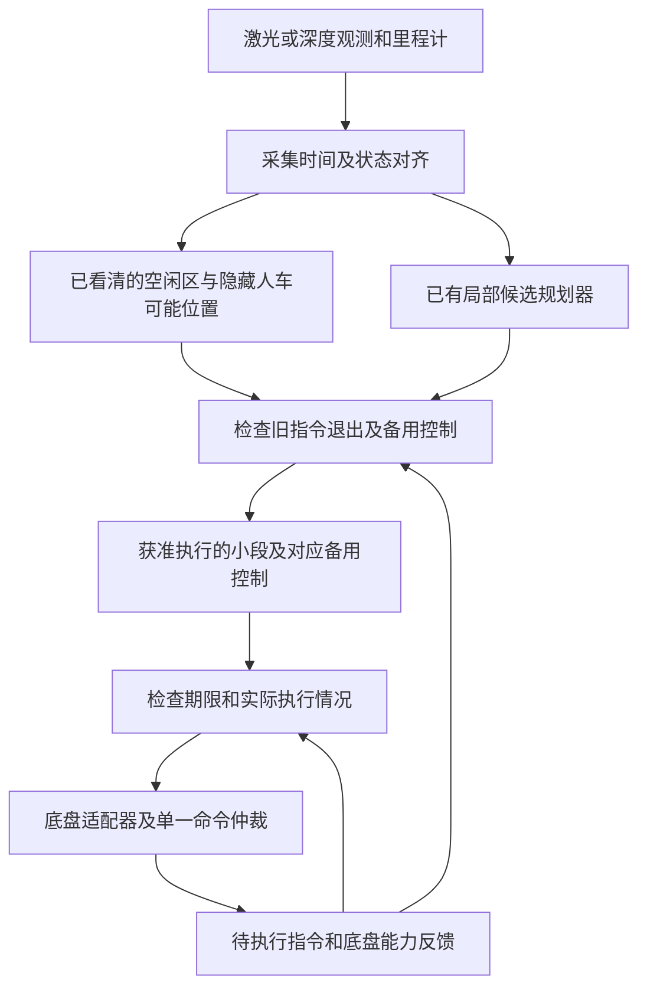

# A 案技术详解：看不见拐角来人时，机器人还能前进多久、何时必须开始停车

> 版本：V2.1 通俗说明修订，2026-10-16；不改变原方案的技术条件。
> 对应交底书：[01_patent_a_occlusion_handover_certificate_disclosure_20261015.md](01_patent_a_occlusion_handover_certificate_disclosure_20261015.md)。
> 2026-10-20 同步说明：按“缺点及原因—目的及效果”和“现有结构原理—针对性不足”补充阅读入口；[七部分模板稿](01_patent_a_disclosure_template_rewrite_20261019.md)为当前交底编排，本文保留原公式、算例和来源编号。
> 本文可独立阅读。公式是解释性设计，伪代码不是已完成的软件；全部本案数值为假设算例，不是论文实验或本案硬件结果。
> 创新判断：高风险。“原计划还能执行多久”“备用控制能否处理接管状态”和“执行许可到期倒计时”已有直接先例；本案尚未证实具有足以支持专利授权的区别。

## 0. 阅读说明与交底书术语对照

**一句话概括：每次只批准机器人再走一小段，而且要先确认“继续走这段、等旧指令执行完、再停车”的全过程仍满足约束。** 不是给整条路线一次性盖上“安全”的章。

可先看第 1 节场景、第 7 节三个执行阶段和第 10 节算例，再读公式。来源表中的 L 表示论文、P 表示已有专利、D 表示规范或软件文档；编号沿用组合台账，不表示技术步骤或重要程度。本次只改写说明，不新增文献核验或试验结果。

下表解释交底书和本文中的用语。保留专业名称是为了方便对应交底书，不要求先掌握这些名称才能理解方案。

| 交底书/原说明用语 | 通俗含义 | 本案中的例子或限制 |
| --- | --- | --- |
| 隐藏参与者、潜在运动体 | 可能被挡住、尚未被传感器看到的人或车辆 | 货架后可能走出一个人，不是已检测到的目标 |
| 占用外包络、可达占用 | 把目标在某时刻可能占到的所有位置都圈进去的范围 | 等待越久，隐藏的人可能走到的范围越大；不只是一个预测点 |
| 轨迹前缀、主前缀、名义段 | 原计划最前面获准执行的一小段 | 只准继续匀速走 0.16 s，不是批准整条路线 |
| 备份策略、备份反馈 | 原计划不能继续时，根据实际状态调整的备用控制办法 | 一边减速一边控制转向，不只是存一条理想停车线 |
| 接管 | 从原计划切换到备用控制，并由驱动器实际执行 | 发出切换消息与刹车开始起作用不是同一时刻 |
| 接管可达、可恢复集合 | 从哪些位置、速度等状态出发，指定备用控制还能满足约束并到达停止等目标状态 | 同在门前，低速可能能停住，高速可能不能；“恢复”不是恢复通信 |
| 接管可达证书、前缀证书、认证 | 一份注明适用条件、获准动作和最迟切换时刻的内部检查记录；“认证”指重新检查并生成记录 | 不是行政证书、第三方安全认证，也不是加密签名 |
| 执行队列、不可撤销输入 | 驱动器已收下、即使上层改计划也可能还要执行的指令 | 排队的加速指令可能使机器人在切换前继续提速 |
| 代际、执行游标 | 指令属于哪一批，以及这一批已执行到哪里 | 新计划启用后拒绝迟到的旧批次指令；游标不是地图位置 |
| 备份预置/激活、ACK | 备用控制已装载待用/已开始执行，以及接收方的确认反馈 | “消息发出”不能代替“驱动器确认已准备好” |
| 状态管、输入/误差包络 | 随时间列出的可能状态或输入范围，不只是一条理想曲线 | 1 s 后速度可能为 0.8～0.9 m/s；状态管不是物理管道 |
| 扫掠体 | 机器人运动过程中，机身和载荷实际经过的整个空间 | 转弯时货箱外角经过的地方也要查碰撞 |
| 终端集合、可保持状态 | 检查结束时必须达到、且能在规定条件和时段内维持的状态范围 | 停在冲突区外且线速度、转速都接近零；不代表永远不会被撞 |
| 驱动契约、能力界 | 经标定或接口约定确认的驱动行为限制 | 最慢多久开始制动、最小可保证减速度，不是商业合同 |
| 绝对决定期限、有效时域 | 最迟发出切换决定的时刻，以及计算结论覆盖的完整时间段 | 期限按统一时钟计时；收包晚了，剩余时间会变短 |
| 硬上界、P99 | 前者要求在声明条件下不超过；后者是统计分位数 | P99 时延仍允许尾部超出，不能直接当作绝不会超出的时延 |
| 风险最小化 | 原保证已不成立时，采取平台当前可行的减风险动作并报告异常 | 尽可能减速或稳定车体，不把“发出急停”说成一定能避碰 |

AMR 是自主移动机器人，本文主要指仓储、配送等地面机器人；ROS 2 是机器人软件框架，Nav2 是其中常用的导航组件。MPC（模型预测控制）指反复预测未来一小段运动、再求当前控制输入的方法。gatekeeper 是已有的一类安全过滤方法：检查原计划还能执行多久，并在期限前转入备用控制。

## 1. 用一个问题理解本案

仓储机器人经过货架盲角时，看不见另一侧的人。规划器给出“继续前进”和“必要时停车”两种动作。真正需要问的不是“现在刹车能否停住”，而是：

**继续原计划一小段后再决定切换，旧命令还会执行一段时间；等备用控制真正接手，是否仍能避开可能藏着的人车，并停在能够按要求等待的地方？**

三个时刻不能混为一谈：观测采集、监督决定、执行器实际切换。备份在生成时可行，不代表未来接管时仍可行。假如驱动器还排有加速指令，仅用当前速度计算停车距离会偏乐观。

本案拟在驱动指令出口增加一个监督模块：检查原计划最前面还能执行多长一段，把旧指令执行完毕、切换生效和停车所需的运动一起计算；新规划未到，不自动延长批准时间。规划、通信和底盘执行并不同时完成，方案必须处理这种时间差，且仍需继续查新和实测。

### 1.1 适用平台与不适用情形

| 平台 | 可以复用的结构 | 必须另建的运动模型及停止/保持条件 |
| --- | --- | --- |
| 差速 AMR、配送/服务机器人（靠左右轮速差转向） | 观测时间对齐、待执行指令预测、短段执行监督 | 左右轮速度和加速度相互限制，直走与旋转都要能停住，计入载荷经过的空间 |
| 阿克曼巡检机器人、车辆（类似汽车前轮转向） | 同一监督结构 | 转向和制动响应、车身侧滑及轮胎能力适用范围 |
| 全向机器人（可直接侧向移动） | 同一监督结构 | 各轮转速与车体运动的换算关系、不同方向摩擦能力与侧向加速限制 |
| 四足/轮足机器人 | 只能复用监督思想 | 脚何时接触和承重、关节及身体运动，最终能否稳定支撑 |
| 无人机 | 只能作为条件化扩展 | 三维动力学、推力/姿态、能量及悬停/着陆条件 |

本版最小原型选择地面差速 AMR；不声称已经给出足式或飞行平台的完整安全控制器。

### 1.2 缺点、原因和本案目的如何对应

| 现有实现的具体缺点 | 为什么会发生 | 本案处理目的和对应效果 |
| --- | --- | --- |
| 接管时速度比计算时更高 | 驱动器还在执行旧加速指令，预测却按已经刹车计算 | 计入旧输入退出阶段，避免漏算额外位移和接管速度 |
| 查过的方案仍可能在错误条件下启用 | 批次、执行进度或备用准备状态在检查后改变 | 把许可与执行反馈绑定，条件不符就不沿用旧结果 |
| 原计划执行超过原覆盖时间 | 收包或重算失败后又起一个完整倒计时 | 按绝对期限消耗余量，不因消息到达延长许可 |

目的不是单纯“多加一道确认”，而是让真实输入改变预测和允许执行长度。以上效果依赖输入、时延、误差和占用边界有效，尚无本案实测；未知输入或已无可行备用动作时必须报告，不能靠许可记录恢复物理能力。

## 2. 技术来源与逐项依据

### 同类系统怎样工作、问题在哪一环

同类结构为“传感及状态估计→原计划生成→主备运动检查→跟踪控制→驱动器”，驱动反馈再回到估计和监督。遮挡预测为检查模块提供隐藏人车的可能占用，而备用反馈决定在具体速度和位置下如何停车或避让。

gatekeeper 原始论文（Agrawal、Chen、Panagou，[第五部分与算法 1](https://arxiv.org/html/2211.14361v4)）先跟踪原计划、再切换备用控制，搜索允许的切换时长并保存已确认轨迹。L12 进一步处理隐藏动态障碍，P02/P07 已涉及轨迹时效和时延。它们已经提供本案许多基础，不能说“现有方案都不算接管时间”。

要检查的具体缺口是：在驱动器仍有旧输入的实现中，预测是否真的包含这些输入；启用前是否确认同一批次、进度和备用状态；许可是否按原绝对期限到期。若已有系统处理了这些关系，就不能再把它列为同样有缺点。出处及核读层级见下表和文末参考资料。

### 2.1 来源不是创新证明

| 技术要素 | 来源及实际核读范围 | 本文采用方式 | 不能据此声称什么 |
| --- | --- | --- | --- |
| 预测隐藏人车可能占到哪里，继续探索与回退路线共用起始一段 | L01，正文 II-A、III-V | 作为遮挡预测和候选轨迹的已有基础 | 双轨迹、共享前缀为本案首创 |
| 边运行边更新目标可能的运动意图和到达范围 | L02，摘要 | 说明预测边界可更新，但更新须重验 | 已读其全部理论，或学习一定覆盖真实行为 |
| 预测备用控制的运动、检查结束状态和隐藏障碍范围 | L12，正文 II-IV、V-D | 与本案很接近的已有方案；解释哪些状态仍能由备用控制处理 | “遮挡＋备用控制＋结束状态检查”是本案独有 |
| 计算原计划最长还能执行多久，并持续记录剩余时间 | L13，正文 II-VI，尤其 V-B/V-C | 与本案很接近的已有方案；限制本案可主张的创新范围 | gatekeeper 不考虑前缀，或本案首提倒计时 |
| 多类机器人探索/安全/应急轨迹 | L11，摘要 | 支持平台扩展的技术背景 | 从汽车换成机器人便产生创新 |
| 轨迹时效、能力和一致性验证 | P02，权利要求 1、6、16 及相关说明 | 设计版本和时效检查 | 时间戳和验证模块本身新颖 |
| 反应时间及遮挡停车能力 | P01，权利要求 1、8，图 22/26 | 构造物理反例的基础 | 首次将反应时间用于遮挡 |
| 追踪数据经过各处理环节的耗时、统计阈值和安全响应 | P07，权利要求 1、8-9、17-19，图 6 | 作为已有时延监控手段 | P99 是确定时延上界，或超时切备份是新概念 |
| 下游速度过滤器 | D02，官方 README | 说明 ROS 2 中可安放监督器的位置 | Collision Monitor 自带可达性证明或安全认证 |

### 2.2 本案新增设计与已有部分的边界

本文提出同时检查五件事：机器人当前的位置和速度、还会执行哪些旧指令、指令属于哪一批、已执行到哪里、备用控制是否真的准备好或开始执行。用这些信息预测切换过程，只有驱动器反馈与检查结果相符，才启用新的执行许可。预期作用是：不同的旧指令会改变未来速度、机身经过的空间和还能前进的时间；反馈不符时取消继续执行许可。

这只是本次整理的方案合成，不是已经查明的独占发明点。L13 引用的原始 gatekeeper、鲁棒/时延安全过滤及异步架构专利仍可能覆盖该组合。单纯增加字段、握手或更保守的判断不自动具有创造性，须证明它们与物理控制结果的必要因果关系。

## 3. 系统框架与数据流



规划器负责提出动作，不享有绕过监督器的驱动通道。备份必须在需要使用前已装载；若临时求解备份，其耗时必须进入接管界。硬件急停等独立安全功能保留，软件监督不能替代它们。

### 3.1 建议接口

| 消息/数据 | 最小字段 | 由谁产生及校验 |
| --- | --- | --- |
| `ObservationBundle`（本次观测记录） | 采集时刻、所属时钟、坐标系版本、已确认空闲区、障碍范围及误差界 | 感知/对齐模块；验证器检查能用到何时 |
| `PlatformDescriptor`（底盘及载荷说明） | 模型、外形/载荷、输入大小及变化速度限制、停止/保持要求、能力版本 | 标定/底盘适配器；换载荷须换版本 |
| `QueueSnapshot`（待执行指令记录） | 记录 ID、指令批次、执行进度、已接收输入及可能执行时间、哪些指令不能撤回 | 驱动适配器；不能由规划器希望发送的命令冒充 |
| `BackupArmedAck`（备用控制准备确认） | 策略版本、是否已装载、允许启用时间段、接收时刻 | 驱动/控制侧；消息发送成功不是确认 |
| `PrefixCertificate`（短段执行许可记录） | 原计划/备用控制/观测/队列 ID、能力/坐标系版本、最迟决定时刻、允许状态范围 | 验证器生成，监督器每周期重验 |
| `ExecutionFeedback`（实际执行反馈） | 实际指令批次/进度、输出或跟踪误差、备用控制是否已启用 | 驱动器；超出已检查范围就撤销许可 |

这些是设计接口，不是已发布的 ROS 标准消息。ID 是对应记录的标识，版本用于区分不同配置或计算结果。无队列读取接口时，须根据驱动器的已知行为限制，列出它可能执行的输入范围；无法限定这个范围时，只能采取不带原安全保证的减风险措施，不能假设自己知道精确执行情况。

## 4. 建模假设、变量与单位

| 符号 | 含义 | 单位/约束 |
| --- | --- | --- |
| $t_o,t_d$ | 观测采集时刻、当前验证起点 | s，同一单调时间基准 |
| $h$ | 验证起点到发出接管决定的名义时长 | s，非负 |
| $\tau_h$ | 决定到备份实际生效的上界 | s，不含已经传播的观测年龄 |
| $x,u,w$ | 平台状态、输入、模型扰动 | 分量按模型给定，$w$ 在经标定集合内 |
| $Q,e,c,a_b$ | 队列、代际、游标、备份状态 | 离散执行状态，不与位置误差混合取平均 |
| $\mathcal O(t)$ | 障碍物物理占用外包络 | m 表示的几何集合，随绝对时间变化 |
| $\mathcal K_b(t)$ | 按指定备份策略可恢复的状态集合 | 在其模型和时域条件下成立 |
| $\Delta_s$ | 控制侧监督周期及已界定抖动预算 | s，不能以平均运行周期代替 |

确定性结论要求：障碍行为被外包络覆盖、动态模型/外形正确、误差与时延有界、实际输入被包络覆盖、完整时域有效。某项只能统计描述时，明确标注概率/分布及越界风险，不把它转述成必然安全。

## 5. 从遮挡几何到占用预测

### 5.1 不检测到不等于没有

由传感器探测方向、量程和遮挡位置，区分已经看清的空闲处与尚未看清的空间。若货架挡住一条通道，应在计算模型中为入口处可能藏着的人设置初始位置、速度范围，而不是只追踪已检测到的目标；这里的“放置”不是在现场放一个物体。

对于一个无方向先验的隐藏参与者，示例保守扩张可写为：

$$
\mathcal P_q(t)\subseteq\mathcal P_q(t_o)\oplus
\mathbb B\!\left(v_{q,\max}(t-t_o)+\tfrac12 a_{q,\max}(t-t_o)^2\right).
$$

$\mathcal P_q(t)$ 表示隐藏目标 $q$ 在时刻 $t$ 的可能位置，$t_o$ 是观测时刻，$v_{q,\max}$、$a_{q,\max}$ 是采用的速度和加速度上界。$\oplus$ 称为 Minkowski 和，这里可直观理解为“把初始范围向周围扩宽”；$\mathbb B(r)$ 是半径为 $r$ 的圆或球。式子右侧按最大可能行进距离扩大初始范围；$\subseteq$ 表示左侧所有位置都应被右侧覆盖。

参与者形状和初始位置误差还需加入占用范围。道路/通道约束可缩小范围，但必须有依据，不能靠“行人通常不会横穿”排除仍可能发生的运动。

### 5.2 只膨胀一次外形

一种实现直接检查平台扫掠体与障碍物理占用是否相交；另一种把障碍按平台形状及误差膨胀后，检查参考点。两种方式择一并保持定义一致，不能遗漏外形，也不要在两端无说明地重复计算同一尺寸。

观测过期使隐藏占用随时间扩张。更新若突然增大占用，必须重新认证当前状态；旧证书不因“新数据已到”自动有效。L12 的理论也具有预测覆盖、时序一致和更新后重验条件。

## 6. 为什么要检查实际停车控制，而不只画一条停车线

备份策略 $\pi_b$ 是随状态产生输入的反馈规则，例如沿当前安全走廊受限减速，同时把角速度降至可保持范围。名义停车折线只描述理想初态，不包含起点误差、执行器滞后或负载变化。

把运动分成小时间步，$x_{k+1}=f_{\mathcal P}(x_k,u_k,w_k)$ 表示：由当前状态、控制输入和可能扰动，计算下一步状态。下标 $\mathcal P$ 表示所选平台模型，$k$ 是时间步编号，$N$ 是最后一步。先确定结束时允许的停止/保持状态集合 $\mathcal S_N$，再逐步倒推哪些起始状态能够到达它：

$$
\mathcal K_N=\mathcal S_N,\qquad
\mathcal K_k=\left\{x\in\mathcal C_k:\ 
f_{\mathcal P}(x,\pi_b(x),w)\in\mathcal K_{k+1},\ \forall w\in\mathcal W_k\right\}.
$$

读法是：最后一步的可接受状态就是 $\mathcal S_N$；再往前一步，只有当前满足约束、且在所有允许扰动下执行指定备用控制都能进入下一步可接受范围的状态，才加入 $\mathcal K_k$。其中 $\mathcal C_k$ 是当前满足碰撞、驱动能力、状态及接触限制的状态范围，$\mathcal W_k$ 是允许扰动范围，$\forall$ 表示“对其中每一种扰动都成立”。

每步之间还需检查机身经过的空间。这只找到了“使用指定备用控制能处理的状态”，不等于“不限定使用这套备用控制，只要存在某种控制能持续满足约束就算入”的完整状态范围（后者常称生存域）。实现时可预先制表，或在线预测备用控制下的可能运动；近似结果只能少批准一些，不能把无法确认的状态也算安全。

地面停止终端至少包含位置位于冲突区外、线/角速度接近零、可保持制动/支撑能力。移动障碍仍可能撞向静止机器人，因此保证只覆盖已声明的预测时域或真正可保持的安全区域，不意味着永久无碰撞。

## 7. 队列过渡、前缀与期限的原理

### 7.1 继续前进、等待切换、执行停车：三个阶段

1. 主段：在 $[t_d,t_d+h]$ 执行允许主策略。
2. 过渡段：在 $[t_d+h,t_d+h+\tau_h]$ 执行尚未退出的旧输入和可能的执行器响应。
3. 备份段：从真实接管状态集合开始执行 $\pi_b$，到达终端并满足保持条件。

计算时同时跟踪 $z=(x,Q,e,c,a_b)$：机器人状态、待执行指令、指令批次、执行进度和备用控制状态。根据已确认的驱动行为，逐步预测这些量如何变化。不能假定等待切换期间没有控制输入，也不能把发出决定时的速度当成真正开始制动时的速度。

令 $\mathcal R_{\rm trans}(s;h)$ 为过渡状态管、$\mathcal R_h^{\rm end}$ 为过渡终态集合。主要判据为：

$$
\operatorname{Sweep}(\mathcal R_{\rm nom}\cup\mathcal R_{\rm trans})
\cap\mathcal O=\varnothing,\qquad
\mathcal R_h^{\rm end}\subseteq\mathcal K_b(t_d+h+\tau_h).
$$

第一项的 $\operatorname{Sweep}$ 是机身和载荷经过的空间；$\cap\mathcal O=\varnothing$ 表示它与同一时刻的障碍占用没有交集，即不重叠。$\mathcal R_{\rm nom}$ 是继续原计划时的可能状态范围，$\mathcal R_{\rm trans}$ 是等待切换时的可能状态范围。比较必须逐时进行，不能拿机器人现在的位置去对比障碍很久以后的位置。

第二项的 $\subseteq$ 表示：等待切换结束时，每一种可能状态都必须属于“备用控制还能处理”的集合。不能只检查平均位置或平均速度。通俗说，两项分别检查“切换前不碰撞”和“真正接手后还来得及完成备用动作”。

### 7.2 怎样确定还能继续执行多久，与已有 gatekeeper 方法有何区别

在 $0,\Delta,2\Delta,\ldots$ 的候选切换点逐个验证。若某个较短切换点失败，本实现不授权跨过它再等待较晚可行点，确保每个允许的中间监督决定都仍可接管。未验证的采样间隔应以运动界覆盖，或明确只在特定切换网格允许决策。

L13 的一般 gatekeeper 搜索最大可行切换时刻，且已有有状态期限管理。这里要求中间允许切换点全部可行只是额外保守条件，并非证明算法更先进或新颖；不可用单调性未知的二分法替代逐项检查。

### 7.3 最迟切换时刻不能在收到消息时重新计时

设已验证连续时长为 $h_{\rm valid}$，扣除监督/抖动裕量得到绝对最迟决定时刻。证书携带该绝对时刻；传输耗时会消耗剩余时长，不是从接收时重新获得完整前缀。

接管时延已经在过渡管计算一次。执行侧只判断“到下一次监督是否仍不越决定期限”，不再扣同一 $\tau_h$。备份激活确认超出界时，原保证失效，必须进入明确标注的风险最小化。

## 8. 差速 AMR 的具体实现

状态 $x=[p_x,p_y,\psi,v,\omega]$，输入为线加速度 $a$ 和角加速度 $\alpha$：

其中 $p_x,p_y$ 是平面位置（m），$\psi$ 是朝向（rad），$v$ 是前进速度（m/s），$\omega$ 是转动速度（rad/s）；$a$、$\alpha$ 分别表示前进速度和转动速度每秒改变多少。变量上方的点表示对时间的变化率。

$$
\dot p_x=v\cos\psi,\quad\dot p_y=v\sin\psi,\quad
\dot\psi=\omega,\quad\dot v=a,\quad\dot\omega=\alpha.
$$

轮半径为 $R$、左右轮间距为 $W$（均以 m 计）时，左右轮转动速度 $\dot\phi_R,\dot\phi_L$（rad/s）为：

$$
\dot\phi_R=(v+W\omega/2)/R,\qquad
\dot\phi_L=(v-W\omega/2)/R.
$$

将轮速/轮加速度上限代入，得到线/角运动耦合限制。不能独立把 $v$ 与 $\omega$ 各自限幅后便认定轮端可行。若底盘只收速度指令，验证模型须覆盖底层速度环的响应、制动斜率和饱和。

矩形机身、伸出货箱及机械臂共同形成当前外形。拐角或原地旋转要检验旋转扫掠体；线速度为零但角速度未停仍不满足完整停止终端。侧滑、地面坡度或载荷使模型界失效时重验，不用低速无滑模型无限外推。

### 8.1 工程落地顺序

1. 获取底盘驱动契约、反馈可用性和载荷外形，标定最坏减速及角速度响应。
2. 统一传感器采集时刻和执行时钟，记录同步误差，建立输入/延迟外包络。
3. 复用已有 ROS 2/Nav2 候选规划或跟踪组件，在唯一驱动通道前加仲裁监督。
4. 先实现直走盲角的保守停车策略，再逐步加入转弯与更复杂备份。
5. 将验证器与控制侧监督分离；规划线程过载不能阻止期限检查。
6. 先让新模块只记录判断、不控制底盘，并用记录数据回放检查；再测试“输出会影响下一步运动”的闭环仿真，随后接入真实控制硬件测试，最后进入低速封闭场地。

D02 支持在驱动指令出口前增加检查模块这一已有架构，但其停止区和 TTC（按当前运动估计的距碰撞剩余时间）机制不替代上述接管全过程计算。多个检查模块应由统一的指令选择模块协调；后级减速也会改变未来位置和到达时间，必须处于已检查的输入范围内。

## 9. 每次检查和每个控制周期做什么

以下是流程伪代码，不是可直接运行的软件。使用中文步骤，是为了说明各项检查的先后关系。

```text
生成短段执行许可（观测、当前状态、候选计划、驱动反馈）：
    将各项数据对齐到同一时间基准
    若误差范围、能力或版本无效：记录原因，不批准
    取得已装载的备用控制及驱动器确认
    预测隐藏人车直到机器人完成停车期间的可能占用范围
    已通过时长 = 无
    按从短到长的顺序，逐个检查允许的切换时刻：
        预测继续原计划期间的可能运动
        预测旧指令执行完毕、备用控制生效前的可能运动
        若途中机身可能与障碍重叠：停止延长
        若任一可能接管状态无法用备用控制完成停止/保持：停止延长
        已通过时长 = 本次检查时长
    若没有通过时长：记录原因，不批准
    保存最迟决定时刻、允许状态范围及对应备用控制

每个控制周期（当前时间、执行许可、驱动反馈）：
    若批次、进度、备用控制确认或实际状态不符合许可：
        停止追加未经批准的动作，重新检查或请求减风险处理
    否则，若等到下一检查周期将超过最迟决定时刻：
        立即触发已准备好的备用控制
    否则：
        只批准下一小段已检查的指令
```

新包先准备、核对允许游标区间和备份确认，再激活；激活失败继续依照旧包期限，而不是取消旧备份等待新包。首次启动无旧有效包时保持不放行。恢复到名义模式同样需要新验证，不因通信恢复自动解除。

## 10. 完整数值例：货架盲角与旧队列

假设 AMR 宽 0.60 m、长 0.80 m，沿直线匀速 1.20 m/s；冲突边界可用净距离 1.50 m 已考虑机身尺寸。保证减速度 $b=0.80$ m/s²，接管时延 0.15 s，额外误差/裕量 0.20 m。此处只做一维必要筛查。

$$
d_{\rm need}=v\tau_h+\frac{v^2}{2b}+m_d
=0.18+0.90+0.20=1.28\ \mathrm m.
$$

若主段仍保持同速，可等待的理论上界为 $(1.50-1.28)/1.20=0.18333$ s。监督周期 0.02 s，先扣一周期再向下取周期整数倍，得到 0.16 s，而不是向上取为 0.18 或 0.20 s。

| 相对时刻 | 发生事件 | 一维状态或距离 |
| --- | --- | --- |
| 0.00 s | 签发绝对期限 | 按原始时刻计时，不等收包重新起算 |
| 0.16 s | 最迟工程决定时刻 | 主段前进 0.192 m，触发备份 |
| 0.31 s | 最坏备份实际开始 | 过渡再前进 0.180 m，速度仍为 1.20 m/s |
| 1.81 s | 完成减速 | 再前进 0.900 m，累计 1.272 m，加 0.20 m 余量后为 1.472 m |

完整有效时域至少覆盖上述前缀、过渡与停止，还需终端保持条件。若接管延迟变为 0.35 s，即使现在切换也需 $0.42+0.90+0.20=1.52$ m，超过 1.50 m，应拒绝原证书；这不等于现实中必然碰撞，但原保证已不能成立。

### 10.1 同时延但不同队列的反例

另设过渡 0.15 s 内仍执行 $+0.30$ m/s² 加速。过渡距离为 $1.20\times0.15+0.5\times0.30\times0.15^2=0.183375$ m，接管速度为 1.245 m/s。后续停车距离为 $1.245^2/(2\times0.80)=0.968765625$ m，总需求为 1.352140625 m。

在“决定前主段仍匀速、决定后该加速队列生效”的假设下，扣一监督周期并向下取整后，前缀只能取 0.10 s；照旧放行 0.16 s 将需 $0.192+1.352140625=1.544140625$ m。可见只记录总时延而不传播输入会给出不同决策。真实队列时间关系须由驱动契约确认，不能把此假设当作所有驱动器的行为。

上述均未验证隐藏人运动、转向和二维碰撞，因此算术通过不是完整安全放行结果。

## 11. 为什么这条链在假设内成立

推理分三步：第一，继续原计划和等待切换期间，所有可能运动都不碰撞；第二，真实运动始终落在计算覆盖的范围内；第三，真正切换时的所有可能状态，都能用指定备用控制完成停止/保持。三项同时成立，实际接管状态就不会漏出已检查范围，后续备用控制也能在所声明的时段内满足约束。监督模块负责防止机器人继续执行到未经检查的时刻。

推理要求可能运动范围没有漏算、驱动器行为没有违反已知限制、备用控制真正生效。任一条件失效，不能只发一条“紧急停车”指令就宣称保证仍成立。离散时刻检查通过也不排除两次检查之间碰撞；需要检查连续运动，或根据已标定的变化率上界，把两次采样之间可能经过的位置也纳入检查。

这是一条设计论证，不是本案已经完成的形式化证明；L12/L13 的理论不能不带原假设直接移植到本案网络、队列和切换实现。

## 12. 失败处理、对照实验与验收

| 故障/反例 | 要检查的行为 | 证据记录 |
| --- | --- | --- |
| 规划线程卡住 | 旧期限继续消耗，按时触发已预置备份 | 决定/发送/驱动生效时间线 |
| 旧代际命令迟到 | 拒绝追加或纳入原允许包络，不能静默执行 | 队列游标与代际轨迹 |
| 已确认备份被重载 | 旧证书失效，新版本须重新确认 | 策略 ID 与激活 ACK |
| 隐藏目标超出行为界 | 撤销确定性保证并风险最小化 | 预测外包络和首次越界点 |
| 外形增加、附着下降 | 重新验证停止和旋转扫掠体 | 能力/外形版本及误放行数 |
| 统计时延偶发超界 | 记录超界，不把历史 P99 当硬上界 | 分位数、超界频次及结果 |

对照组至少包括固定超时监督、无队列状态的相同验证、L13 类 gatekeeper 和具备可比假设的遮挡过滤器；对比需相同感知、模型、扰动及计算预算。不要求本案一定优于先例，重点检验队列状态是否真正改变误放行和接管结果。

先执行确定性反例，再做参数扫描与随机统计；报告碰撞/不可行/保守拒绝分别多少，不能只报告成功率。端到端最坏时间需在目标硬件测量并建立可监督预算，论文平均毫秒数不能拿来证明本案截止时间。

## 13. 本文参考文献与读取层级

统一访问日为 2026-10-15；编号与组合台账一致，以下资料足以独立查找。摘要级来源不支持“正文没有该机制”的断言。

| 编号 | 完整可检索书目信息与链接 | 核验与限制 |
| --- | --- | --- |
| L01 | Lei Zheng, Rui Yang, Minzhe Zheng, Zengqi Peng, Michael Yu Wang, Jun Ma. *Occlusion-Aware Contingency Safety-Critical Planning for Autonomous Driving*. [arXiv:2502.06359](https://arxiv.org/abs/2502.06359), 2025-02-10；v3 2026-10-05；页面列 IEEE TCyb 56(5), 2777-2790, 2026，DOI 10.1109/TCYB.2025.3632366 | [正文 v3](https://arxiv.org/html/2502.06359v3) II-A、III-V；其缩尺 Ackermann 机器人实验不等于本案实测 |
| L02 | Rui Yang, Lei Zheng, Shuzhi Sam Ge, Jun Ma. *Safe and Nonconservative Contingency Planning for Autonomous Vehicles via Online Learning-Based Reachable Set Barriers*. [arXiv:2509.07464](https://arxiv.org/abs/2509.07464), 2025-09-09；v2 2026-04-15 | 摘要；不转述未读理论为本案保证 |
| L11 | Kota Kondo, Mason Peterson, Nicholas Rober, Juan Rached Viso, Lucas Jia, Jialin Chen, Harvey Merton, Jonathan P. How. *DYNUS: Uncertainty-aware Trajectory Planner in Dynamic Unknown Environments*. [arXiv:2504.16734](https://arxiv.org/abs/2504.16734), 2025-04-23；v3 2025-05-18 | 摘要；页面投稿状态不当作已独立核实出版 |
| L12 | Taekyung Kim, Hun Kuk Park, Renya Wada, Nikolay Atanasov, Shumon Koga, Dimitra Panagou. *OcclusionCBF: Backup Control Barrier Functions for Safe Navigation Among Hidden Dynamic Obstacles*. [arXiv:2609.06342](https://arxiv.org/abs/2609.06342), v1 2026-09-06 | [正文](https://arxiv.org/html/2609.06342v1) II-IV、V-D；IV-E 说明采样实现边界，V-D 含 TurtleBot 硬件实验；不复制为本案成果 |
| L13 | Taekyung Kim, Aswin D. Menon, Akshunn Trivedi, Dimitra Panagou. *Backup-Based Safety Filters: A Comparative Review of Backup CBF, Model Predictive Shielding, and gatekeeper*. [arXiv:2604.02401](https://arxiv.org/abs/2604.02401), 2026-04-02；v2 2026-09-18 | [正文](https://arxiv.org/html/2604.02401v2) II-VI；综述，不把其介绍的旧算法当成 2026 首创；原始 gatekeeper 2023/2024 引文仅间接核对，尚未全文复核 |
| P01 | *Contingency planning and security*，同族题名含 *Contingency Planning and Safety Assurance*. [JP7401650B2](https://patents.google.com/patent/JP7401650B2/en)，2023-12-19；JP2022542277A 2022-09-30；优先权 2019-07-31；同族 US20210031760A1/WO2021021269A1 2021-02-04 | 权利要求 1、8 及相关说明；索引与全文 Nissan/Renault 主体差异待官方核对 |
| P02 | Zoox. *System and method for trajectory validation*. [US11407409B2](https://patents.google.com/patent/US11407409B2/en)，2022-08-09；US20210046923A1 2021-02-18；优先权 2019-08-13 | 权利要求及相关图文已读；未核现时权利状态和全部同族 |
| P07 | Zoox. *Safe system operation using latency determinations*. [US11099573B2](https://patents.google.com/patent/US11099573B2/en)，2021-08-24；US20200201335A1 2020-06-25；优先权 2018-12-19 | 权利要求及图 6 已读；实际 kind code 为 B2，不采用相似表中的错误 B1 |
| D02 | Navigation2 project. *Nav2 Collision Monitor*. [官方 README 源文](https://raw.githubusercontent.com/ros-navigation/navigation2/main/nav2_collision_monitor/README.md) | 已读 Features、Design、Metrics；`main` 动态分支未固定提交，不声称对应任意 ROS 发行版；明确非硬实时安全认证 |

## 14. 下一步补证与阅读结论

先补读原始 gatekeeper 和时延/鲁棒备份安全过滤文献，再逐项检索队列状态、激活确认和异步监督专利。若差异仅是工程常规加固，应据实放弃宽独立项，而非继续换术语。

技术上先做带驱动队列的直线 AMR 最小模型，复现第 10 节两种队列的差异，再逐步增加转弯、误差和动态隐藏目标。当前完成的是来源核验、方案解释及算术校验，未完成求解器实现、仿真、实机、认证或法律查新。