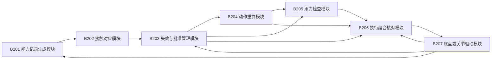
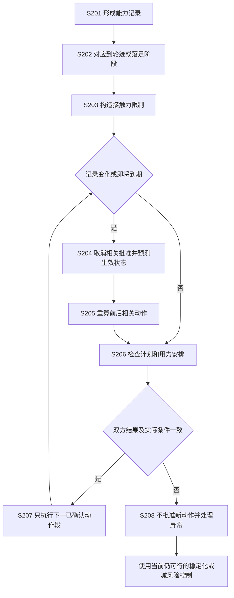

# 专利交底书 B：一种地面接触能力判断失效后的运动计划撤销、关联重算与一致执行方法

> 撰写依据：[专利交底书模板及注意事项](../template.md)。重写日期：2026-10-19。
> 建议类型：发明专利；交底对象包括规划控制方法及其控制系统，电子设备和存储介质形式由代理人据实整理。
> 本文为设计草案，未完成本方案仿真、实机或性能验证。数值为假设算例，不是实验结果。
> 发明人、申请人、实际研发形成日期和已公开情况：待根据真实记录填写。
> 历史材料：[原交底书](02_patent_b_friction_evidence_consistent_planning_disclosure_20261015.md)、[通俗技术详解](02_patent_b_sources_and_technical_principles_20261015.md)。本文独立说明主方案及轮式、足式实现条件。

## 一、本发明解决的技术问题是：

### 1.1 现有技术的缺点及产生原因

已有移动平台通过估计地面摩擦能力、建立分区摩擦地图或更新控制约束，使运动适应湿滑地面。但在能力判断改变、规划与驱动异步运行时，对于仅更新能力数值而未同步处理已批准动作的实现，仍存在以下不足：

1. **能力判断失效后，依赖它的旧动作可能继续执行。** 原因是能力值与具体轨迹段、轮脚接触阶段及执行批准之间缺少可反查的对应关系。更新地面记录并不自动取消此前发布的速度和用力安排。
2. **局部约束变更后，前后运动可能不再衔接。** 原因是只降低湿滑段的允许速度或用力，没有检查较早路段是否来得及减速，也没有更新较晚路段的到达时间和接触位置。原本有效的其他能力记录可能随时间和位置变化而失效。
3. **规划和实际用力可能依据不同条件。** 原因是两个模块更新时刻不同，或只比较版本数字而未核对接触阶段、生效状态和不能取消的旧输入。因此，新路线可能与旧用力安排混用，或者按当前状态可行、真正生效时却不可行。

上述不足针对第二部分所述技术在缺少对应撤销和生效核对机制时的实现，不表示摩擦自适应规划或同步控制本身尚不存在。

### 1.2 本发明的目的及要解决的技术问题

本发明的目的，是使地面接触能力判断改变后，所有受影响动作及时停止沿用旧依据，并在实际能够生效的状态下重新形成相互一致的运动计划和用力安排。

具体要解决的技术问题是：**如何把一条能力判断的失效准确传递到相关接触限制、前后运动段及执行批准，并阻止重新计算完成前或条件不一致的动作进入驱动执行。**

### 1.3 针对上述缺点能够达到的技术效果

| 对应缺点 | 本发明的技术处理及其作用 | 对应技术效果 |
| --- | --- | --- |
| 第 1 项：旧动作遗漏撤销 | 保存能力记录到具体接触限制和动作批准的对应关系，失效后先反查取消 | 找出并阻断继续使用失效依据的动作，而不是只改变能力估计值 |
| 第 2 项：前后运动不再衔接 | 向较早段重算减速要求，向较晚段更新状态、到达时间和接触安排，必要时重验整条剩余计划 | 识别来不及达到新入口速度、后续记录过期或跨区等连带不可行情形 |
| 第 3 项：规划与用力条件不一致 | 计入未完成旧输入，双方按同一能力条件、接触阶段和生效状态联合确认 | 拒绝新旧条件混用的执行组合，使获准动作对应同一个接触力学问题 |

这些效果以能力范围和实际反馈有效、对应关系完整及响应时间有界为条件。地面突变后已无法满足制动或支撑要求时，本发明识别并报告不可行，不声称通过重新同步就能恢复物理能力。

## 二、详细介绍技术背景，并描述已有的与本发明最相近似的实现方案。

### 2.1 技术背景与统一术语

地面移动平台通过轮子、履带或脚与地面之间的接触力运动。摩擦限制决定了制动、加速和转弯不能任意同时增加。规划器不仅要算空间是否畅通，还要算实际接触力及执行器是否足够。

同类系统一般包括轮速、惯性和地面传感器，摩擦或接触估计器，地面能力地图，运动规划器，用力分配控制器以及电机/关节驱动器。估计器从轮速、力矩及运动响应中判断地面能力；规划器据此选择路径和速度；用力分配控制器把整体运动需求分配到轮脚，并由驱动器执行。机器人真正能够完成动作，要求上述环节采用相容的能力和接触条件。

| 本文统一用语 | 含义及例子 |
| --- | --- |
| 接触能力 | 地面接触可提供的力及相关支撑条件，例如轮子能提供多少制动力 |
| 能力记录 | 带来源和适用条件的能力判断；对应历史材料中的“接触能力证据”，不是法律证据 |
| 适用条件 | 可以使用该判断的地点、时间、轮胎/足垫、载荷、接触方式及受力工况 |
| 受力工况 | 形成或验证判断时的加速、制动、转弯、速度等情况；历史材料也称“激励域” |
| 动作段、接触阶段 | 一小段运动，以及哪只轮/脚在该段接触地面；脚承重称支撑阶段，抬脚移动称摆动阶段 |
| 对应关系表 | 哪条能力记录被哪个动作段、哪个轮/脚、哪项限制使用；支持反向查找 |
| 能力条件版本 | 固定下来供本次规划和控制共同使用的完整能力集合；历史材料称“快照” |
| 用力安排 | 各轮或各脚分别提供多大力，及其能否由电机/关节实现；对应“控制分配” |
| 执行批准 | 对特定计划和用力安排的本次确认，不仅是“算法求解成功” |
| 生效状态范围 | 新指令真正起作用时可能的位置、速度、轮脚接触和执行器状态 |

“向前重算”指沿路线向较早路段更新制动准备，“向后重算”指按新运动结果更新较晚路段，避免把这里的“前后”与网络上下游混淆。

### 2.2 专利中的摩擦估计和规划约束

US11427223B2 [B-R1] 涉及在加速、减速或停止事件下，根据车轮动作的运行数据估计地面摩擦，并用于车辆控制和运动/路线规划。最终权利要求 1 包含摩擦探测请求、事件检测、轮端动作、数据获取及控制；权利要求 2、3 涉及规划和规划约束，5、6 涉及置信度及随时间降低。

因此，正常行驶事件提供摩擦信息、记录会随时间变得不可靠、用摩擦约束规划，都已有公开基础。本案不能把“不主动打滑”和“估计值带置信度”作为充分区别。

### 2.3 主要对比方案：分区摩擦规划与同步控制的结构及工作原理

CN120552911B [B-R2] 从多源数据构建带摩擦分区的地图，结合路径连接关系进行模型预测控制，考虑轮胎力椭圆和车体转动限制，分解转向及扭矩指令；其权利要求 4～7 还涉及地面分区、前后轮摩擦及扭矩分配、更新约束和同步控制器。

其系统按数据处理过程包括动态感知与建图、协同感知、风险路径生成及指令执行相关单元。工作过程可概括为：

1. 汇集车载和路侧数据，进行时间、空间对齐，得到地面摩擦分区和风险信息。
2. 将各车道的摩擦信息与道路连接关系结合，生成考虑接触力和车体转动限制的轨迹候选。
3. 结合前后轮摩擦、轨迹及风险，选择路径并分配扭矩，再生成转向和动力指令执行。
4. 根据实际轨迹、响应延迟和传感异常等执行记录更新模型和约束，并同步控制器。

这一方案已将能力变化传递到规划和控制，不能笼统说现有技术没有同步更新。**针对本案问题仍需说明的环节**是：更新某一地面判断时，如何定位此前依赖它的每项已批准接触动作，何时取消旧批准，以及旧物理输入退出前的状态如何纳入新动作确认。上述公开的分区、扭矩分配和约束同步关系，不能单独代替这些执行条件的核对。本稿据此提出针对性补充，不将其等同于该专利在所有实施中必然存在失控问题。

引用该专利只用于识别其技术公开范围，不直接照搬其中涉及力和摩擦系数的表达作为本案力学公式；本稿公式按力的单位和平台模型独立说明。

### 2.4 论文中的摩擦不确定性和接触规划

- **摩擦自适应随机非线性模型预测控制 [B-R3]**：在线学习轮胎—路面模型，并把不同工况下估计的不确定性用于预测控制。本轮核读摘要，足以说明“摩擦不确定性进入规划”已知，不据此断言全文没有记录管理或一致性实现。
- **FrictionMap [B-R4]**：2026 年 10 月公开的摘要提出，从已记录的驾驶数据离线估计车辆运动，筛选摩擦极限可观测的数据，再沿行驶轨迹建立连续摩擦估计。说明“把能力与空间关联”也不能笼统视为首创；其离线结果不能直接作为本案在线保证下界。
- **轨迹验证专利 [B-R5]**：已涉及当前状态、轨迹时效和可执行性检查，说明执行前重验不是本案单独创新点。

### 2.5 现有方案针对本发明技术问题的不足归纳

摩擦估计、空间分区、不确定性规划及同步控制已为地面适应提供基础；但在已批准动作仍可能继续执行的场景，需要进一步处理以下关系：

| 已有技术处理环节 | 仍需补足的具体关系 | 缺少该关系时的不足 |
| --- | --- | --- |
| 更新能力值、置信度或地图区域 | 对应到使用该判断的具体轮脚接触限制和执行批准 | 不能仅由数值已更新判断旧动作已停止使用旧依据 |
| 按新能力重算目标段 | 与较早段的入口可达性、较晚段的状态和接触时间相联动 | 新目标段单独可行，整体计划仍可能来不及减速或使用过期记录 |
| 将新约束同步给控制器 | 在同一实际生效状态下确认计划和用力安排，并阻止旧确认再次启用 | 同步消息到达不等于旧输入已经退出，也不等于接触阶段仍一致 |

本发明以这些不足为对象，第三部分给出“对应查找—先取消批准—前后关联重算—同条件确认—执行反馈核对”的具体流程。授权及进一步检索事项置于第七部分，不以一般数据管理机制本身证明技术创新。

## 三、本发明技术方案的详细阐述（核心的重点内容）：

### 3.1 实施范围、前提与输出

主实施例选取可读取轮速、实际电流或力矩、惯性数据的差速机器人。传动、轮径、载荷、力矩和制动响应需事先标定；支持读取未完成指令，或至少能给出其可能持续时间与输入范围。

本案优先复用已有估计器或经测试的地面能力表，不要求训练新的视觉模型。视觉地材分类只能作辅助来源；没有有效力学依据时，不产生未经验证的高摩擦下界。

输出包括：被取消批准的动作清单、更新后的能力条件、重新检查通过的动作及用力安排，或不可行原因。自由飞行无人机不属于本地面接触方案的直接实施对象。

### 3.2 图 1：模块与连接

| 标号及名称 | 具体实现及职责 |
| --- | --- |
| B201 能力记录生成模块 | 把估计或标定结果及误差、适用条件写成记录；用实测与模型差值发现不符 |
| B202 接触对应模块 | 由预测轮迹或落足区域、预计接触时间，把能力记录对应到具体力限制 |
| B203 失效与批准管理模块 | 保存正向及反向对应关系、到期事件、取消状态和能力条件版本；失效后先阻止旧批准继续使用 |
| B204 动作重算模块 | 重算受影响段，向前调整减速或落足准备，向后更新状态、时间和接触安排 |
| B205 用力检查模块 | 在同一能力条件和生效状态下计算轮脚用力，并检查电机、关节及稳定性限制 |
| B206 执行组合核对模块 | 比较计划和用力安排的版本、接触阶段、初态、期限及取消状态，选择实际可执行组合 |
| B207 底盘或关节驱动模块 | 执行指令并返回真实状态、用力/力矩、接触及排队反馈，保留独立保护机制 |

### 3.3 图 2：失效后的处理顺序

图中事件、判断和处理动作为流程节点，不是新增部件。S201～S208 的实现如下。

### 3.4 S201：形成有明确使用条件的能力记录

能力记录至少包含：

| 字段 | 内容及作用 |
| --- | --- |
| 标识及来源 | 记录编号、估计器/标定表/传感来源，支持追踪而不是把各源无条件平均 |
| 区域与坐标版本 | 多边形或地面网格及其误差；坐标重置后不能直接沿用 |
| 观测和有效时间 | 采集时刻、到期时刻以及变化速率依据 |
| 接触配置 | 轮胎或足垫材料、磨损类别、载荷范围、接触模型版本 |
| 能力范围 | 摩擦系数范围、有效法向载荷或其他经验证接触力限制，注明确定区间或统计含义 |
| 适用工况 | 速度、滑移、转弯、受力和接触方式范围，不能从小力匀速外推到极限急刹 |
| 误差与失效条件 | 模型/传感误差界、实测偏差阈值、配置改变等立即停用条件 |

轮速与车体速度不符可提示打滑；电流结合传动和电机模型可估轮端力矩，但指令力矩不是实际接触力。惯性测量与运动模型的差值用于校验，模型误差需纳入范围。

一种可用输入是“按轮胎、载荷和地面工况划分的保守能力表＋在线一致性检查”。表内下界须已有对应测试依据；地面不能确定属于哪一项时，取覆盖仍合理地面的保守条件，或标记未知。在线估计器也必须给出经校准误差范围及适用工况；本案不把估计均值自动当作可保证下界。

在已验证缓变速率内，可采用：

$$
\underline\mu_e(t)=\max\{0,\underline\mu_e(t_e)-L_e(t-t_e)\}.
$$

$e$ 是记录编号，$t_e$ 是观测时间，$\underline\mu$ 是摩擦系数下界，$L_e$ 是下界每秒减少的量，单位 s⁻¹。突发积水、材料变化或实测打滑直接停用旧记录，不等待缓慢衰减。零下界仅表示不能证明可用摩擦，不意味着能按零摩擦保证停车。

### 3.5 S202：对应到将来的真实接触位置和时间

将候选运动分为动作段。由机器人位置、朝向、轮距、轮宽及误差，计算每只轮在该段将经过的整个接触区域和到达时间区间；足式则使用整块足垫可能落入的区域及承重时间。

仅当以下条件全部成立，记录才能支持该接触限制：

1. 可能接触区域被记录的区域条件覆盖。
2. 整个接触时间区间处于记录有效时间内，包含排队和计划时间误差。
3. 材料、载荷、接触方式、模型及受力工况满足适用条件。

接触跨多个区域时，分段检查；也可对各仍合理区域采用共同的保守力限制。未覆盖区域不能因附近有高摩擦记录而被填成高摩擦。前轮信息传给后轮，也须检查轮迹、时间和配置都适用。

对应关系表的每项存为“能力记录编号—计划编号—动作段—轮/脚—接触阶段—具体限制—执行批准”。同时保存反向索引，能够从记录查回使用者。新计划启用前先写好对应关系，避免出现已执行动作却未被索引的空窗。

### 3.6 S203：把能力记录转换成能计算的接触力限制

对于第 $i$ 个轮子，接触坐标中的纵向力、侧向力为 $F_{x,i},F_{y,i}$，有效法向载荷下界为 $\underline F_{z,i}>0$，可采用：

$$
\left(\frac{F_{x,i}}{\underline\mu_{x,i}\underline F_{z,i}}\right)^2+
\left(\frac{F_{y,i}}{\underline\mu_{y,i}\underline F_{z,i}}\right)^2
\le\eta_i^2,\qquad 0<\eta_i\le1.
$$

力的单位为 N，摩擦系数和预留系数 $\eta_i$ 无单位。式子表达“制动和转弯共用抓地力”，不能两个方向各自用满。两个摩擦下界必须为正；轮可能离地、下界为零或接触模型失效时，停止使用该分式，切换相应接触处理或报告无法确认能力。

把各轮的力换到共同车体坐标，至少满足实际平台模型中的合力和转动力矩关系。水平平面示例为：

$$
\sum_iF^B_{x,i}=ma_x,\quad
\sum_iF^B_{y,i}=ma_y,\quad
\sum_i(r_{x,i}F^B_{y,i}-r_{y,i}F^B_{x,i})=I_z\dot\omega.
$$

$m$ 是质量，$a_x,a_y$ 是质心实际加速度在车体系的分量；$r_{x,i},r_{y,i}$ 是接触点相对质心的位置，$I_z$ 是绕竖直轴的转动惯量，$\omega$ 是车体转动速度。坡度、阻力及其他外力依所选模型加入。

同时检查轮速、滑移、轮端力矩、变化速度及车身运动。理想轮端有 $T_i=R_iF_{x,i}$，但还须计入传动效率、转动惯性和制动响应。力椭圆满足只是必要条件，不保证任意侧向力都能瞬间形成。

差速平台检查左右轮及其转动作用；两驱车辆加入差速器和轴端耦合限制，不能假设四轮独立驱动。所有限制保存所依赖的能力记录编号和模型版本。

### 3.7 S204：发现变化先取消批准，再重算

变化来源包括定时到期、区域关联改变、工况越界、材料或载荷变化、实际打滑及模型残差越界。预计接触时将过期的记录，在规划检查时就不采用；定时检查不能只等传感器产生新数据。

处理顺序为：

1. B203 将记录标为不可继续使用；将所有依赖它的动作批准标为已取消，通知 B206 阻止追加相关指令。
2. 产生新的更新序号。已经取消的旧批准保持取消状态，不能因为迟到的旧确认到达又变为有效。
3. 从 B207 读取已下发且不能撤销的输入，预测新控制最早和最晚生效时的位置、速度、力矩及接触阶段，形成生效状态范围。
4. 立即检查当前动作和支撑。若旧输入在新控制生效前就会超出新能力，记录原无滑移或稳定性保证已失效，并调用本地稳定化处理，不能等待整条路线重算。
5. 再进入后续重算。若其他有效记录可重新支持相关接触，须重建限制并重新批准；不能简单删掉失效限制后让优化器获得更大的可行空间。

这里取消的是“使用旧条件执行”的许可，不能撤回已经实际作用于电机的输入，也不能让未知能力重新变得已知。

### 3.8 S205：向前检查来不来得及减速，向后更新动作结果

在固定候选路径上，可先用下式倒推路段入口速度：

$$
v_j\le\sqrt{v_{j+1}^2+2b_j\Delta s_j}.
$$

$\Delta s_j$ 是第 $j$ 段长度（m），$b_j>0$ 是结合该段转弯、坡度和轮端能力可保证的减速度（m/s²），不是直接取摩擦系数乘重力加速度；$v_j,v_{j+1}$ 是相邻入口速度（m/s）。

由受影响段开始向较早段倒推，直到新的入口要求与未改动段的可行状态范围相容；若一直推到新控制生效状态仍不能满足，则该路径不批准。可尝试其他已确认空间内的路径，但每条都重新检查。

随后按新速度、加速度和接触安排向较晚段传播状态及到达时间。到达时间变化可能使原本未受影响的记录过期，或使轮脚接触落入其他区域，必须继续重验，直到没有新的依赖变化。不能证明影响已局限时，重验整个剩余计划。

上述式子不包括完整切换时延、加速度变化快慢及转向限制。最终仍从生效状态范围出发，按第三部分的接触力及平台动态模型检查，不能仅凭入口速度公式确认执行。

### 3.9 S206：规划和用力安排必须确认同一个物理问题

B203 生成固定版本的能力条件，包含仍有效记录、接触限制、材料/载荷、模型、预计接触时间、接触安排、生效状态范围及最迟启用时刻。修改任何相关内容均产生新版本，旧版本不就地改写。

B204 输出计划编号、能力版本、动作段及状态范围；B205 使用同一版本检查该计划的接触力与执行器，输出用力安排和执行确认。

B206 仅在下列条件同时满足时批准：

- 计划编号、能力版本、接触安排及模型一致。
- 双方确认仍未被取消，适用记录覆盖预计执行时间。
- 最新实际状态落在共同检查过的生效状态范围内。
- 驱动器指令批次和执行进度仍处于预测范围，启用时间没有超期。
- 计划、用力安排及当前接触状态联合可行，而不只是两边版本号相同。

任一不满足，记录原因且不批准新动作。旧组合只有在其依据仍有效并再次核对通过时，才可保留有限执行时间；不能把等待新确认当作无限续用旧组合的理由。

### 3.10 S207：执行下一段并持续检查

在软件控制周期边界一起选择已确认计划和用力安排，给指令附本次批次；驱动端或唯一指令入口拒绝迟到旧批次。无法拒绝的已接受输入已在 S204 预测。

每周期检查实际输出、接触状态和记录有效性。实际滑移或力矩偏差越界时，底盘侧可以直接取消批准并收紧控制，不必等上层规划应答。控制与通信响应时间均计入当前动作的可执行范围。

### 3.11 S208：失败和恢复

| 条件 | 处理 |
| --- | --- |
| 能力未知、记录冲突 | 使用已有验证依据的保守限制，或拒绝该动作；不平均成更乐观的摩擦值 |
| 新约束下规划或用力安排无解 | 报告具体限制冲突，采用当前可行稳定化/减风险控制，不用大松弛量把硬限制伪装成通过 |
| 左右轮能力不同 | 按合力和转动力矩重新分配；不机械等分制动力 |
| 软件取消后旧物理输入仍作用 | 继续监测并报告过渡过程，不能把替换变量说成瞬间清空电机输入 |
| 能力恢复 | 用新记录重新建立对应关系并联合检查；设置经标定的恢复条件，不能仅以一次高估值自动加速 |
| 计算或反馈超时 | 不批准新组合；当前组合无有效依据时明确标记保证丢失 |

### 3.12 主实施例：配送机器人进入湿滑区

假设总质量 160 kg，两驱动轮法向载荷下界各 400 N，其余载荷由支撑轮承担，轮半径 0.10 m，$\eta=0.8$。这里的力仅计算两驱动轮贡献，暂不计有利阻力。

若干地摩擦下界为 0.50，每驱动轮允许的纵向力上界为 160 N；改用湿地 0.15 后，上界为 48 N。要求 1 m/s² 直线加速度，需要总力 160 N、每轮 80 N，旧限制下必要检查通过，新限制下不通过。

湿地总可用力上界 96 N，对应加速度大小的必要上界 0.60 m/s²；真实可保证制动还需底盘响应、载荷及打滑标定，不能直接把 0.60 当作保证值。

速度 1 m/s、切换时延 0.12 s、额外余量 0.15 m 时，即便乐观使用全部 0.60 m/s² 减速，也至少需要：

$$
d_{\rm need}=1\times0.12+\frac{1^2}{2\times0.60}+0.15
=1.10333\ {\rm m}.
$$

若只有 1.00 m 可用距离，原停止目标已无法按这些条件保证。正确输出是取消原批准并报告能力不足，不是“把新版本同步后即可安全停车”。

**对应关系示例**：记录 E17 支持左轮动作段 J4、J5，记录 E18 支持右轮。E17 失效先取消 J4/J5 的旧批准，重查左轮限制，再向 J3 及更早段倒推减速要求、向 J6 及以后更新时间。E18 不必无理由删除，但不能因此保留整条计划的旧批准。

### 3.13 转弯实施例：不能把侧向抓地力再完整用于制动

假设单轮法向载荷下界 4000 N，$\eta=0.8$，侧向力要求 500 N。在各向同性摩擦下界 0.25 时，允许合力半径为 800 N，纵向力上界为：

$$
|F_x|\le\sqrt{800^2-500^2}=624.50\ {\rm N}.
$$

摩擦下界改为 0.15 后，半径仅为 480 N，连原先 500 N 的侧向力也无法满足。将纵向驱动力设为零而保留原速度和弯曲路线，不构成解决方案；需在可达条件下改速度、曲率或路线，否则报告不可行。

### 3.14 足式实施方式：取消能力判断不等于立即抬脚

将能力记录对应到“哪只脚、哪片地面、哪个承重时段”。摆动阶段的脚接触力设为零。支撑脚满足：

$$
\|f_{t,i}\|_2\le\eta_i\underline\mu_i f_{n,i},\qquad
0\le f_{n,i}\le f_{n,i}^{\max}.
$$

$f_{n,i}$ 是垂直地面的力，$f_{t,i}$ 是沿地表的力，单位 N。地面法向不确定时，按允许法向范围检查，不假设始终竖直。

用身体质心 $c$、质量 $m$、角动量 $\ell$、脚位置 $p_i$ 和重力加速度向量 $\mathbf g$，检查：

$$
m\ddot c=\sum_i f_i+m\mathbf g,\qquad
\dot\ell=\sum_i(p_i-c)\times f_i.
$$

再用实际多刚体模型检查关节可实现性，例如：

$$
M(q)\dot\nu+h(q,\nu)=S^{\mathsf T}\tau+J_c(q)^{\mathsf T}f.
$$

$q$ 是身体姿态及关节配置，$\nu$ 是相应广义速度，$M$ 是惯性矩阵，$h$ 含重力及运动相关项，$\tau$ 是受上限和变化率限制的关节力矩，$S$ 选择驱动关节，$J_c$ 将整体运动对应到接触点。固定不滑接触还须满足接触点速度及加速度条件；平足另查压力中心和接触力矩。

某脚能力记录失效时，先检查当前支撑和已排队力矩，再选择可行的用力重分配、落足改变或稳定化；剩余脚和关节能力不允许时，不能无条件抬脚。该方式以已有能稳定行走的底层控制器为前提，不声称本稿已实现足式全身控制器。

例如 20 kg 机器人四足均分水平地面法向力时，每足 49.05 N。$\eta=0.8$、摩擦下界由 0.40 降至 0.15 后，每足切向力上界由 15.696 N 变为 5.886 N，总上界 23.544 N，原先总水平力 40 N 的请求不再通过摩擦必要检查。该算例不证明均分载荷、身体转动及关节限制同时成立。

## 四、本发明的关键点和欲保护点是：

按重要性排序：

1. **能力记录的适用条件对应到具体接触限制及已批准动作**：对应内容包括区域、时间、接触配置和工况，不仅是全车摩擦均值。
2. **失效时先取消全部受影响执行批准，再沿动力学关系重算**：依据反向对应关系找到动作，向较早段调整可实现的入口状态，向较晚段更新时间及接触，必要时扩大到整条剩余计划。
3. **从实际生效状态重新联合确认**：计入无法取消的旧输入；计划与用力安排基于同一固定能力条件、接触阶段及生效状态核对通过才执行，迟到旧确认不能解除取消状态。
4. **轮式及足式的具体限定**：分轮合力与转动力矩检查、足式摆动脚零力及关节可实现性，可按实际研发内容作为从属保护方向。

不单独保护摩擦估计、记录老化、摩擦椭圆、版本号、对应关系表或确认消息。设备及系统保护应落在同一组数据如何改变实际运动和输出，而不是只写“用于提高安全性”的功能。

## 五、与第二部分所属的最好的现有技术相比，本发明的优点：

以第二部分的分区摩擦规划及同步控制方案 [B-R2] 为主要对比，在其能力更新基础上，本发明进一步处理已批准动作的撤销和重新生效，具有以下优点：

1. **能力失效能够落实到具体动作停止使用旧依据。** 通过对应关系反查并取消相关执行批准，因此不会仅更新摩擦数值，却仍追加依赖旧判断的动作。
2. **局部更新兼顾整条运动的衔接。** 从受影响段向较早段重算减速要求，再向较晚段更新时间和接触安排，因此能发现目标段之外的入口不可达、记录过期等连带问题。
3. **新计划与实际用力按一致条件执行。** 双方基于同一能力条件、接触阶段和预计生效状态确认，且计入未完成旧输入，因此可拒绝新路线配旧用力安排或实际状态已变化的组合。

上述效果以第三部分的记录、模型、反馈和时限条件成立为前提；尚无实测数据支持速度、精度或事故率改善的定量结论。

## 六、针对第三部分中的技术方案，是否还有别的替代方案？

1. **能力来源替代**：可用在线模型估计、离线标定表或已校准的多源融合。它们都须输出适用条件和不确定性；视觉分类或离线 FrictionMap 不经验证不能直接提供在线安全下界。
2. **数据结构替代**：可用表格及倒排索引、图结构或区域网格记录使用关系。只要能完整找回已批准动作即可，不要求特定数据库或图算法。
3. **重算范围替代**：资源充足时每次全量重验，替代增量重算；仍需先取消受影响批准、处理旧输入并重新确认。不能以“增量”名义跳过状态已变化的后续段。
4. **求解形式替代**：轮式力分配可采用二阶锥规划、非线性优化，或将摩擦范围保守内缩为多边形后用二次规划。内缩表示少允许一些力，不能用包住原范围的外多边形冒充保守限制。
5. **概率模型替代**：可按明确统计假设用机会约束，即以给定概率满足力限制。必须标明允许违反概率、误差分布及整个执行时段的风险，不能与确定误差范围内全部满足的保证混用。
6. **接触平台替代**：全向轮加入滚子方向能力，履带按分布接触与正常转向滑移建模，不能机械套普通轮横向不滑条件。足式采用第三部分的支撑与关节检查，并另标定相应模型。
7. **执行确认替代**：可在同一控制器内锁定组合，也可跨处理器完成双侧确认。无论采用何种软件机制，都需计入总线和驱动时延、拒绝已取消的组合，并检查真实生效条件。

取消对应关系追踪、仅将摩擦数值广播给规划器，是可比较的简化方案，不认定具有相同撤销完整性。

## 七、其他有助于专利代理人理解本技术的资料：

### 7.1 检索与迭代记录

检索和访问日：2026-10-19。公开检索关键词包括 `friction adaptive planning control allocation`、`tire friction spatial confidence patent`，并按原专利号进入公开原文核对。没有进行所有分类、同族及法域的全量检索。

| 迭代 | 核读内容 | 对方案的改写 |
| --- | --- | --- |
| 第一轮：追查估计与规划先例 | [B-R1] 权利要求 1～6、11～13、18 及置信度说明；[B-R3] 摘要 | 将估计、正常事件和置信度老化明确列为已有技术，不作为核心保护点 |
| 第二轮：核查最接近同步方案 | [B-R2] 最终权利要求 1、4～7；[B-R5] 轨迹验证条款 | 不再用“分区摩擦＋同步控制”作宽泛区别，收窄到对应撤销及真实生效条件 |
| 第三轮：补充近期空间估计来源及反例 | [B-R4] 原始摘要；复算轮式和足式例子 | 区分离线能力地图与在线有效依据；增加“失效限制不能直接删掉”和“已取消确认不能迟到复活”处理 |

某次组合关键词搜索未返回相关结果，随后改用原专利号及更窄关键词检索；没有把无结果当作不存在先例的证据。

### 7.2 参考资料及实际读取层级

| 编号 | 可检索来源 | 本轮核读及限制 |
| --- | --- | --- |
| B-R1 | *Driving surface friction estimations for autonomous vehicles*. [US11427223B2](https://patents.google.com/patent/US11427223B2/en)，授权公告日 2022-08-30；同申请公开文本 US20200089243A1，2020-03-19 | 书目、最终权利要求及置信度相关说明已核对；不单凭网页认定当前权利人或完整法律状态 |
| B-R2 | *基于多源数据融合的无人驾驶动态路径规划方法及系统*. [CN120552911B](https://patents.google.com/patent/CN120552911B/zh)，授权公告日 2026-02-06；同申请公开文本 CN120552911A，2025-08-29 | 核读权利要求 1、4～7；与本案高度相关，但不将其文本中的性能表述作为已复现实验 |
| B-R3 | Sean Vaskov, Rien Quirynen, Marcel Menner, Karl Berntorp. *Friction-Adaptive Stochastic Nonlinear Model Predictive Control for Autonomous Vehicles*. [arXiv:2305.03798](https://arxiv.org/abs/2305.03798)，首稿 2023-05-05 | 本轮核对书目和摘要；HTML 正文入口返回 404，未将摘要扩写成全文结论，也未把其计算耗时作为本案指标 |
| B-R4 | Risto Ojala. *Mapping Tire-Road Friction Coefficients Along Driven Trajectories*. [arXiv:2610.14235v1](https://arxiv.org/abs/2610.14235v1)，原始书目提交日 2026-10-09 | 核读原始摘要和书目；用于说明离线沿轨迹摩擦估计已有来源，不声称完成方法全文复现 |
| B-R5 | *System and method for trajectory validation*. [US11407409B2](https://patents.google.com/patent/US11407409B2/en)，授权公告日 2022-08-09 | 核对最终权利要求 1～5、6～10 及相关可执行性说明；不据此作侵权排除结论 |

专利内容依据公开原文，Google Patents 不是官方审查和权利状态档案。足式控制的进一步来源可查[技术详解第十三节](02_patent_b_sources_and_technical_principles_20261015.md#13-本文参考文献与读取层级)；其中历史核读层级不自动视为本轮重新核验。

### 7.3 验证矩阵与验收要求

| 测试情形 | 需确认的实际行为 | 不足以替代验证的指标 |
| --- | --- | --- |
| 能力记录过期、轮迹跨区或配置变化 | 所有对应旧批准在允许响应时间内取消，且可追溯 | 估计均方误差低 |
| 被取消前产生的确认迟到 | 旧确认不能解除取消状态或进入驱动队列 | 消息版本字段存在 |
| 新限速使原入口状态不可达 | 取消原动作，重算或报告无解，不伪造立即降速 | 目标速度数字已变小 |
| 到达时间改变使其他记录到期 | 继续传播重验，不只修改最初受影响的区域 | 最初区域已更新 |
| 新路线与旧用力安排混入 | 计划、能力、接触、生效状态任一不符就拒绝 | 两线程都报告求解成功 |
| 足端支撑转摆动或某脚记录失效 | 摆动脚零力，当前支撑和关节能力检查；不无条件抬脚 | 总质心合力可行 |
| 能力下降前的旧输入无法取消 | 记录物理过渡并识别是否已经超界 | 软件变量替换成功 |

对照全车统一摩擦、只局部改限制、重算但无执行组合核对、本方案；同一感知、误差、时延、执行器限制及预算下比较。分别记录滑移、接触力超界、车身/支撑失稳、不当批准、拒绝次数和重算耗时。

### 7.4 申请前需补充的材料与当前结论

需补入能力估计及误差校准、轮胎/足垫和载荷适用范围、真实驱动接口及力矩响应、可运行的对应关系管理与重算流程，以及至少一次撤销事件的完整时序记录。足式还需已有底层控制器、接触检测和关节力矩限制资料。

正式申请前由代理人继续核查地面能力地图、约束更新、执行计划失效和跨模块一致性专利，尤其比较 [B-R2] 与通用计划失效处理的组合是否已经使本案显而易见。

当前结论：方案的物理作用和实施步骤已在本稿具体化，但未证明新颖性、创造性或自由实施条件，不宜直接写成“首次实现接触能力一致规划控制”。
