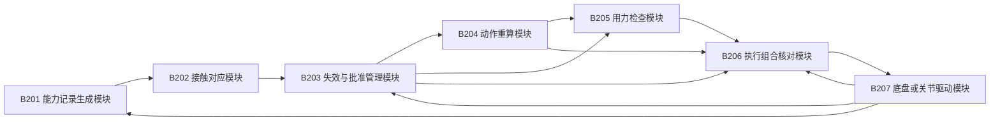
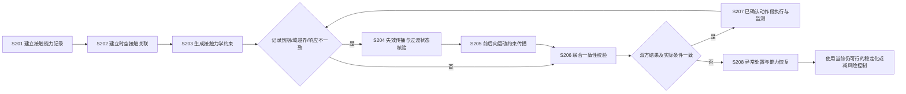

# 专利交底书 B：一种地面接触能力判断失效后的运动计划切换、关联重算与一致执行方法

> 撰写依据：[专利交底书模板及注意事项](../template.md)。重写日期：2026-10-19。
> 修订日期：2026-10-21。本次补充接触能力判断的失效检测依据，区分实际接触力与地面可提供的接触能力。
> 建议类型：发明专利；交底对象包括规划控制方法及其控制系统，电子设备和存储介质形式由代理人据实整理。
> 本文为设计草案，未完成本方案仿真、实机或性能验证。数值为假设算例，不是实验结果。
> 发明人、申请人、实际研发形成日期和已公开情况：待根据真实记录填写。
> 历史材料：[原交底书](02_patent_b_friction_evidence_consistent_planning_disclosure_20261015.md)、[通俗技术详解](02_patent_b_sources_and_technical_principles_20261015.md)。本文独立说明主方案及轮式、足式实现条件。

## 核心摘要：作用原理与拟保护的创新组合

**本案不是“地面变滑后重新规划”本身，而是处理地面接触能力判断失效或与实际运动响应不一致后，旧动作怎样退出、新动作怎样从真实接替状态生效的问题。** 系统通常不能直接测得地面的极限摩擦力；它通过轮/脚受力与运动响应估算或检验原有能力判断是否仍适用。若只把摩擦数值调低并重算路线，这属于常见的自适应规划思路，不能单独作为本案创新点。

作用原理按以下因果链实现：

1. **建立能力与动作的对应关系。** 将每条有来源、适用区域、时间、接触配置和工况范围的地面能力记录，关联到将来具体轮/脚、接触阶段、轨迹段及其力限制和执行批准。通过记录到期、适用域越界，或估算接触响应与预测持续不一致等条件识别记录失效；这样才能找全使用者，而非只更新地图上的一个数值。
2. **失效先撤销“旧依据下继续执行”的许可。** 依据反向关联定位受影响动作，阻止迟到或并发的旧批准继续下发；对已发布指令，按接口能力确认其已被完整覆盖、可撤销或仍会作用。完整覆盖可以直接完成替换，不要求额外撤销报文。
3. **以实际接替时的状态检查过渡和整段运动。** 把检测、计算、通信、控制周期和驱动响应的时间，以及未退出的旧输入纳入预测，得到新控制可能生效时的位置、速度和接触状态范围。先检查该过渡是否仍满足接触和执行器限制，再向前检查能否及时减速、向后更新后续状态、到达时间及接触区域；必要时重验剩余计划。
4. **一致批准并核对实际生效。** 规划结果和轮/脚用力安排必须基于同一组能力条件、接触阶段和接替状态范围联合通过，且执行反馈确认批次和进度符合预测后，才把新安排记为已生效。若实际状态超出已检查范围，不批准原结果并重新检查。

因此，拟保护的候选创新是**“能力记录—动作依赖—旧批准失效—过渡状态预测—前后段关联重验—同一生效条件下联合接替”这一闭环关系**，而不是其中单独的摩擦估计、摩擦约束、版本号、反向索引或新指令覆盖。其技术作用是找出并拒绝普通局部重规划可能遗漏的两类结果：旧输入仍在作用时过渡已不可行；目标段虽然可行，但上游来不及减速或下游接触条件已改变。

该组合仍是**待现有技术检索和实施验证的区别候选**，不是已确认的新颖性结论。若已有方案已完整实现上述依赖处理、过渡检查、关联重验和实际接替核对，就不能仅凭改名或增加数据字段主张区别。

## 一、本发明解决的技术问题是：

### 1.1 现有技术的缺点及产生原因

已有移动平台通过估计地面摩擦能力、建立分区摩擦地图或更新控制约束，使运动适应湿滑地面。但在能力判断改变、规划与驱动异步运行时，对于仅更新能力数值而未同步处理已批准动作的实现，仍存在以下不足：

1. **从能力判断失效到新安排实际生效之间，旧动作可能缺少有效约束。** 更新地面记录后，可以重新计算并发布新的速度和用力安排；若新安排及时、完整地覆盖旧安排，覆盖本身就实现了替换，无需额外撤销指令。问题在于，重新计算、传输和驱动切换需要时间，部分接口还允许已接收指令继续执行。若未明确切换期间执行什么，以及哪些旧指令仍会作用，就不能仅凭“已发布新安排”判断旧依据已停止影响运动。
2. **局部约束变更后，前后运动可能不再衔接。** 原因是只降低湿滑段的允许速度或用力，没有检查较早路段是否来得及减速，也没有更新较晚路段的到达时间和接触位置。原本有效的其他能力记录可能随时间和位置变化而失效。
3. **规划和实际用力可能依据不同条件。** 原因是两个模块更新时刻不同，或只比较版本数字而未核对接触阶段、生效状态和不能取消的旧输入。因此，新路线可能与旧用力安排混用，或者按当前状态可行、真正生效时却不可行。

上述不足针对第二部分所述技术在缺少对应撤销和生效核对机制时的实现，不表示摩擦自适应规划或同步控制本身尚不存在。本文所称“能力判断失效”包括有效期届满、适用条件不再满足，以及实际运动响应与当前判断不一致；不等于系统直接测得地面摩擦极限发生了变化。

### 1.2 针对上述缺点的发明目的及技术问题

本发明的目的，是使地面接触能力判断改变后，所有受影响动作及时停止沿用旧依据，并在实际能够生效的状态下重新形成相互一致的运动计划和用力安排。

具体要解决的技术问题是：**如何把一条能力判断的失效准确传递到相关接触限制、前后运动段及执行批准，在新安排接替前处理仍会作用的旧输入，并使新计划和用力安排从实际生效状态一致接替。** 该问题不同于仅问“新地面条件下哪条路线可行”，还要回答“新路线接管以前机器人会怎样运动、接管时处于什么状态，以及前后动作能否从该状态连续执行”。不要求重新计算期间完全没有控制输出，而是阻止未经有效依据确认的任务动作继续下发，并采用经检查可行的过渡控制；无可行控制时明确报告保证失效。

### 1.3 针对上述缺点能够达到的技术效果

| 对应缺点 | 本发明的技术处理及其作用 | 对应技术效果 |
| --- | --- | --- |
| 第 1 项：切换期间旧依据仍影响运动 | 反查受影响动作，阻止其继续下发；通过完整覆盖或显式撤销替换可替换部分，并检查仍会作用的输入 | 区分发布与实际生效，识别并处理切换期间可能超出新能力的运动，而不是仅确认数值已更新 |
| 第 2 项：前后运动不再衔接 | 向较早段重算减速要求，向较晚段更新状态、到达时间和接触安排，必要时重验整条剩余计划 | 识别来不及达到新入口速度、后续记录过期或跨区等连带不可行情形 |
| 第 3 项：规划与用力条件不一致 | 计入未完成旧输入，双方按同一能力条件、接触阶段和生效状态联合确认 | 拒绝新旧条件混用的执行组合，使获准动作对应同一个接触力学问题 |
| 能力判断可能已不适用但仍被沿用 | 结合记录到期/适用域检查及经标定的实际响应一致性检查；无法区分地面变化与设备异常时标记未知 | 不把单次接触力变化误当作摩擦能力变化，也不继续把可疑记录作为已验证能力 |

这些效果以能力范围和实际反馈有效、对应关系完整及响应时间有界为条件。地面突变后已无法满足制动或支撑要求时，本发明识别并报告不可行，不声称通过重新同步就能恢复物理能力。

## 二、详细介绍技术背景，并描述已有的与本发明最相近似的实现方案。

### 2.1 技术背景

地面移动机器人依靠轮子或脚与地面之间的接触力运动，抓地能力限制了加速、制动和转弯。系统通常由轮速/惯性等传感器、能力估计器、地面能力地图、运动规划器、用力分配控制器及驱动器组成：估计器判断抓地能力，规划器选择路径和速度，控制器把运动需求分配到各轮脚，驱动器执行并反馈。

地面变湿滑后，新计划和用力安排可以完整覆盖旧安排，无需额外撤销报文。但重算、传输和驱动响应需要时间，须区分“已发布”与“实际生效”，并考虑接替前仍会作用的输入。

### 2.2 现有技术方案及缺点

**主要方案。** CN120552911B [B-R2] 融合多源数据形成摩擦分区，结合道路连接、轮胎力和车体转动限制生成轨迹，按前后轮能力分配扭矩，再根据执行日志更新模型和约束、同步控制器。其权利要求 4～7 已连接地面能力、规划和控制。US11427223B2 [B-R1] 还公开了自然行驶事件估计摩擦、置信度老化及生成规划约束。摩擦自适应预测控制 [B-R3]、FrictionMap [B-R4] 分别涉及不确定性规划和空间摩擦估计，轨迹验证专利 [B-R5] 已涉及执行前可行性检查。

**针对本案场景的缺点。** 若更新只确认新安排已发送，未核对实际接替时刻及过渡输入，旧安排仍可能影响运动；若仅重算湿滑段，较早路段可能来不及减速，较晚路段的状态和接触时间也可能失配；若规划与用力安排未按同一接触阶段及实际生效状态确认，版本一致仍不代表动力学一致。已经完整覆盖并检查这些关系的实现不具有上述缺口，完整全量重验也可能达到相同目的，不能以“增加撤销步骤”作为区别。文献出处和核读范围见第七部分 [B-R1]～[B-R5]。

## 三、本发明技术方案的详细阐述（核心的重点内容）：

### 3.1 实施范围、前提与输出

主实施例选取可读取轮速、实际电流或力矩、惯性数据的差速机器人。传动、轮径、载荷、力矩和制动响应需事先标定；支持读取未完成指令，或至少能给出其可能持续时间与输入范围。

本案优先复用已有估计器或经测试的地面能力表，不要求训练新的视觉模型。视觉地材分类只能作辅助来源；没有有效力学依据时，不产生未经验证的高摩擦下界。

输出包括：受影响及已失效的动作批准清单、覆盖或撤销的处理状态、切换期间仍会作用的输入及生效状态范围、更新后的能力条件、重新检查通过的动作及用力安排，或不可行原因。自由飞行无人机不属于本地面接触方案的直接实施对象。

### 3.2 图 1：模块与连接

| 标号及名称 | 具体实现及职责 |
| --- | --- |
| B201 能力记录生成模块 | 把估计或标定结果及误差、适用条件写成记录；基于到期、适用域和实测响应检查记录有效性 |
| B202 接触对应模块 | 由预测轮迹或落足区域、预计接触时间，把能力记录对应到具体力限制 |
| B203 失效与批准管理模块 | 保存正向及反向对应关系、到期事件、取消状态和能力条件版本；失效后先阻止旧批准继续使用 |
| B204 动作重算模块 | 重算受影响段，向前调整减速或落足准备，向后更新状态、时间和接触安排 |
| B205 用力检查模块 | 在同一能力条件和生效状态下计算轮脚用力，并检查电机、关节及稳定性限制 |
| B206 执行组合核对模块 | 比较计划和用力安排的版本、接触阶段、初态、期限及取消状态，选择实际可执行组合 |
| B207 底盘或关节驱动模块 | 执行指令并返回真实状态、用力/力矩、接触及排队反馈，保留独立保护机制 |

### 3.3 图 2：失效后的处理顺序

图中事件、判断和处理动作为流程节点，不是新增部件。S201～S208 的实现如下。

### 3.4 S201：建立具有适用域的地面接触能力记录

本步骤区分**实际接触力**与**地面接触能力**。实际接触力是某一时刻轮/脚对地面施加或由地面反作用的力，会随驱动输入、载荷转移、姿态和运动改变；接触能力是给定地面、接触配置和工况下可用于约束规划的力范围或摩擦下界。测得一次接触力变化，不能单独推出地面能力变化；低负载下没有打滑，也不能证明极限抓地能力足够。

能力记录至少包含：

| 字段 | 内容及作用 |
| --- | --- |
| 标识及来源 | 记录编号、估计器/标定表/传感来源，支持追踪而不是把各源无条件平均 |
| 区域与坐标版本 | 多边形或地面网格及其误差；坐标重置后不能直接沿用 |
| 观测和有效时间 | 采集时刻、到期时刻以及变化速率依据 |
| 接触配置 | 轮胎或足垫材料、磨损类别、载荷范围、接触模型版本 |
| 能力范围 | 摩擦系数范围、有效法向载荷或其他经验证接触力限制，注明确定区间或统计含义 |
| 适用工况 | 速度、滑移、转弯、受力和接触方式范围，不能从小力匀速外推到极限急刹 |
| 误差与失效条件 | 模型/传感误差界、实测偏差阈值、配置改变等立即停用条件 |

能力记录的来源可为经测试的地面能力表、在线估计器输出或二者结合。在线监测用于检查该记录是否仍适用，不要求每次监测都重新识别出精确摩擦系数。轮式平台可按以下方式构造观测量：

1. **轮端力估算。** 根据实测电机电流/力矩、传动模型、轮半径、轮子转动惯量及损耗估算轮胎纵向力。例如简化关系为

   $$
   \hat F_{x,i}=\frac{T_{w,i}-J_{w,i}\dot\omega_i-\tau_{\mathrm{loss},i}}{R_i},
   $$

   其中 $T_{w,i}$ 是估算的轮端力矩，$J_{w,i}\dot\omega_i$ 是车轮自身角加速所需力矩，$\tau_{\mathrm{loss},i}$ 是传动及滚阻等损耗项，$R_i$ 是有效滚动半径；正负号依所用力矩和运动方向约定。该关系须按传动方向、制动器和轮胎模型校准；仅有下发的指令力矩时，不能把它当作实际接触力。
2. **滑移与车体响应观测。** 将编码器轮速换算的轮缘速度与 IMU/定位系统估计的车体纵向、横向速度比较，可形成滑移指标；将轮端力及车辆模型预测的车体加速度、角速度，与 IMU 实测值比较，可形成运动残差。足式平台可使用足端力/力矩传感器，或经验证的关节力矩与动力学观测器估算支撑力，并结合足端速度、接触状态、质心加速度和身体角运动核对。
3. **基于工况判定不一致。** 只有在轮/脚接触状态、传感器健康、载荷与模型适用条件可确认时，才把超过标定误差界的持续滑移或运动残差作为当前能力记录不适用的依据。阈值、持续周期和滞回由平台标定；可以用归一化残差及其不确定度判定，不规定脱离传感精度的通用常数。突发滑移等高置信事件可触发立即停用，不必等待持续计数。
4. **区分接触变化与能力变化。** 载荷转移、转向、碰撞、执行器饱和、轮径误差或传感器异常也会造成受力/运动不一致。系统先检查这些可识别因素；若原因不能区分，不把残差直接换算成新的摩擦值，而将有关能力记录标为“待核验/未知”并采取不依赖该旧记录的保守处理。传感器故障时不得把故障本身当成地面变滑的证据。

因此，触发器可以由**有效期/适用域检查**和**在线响应一致性检查**共同构成：前者即使没有打滑也可提前撤下即将失效的记录；后者在预期接触响应与实测持续不符时提前撤下旧批准。若证据只支持“旧判断不再可信”，系统只将该记录失效或降为未知，只有在估计器输出具有校准误差范围和适用域时才更新为新的定量能力值。

例如，可采用“按轮胎、载荷和地面工况划分的保守能力表＋在线一致性检查”。表内下界须有对应测试依据；地面不能确定属于哪一项时，采用覆盖仍合理地面的保守条件或标记未知。在线估计器也须给出经校准的误差范围及适用工况；不把估计均值自动当作可保证下界。

在已验证缓变速率内，可采用：

$$
\underline\mu_e(t)=\max\{0,\underline\mu_e(t_e)-L_e(t-t_e)\}.
$$

$e$ 是记录编号，$t_e$ 是观测时间，$\underline\mu$ 是摩擦系数下界，$L_e$ 是下界每秒减少的量，单位 s⁻¹。突发积水、材料变化或实测打滑直接停用旧记录，不等待缓慢衰减。零下界仅表示不能证明可用摩擦，不意味着能按零摩擦保证停车。

### 3.5 S202：建立能力记录与预测接触的时空关联

将候选运动分为动作段。由机器人位置、朝向、轮距、轮宽及误差，计算每只轮在该段将经过的整个接触区域和到达时间区间；足式则使用整块足垫可能落入的区域及承重时间。

仅当以下条件全部成立，记录才能支持该接触限制：

1. 可能接触区域被记录的区域条件覆盖。
2. 整个接触时间区间处于记录有效时间内，包含排队和计划时间误差。
3. 材料、载荷、接触方式、模型及受力工况满足适用条件。

接触跨多个区域时，分段检查；也可对各仍合理区域采用共同的保守力限制。未覆盖区域不能因附近有高摩擦记录而被填成高摩擦。前轮信息传给后轮，也须检查轮迹、时间和配置都适用。

对应关系表的每项存为“能力记录编号—计划编号—动作段—轮/脚—接触阶段—具体限制—执行批准”。同时保存反向索引，能够从记录查回使用者。新计划启用前先写好对应关系，避免出现已执行动作却未被索引的空窗。

### 3.6 S203：将能力记录映射为接触力学约束

对于第 $i$ 个轮子，接触坐标中的纵向力、侧向力为 $F_{x,i},F_{y,i}$，有效法向载荷下界为 $\underline F_{z,i}>0$，可采用：

$$
\left(\frac{F_{x,i}}{\underline\mu_{x,i}\underline F_{z,i}}\right)^2+
\left(\frac{F_{y,i}}{\underline\mu_{y,i}\underline F_{z,i}}\right)^2
\le\eta_i^2,\qquad 0<\eta_i\le1.
$$

力的单位为 N，摩擦系数和预留系数 $\eta_i$ 无单位。式子表达“制动和转弯共用抓地力”，不能两个方向各自用满。两个摩擦下界必须为正；轮可能离地、下界为零或接触模型失效时，停止使用该分式，切换相应接触处理或报告无法确认能力。

把各轮的力换到共同车体坐标，至少满足实际平台模型中的合力和转动力矩关系。水平平面示例为：

$$
\sum_iF^B_{x,i}=ma_x,\quad
\sum_iF^B_{y,i}=ma_y,\quad
\sum_i(r_{x,i}F^B_{y,i}-r_{y,i}F^B_{x,i})=I_z\dot\omega.
$$

$m$ 是质量，$a_x,a_y$ 是质心实际加速度在车体系的分量；$r_{x,i},r_{y,i}$ 是接触点相对质心的位置，$I_z$ 是绕竖直轴的转动惯量，$\omega$ 是车体转动速度。坡度、阻力及其他外力依所选模型加入。

同时检查轮速、滑移、轮端力矩、变化速度及车身运动。理想轮端有 $T_i=R_iF_{x,i}$，但还须计入传动效率、转动惯性和制动响应。力椭圆满足只是必要条件，不保证任意侧向力都能瞬间形成。

差速平台检查左右轮及其转动作用；两驱车辆加入差速器和轴端耦合限制，不能假设四轮独立驱动。所有限制保存所依赖的能力记录编号和模型版本。

### 3.7 S204：能力失效传播、过渡状态核验与执行批准撤销

触发事件包括：能力记录到期或预计在接触前到期；轮迹/落足区域、接触配置、载荷或工况离开记录适用域；以及在传感器健康、接触状态和动力学模型适用的前提下，轮端力估算、轮速滑移、足端受力或车体运动响应与预测持续不一致。后者表示“原能力判断需要撤下核验”，并不当然表示已测得新的摩擦系数。应按检测器校准阈值和持续条件区分瞬态噪声与持续异常；明显突发打滑可走快速失效路径。若残差可能由传感器/执行器故障、碰撞、载荷突变等多因造成且无法排除，则标记能力未知，不作虚假精确更新。预计接触时将过期的记录，在规划检查时就不采用；定时检查不能只等传感器产生新数据。

处理顺序为：

1. **阻止继续沿用失效依据。** B203 标记记录不可用，反查依赖它的动作批准。在 B206 的唯一指令入口，通过同一控制周期内更新或互斥保护，将这些批准置为失效并更新序号，使并发到达的旧结果不能继续下发。入口确认前已接受的指令归入后续过渡检查，不能假设通知发出就已拦截。
2. **按接口能力处理已下发部分。** 支持完整覆盖时，在明确的切换边界联合替换计划和用力安排，无需另发独立撤销报文；支持队列撤销时，撤销尚未执行的相关项并核对确认。两者都不能把“已发送”当作“已生效”。重新计算尚未完成时，替代输出只能是已按当前有效条件检查的过渡控制，不能为了覆盖而发布未经检查的新任务安排。
3. **查明仍会作用的输入及时间。** 从 B207 读取实际执行批次、进度和队列处理结果，区分已替换、可撤销和仍须执行的部分。反馈缺失时仅可用事先验证的持续时间及输入范围作保守预测；无此依据则报告无法确认生效状态，不把未确认队列当作已清空。计入检测响应、必要计算、通信、控制周期等待及驱动响应，分别预测过渡控制和新任务安排最早、最晚生效时的状态；持续反馈发生变化时更新预测。
4. **立即检查切换期间的运动和支撑。** 从当前真实状态出发，使用仍会作用的输入及候选过渡控制，检查新能力下的接触力、稳定性和执行器限制。局部制动或稳定支撑应由能够及时响应的控制器处理，不等待整条路线重算。若过渡已不可行，报告原无滑移或稳定性保证失效，并采用当前可行的减风险处理；停发、零力或保持旧输出都不能无条件当作安全替代。
5. **重算并联合确认新安排。** 进入 S205、S206；若过渡期间状态或接触阶段变化，新计划须从更新后的生效状态范围重新检查。其他有效记录重新支持相关接触时，也须重建限制并重新批准；不能删掉失效限制就让优化器获得更大可行空间。
6. **核对接替结果。** 记录新批次实际启用边界及仍未退出的旧输入，交由 S207 持续反馈核对。旧批准一旦失效不能由迟到确认恢复，恢复能力也须产生新批准。

这里撤销的是“凭旧条件继续执行”的许可，完整覆盖是其一种实现，不是额外必需的物理动作。指令即便立即被覆盖，已有速度、接触力和执行器状态也只能按动力学演变；本案不预设所有驱动器都有不可撤销队列。

### 3.8 S205：受影响运动段的上游约束反向传播与下游状态正向更新

在固定候选路径上，可先用下式倒推路段入口速度：

$$
v_j\le\sqrt{v_{j+1}^2+2b_j\Delta s_j}.
$$

$\Delta s_j$ 是第 $j$ 段长度（m），$b_j>0$ 是结合该段转弯、坡度和轮端能力可保证的减速度（m/s²），不是直接取摩擦系数乘重力加速度；$v_j,v_{j+1}$ 是相邻入口速度（m/s）。

由受影响段开始向较早段倒推，直到新的入口要求与未改动段的可行状态范围相容；若一直推到新控制生效状态仍不能满足，则该路径不批准。可尝试其他已确认空间内的路径，但每条都重新检查。

随后按新速度、加速度和接触安排向较晚段传播状态及到达时间。到达时间变化可能使原本未受影响的记录过期，或使轮脚接触落入其他区域，必须继续重验，直到没有新的依赖变化。不能证明影响已局限时，重验整个剩余计划。

上述式子不包括完整切换时延、加速度变化快慢及转向限制。最终仍从生效状态范围出发，按第三部分的接触力及平台动态模型检查，不能仅凭入口速度公式确认执行。

### 3.9 S206：运动计划与接触力分配的联合一致性校验

B203 生成固定版本的能力条件，包含仍有效记录、接触限制、材料/载荷、模型、预计接触时间、接触安排、生效状态范围及最迟启用时刻。修改任何相关内容均产生新版本，旧版本不就地改写。

B204 输出计划编号、能力版本、动作段及状态范围；B205 使用同一版本检查该计划的接触力与执行器，输出用力安排和执行确认。

B206 仅在下列条件同时满足时批准：

- 计划编号、能力版本、接触安排及模型一致。
- 双方确认仍未被取消，适用记录覆盖预计执行时间。
- 最新实际状态落在共同检查过的生效状态范围内。
- 驱动器指令批次和执行进度仍处于预测范围，启用时间没有超期。
- 计划、用力安排及当前接触状态联合可行，而不只是两边版本号相同。

任一不满足，记录原因且不批准新动作。旧组合只有在其依据仍有效并再次核对通过时，才可保留有限执行时间；不能把等待新确认当作无限续用旧组合的理由。

### 3.10 S207：已确认动作段的执行与运行状态监测

在软件控制周期边界一起选择已确认计划和用力安排，给指令附本次批次；驱动端或唯一指令入口拒绝迟到旧批次。支持完整覆盖的驱动接口按约定边界接替；不能在该边界替换的已接受输入须已在 S204 预测，不能在新安排中假设其消失。

将新批次下发记为“已发布”，仅当驱动反馈确认实际执行批次及进度与预测一致时记为“已生效”；尚未确认时继续按过渡状态监测，不提前宣告切换完成。实现若采用同一控制器同步更新，可由同周期的内部执行状态代替跨处理器确认，不额外引入消息往返。

每周期检查实际输出、接触状态和记录有效性。实际滑移或力矩偏差越界时，底盘侧可以直接取消批准并收紧控制，不必等上层规划应答。控制与通信响应时间均计入当前动作的可执行范围。

### 3.11 S208：异常状态处置与接触能力恢复

| 条件 | 处理 |
| --- | --- |
| 能力未知、记录冲突 | 使用已有验证依据的保守限制，或拒绝该动作；不平均成更乐观的摩擦值 |
| 新约束下规划或用力安排无解 | 报告具体限制冲突，采用当前可行稳定化/减风险控制，不用大松弛量把硬限制伪装成通过 |
| 左右轮能力不同 | 按合力和转动力矩重新分配；不机械等分制动力 |
| 已发布覆盖安排但未确认生效 | 按已接受指令及有界接口时序监测过渡，超时报告；不把发布成功当作旧输入退出 |
| 完整覆盖已确认生效 | 不再重复要求独立撤销报文；从真实速度、接触及执行器状态检查后续运动 |
| 能力恢复 | 用新记录重新建立对应关系并联合检查；设置经标定的恢复条件，不能仅以一次高估值自动加速 |
| 计算或反馈超时 | 不批准新组合；当前组合无有效依据时明确标记保证丢失 |

### 3.12 主实施例：配送机器人进入湿滑区

假设总质量 160 kg，两驱动轮法向载荷下界各 400 N，其余载荷由支撑轮承担，轮半径 0.10 m，$\eta=0.8$。这里的力仅计算两驱动轮贡献，暂不计有利阻力。

若干地摩擦下界为 0.50，每驱动轮允许的纵向力上界为 160 N；改用湿地 0.15 后，上界为 48 N。要求 1 m/s² 直线加速度，需要总力 160 N、每轮 80 N，旧限制下必要检查通过，新限制下不通过。

湿地总可用力上界 96 N，对应加速度大小的必要上界 0.60 m/s²；真实可保证制动还需底盘响应、载荷及打滑标定，不能直接把 0.60 当作保证值。

速度 1 m/s、切换时延 0.12 s、额外余量 0.15 m 时，即便乐观使用全部 0.60 m/s² 减速，也至少需要：

$$
d_{\rm need}=1\times0.12+\frac{1^2}{2\times0.60}+0.15
=1.10333\ {\rm m}.
$$

若只有 1.00 m 可用距离，原停止目标已无法按这些条件保证。正确输出是取消原批准并报告能力不足，不是“把新版本同步后即可安全停车”。

**对应关系示例**：记录 E17 支持左轮动作段 J4、J5，记录 E18 支持右轮。E17 失效先取消 J4/J5 的旧批准，重查左轮限制，再向 J3 及更早段倒推减速要求、向 J6 及以后更新时间。E18 不必无理由删除，但不能因此保留整条计划的旧批准。

**覆盖与过渡的时序说明**：上述 0.12 s 假设为从发现能力变化到制动实际起作用的总过渡时间，已包含必要的计算、通信和驱动响应，不再重复叠加同一时延。假定该期间速度保持 1 m/s，才得到式中的 0.12 m；若旧加速指令仍作用，则须按加速后的位移和接管速度重算。若接口支持立即完整覆盖且制动立即起作用，总过渡时间可以减小，不能人为保留固定队列时延；即便理想地取零，停止距离加余量仍为 0.98333 m，而非瞬间停车。这个例子说明覆盖可以结束旧指令，却不能消除已有速度。

### 3.13 转弯实施例：不能把侧向抓地力再完整用于制动

假设单轮法向载荷下界 4000 N，$\eta=0.8$，侧向力要求 500 N。在各向同性摩擦下界 0.25 时，允许合力半径为 800 N，纵向力上界为：

$$
|F_x|\le\sqrt{800^2-500^2}=624.50\ {\rm N}.
$$

摩擦下界改为 0.15 后，半径仅为 480 N，连原先 500 N 的侧向力也无法满足。将纵向驱动力设为零而保留原速度和弯曲路线，不构成解决方案；需在可达条件下改速度、曲率或路线，否则报告不可行。

### 3.14 足式实施方式：取消能力判断不等于立即抬脚

将能力记录对应到“哪只脚、哪片地面、哪个承重时段”。摆动阶段的脚接触力设为零。支撑脚满足：

$$
\|f_{t,i}\|_2\le\eta_i\underline\mu_i f_{n,i},\qquad
0\le f_{n,i}\le f_{n,i}^{\max}.
$$

$f_{n,i}$ 是垂直地面的力，$f_{t,i}$ 是沿地表的力，单位 N。地面法向不确定时，按允许法向范围检查，不假设始终竖直。

用身体质心 $c$、质量 $m$、角动量 $\ell$、脚位置 $p_i$ 和重力加速度向量 $\mathbf g$，检查：

$$
m\ddot c=\sum_i f_i+m\mathbf g,\qquad
\dot\ell=\sum_i(p_i-c)\times f_i.
$$

再用实际多刚体模型检查关节可实现性，例如：

$$
M(q)\dot\nu+h(q,\nu)=S^{\mathsf T}\tau+J_c(q)^{\mathsf T}f.
$$

$q$ 是身体姿态及关节配置，$\nu$ 是相应广义速度，$M$ 是惯性矩阵，$h$ 含重力及运动相关项，$\tau$ 是受上限和变化率限制的关节力矩，$S$ 选择驱动关节，$J_c$ 将整体运动对应到接触点。固定不滑接触还须满足接触点速度及加速度条件；平足另查压力中心和接触力矩。

某脚能力记录失效时，先检查当前支撑和已排队力矩，再选择可行的用力重分配、落足改变或稳定化；剩余脚和关节能力不允许时，不能无条件抬脚。该方式以已有能稳定行走的底层控制器为前提，不声称本稿已实现足式全身控制器。

例如 20 kg 机器人四足均分水平地面法向力时，每足 49.05 N。$\eta=0.8$、摩擦下界由 0.40 降至 0.15 后，每足切向力上界由 15.696 N 变为 5.886 N，总上界 23.544 N，原先总水平力 40 N 的请求不再通过摩擦必要检查。该算例不证明均分载荷、身体转动及关节限制同时成立。

## 四、本发明的关键点和欲保护点是：

### 4.1 独立权利要求的候选核心组合

建议围绕以下连续处理关系组织方法独立权利要求，而不是把“地面能力变化后重新规划”作为全部限定：

1. 将具有适用条件的地面接触能力记录关联到至少一个未来动作段的接触对象、接触阶段、接触限制及执行批准；
2. 根据记录有效期、适用域或接触响应与预测之间的经标定不一致条件，判定记录不再适用；使依赖该记录的旧执行批准失效，并从执行接口状态确定旧输入的替换、撤销或持续作用情况；
3. 根据仍会作用的输入和切换时延，计算新控制可生效时的状态范围，检查过渡可行性，并据能力限制变化向较早动作段传播入口状态要求、向较晚动作段传播运动状态和接触时序变化；
4. 使更新后的运动计划与用力安排依据同一能力条件、接触阶段和生效状态范围联合校验；仅在校验通过且执行状态符合预测时，批准或确认新安排生效。

### 4.2 从属限定及保护边界

可根据实际研发内容进一步限定：以有效期或适用域越界触发失效；以经过传感器健康检查的轮端力估算、轮速滑移、运动残差或足端受力与预测持续不一致触发失效；对原因不明的残差将能力标为未知而非生成未经校准的新摩擦值；轮迹扫掠区域或足垫落足区域与能力记录的时空匹配；分轮接触力、车体合力/转矩及执行器约束；足式支撑相、摆动脚零力和关节可实现性；反馈缺失时的保守状态预测；迟到批次拒绝及实际执行反馈核对。

不单独主张摩擦估计、记录老化、摩擦椭圆、版本号、对应关系表、确认消息或通常的新指令覆盖旧指令。独立撤销报文不是必要限定。完整覆盖加全量重验也可能实现相同技术作用，因此权利要求应关注上述**失效传播、过渡状态检查、前后段连续性重验和实际状态接替的组合关系**，不应把某种数据结构或消息机制误写成必要创新。该组合能否构成可保护区别仍须进一步检索和核实。

## 五、与第二部分所属的最好的现有技术相比，本发明的优点：

以第二部分的分区摩擦规划及同步控制方案 [B-R2] 为主要对比，本发明将能力变化后的受影响动作、过渡控制及关联重算明确连接，技术作用如下；这些作用不能仅由“增加撤销步骤”推导：

1. **切换检查不止于发布新安排。** 反查受影响动作并阻止旧批准继续下发，同时核对覆盖范围和实际生效状态，因此可识别发布成功但仍有旧输入作用的过渡风险；接口已支持完整覆盖时直接复用，不增加多余撤销步骤。
2. **局部更新兼顾整条运动的衔接。** 从受影响段向较早段重算减速要求，再向较晚段更新时间和接触安排，因此能发现目标段之外的入口不可达、记录过期等连带问题。
3. **新计划与实际用力按一致条件执行。** 双方基于同一能力条件、接触阶段和预计生效状态确认，且计入未完成旧输入，因此可拒绝新路线配旧用力安排或实际状态已变化的组合。

上述效果以第三部分的记录、模型、反馈和时限条件成立为前提；尚无实测数据支持速度、精度或事故率改善的定量结论。

## 六、针对第三部分中的技术方案，是否还有别的替代方案？

1. **能力来源与失效检测替代**：能力值可来自在线模型估计、离线标定表或已校准的多源融合；失效触发可由到期/适用域检查、滑移检测、实测与模型残差检查，或其组合实现。它们都须输出适用条件和不确定性；视觉分类或未经验证的残差不能直接提供在线安全下界，也不能据此声称已测得精确新摩擦值。
2. **数据结构替代**：可用表格及倒排索引、图结构或区域网格记录使用关系。只要能完整找回已批准动作即可，不要求特定数据库或图算法。
3. **重算范围替代**：资源充足时每次全量重验，替代增量重算；仍需停用受影响旧批准、处理过渡并重新确认。若全量替换已完整实现这些作用，不要求另建逐条撤销操作。不能以“增量”名义跳过状态已变化的后续段。
4. **求解形式替代**：轮式力分配可采用二阶锥规划、非线性优化，或将摩擦范围保守内缩为多边形后用二次规划。内缩表示少允许一些力，不能用包住原范围的外多边形冒充保守限制。
5. **概率模型替代**：可按明确统计假设用机会约束，即以给定概率满足力限制。必须标明允许违反概率、误差分布及整个执行时段的风险，不能与确定误差范围内全部满足的保证混用。
6. **接触平台替代**：全向轮加入滚子方向能力，履带按分布接触与正常转向滑移建模，不能机械套普通轮横向不滑条件。足式采用第三部分的支撑与关节检查，并另标定相应模型。
7. **执行确认替代**：可在同一控制器内锁定组合，也可跨处理器完成双侧确认。旧安排可通过同周期完整覆盖、带确认的队列撤销或批次切换停用；只要覆盖范围、生效边界和过渡条件均可确认，就无需独立撤销指令。无论采用何种软件机制，都需按实际接口计入时延、阻止旧组合重新启用，并检查真实生效条件。

省去逐条对应关系、每次停用并全量重验整个计划，是可行但计算范围可能更大的替代；不能仅因未逐项撤销就判定其不完整。仅广播摩擦数值而不核对实际替换及过渡，则不足以说明具有相同执行效果。

## 七、其他有助于专利代理人理解本技术的资料：

### 7.1 检索与迭代记录

检索和访问日：2026-10-19。公开检索关键词包括 `friction adaptive planning control allocation`、`tire friction spatial confidence patent`，并按原专利号进入公开原文核对。没有进行所有分类、同族及法域的全量检索。

| 迭代 | 核读内容 | 对方案的改写 |
| --- | --- | --- |
| 第一轮：追查估计与规划先例 | [B-R1] 权利要求 1～6、11～13、18 及置信度说明；[B-R3] 摘要 | 将估计、正常事件和置信度老化明确列为已有技术，不作为核心保护点 |
| 第二轮：核查最接近同步方案 | [B-R2] 最终权利要求 1、4～7；[B-R5] 轨迹验证条款 | 不再用“分区摩擦＋同步控制”作宽泛区别，收窄到对应撤销及真实生效条件 |
| 第三轮：补充近期空间估计来源及反例 | [B-R4] 原始摘要；复算轮式和足式例子 | 区分离线能力地图与在线有效依据；增加“失效限制不能直接删掉”和“已取消确认不能迟到复活”处理 |
| 第四轮：澄清覆盖与撤销的关系（2026-10-20） | 针对本文执行时序进行逻辑复核，未新增外部检索 | 承认完整覆盖即可替换旧安排；区分记录更新、发布及实际生效，补充过渡控制与接口分支，不将独立撤销当作必要创新 |

某次组合关键词搜索未返回相关结果，随后改用原专利号及更窄关键词检索；没有把无结果当作不存在先例的证据。

### 7.2 参考资料及实际读取层级

| 编号 | 可检索来源 | 本轮核读及限制 |
| --- | --- | --- |
| B-R1 | *Driving surface friction estimations for autonomous vehicles*. [US11427223B2](https://patents.google.com/patent/US11427223B2/en)，授权公告日 2022-08-30；同申请公开文本 US20200089243A1，2020-03-19 | 书目、最终权利要求及置信度相关说明已核对；不单凭网页认定当前权利人或完整法律状态 |
| B-R2 | *基于多源数据融合的无人驾驶动态路径规划方法及系统*. [CN120552911B](https://patents.google.com/patent/CN120552911B/zh)，授权公告日 2026-02-06；同申请公开文本 CN120552911A，2025-08-29 | 核读权利要求 1、4～7；与本案高度相关，但不将其文本中的性能表述作为已复现实验 |
| B-R3 | Sean Vaskov, Rien Quirynen, Marcel Menner, Karl Berntorp. *Friction-Adaptive Stochastic Nonlinear Model Predictive Control for Autonomous Vehicles*. [arXiv:2305.03798](https://arxiv.org/abs/2305.03798)，首稿 2023-05-05 | 本轮核对书目和摘要；HTML 正文入口返回 404，未将摘要扩写成全文结论，也未把其计算耗时作为本案指标 |
| B-R4 | Risto Ojala. *Mapping Tire-Road Friction Coefficients Along Driven Trajectories*. [arXiv:2610.14235v1](https://arxiv.org/abs/2610.14235v1)，原始书目提交日 2026-10-09 | 核读原始摘要和书目；用于说明离线沿轨迹摩擦估计已有来源，不声称完成方法全文复现 |
| B-R5 | *System and method for trajectory validation*. [US11407409B2](https://patents.google.com/patent/US11407409B2/en)，授权公告日 2022-08-09 | 核对最终权利要求 1～5、6～10 及相关可执行性说明；不据此作侵权排除结论 |

专利内容依据公开原文，Google Patents 不是官方审查和权利状态档案。足式控制的进一步来源可查[技术详解第十三节](02_patent_b_sources_and_technical_principles_20261015.md#13-本文参考文献与读取层级)；其中历史核读层级不自动视为本轮重新核验。

### 7.3 验证矩阵与验收要求

| 测试情形 | 需确认的实际行为 | 不足以替代验证的指标 |
| --- | --- | --- |
| 能力记录过期、轮迹跨区或配置变化 | 所有对应旧批准在允许响应时间内停用，覆盖或撤销状态及仍会作用的输入可追溯 | 估计均方误差低 |
| 持续滑移或模型残差越界，且传感器/接触状态通过健康检查 | 按标定的阈值和持续条件停用相关能力记录；若不能区分地面变化与设备异常则标记未知，不伪造新的摩擦值 | 单个噪声样本或单次力变化就判定摩擦系数已改变 |
| 同一控制周期完整覆盖计划和用力安排 | 旧批次不再启用；无需独立撤销报文，仍检查真实初态和执行器响应 | 额外撤销报文存在 |
| 重算、传输或驱动切换尚未完成 | 阻止失效批准继续下发，以有效过渡控制处理；超出新能力时明确报告 | 上层已发布新计划 |
| 覆盖确认丢失、撤销未确认或反馈超时 | 按已验证时序范围检查；无界时报告无法确认，不当作队列已清空 | 已发出覆盖或撤销请求 |
| 被取消前产生的确认迟到 | 旧确认不能解除取消状态或进入驱动队列 | 消息版本字段存在 |
| 新限速使原入口状态不可达 | 取消原动作，重算或报告无解，不伪造立即降速 | 目标速度数字已变小 |
| 到达时间改变使其他记录到期 | 继续传播重验，不只修改最初受影响的区域 | 最初区域已更新 |
| 新路线与旧用力安排混入 | 计划、能力、接触、生效状态任一不符就拒绝 | 两线程都报告求解成功 |
| 足端支撑转摆动或某脚记录失效 | 摆动脚零力，当前支撑和关节能力检查；不无条件抬脚 | 总质心合力可行 |
| 能力下降前的旧输入无法取消 | 记录物理过渡并识别是否已经超界 | 软件变量替换成功 |

对照全车统一摩擦、只局部改限制、重算但无执行组合核对、完整覆盖且检查过渡的全量重规划、本方案；同一感知、误差、时延、执行器限制及预算下比较。必须包含已经正确处理覆盖与过渡的对照，不能仅用未完成指令更新的实现衬托效果。分别记录滑移、接触力超界、车身/支撑失稳、不当批准、拒绝次数和重算耗时，以及发现变化、阻止旧批准、发布替代安排和实际生效的时间。

### 7.4 申请前需补充的材料与当前结论

需补入能力估计及误差校准、轮胎/足垫和载荷适用范围、真实驱动接口的覆盖范围及生效语义、队列可撤销性及力矩响应、可运行的对应关系管理与重算流程，以及至少一次能力变化到新安排接替的完整时序记录。足式还需已有底层控制器、接触检测和关节力矩限制资料。

正式申请前由代理人继续核查地面能力地图、约束更新、执行计划失效和跨模块一致性专利，尤其比较 [B-R2] 与通用计划失效处理的组合是否已经使本案显而易见。若已有方案通过完整覆盖、过渡检查和关联重算实现同样关系，不能仅因其没有独立撤销步骤就认定存在区别。

当前结论：方案的物理作用和实施步骤已在本稿具体化，但未证明新颖性、创造性或自由实施条件，不宜直接写成“首次实现接触能力一致规划控制”。
