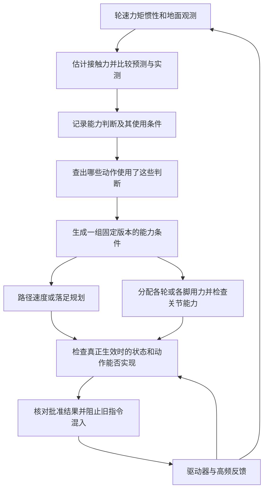
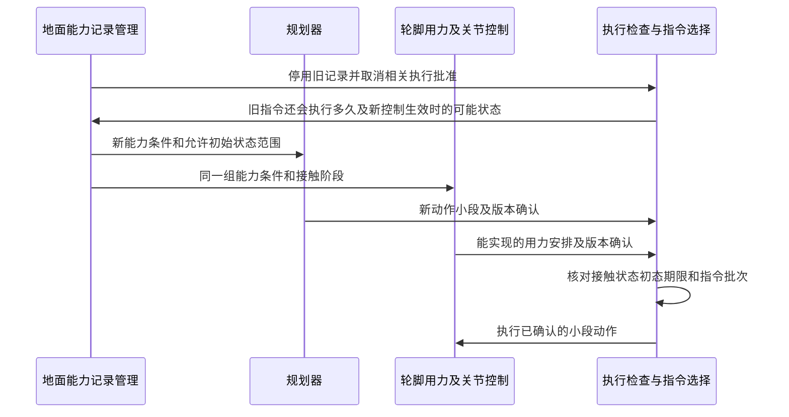

# B 案技术详解：地面变滑后，怎样让规划和底盘一起改动作

> 版本：V2.2 通俗说明修订，2026-10-21；补充作用原理和创新边界，不改变原方案的技术条件。
> 对应交底书：[02_patent_b_friction_evidence_consistent_planning_disclosure_20261015.md](02_patent_b_friction_evidence_consistent_planning_disclosure_20261015.md)。
> 2026-10-20 同步说明：缺点原因、目的效果及现有结构原理与[七部分模板稿](02_patent_b_disclosure_template_rewrite_20261019.md)对应；完整覆盖可以实现旧安排替换，本文不要求额外撤销报文。
> 本文独立给出来源、系统框架、动力学、实现过程和数值例。示例为假设参数；未实现本案控制器、未进行仿真或实机试验。
> 核心结论：若方案只做“发现变滑—降低速度—重新规划”，它就是常见的自适应规划，不能单独说明本案创新。待检验的区别在于闭环地处理能力判断失效、旧批准退出、接替前状态及残余输入预测、前后运动关联重验，以及新计划和实际用力按同一生效状态联合接替。摩擦估计、摩擦力限制、MPC、全身控制和版本号均不是本案首创；该组合也尚未被证明具备新颖性。

## 0. 阅读说明与交底书术语对照

**一句话概括：一旦发现某处地面不能再提供原先假定的抓地力，就找出受影响动作，让路线规划和车轮/关节控制按同一组新能力重新检查并接替。** 新安排完整覆盖旧安排，就实现了替换，无需额外撤销报文；真正要检查的是覆盖范围、实际生效时刻及切换期间仍会作用的输入。仅改变数值或版本号而不处理实际执行，才是不够。

可先看第 1 节场景、第 8～9 节更新过程和第 11 节算例；第 5～7 节解释力学与计算方法。来源表中的 L 表示论文、P 表示已有专利，编号沿用组合台账。本次只改写说明，不新增文献核验或试验结果。

| 交底书/原说明用语 | 通俗含义 | 本案中的例子或限制 |
| --- | --- | --- |
| 接触能力、附着能力 | 轮子或脚与地面接触时，能提供多大的力、能否稳定支撑 | 能提供多大制动力、转弯时多大侧向力；不只是一项速度上限 |
| 接触能力证据 | 一条带来源和使用条件的能力判断记录 | “这块地面在当前轮胎和载荷下，可采用摩擦系数下界 0.15”；不是法律证据 |
| 摩擦系数下界 | 在声明条件下采用的保守最低摩擦系数 | 不能把相机识别出的“干地”类别直接当作已证实下界 |
| 适用域 | 一项判断可以用于哪些地点、时段、材料、载荷和动作工况 | 左轮经过湿瓷砖的判断，不能自动套给别处右轮 |
| 激励、激励工况域 | 用来判断能力的转弯、加速、制动等实际受力情况，以及判断适用的工况范围 | 小力匀速不滑，只说明这次小力没超过能力，不能证明急刹也行 |
| 接触模式、支撑相、摆动相 | 哪些轮/脚正接触地面；脚承重/脚抬起移动的阶段 | 摆动中的脚不能被计算成正在提供支撑力 |
| 接触关联、轮迹扫掠区域 | 把将来的轮/脚接触位置及时间，与对应地面记录匹配；车轮经过的整个接触区域 | 不能只看落足中心点，忽略误差使足垫跨入湿滑处 |
| 摩擦圆、椭圆、锥 | 同时考虑各方向用力的允许范围 | 已用很多抓地力转弯，就不能再把全部抓地力拿来制动；不是路面上画的图形 |
| 各向异性、地面法向 | 不同方向能力不同；垂直地面的方向 | 全向轮某方向更容易滑；斜坡的法向不是竖直向上 |
| 约束、力分配、全身控制 | 动作不能违反的限制；把所需力分给各轮/脚；进一步计算关节能否实现 | 总力够，不代表某只轮不过载或某个关节力矩够 |
| 约束快照、能力快照、不可变 | 某一版本下完整且固定的一组能力条件；修改时另建新版本 | 规划器和控制器都按版本 13 的载荷、地面、接触安排计算 |
| 依赖图、反向索引 | 记录“哪项动作依据了哪条判断”，并能从判断查回动作 | 某地面记录失效时，查到经过它的轨迹段和支撑阶段 |
| 撤证、失效传播、增量重验 | 停止使用失效记录，取消依赖它的批准，只重算受影响部分及其连带后果 | 湿滑段入口要慢下来，前面的减速段和后面的到达时间也可能要改 |
| 上游/下游、反向/正向传播 | 沿路线较早/较晚的段；从后向前更新减速要求/从前向后更新运动结果 | “上游”不是网络服务器，而是到湿滑段之前的路线 |
| 激活状态、初态集合 | 新控制真正生效时，机器人可能处于的位置、速度和接触状态范围 | 不是规划开始时的理想状态；须计入仍会执行的旧指令 |
| 代际屏障、游标、执行确认 | 用指令批次挡住迟到旧消息、记录执行进度、确认本次动作确实可执行 | 版本相同但支撑脚不同，也不能批准；确认常缩写为 ACK |
| 鲁棒约束、机会约束、软约束 | 分别是：在声明误差范围内都满足；按声明概率满足；求解时允许带代价违反部分限制 | 三者保证不同，优化器有解不等于所有硬限制都满足 |
| 风险最小化、稳定化 | 保证已丢失时，采用当前可行的减风险或维持平衡动作并报告异常 | 不意味着立刻抬脚、瞬间停车，或一定能避免失稳 |

AMR 是自主移动机器人；IMU 是测加速度和角速度的惯性传感器。MPC（模型预测控制）指反复预测未来运动并求当前控制的方法；QP（二次规划）、SOCP（二阶锥规划）是常用的优化问题形式。SRBD 是单刚体动力学模型，把机器人整体运动简化为一个刚体，再计算接触力；它不能代替关节级检查。

## 1. 用直观场景理解问题

一台配送机器人准备转弯，左轮即将经过湿瓷砖。规划器仍按干地速度过弯，控制器已把左轮可用力调低，两边各自“运行正常”，组合却可能不可行。另一台四足机器人准备落足，地面证据突然失效，直接把该脚抬走也可能破坏当前支撑。

本案处理的不是单一摩擦系数估计，而是：**哪一条接触能力判断支持了哪些轨迹段、哪些支撑相和哪些已确认指令；判断被推翻时，怎样使依赖旧判断的批准失效，并在同一能力下重新规划和执行。**

“证据”在这里是带来源和适用条件的记录，不是法律证据；“失效”可以是过期、接触地点不确定、载荷/轮胎变化、实际滑移或模式改变，不只表示摩擦数值变小。

### 作用原理：为什么不等于“变滑后重新规划”

普通重规划主要回答：**按新的地面条件，之后走哪条路、用多大速度？** 本案还要回答：**新方案接管以前，旧命令还会让机器人做什么？实际接管时处于什么状态？从该状态出发，前面的制动和后续接触还能否成立？**

原理是把“能力判断”当作动作批准的物理依据，而不只是地图上的一个数字。每条能力记录带有地点、有效时间、接触对象和工况；系统将它关联到未来动作及其接触限制。当记录失效，系统沿关联找到所有依赖动作并停止旧批准；随后结合剩余旧输入和响应时延预测切换状态。新约束先作用到仍在发生的过渡运动，再沿运动顺序向前检查减速是否可达、向后更新状态及接触时间。最后，规划器与用力控制器对同一能力条件和接替状态联合确认，执行反馈再核实是否真正接管。

| 只做常规局部重规划 | 本案拟解决的附加问题 |
| --- | --- |
| 更新摩擦数值，求新的路线或速度 | 找出哪些已批准动作依赖失效判断，防止迟到的旧批准再次下发 |
| 认为发布新指令即完成切换 | 区分已发布与实际生效，计算仍会作用的输入和接管时的状态范围 |
| 只检查湿滑目标段 | 检查过渡期间是否可行，并向前、向后传播入口速度、状态、接触时间和区域变化 |
| 分别认为规划和控制的结果可用 | 要求二者在同一能力、接触阶段和实际生效状态下联合通过 |

这里的创新候选是这些环节之间的**闭环依赖与接替关系**，不是“重规划”这个动作本身。若某现有方案已经完整处理了依赖批准、残余输入、过渡预测、前后段重验和实际接替核对，就不能仅靠改用不同字段或名称主张区别；是否存在这样的现有技术，仍须进一步检索。

### 1.1 平台范围

| 平台 | 接触对象 | 不能省略的差异 |
| --- | --- | --- |
| 差速 AMR（靠左右轮速差转向）、配送机器人、车辆 | 车轮与预计经过的地面 | 轮速/力矩、车体转动、各轮载荷随运动变化、制动能力 |
| 全向机器人（可直接侧向移动） | 车轮滚子与地面的接触方向 | 不同方向摩擦能力不同，不可套普通轮横向不滑条件 |
| 履带/滑移转向机器人 | 一片区域内的接触及滑动情况 | 正常转向就可能滑移；须有适用接触模型 |
| 四足/轮足机器人 | 足端、承重阶段、地面朝向 | 抬起移动的脚没有支撑力，还须检查身体受力、转动和关节能力 |
| 自由飞行无人机 | 无地面接触 | 本案地面摩擦证据方案不直接适用 |

### 1.2 缺点、原因和本案目的如何对应

| 现有实现的具体缺点 | 为什么会发生 | 本案处理目的和对应效果 |
| --- | --- | --- |
| 发布新安排后过渡运动仍可能超出能力 | 重算、传输和驱动响应未完成，旧输入仍会作用 | 核对完整覆盖或撤销的实际边界，并检查过渡；不把发送成功当成生效 |
| 湿滑段改慢了，整条运动仍不衔接 | 前面可能来不及减速，后面的到达时间及接触点也改变 | 重算较早制动及较晚状态，识别连带不可行 |
| 新路线配上旧用力安排 | 规划和控制异步更新，未确认同一接触阶段及初态 | 从真实生效状态联合确认，拒绝不同条件组合 |

目的是使能力变化落实到可实现的运动，而不是单独强调“取消”。完整覆盖并作全量重验也可能达到相同目的；对应关系只是一种找全影响范围的实现。已有速度不能因覆盖瞬间消失，已失去制动或支撑能力时须明确报告。

## 2. 逐项来源依据与创新边界

### 同类结构、主要对比和针对性不足

同类结构为“传感器→能力估计/地面记录→路线与速度规划→轮脚用力分配→驱动执行”，实际动作和轮速等反馈又用于估计。规划器决定希望怎样运动，分配器检查各轮/脚能否共同提供所需力，二者不能只靠同名版本证明力学一致。

主要对比 P06 [CN120552911B](https://patents.google.com/patent/CN120552911B/zh) 已包括摩擦分区、路径约束、前后轮扭矩分配及依据执行日志更新约束和同步控制器。P03 则有自然动作测附着及置信度老化。这不是“现有技术只估计、不更新动作”的背景。

针对本案，应核对其具体实施是否在新安排前处理过渡、是否重验前后路段、是否联合确认实际接触和生效状态。缺少这些关系才有第一节所述缺点；已有完整处理的方案不能被当成弱对照。下表及文末资料保留各来源的实际读取范围，未读全文的论文不据此判定缺失某机制。

| 技术要素 | 已有来源及读取层级 | 本案使用方式与区别候选 |
| --- | --- | --- |
| 从正常转弯或制动估计抓地力，随记录变旧降低信任程度，分别控制各轮 | P03，相关权利要求及说明书 | 作为能力判断来源；不主张首次利用正常动作或分别估计各轮 |
| 在考虑随机误差的 MPC 中使用抓地力不确定性 | L07，摘要 | 作为已有规划方法；区别不在 MPC 中出现摩擦系数 $\mu$ |
| 主动执行动作以了解未知运动能力 | L06，摘要 | 没有足够受力变化不等于已测出能力极限；探测动作须先可行 |
| 按预测与实测的平均差修正模型，缩小允许动作范围以留余量，允许部分限制带代价违反 | L05，正文 II-IV、V-E、VI | 可辅助能力估计；允许违约的优化解不等于硬安全保证 |
| 按地面区域描述抓地力、使用力椭圆、分配前后轴用力并同步更新控制器 | P06，权利要求 1、4-7 | 很接近的专利先例；不能把“各处抓地力分布＋同步控制”当成新组合 |
| 速度、转向和车体转动力矩改变可保持稳定的运动范围 | L09，摘要 | 输入和执行器条件改变后也须重新检查 |
| 用单刚体模型规划四足运动，按概率限制脚的摩擦力，摆动脚不提供力 | L14，正文 III、IV、V | 足式适配已有基础，不把带摩擦限制的 MPC 当新发明 |
| 在线学习模型预测与实测的差异，并用于腿式 MPC | L15，摘要 | 可辅助估计；学习表现的理论界限不提供接触安全保证 |
| 较慢更新运动计划，较快反馈调整力矩，并考虑执行器反应速度 | L16，摘要 | 采用分层实现，不让导航线程代替高频力矩控制 |

本案待检验的组合是：把每条地面能力记录的地点、时间、接触模式和受力工况，与具体轨迹段或承重阶段对应起来；记录失效后，取消相关动作的执行批准，向前重算是否来得及减速，向后重算速度、到达时间和接触安排；最后让规划与控制基于同一组新能力、同一个预计生效状态再批准执行。

依赖图和版本一致性本身是常见计算方法。应通过真实物理反例说明，它们消除了哪些跨模块不一致，而不是只增加数据管理字段。机器人领域更近的证据地图、接触规划及全身控制专利尚需继续检索，当前没有完成新颖性或自由实施结论。

## 3. 系统框架与职责



证据管理模块不代替估计器；规划器不直接输出未经控制分配验证的动作；全身控制器不因为收到新快照就能瞬间消除旧力矩。驱动队列、总线及力矩响应必须进入过渡状态计算。

### 3.1 数据契约

| 对象 | 必需内容 | 实际作用 |
| --- | --- | --- |
| `ContactEvidence`（接触能力判断记录） | ID、来源、区域/坐标系、观测及到期时间、摩擦区间、受力工况范围、配置/接触模型版本 | 决定判断能用于何处、何时、什么接触 |
| `ContactAssociation`（动作与地面记录的对应关系） | 计划/段/接触部位/承重阶段 ID、到达时间区间、区域覆盖关系、匹配误差 | 防止用左脚证据支持别处右脚或别时刻 |
| `ContactConstraint`（接触力限制） | 力/力矩/滑移限制、可能的地面法向、接触模式、所依赖记录的 ID、模型版本 | 限制来源可追溯，不只是一个速度上限 |
| `CapabilitySnapshot`（某一版本的完整能力条件） | 固定版本、全部相关限制、接触模式、外形/载荷、适用输入与状态范围 | 规划与力分配对同一版本能力的含义理解一致 |
| `PlanAllocationAck`（规划和力分配的执行确认） | 计划/能力条件/接触阶段版本、允许初始状态范围、预计生效时间、首段可实现指令 | 对同一状态和能力作确认，而非只比较数字 |
| `ExecutionEpoch`（指令执行批次记录） | 生效时刻、指令批次、队列执行进度、实际执行反馈 | 防止迟到旧指令在撤销后重新进入 |

这些是建议接口，不是已落地标准，ID 是对应记录的标识。不同模块若只共享同一个版本数字，却对载荷、地面方向或初始状态理解不同，仍是不一致。

## 4. 证据从哪里来，哪些内容不能估出来

### 4.1 轮式证据

轮速与车体速度差可指示打滑，电机电流/力矩结合传动模型可估车轮沿滚动方向的力。惯性传感器的实测结果与按各轮用力预测的侧向运动、车体转动结果之间的差值，称为“残差”，可用来发现模型与实际不符。但直线匀速时受力很小，即使不滑，也不能据此确定地面最多能提供多大摩擦力。

相机识别积水、冰雪或地材可形成先验，不能单凭类别给出未经校准的确定摩擦下界。主动试探需满足当前保守能力及任务约束，不应为了学附着先执行可能失稳的急转或急刹。

### 4.2 足式证据

通过足端力传感器、关节力矩、接触估计、IMU、足端速度和地形几何构造支撑置信与力能力范围。无直接力传感器时，观测器误差必须进入边界；期望力矩不是测得接触力。

落足点误差、地面朝向、足垫材料和脚是否正在承重，决定判断能否使用。视觉判断“这是一块干地”也不能保证足垫能提供指定的切向力（沿地表方向的力）。地面下陷、石块滚动及断裂意味着原来的接触模型可能已不适用，不能总用较小摩擦系数 $\mu$ 代替。

### 4.3 时效与相关性

若已标定地面能力缓慢变化的最大速率，可用 $\underline\mu(t)=\max(0,\underline\mu(t_e)-L_\mu(t-t_e))$。下划线表示保守下界，$t_e$ 是观测时刻，$L_\mu$ 是下界每秒降低多少，单位为 s⁻¹。意思是“记录越旧，能依赖的能力越低，且不取负值”。突发积水、足垫换装或实际滑移应直接停用旧记录，不能等它慢慢衰减。

多个来源共享相机、训练集或运动估计时，不能当作独立概率相乘。区间融合须先检查覆盖假设与相关性；冲突证据可能意味着模型失效，应降级，而不是简单平均成看起来更精确的值。没有有效证据时使用经验证的保守默认域或拒绝该动作，不从“缺记录”推导高摩擦。

## 5. 从轮端证据到轨迹约束

### 5.1 摩擦圆与各向异性椭圆

对于滚动轮接触、有效法向载荷 $F_{z,i}>0$，一种必要约束为：

$$
\left(\frac{F_{x,i}}{\underline\mu_{x,i}\underline F_{z,i}}\right)^2+
\left(\frac{F_{y,i}}{\underline\mu_{y,i}\underline F_{z,i}}\right)^2
\le\eta_i^2,\qquad 0<\eta_i\le1.
$$

力单位 N，摩擦系数与裕量无量纲。使用载荷下界须确实覆盖当前工况，且下界为正；轮离地时应切换模式，不在分母放零。椭圆只描述合力必要范围，仍需轮胎/轮子模型、扭矩、轮速及接触条件。

读公式时：$i$ 表示第几个轮子，$F_{x,i}$ 是沿轮滚动方向的力，$F_{y,i}$ 是侧向力，$F_{z,i}$ 是垂直地面的载荷；$\underline\mu_{x,i},\underline\mu_{y,i}$ 是两个方向采用的摩擦系数下界，$\underline F_{z,i}$ 是载荷下界。$\eta_i$ 是 0～1 之间（不含 0）的预留系数，取小一些就少用一部分理论能力。两个分数的平方相加不能超过右侧，表达的是**制动与转弯共用同一份抓地力预算**，不是两个方向各自都能用满。

各向同性时可得到给定侧向力下的纵向上界：

“各向同性”指两个方向采用相同摩擦能力。以下省略轮编号 $i$：

$$
|F_x|\le\sqrt{(\eta\underline\mu\underline F_z)^2-F_y^2}.
$$

根号内为负表示侧向需求本身不可行，不是把纵向力设为零就解决。各向异性时须保留两方向不同的系数，不能套该简化式。

### 5.2 力分配与底盘平衡

平面底盘需满足总力和横摆力矩需求，例如：

$$
\sum_iF_{x,i}=ma_x,\quad \sum_iF_{y,i}=ma_y,\quad
\sum_i(r_{x,i}F_{y,i}-r_{y,i}F_{x,i})=I_z\dot r.
$$

这里 $m$ 是质量，$a_x,a_y$ 是车体前后、左右加速度；$r_{x,i},r_{y,i}$ 是第 $i$ 个接触点相对所选参考点的位置，$I_z$ 是绕竖直轴的转动惯量，$r$ 是车体绕竖直轴转动的角速度。三项分别要求“前后合力够、左右合力够、让车身转动的合力矩也正确”。$\sum_i$ 表示把各轮贡献相加。

各接触点的力须先换算到同一个车体坐标系再求和，外力、坡度和阻力按模型加入。轮端力还受电机/制动器输出上限和变化速度限制；有些电机在低速或掉电时不能提供所需保持制动。理论 $T=RF_x$ 中，$T$ 是轮端力矩，$R$ 是轮半径；这只是理想关系，仍需计入传动效率、车轮转动惯性及驱动器响应。

### 5.3 为什么前方地面变滑，当前位置就可能需要减速

设段长 $\Delta s_j$，段内可保证减速为 $b_j>0$，忽略时延的必要反向筛查为：

$$
v_j\le\sqrt{v_{j+1}^2+2b_j\Delta s_j}.
$$

其中 $v_j$ 是当前段入口速度，$v_{j+1}$ 是下一段允许的入口速度。直观意思是：已知前面必须降到多慢，倒推当前最多能有多快。它不表示机器人可以等进入湿滑区后才开始减速。

前方湿滑区域使允许进入速度下降，前面的路段也必须降低速度；不能只把湿滑段标成“慢行”而保留来不及实现的入口速度。时延、转弯、加速度变化快慢（称为“加加速度”）及各轮用力的相互影响，应在完整优化中再验，这个平方根不是最终通用规划器。

## 6. 足式机器人：从摩擦锥到全身控制

### 6.1 足端接触力锥

将接触力按地表单位法向分解为 $f_{n,i}$ 与切向二维向量 $f_{t,i}$。支撑足满足：

$$
\|f_{t,i}\|_2\le\eta_i\underline\mu_i f_{n,i},\qquad
0\le f_{n,i}\le f_{n,i}^{\max};\qquad f_i=0\ \text{于摆动相}.
$$

足端法向力通常是优化变量，不能把汽车载荷下界简单替代进所有足端约束。地面法向不确定时，应按法向集合做保守验证，或相应收缩力锥。

其中 $f_{n,i}$ 是第 $i$ 只脚垂直压向地面的力，$f_{t,i}$ 是沿地表方向的力，$\|f_{t,i}\|_2$ 表示切向合力大小，$f_{n,i}^{\max}$ 是允许的法向力上限。这个式子的白话含义是“脚压得住，才有相应的抗滑能力；脚在空中时不能帮忙推地”。“力锥”是允许力的几何表示，不是要求脚站在锥形地面上。

用 QP 求解时，可用更容易计算、但只允许原范围内一部分力的多面体替代圆锥，例如 $|f_x|+|f_y|\le\eta\underline\mu f_n$。这叫“保守内近似”：宁可少批准一些力，也不批准圆锥外的力。因为 $\|f_t\|_2\le\|f_t\|_1$（合力长度不超过两个分量绝对值之和），上述限制足以落在圆锥内。若两个方向各自独立允许用满，形成的方形角点会越出圆锥；采用方形内近似时，两方向的界都须除以 $\sqrt2$，或改用正确的多边形。

### 6.2 质心动力学与角动量

点足示例中，质量 $m$、质心 $c$、质心角动量 $\ell$、足端位置 $p_i$ 满足：

$$
m\ddot c=\sum_i f_i+m\mathbf g,\qquad
\dot\ell=\sum_i(p_i-c)\times f_i.
$$

$\mathbf g$ 是重力加速度向量，$\ddot c$ 是质心加速度，$f_i$ 是第 $i$ 只脚的接触力；$\times$ 表示叉乘，用来计算接触力对身体转动的影响。第一式检查身体能否按要求平移，第二式检查身体转动是否符合要求。角动量可理解为描述身体转动状态的量，不能只看总推力而忽略它。

不能只检查总切向力够不够：相同总力但左右分配不同会产生不同角动量，可能导致倾覆；运动还须符合步态相位和可达落足。平足存在接触力矩时，在角动量方程中加入相应力矩，并约束压力中心及足底扭转能力。

### 6.3 全身关节可实现性

采用合适局部广义坐标的刚体动力学写为：

$$
M(q)\ddot q+h(q,\dot q)=S^{\mathsf T}\tau+J_c(q)^{\mathsf T}f.
$$

$q$ 记录身体位置、姿态和关节角度（身体并未固定在地面上，故称“浮动基座”）；$M$ 是描述质量和惯性作用的矩阵，$h$ 包括重力及运动带来的相关项，$\tau$ 是受上限约束的关节力矩。$S$ 选出有电机驱动的关节，$J_c$ 是把身体、关节运动与接触点运动联系起来的矩阵，称为接触雅可比；上标 $\mathsf T$ 表示矩阵转置。该式用于检查“算出的接触力，是否真能由这些关节和电机实现”。

使用四元数表示身体姿态的软件，还应区分配置 $q$ 和速度 $\nu$，改用 $M(q)\dot\nu+h(q,\nu)$ 及相应运动映射，不能直接把不同维度向量相加。

持续不滑支撑还需 $J_c\ddot q+\dot J_c\dot q=0$，配合关节角/速度/力矩/速率、足端运动学和接触约束。只算出质心受力可行而未通过全身检查，不应确认执行。

这里等于零表示：在采用的固定接触、不滑动模型下，支撑脚不能在地面上产生不应有的加速度。它是特定接触模式下的条件，不适用于正在抬起或滚动的接触。

撤销一个支撑足的证据，意味着重新评估这个接触的能力，不意味着立刻抬起该足。只有剩余支撑、可达落足和关节能力共同可行，才可改变接触安排；没有可行模式时进入平台已验证的稳定化/风险最小化，而不声称“强制四足停住”一定可行。

## 7. “误差范围内都满足”和“按某个概率满足”不是同一种保证

L14 以 SRBD 中的参数及加性不确定性构造足端力机会约束，再转为 QP；其支撑相和摆动足零力也是已有设计。本文不直接复刻该论文控制器，且不把它的硬件结果当作本案成果。

若 $f$ 在某近似模型下服从高斯分布，线性约束希望满足 $\Pr(a^{\mathsf T}f\le b)\ge1-\alpha$，标准确定等价式为：

$$
a^{\mathsf T}\bar f+
\Phi^{-1}(1-\alpha)\sqrt{a^{\mathsf T}\Sigma_f a}\le b.
$$

这里 $a^{\mathsf T}f\le b$ 代表某一条线性力限制，$\bar f$ 是预测平均力，$\Sigma_f$ 是描述力误差大小及相关性的协方差矩阵，$\alpha$ 是这条限制允许的违反概率；$\Phi^{-1}$ 用于根据正态分布把概率换成需要预留的误差倍数。读法是“平均需求再加一份与不确定性、风险要求对应的余量，仍不得超过上限”。此处 $b$ 是力限制值，不是第 5.3 节的减速度 $b_j$。

这里必须是标准差平方根，量纲与力相同；不是直接加方差。用联合概率时，各面、各足和必要时间点须分配风险，使 $\sum\alpha_j\le\delta$；该并集界不要求事件独立，但会保守。只对单时刻各足分配风险，不等于整个执行时域的违约概率也相同。

L14 的 HTML 转换在个别不等式/根号显示上有疑点，因此上述为按标准线性高斯推导重写的解释式，非照搬其网页公式；复现应核对原 PDF 与作者代码。对非高斯、相关误差、模式跳变及非线性近似，不能无说明套正态分位数。

本案可选择“在有覆盖保证的误差区间内逐项满足限制”，或选择“在明确统计假设下按给定概率满足限制”，但能力记录必须写清采用哪一种。学习算法的累计表现差距指标（文献称“动态遗憾”）、优化代价较低，或允许部分违约的软约束求解成功，都不能替代接触力限制真正满足。

## 8. 地面判断失效后，怎样找全并重查受影响动作

### 8.1 从证据定位受影响动作

维护反向索引：

$$
D(e)=\{(\text{plan},\text{segment},\text{contact},\text{phase},\text{constraint})\mid
\text{该约束依赖证据 }e\}.
$$

$D(e)$ 是“使用了记录 $e$ 的所有动作限制”的清单。括号内依次记录计划、轨迹段、轮或脚、接触阶段、具体限制，方便从一条失效记录反查所有使用者，而不是只删除记录本身。

轮式按预计轮迹扫掠区域与证据多边形相交；足式按落足不确定区域及支撑时间区间关联。跨出证据区域、到达时间超期、载荷/足垫版本或激励域不满足，均视为不能继续依赖，而非仅判断几何中心点是否在区内。

### 8.2 停用一条能力记录后的处理顺序

1. 将证据标为失效，撤销关联约束及执行确认，阻止新的坏动作进入队列。
2. 读取不可撤销旧输入，预测新约束最早能生效时的状态集合。
3. 检查当前支撑/接触模式，必要时立即请求已验证稳定化；不要先等待全路线优化。
4. 在新能力下重验受影响段，反向更新上游速度或落足准备，正向更新状态及后续支撑。
5. 重新绑定其他仍有效证据；局部更新后，整条依赖链的动态连续性仍须成立。
6. 建立新快照，规划与分配分别确认同一快照、模式和激活初态，才允许新前缀执行。

“增量”只是避免重复重算无关约束，不能意味着后续初态改变却跳过后续段验证。无法证明更新局限时做完整重验。

## 9. 一致执行与实际时序



例如旧计划版本 12、分配版本 12 运行时，某证据失效产生快照 13。即便新计划 13 已到，但分配仍为 12，也不执行新计划；即便双方均为 13，若预计三足支撑实际变为两足，也不因版本相同而执行。到达期限不够时执行当前仍可验证的降级策略。

指令接收端须按批次拒绝迟到的旧消息，这就是“代际屏障”。已经下发并不可撤销的电机输入不能被软件删除，应计入切换过程的状态预测；若真正接管前就会超出新能力，不能再声称可保证不打滑，应记录原条件失效并采用当前可行的减风险措施。

## 10. 逐周期伪代码与实施过程

以下为事件处理流程，不是已实现的软件；“不批准”指不追加新动作，不能撤回驱动器已经接收且无法取消的输入。

```text
能力判断变化时（变化记录、实际执行反馈）：
    查出使用过这些记录的动作及力分配
    取消受影响动作和力分配的执行批准
    根据无法取消的旧指令，预测新控制真正生效时的可能状态
    生成固定版本的新能力条件
    若当前轮脚接触安排已无法保持或恢复稳定：
        请求该平台适用的稳定化处理
    重算受影响动作，并更新前后相关段的状态
    检查各轮脚用力和各执行器是否能实现新动作
    若规划或力分配不可行：记录原因，不批准新动作
    将新计划、接触阶段、能力版本和生效状态一起确认
    执行前再核对指令批次、实际接触状态、初态和期限
    只有仍全部符合，才启用新动作
```

### 10.1 最小实现路线

先从可读轮速、实际电流/力矩及 IMU 的差速底盘开始，固定地表区域和保守能力表，不必先训练视觉模型。建立证据 ID、轮迹关联、分配器和队列仲裁；用一次撤证事件检验原计划是否真的被阻断。

足式版本以已有可稳定行走的控制器为前提：导入接触相/力/关节反馈，将快照输入落足规划、质心 MPC 与全身控制，先验证四足静态及低速步行，再尝试动态步态。不能只修改导航速度上限便声称完成足式方案。

轮式可用 QP/SOCP 或已有非线性 MPC；足式按接触模型选择质心 MPC 和全身 QP。线性化、求解容差与约束近似均需保守余量，超时不自动保留无限期旧解。建议频率是待测设计预算，不把论文 500 Hz 当作本案能达到的指标。

### 10.2 工程实现拆解：以差速配送机器人为例

本节把前述方案拆成可由机器人软件团队实现的模块和一次事件处理事务。它是一个建议实现，不假设某个特定 ROS 版本、驱动器接口或求解器；具体周期、超时和误差界必须在目标平台测量和标定。

#### A. 软件模块和数据流

在现有导航与底盘软件中增加或明确以下职责，不必把每项做成独立进程：

| 模块 | 输入 | 输出/约束 |
| --- | --- | --- |
| 状态估计器 | 编码器、IMU、轮端电流/力矩、接触/滑移反馈 | 带时间戳和不确定范围的车体位姿、速度、角速度、轮速、接触状态 |
| 能力记录管理器 | 已校准能力表或有误差界的在线估计、地面区域与配置 | 不可变的能力记录；状态为有效、将过期、失效或未知 |
| 接触关联索引 | 候选计划、轮迹扫掠范围、到达时间和轮胎/载荷配置 | 从能力记录到计划段、车轮、限制及批准的正反向索引 |
| 事件协调器/命令仲裁器 | 失效事件、旧命令批次、计划/控制器结果、驱动反馈 | 原子撤销旧批准；唯一的动作放行入口；当前执行批次 |
| 规划器与力分配器 | 同一能力快照和接替状态范围 | 计划片段、轮端力/力矩安排、各自的可行性结果和输入快照标识 |
| 驱动适配器 | 已放行的有限时长指令片段 | 发送/接受/执行状态、批次号、执行进度及实际反馈 |

导航规划通常运行在较慢周期，轮速与力矩控制运行在更快周期。能力失效事件不应等待下一次完整导航规划才被处理：先由实时命令入口撤销相关动作的放行资格，并由底盘侧执行其已验证、能及时响应的局部保护；上层随后完成全局或局部重算。保护动作必须针对平台验证，不能把“零力”“停车”或“保持原指令”默认成安全动作。

#### B. 最小可实现的数据对象

能力记录和动作批准应可追溯且不可原地改写。示意字段如下，类型可按语言和中间件调整：

```text
ContactEvidence {
  evidence_id, revision, source, frame_id, region
  observed_at, valid_until
  friction_lower_bound, normal_load_range, uncertainty_kind
  wheel_tire_id, payload_range, contact_model_id, valid_operating_domain
  status: VALID | EXPIRING | INVALID | UNKNOWN
}

ActionDependency {
  plan_id, segment_id, wheel_id, contact_phase
  evidence_id, constraint_id, contact_time_interval, swept_region
}

ExecutionApproval {
  epoch, plan_id, allocation_id, capability_snapshot_id
  contact_phase_id, allowed_activation_state, expires_at
  status: PENDING | APPROVED | REVOKED | ACTIVE | COMPLETED
}

DriverProgress {
  epoch, accepted_command_id, active_command_id
  queue_state, measured_state, report_timestamp
}
```

`capability_snapshot_id` 指向一次完整、固定的能力条件集合；`epoch` 是单调递增的执行批次。每条下发指令带 `epoch` 和短有效期限，驱动适配器拒绝小于当前批次的迟到指令。所有时间戳使用同一单调时钟或明确的时钟映射，不能直接混用不同设备的墙上时钟。

#### C. 一次“能力失效事件”的处理事务

例如地面记录 `E17` 原本支持动作段 `J4/J5`，打滑检测或记录到期将其置为失效：

1. **接收并确认事件。** 检查事件的采样时间、传感器健康状态和接触对象，避免用过期消息覆盖更新状态。能力记录由有效转为失效是单向的；重新获得证据时新建记录，不能把旧记录直接改回有效。
2. **在唯一命令入口撤销批准。** 通过反向索引查出依赖 `E17` 的所有计划段及轮端安排。在命令仲裁器的一次原子操作中递增 `epoch`、将这些批准标记为 `REVOKED`，并使等待中的旧求解结果/旧消息因批次不匹配而无法放行。该操作阻止后续旧命令，不会神奇地撤回驱动器已接受的输入。
3. **读取执行端真实进度。** 查询当前批次、已接受命令、活动命令和剩余队列。驱动接口如果支持“按批次完整替换”，记录替换边界；若支持逐项取消，等待取消确认；若两者都不支持，则按经测试的最坏持续时间和输入范围把旧指令纳入预测。反馈缺失或状态不明时，扩大可能状态范围；若无有限可信范围，就不能声称切换过程已验证。
4. **预测新控制接管时的状态。** 从状态估计器取得带误差范围的当前状态，按剩余旧输入、控制时延、总线传输、控制周期等待和驱动响应传播到预计接管时刻。实际系统可使用已验证的运动模型、区间传播或采样包络；输出至少包括位置、速度、角速度、轮速及接触模式的范围，而不是单一理想点值。
5. **同步产生新快照和依赖。** 排除失效记录，重新匹配候选动作的轮迹与接触时间；其余有效记录按原适用域使用，未覆盖区域标记未知或采用经验证的保守限制。生成新的不可变 `CapabilitySnapshot`，规划器与力分配器必须读取同一快照 ID 和同一接替状态范围。
6. **重算前后关联动作。** 对目标湿滑段求满足接触力和执行器限制的速度/加速度；向较早段反向传播所需入口速度并检验当前是否有足够距离；向较晚段正向传播新的速度、位置与到达时间，重新检查证据有效期和接触区域。只有可证明影响局限时才做增量重验，否则重验剩余计划。
7. **联合验证并提交有限动作片段。** 规划器返回计划段，力分配器返回轮端力/力矩序列及可实现性结果。仲裁器检查两者的快照 ID、epoch、接触阶段、允许初态、有效期限和接口预测均匹配；任一不匹配、求解超时或状态越界则拒绝，不得沿用旧批准冒充成功。批准后只提交有限时长的下一动作片段，留待下周期按反馈续批。
8. **核实是否真的生效。** 把命令发送、驱动接受和驱动正在执行分成不同状态。只有反馈显示活动批次及执行进度落在预测范围内，才标记 `ACTIVE`；否则撤销该批准、更新状态范围并重新检查。日志至少记录事件 ID、证据版本、epoch、旧/新队列边界、预测范围、拒绝原因和实际生效时间，便于复现时序故障。

核心仲裁逻辑可表达为：

```text
on_capability_invalidated(evidence_id):
    affected = reverse_index.lookup(evidence_id)
    atomically:
        epoch += 1
        revoke(affected)
        reject_all_pending_results_with_older_epoch()

    driver_state = query_driver_progress()
    activation_states = predict_activation_states(
        estimator.state_with_bounds,
        driver_state,
        measured_transition_latency_bounds
    )
    if activation_states are not bounded:
        enter_platform_verified_degraded_mode()
        report("activation state unknown; new task motion not approved")
        return

    snapshot = build_immutable_snapshot(excluding_invalid_evidence)
    plan = replan_affected_and_coupled_segments(snapshot, activation_states)
    allocation = allocate_contact_forces(snapshot, plan, activation_states)
    if not jointly_feasible_and_current(plan, allocation, epoch):
        enter_platform_verified_degraded_mode()
        report_infeasibility()
        return

    approval = approve_short_horizon(plan, allocation, snapshot, epoch)
    send(approval)
    verify_driver_activation_before_marking_active()
```

#### D. 湿滑区例子：软件最终要作出什么判断

沿用前文的假设参数：机器人以 1 m/s 接近湿滑段，湿地能力下的乐观加速度幅值上界为 0.60 m/s²，发现变化到制动实际生效总计 0.12 s，另留 0.15 m 余量。即使将该上界乐观地当作可用减速度，必要距离约为 1.103 m；可用距离只有 1.00 m 时，工程实现应：

- 立即使依赖旧能力的动作批准失效，并阻止旧计划结果迟到后重新进入命令口；
- 不能把尚未执行的 0.12 s 当作已制动，也不能把“新计划已发出”记作“新计划已生效”；
- 报告原停车目标在给定条件下不可保证，评估当前仍可执行的底盘减风险策略，并记录保证边界；
- 若剩余状态还有其他可行路线或目标，按新的实际接替状态重算并联合确认；否则停止批准新的任务运动。

这里的“不批准”不等于停掉实时控制器，也不等于物理上必然能安全停车；它表示系统不再把未验证的任务动作标为可行或安全。

#### E. 必须覆盖的工程故障注入

至少测试：事件到达时规划器正运行、旧结果晚到、驱动队列不可取消、反馈丢失/延迟、能力记录在预计接触前到期、姿态或接触阶段超出预测、规划器与分配器使用不同快照、求解超时、执行器饱和。验收不只看“规划器返回新路线”，还应核对旧 epoch 是否被拒绝、过渡预测是否覆盖实测状态、非可行情形是否明确拒绝，以及活动批次是否得到驱动反馈确认。可先在仿真和硬件在环测试，再以限速、可控地面条件开展实机验证。

## 11. 数值实施例与反例

### 11.1 车辆轮端椭圆例

单轮载荷下界 4000 N，$\eta=0.8$，侧向力需求 500 N。摩擦下界 0.25 时，合力半径为 800 N，纵向上界 $\sqrt{800^2-500^2}=624.5$ N。若误用 0.70，得到 $\sqrt{2240^2-500^2}=2183.5$ N，会严重夸大能力；降至 0.15 时半径 480 N，侧向需求本身已超界。

20 m 内希望降至 8 m/s，若保证减速仅 2 m/s²，上游必要速度界为 $\sqrt{8^2+2\times2\times20}=12$ m/s；当前 15 m/s 时，即便不计时延也不可行，必须记录原目标无法保证，而不是只把目标标成 8 m/s。

### 11.2 差速配送 AMR 湿滑区域

假设总质量 160 kg，两只驱动轮法向载荷各 400 N，其余载荷由支撑轮承担；忽略可助力的阻力，每轮可用力仅来自驱动轮，轮半径 0.10 m，$\eta=0.8$。干地摩擦下界 0.50 时，每驱动轮必要能力上界 160 N；湿地降为 0.15 时变为 48 N。

请求 1 m/s² 直线加速度需总力 160 N，均分为每轮 80 N；旧能力筛查可行，新能力下不行。湿地总可用切向力上界 96 N，因此绝对加速度能力必要上界为 0.60 m/s²；实际可保证减速通常还要更小，不能把此上界当标定保证。

若速度 1 m/s，接管时延 0.12 s、附加余量 0.15 m，即便乐观使用全部 0.60 m/s² 减速，所需距离也至少 $0.12+1/(2\times0.60)+0.15=1.1033$ m。可用仅 1.00 m 时，新能力不足以维持原停止承诺，不能靠快照同步掩盖物理不可行。

### 11.3 四足机器人低摩擦支撑

假设 20 kg，水平地面四足均分法向载荷，每足 $20\times9.81/4=49.05$ N，裕量 0.8。摩擦下界 0.40 时每足切向上界 15.696 N，期望总水平力 40 N、均分每足 10 N 的摩擦必要检查通过。

四足所处区域证据均改为 0.15 后，每足仅 5.886 N，总力上界 23.544 N，对应质心水平加速度必要上界 1.1772 m/s²，原 2 m/s² 请求失效。维持原地支撑可能仍然可行，但原动态轨迹不再可行。

该例只验证力锥数量级；载荷均分、角动量平衡、关节扭矩、步态和地面接触仍须联合求解。三足/两足支撑不能沿用除以四的计算。

### 11.4 支撑相错配

足端 A 在版本 21 的计划中处于支撑，在版本 22 中已进入摆动。即便 A 所处地面的摩擦证据仍有效，也不能继续使用版本 21 给 A 的非零接触力。相位依赖改变即撤销确认，说明“证据数值没变”也会导致旧约束失效。

## 12. 验证计划、失效边界与验收

| 验证项目 | 必须观察的结果 | 不能替代它的指标 |
| --- | --- | --- |
| 证据过期/区域错配 | 所有依赖确认被撤销并可追踪 | 估计器均方误差较低 |
| 左右轮不同附着 | 总力/横摆/扭矩均可行或明确报告不可行 | 全车平均摩擦估得准 |
| 足端支撑转摆动 | 摆动足零力，剩余支撑与全身能力重验 | 只检查质心合力 |
| 新计划旧分配或初态错配 | 禁止跨版本/跨相位执行 | 双方版本字段都存在 |
| 旧队列不可撤销 | 记录过渡及最早生效，不虚构瞬间清零 | 软件原子变量替换成功 |
| 摩擦突降晚于可恢复界 | 报告保证丢失并风险最小化 | 命令名叫“安全停车” |

对照全局单一摩擦、仅更新局部约束不传播、传播但不做执行确认、完整方案。固定同一模型、估计误差与延迟，比较约束违反、滑移、支撑失稳、误放行、重算耗时和保守拒绝。若依赖图成本超过直接全量重验，应报告其不适用规模。

实机验证须使用平台允许载荷、低风险地面和保护措施，不能照搬文献中的超载或涂油实验。当前只有算术/文档检查，无任何本案跌倒、滑移或性能统计结果。

## 13. 本文参考文献与读取层级

访问日均为 2026-10-15。下表独立列出本案所需书目；编号与总台账一致。

| 编号 | 书目信息及原始链接 | 核验范围与限制 |
| --- | --- | --- |
| L05 | Bongsob Song. *Diffusion-Residual Model Predictive Steering Control for Vehicle Stabilization at the Limit of Handling under Model Uncertainty*. [arXiv:2607.10243](https://arxiv.org/abs/2607.10243)，2026-07-11，v1 | [正文](https://arxiv.org/html/2607.10243v1) II-IV、V-E、VI；投稿 TCST 不视为已录用；实测耗时不是硬界 |
| L06 | Alexander Davydov, Franck Djeumou, Marcus Greiff, Makoto Suminaka, Michael Thompson, John Subosits, Thomas Lew. *First, Learn What You Don't Know: Active Information Gathering for Driving at the Limits of Handling*. [arXiv:2411.00107](https://arxiv.org/abs/2411.00107)，2024-10-31；v2 2025-07-23 | 摘要；主动学习与适应背景 |
| L07 | Sean Vaskov, Rien Quirynen, Marcel Menner, Karl Berntorp. *Friction-Adaptive Stochastic Nonlinear Model Predictive Control for Autonomous Vehicles*. [arXiv:2305.03798](https://arxiv.org/abs/2305.03798)，2023-05-05，v1 | 摘要；基础先例，不是最新论文 |
| L09 | Yurun Gan, Ziyu Song, Jing Yang, Zheng Lin, Jianuo Zhang, Tongtong Gu, Haitao Ding, Nan Xu, Por Lip Yee, Wei Ni, Jun Luo. *Dual-Envelope Constrained Nonlinear MPC for Distributed Drive Electric Vehicles Drifting Under Bounded Steering and Direct Yaw-Moment Control*. [arXiv:2604.07342](https://arxiv.org/abs/2604.07342)，2026-04-08，v1 | 摘要；输入条件依赖，不假定正文未读机制不存在 |
| L14 | Ananya Trivedi, Sarvesh Prajapati, Mark Zolotas, Michael Everett, Taskin Padir. *Chance-Constrained Convex MPC for Robust Quadruped Locomotion Under Parametric and Additive Uncertainties*. [arXiv:2411.03481](https://arxiv.org/abs/2411.03481)，2024-11-05，v1 | [正文](https://arxiv.org/html/2411.03481v1) III-V；足端机会约束及 Go1 实验；V-C 的油面实验调整速度和摩擦参数，不能概括为所有地面无需调整 |
| L15 | Hongyu Zhou, Xiaoyu Zhang, Vasileios Tzoumas. *Adaptive Legged Locomotion via Online Learning for Model Predictive Control*. [arXiv:2510.15626](https://arxiv.org/abs/2510.15626)，2025-10-17；v2 2025-11-30 | 摘要；随机 Fourier 特征/最小二乘残差，Gazebo/MuJoCo 仿真；页面期刊说明未独立核发行记录 |
| L16 | Ruben Grandia, Farbod Farshidian, Rene Ranftl, Marco Hutter. *Feedback MPC for Torque-Controlled Legged Robots*. [arXiv:1905.06144](https://arxiv.org/abs/1905.06144)，2019-05-15；v2 2019-08-09；页面列 IROS 2019 | 摘要；摩擦约束、高频反馈和 ANYmal 验证为已有技术，不转作本案结果 |
| P03 | *Driving surface friction estimations for autonomous vehicles*. [US11427223B2](https://patents.google.com/patent/US11427223B2/en)，2022-08-30；US20200089243A1 2020-03-19；优先权 2018-09-14；页面列 UATC/Volvo | 权利要求 1-6、11-13、18-20 及相关说明；非现时权利人核验 |
| P06 | *基于多源数据融合的无人驾驶动态路径规划方法及系统*. [CN120552911B](https://patents.google.com/patent/CN120552911B/zh)，2026-02-06；CN120552911A 2025-08-29；申请/优先权 2025-05-20 | 权利要求 1、4-7 已读；索引列河南海融软件有限公司，英文主体 Henan Hisoft Software Co ltd，法定中文主体仍待官方核实 |

## 14. 学习结论与后续补证

理解本案应先掌握“接触可提供什么力”，再掌握“这项能力何时何地成立”，最后才是“撤证后如何阻断旧动作”。顺序颠倒会做成只有版本字段、没有真实动力学约束的数据系统。

申请前补齐机器人接触地图与执行一致性的更近先例；研发先验证轮式局部撤证链，再评估足式全身控制接口是否可获得。当前交付不能证明任何平台已达到给定频率、稳定性或安全等级，也不是专利授权保证。