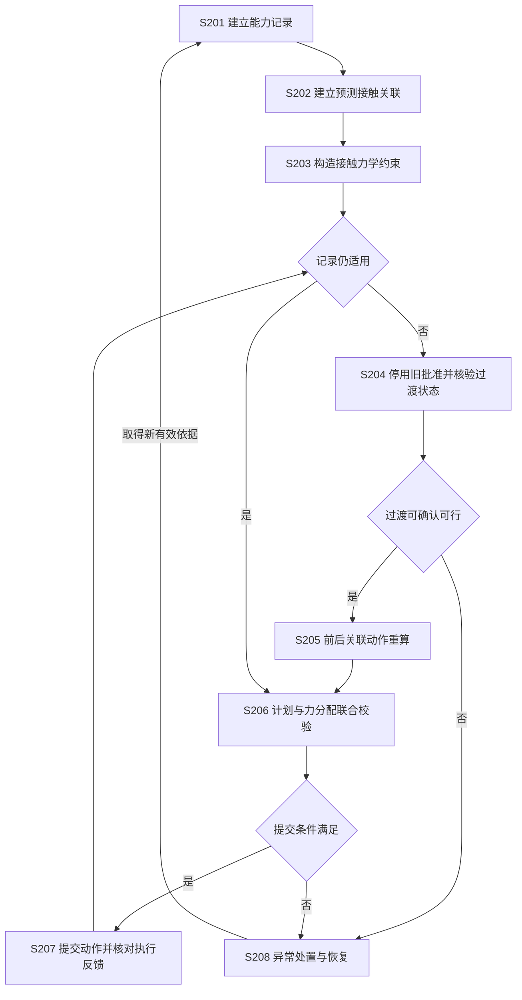
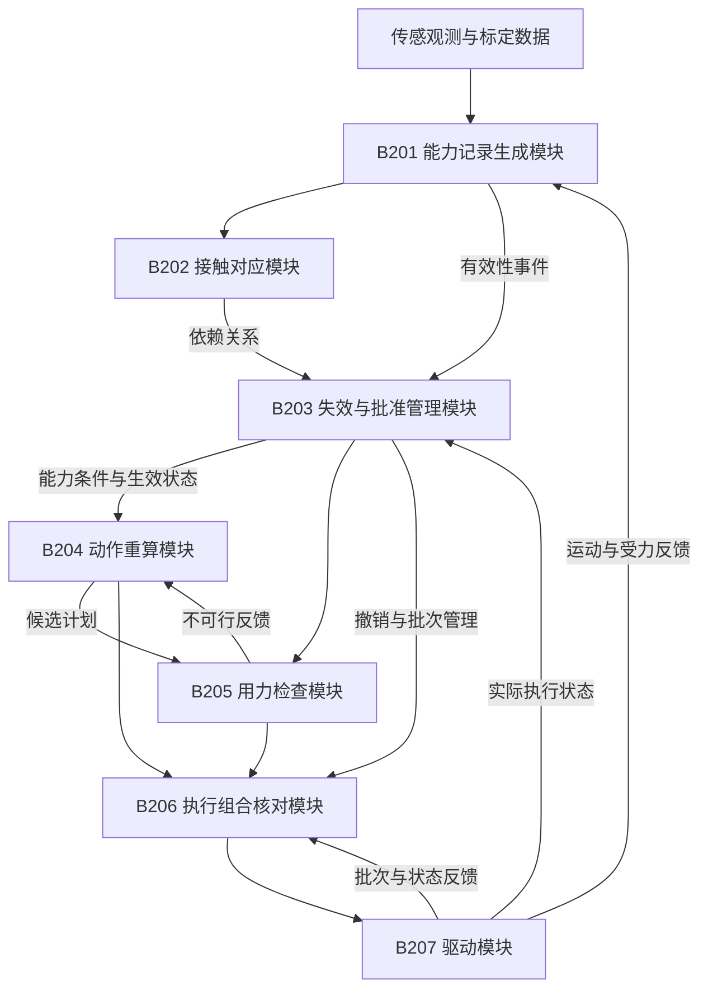
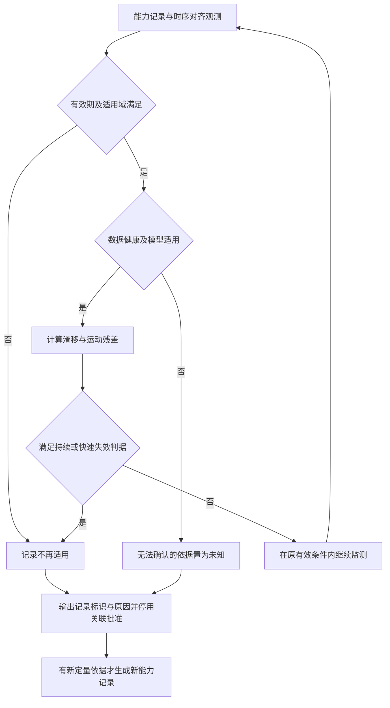
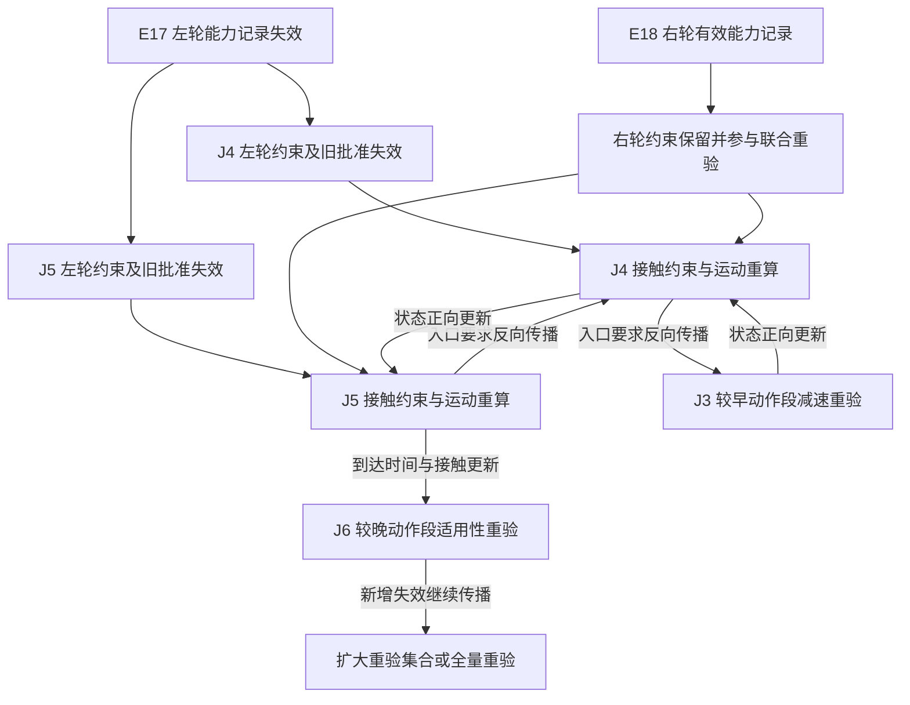
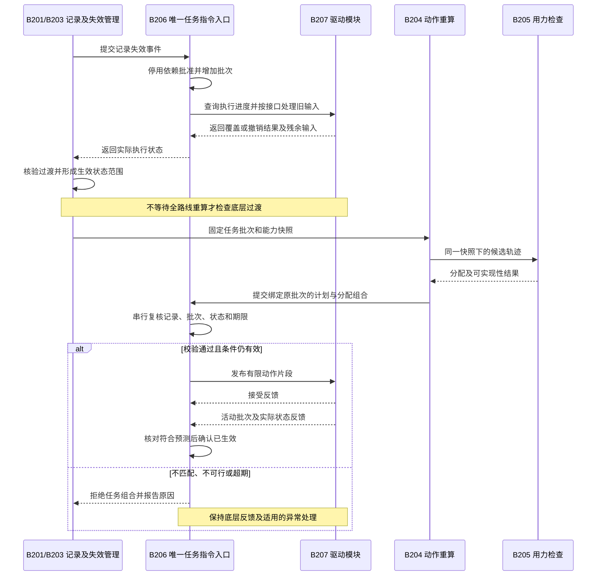

# 地面接触能力失效后的运动计划切换方法及系统

> 专利申请文件草案，编制日期：2026-10-21。
> 编制依据：[专利二交底书](02_patent_b_disclosure_template_rewrite_20261019.md)、[专利二技术原理与工程实现说明](02_patent_b_sources_and_technical_principles_20261015.md)。本文独立说明技术方案，不替代上述研发材料。
> 使用说明：以下为摘要、权利要求书、说明书及附图的合并审阅稿。为便于图文对照，摘要和正文就近展示相关附图，末尾按原图号汇总同一组图，不另增图号。附图使用可渲染的 Mermaid 矢量图源，正式提交时应转换、分页并核对所申请法域的文件格式。发明人、申请人、研发形成时间和公开情况另据真实记录填写。
> 验证边界：本方案尚未完成控制器实现、仿真或实机验证；数值实施例均为假设参数下的计算说明。本文补充的判据、状态传播和软件时序是拟实施方案，不表示已取得实验效果。权利要求保护范围及新颖性、创造性尚需结合检索和实际研发内容由专利代理师复核。

## 一、说明书摘要

本发明公开一种地面接触能力失效后的运动计划切换方法及系统，涉及移动平台运动规划与控制。将带适用条件的接触能力记录关联至动作段、接触约束及执行批准；依据有效期、适用域或实测响应与预测的不一致判定记录失效，停止沿用相关旧批准；结合仍会作用的旧输入及切换时延，预测新控制生效状态并核验过渡过程；向上游传播入口状态要求、向下游更新运动状态与接触时序；使运动计划和接触力分配基于同一能力条件、接触阶段及生效状态联合校验，并根据执行反馈确认接替。本发明用于识别局部重规划遗漏的连带不可行及新旧执行条件混用；无法确认可行时输出异常状态而不放行相应任务动作。

## 二、摘要附图

图中 S201—S208 展示能力记录建立、接触关联、约束构造、失效与过渡处理、关联重算、联合校验、执行反馈及异常处置的闭环关系。

**图1 运动计划切换方法流程图**




## 三、权利要求书

**1.** 一种地面接触能力失效后的运动计划切换方法，应用于具有地面接触部件及驱动执行机构的移动平台，其特征在于，包括：

获取具有适用条件及能力范围的地面接触能力记录，根据候选运动计划中各动作段的预测接触区域、预测接触时间及接触配置，建立所述地面接触能力记录与动作段、接触部件、接触阶段、接触约束及执行批准之间的关联关系；

依据所述地面接触能力记录的有效期、适用条件或实测接触响应与预测接触响应之间的不一致条件，确定不再适用的地面接触能力记录，根据所述关联关系使对应的执行批准失效，并阻止基于所述失效的执行批准继续下发任务指令；

根据驱动执行机构的执行状态及指令替换或撤销结果，确定仍会作用的旧输入及其持续时间范围，结合所述移动平台的状态范围和切换时延，预测候选过渡控制及新运动计划实际生效时的状态范围，并根据当前有效的接触能力条件核验旧输入与候选过渡控制作用期间的运动可行性；

在所述过渡过程可行的条件下，对受影响动作段进行重算，向较早动作段反向传播入口状态要求，向较晚动作段正向传播运动状态和接触时序变化，并重新检查受到所述变化影响的地面接触能力记录的适用性；

将更新后的运动计划及其接触力分配方案在同一接触能力条件、接触阶段和预计生效状态范围下进行联合校验，在联合校验通过且提交前的状态及执行进度符合预测条件时，批准并提交所述运动计划及接触力分配方案，依据执行反馈确认其实际生效；

在过渡过程或联合校验不通过，或者无法确定符合检查要求的生效状态范围时，不批准对应的新任务动作，并输出异常原因。

**2.** 根据权利要求1所述的方法，其特征在于，所述地面接触能力记录包括记录标识、数据来源、区域及坐标系版本、观测时间、有效时间、接触材料和载荷范围、接触模型版本、能力范围、能力范围的不确定性含义以及适用运动工况；所述能力范围来源于经标定的能力表或具有经校准误差范围的在线估计结果；记录恢复使用时，建立具有新标识或新版本的记录，而不恢复依赖原失效记录的旧执行批准。

**3.** 根据权利要求1所述的方法，其特征在于，所述移动平台为轮式移动平台，实测接触响应的获取包括：根据实测电机电流或力矩、传动参数、车轮角加速度和有效滚动半径估算轮端纵向接触力；将轮缘速度与预测轮心运动速度在车轮滚动方向的分量比较，得到滑移残差；以及将基于运动模型得到的车体响应与经时间和坐标对齐的惯性或定位观测比较，得到运动残差；其中，所述预测轮心运动速度计入车体角运动及车轮安装位置。

**4.** 根据权利要求3所述的方法，其特征在于，对所述滑移残差或运动残差设置与传感器误差、模型误差及当前工况对应的阈值和持续条件，在传感器健康且适用工况满足时，将持续越界或满足快速失效判据的响应确定为不一致；当不能区分接触能力变化、传感器故障或执行机构异常且原能力依据不能继续确认时，将有关记录置为不可用于批准动作的未知状态，输出原因并触发对应批准失效，而不将所述残差直接转换为未经校准的摩擦能力值。

**5.** 根据权利要求1所述的方法，其特征在于，所述关联关系包括从能力记录至其使用者的反向索引，所述使用者至少包括计划标识、动作段标识、接触部件标识、接触阶段及约束标识；仅当预测接触区域及其误差范围被记录区域覆盖、预测接触时间区间处于记录有效时间内、且接触配置与运动工况符合适用条件时，使用所述记录支持对应约束，并在批准计划前登记所述关联关系。

**6.** 根据权利要求1所述的方法，其特征在于，对于轮式移动平台，根据各轮适用的摩擦能力下界和法向载荷下界构造同时限制纵向力与侧向力的摩擦椭圆约束，结合车体合力、转动力矩、轮端力矩、轮速及执行器响应约束，校验运动计划和接触力分配方案；不以整车平均摩擦系数替代具有不同接触条件的各轮约束。

**7.** 根据权利要求1所述的方法，其特征在于，区分已确认被替换的输入、已确认撤销的输入以及仍可能作用的输入；在驱动接口支持完整覆盖时，以确认的覆盖边界替换旧安排，在驱动接口支持队列撤销时，以撤销反馈确定退出范围；对于尚未确认退出的输入，按照执行反馈或预先验证的输入及持续时间界预测状态，且同时检查过渡期间的状态范围和新控制生效时的状态范围。

**8.** 根据权利要求1所述的方法，其特征在于，所述反向传播包括依据受影响动作段的新入口速度要求、较早动作段的可用距离及经约束校验的减速度，更新较早动作段允许的入口速度；所述正向传播包括依据更新后的速度和接触安排更新较晚动作段的到达时间及接触区域；重复检查直至不存在新增的受影响关联，不能确定影响范围或重算超时则进行剩余计划全量重验或者拒绝该候选计划。

**9.** 根据权利要求1所述的方法，其特征在于，将有效能力记录、接触约束、接触阶段、模型版本、预计生效状态范围及最迟生效时间形成不可变能力快照；运动计划和接触力分配方案分别携带所述快照标识及共同的计划标识，联合校验还包括检查记录有效性、执行批准状态、执行进度与最迟生效时间，以及对应运动和接触力的联合可实现性。

**10.** 根据权利要求9所述的方法，其特征在于，在唯一指令入口中按执行批次管理任务指令，将失效处理和新任务指令的最终提交串行化；求解任务固定其启动时的执行批次及能力快照，在最终提交时重新核对所述执行批次及能力快照，拒绝在其间发生失效事件的旧结果；提交后分别记录指令已发布、已接受及已生效状态，根据驱动反馈或同一控制器的内部执行状态确认实际生效。

**11.** 根据权利要求1所述的方法，其特征在于，在未形成可批准的新任务动作时，保持底层反馈控制及异常处理有效，仅选用在当前接触能力和实际状态下通过检查的过渡控制；不存在可确认的稳定控制时报告原稳定性或无滑移保证失效，并调用平台适用的减风险处理；重新取得有效能力记录后，重新建立关联并校验，不以一次未发生滑移作为能力恢复的充分条件。

**12.** 根据权利要求1所述的方法，其特征在于，所述移动平台为足式或轮足式移动平台，将所述地面接触能力记录关联到足端接触区域及承重时段；对支撑足施加法向力与切向摩擦锥约束，对摆动足施加零接触力约束，并结合质心动力学、角动量及关节力矩约束进行所述联合校验；支撑足对应记录失效时，先检查当前支撑和仍会作用的关节输入，再确定接触力重分配、接触阶段调整或异常处置。

**13.** 一种地面接触能力失效后的运动计划切换系统，其特征在于，包括：

能力记录生成模块，用于根据标定或观测结果生成带适用条件的能力记录，并输出有效期、适用域或响应一致性检查结果；

接触对应模块，用于建立能力记录与预测动作段、接触部件、接触阶段、接触约束及执行批准的关联关系；

失效与批准管理模块，用于依据所述检查结果确定不再适用的记录，使关联的执行批准失效，并结合执行反馈、仍会作用的旧输入和切换时延预测过渡状态及生效状态范围，核验候选过渡控制的可行性；

动作重算模块，用于在过渡可行条件下重算受影响动作段，向较早动作段传播入口状态要求，向较晚动作段更新运动状态和接触时序，并重验记录适用性；

用力检查模块，用于在与所述动作重算模块相同的能力条件、接触阶段及预计生效状态范围下生成和校验接触力分配方案；

执行组合核对模块，用于阻止失效批准继续放行任务指令，对运动计划及接触力分配方案进行联合校验和提交前核对，通过后提交驱动执行，不通过时输出异常原因；

驱动模块，用于执行通过核对的指令并反馈实际执行状态，使所述执行组合核对模块确认新安排是否实际生效。

**14.** 一种电子设备，包括处理器、存储器以及用于连接移动平台传感器和驱动执行机构的接口，其特征在于，所述存储器存储有计算机程序，所述处理器执行所述计算机程序时实现权利要求1至12中任一项所述的方法。

**15.** 一种计算机可读存储介质，其上存储有计算机程序，其特征在于，所述计算机程序被处理器执行时实现权利要求1至12中任一项所述的方法。

## 四、说明书

### 4.1 技术领域

[0001] 本发明涉及移动机器人和车辆的运动规划、接触力控制及执行协调技术，尤其涉及一种当地面接触能力记录不再适用时，对依赖该记录的运动计划、接触力分配与执行批准进行关联处理，并从实际可生效状态切换控制的方法及系统。

### 4.2 背景技术

[0002] 地面移动平台依靠车轮或足端与地面之间的接触作用完成加速、制动、转弯或支撑。接触材料、地面状态、法向载荷及运动工况影响可实现的接触力。实际接触力是当前动作下的受力结果，接触能力则是允许规划使用的受力范围，二者不能等同。低受力时未发生滑移，并不能确定更大受力下仍满足无滑移条件。

[0003] 已有技术包括根据正常行驶事件估计附着能力、按地面区域形成摩擦分布、在规划中引入摩擦约束以及按轮端能力分配驱动力。例如，公开号或授权公告号为 US11427223B2 的专利涉及地面摩擦估计及规划约束，CN120552911B 涉及摩擦分区、轨迹约束、扭矩分配及控制同步，US11407409B2 涉及轨迹验证。这些公开方案构成技术背景，本发明并不将摩擦估计、摩擦椭圆或一般性的重新规划本身作为区别。

[0004] 当能力判断改变而规划器、控制器和驱动机构异步运行时，若实现只更新摩擦参数或发布新的计划，可能无法确认已批准旧指令是否退出，以及重算和驱动响应期间平台实际会如何运动。指令即使能够被完整覆盖，已有速度和执行器状态也不能瞬时消失。

[0005] 对湿滑目标段降低速度，也未必使整条运动可行：较早路段可能没有足够距离达到新的入口速度，较晚路段的到达时间或接触位置可能因减速而改变，使其他能力记录超期或不再覆盖接触区域。此外，规划器和力分配器即使采用相同版本号，若其接触阶段或初始状态不同，仍可能产生不能共同执行的结果。

[0006] 上述问题针对缺少实际接替检查和关联重验的实现。已有实现若已完整处理覆盖范围、过渡运动、前后段连续性及计划与控制的联合可行性，不能仅以使用不同数据结构或增加撤销消息作为区别。

### 4.3 发明内容

#### 4.3.1 所要解决的技术问题

[0007] 本发明解决的技术问题在于：当地面接触能力记录失效或无法继续确认时，如何准确停止依赖旧记录的任务批准，处理仍会作用的旧输入及新控制生效前的运动，并使前后关联动作、运动计划和接触力分配在同一实际生效条件下接替。

#### 4.3.2 技术方案

[0008] 本发明建立能力记录、预测接触、动作约束及执行批准之间的可追溯关联；由有效期、适用域和响应一致性判据触发记录停用；在命令入口停止使用相关旧批准，并取得驱动执行状态；根据残余输入与切换时延计算过渡状态范围；在当前有效能力条件下检查过渡，并重算前后相关动作；最后联合校验更新后的运动计划和接触力分配，在提交前复核条件，以实际执行反馈确认切换。

**图1 运动计划切换方法流程图**


[0009] 如图1所示，S201—S203 建立动作可行性的能力依据；记录不再适用时先进入 S204，不能直接跳到 S205 重算并假定旧动作已退出。过渡可行后，经 S205 重验前后动作，再由 S206 联合校验；S207 的执行反馈返回有效性检查形成闭环，失败分支进入 S208。本方案的作用机理是：能力范围限定可用接触力，可用接触力与平台动力学共同限定可达运动；运动改变又影响后续接触位置与时间，进而影响能力记录适用性。因此，记录失效不仅改变局部规划参数，还须经上述关联传播至运动连续性和执行批准。接替状态预测将软件处理时延与物理运动连接，使新计划的初态对应真正能接管的状态，而非重算启动时已经过时的状态。

[0010] 独立的撤销报文不是必要条件。接口支持完整覆盖时可直接复用覆盖机制，但须确定覆盖范围、实际边界及过渡过程。无法确认旧输入已退出时仍按可能作用处理，不把发布成功等同于物理生效。

#### 4.3.3 有益效果及适用条件

[0011] 在能力范围、模型误差、反馈和响应时限成立的条件下，本方案可识别并阻止失效依据继续支持任务指令，识别局部速度更新之外的入口不可达和后续记录过期，并拒绝不同能力条件、接触阶段或初态的计划与用力组合。上述效果源于物理约束、状态传播和执行检查的联合处理，不依赖某一种数据库或消息中间件。

[0012] 本发明不增加地面本身的抓地能力，不保证任何突变下都能停车或维持稳定。已超出可恢复范围时，输出不可行或保证丢失状态并进行平台适用的减风险处理。本文未给出实测安全率、计算提速或性能改善数值。

### 4.4 附图说明

[0013] 图1为运动计划切换方法流程图，亦为摘要附图；图2为系统模块及信号连接图；图3为能力记录有效性判定流程图；图4为记录失效及前后动作关联传播示意图；图5为失效处理、新计划提交与执行确认的时序图。

[0014] 附图标记：B201，能力记录生成模块；B202，接触对应模块；B203，失效与批准管理模块；B204，动作重算模块；B205，用力检查模块；B206，执行组合核对模块；B207，驱动模块。S201—S208 为方法步骤，不代表额外硬件部件。E17、E18 为示例记录标识，J3—J6 为按运动顺序排列的示例动作段。

### 4.5 具体实施方式

#### 4.5.1 平台结构与初始化

**图2 系统模块及信号连接图**



[0015] 参见图2，主实施方式为具有左右驱动轮和辅助支撑轮的差速配送机器人。传感输入包括编码器、惯性测量单元、实测电机电流或力矩，以及用于限制车体速度漂移的定位观测。定位观测可来自已有的激光、视觉或其他定位系统，其时间延迟和测量误差均须纳入估计。仅以发生疑似滑移的同一组轮速推算车速再比较，不能形成独立的滑移核验依据。

[0016] 初始化时标定有效轮径、轮距、传动比、力矩常数、传动效率、角加速度估计误差、轮端载荷范围、执行器力矩与变化率限制，以及制动和驱动响应。获取指令覆盖、取消、接受与执行反馈接口的实际语义。只有车速指令而无法获知底盘内部力矩约束的接口，不应假定能完成分轮力约束验证；须增加底盘约束接口或取得覆盖其内部控制响应的验证模型。

[0017] B201 接收传感及标定数据并产生能力记录和有效性事件；B202 计算接触关联；B203 管理记录依赖、停用状态与生效状态预测；B204 重算运动；B205 检查接触力及执行器可实现性；B206 作为唯一任务指令入口完成最终放行；B207 驱动电机并反馈状态。图2中 B205 至 B204 的返回连接表示用力不可行时须重新调整运动，而不是将不满足原轨迹的分配结果直接执行；B207 返回 B203、B206 的连接分别用于状态预测和生效核对。各模块可部署于同一控制器，也可分布于上位计算单元和实时控制器。

[0018] 底层反馈控制采用满足平台要求的固定周期，上层规划异步运行。周期和最坏响应时间以目标设备测量及验证为依据，不指定普适频率。到期检查须有定时触发，能力失效事件应优先送入指令入口，不等待完整规划结束。控制器使用统一单调时钟；跨设备时间戳使用带误差界的时钟映射，误差计入有效期和接替时间区间。

#### 4.5.2 数据对象与状态含义

[0019] 一种数据实现采用以下记录。表中字段为工程示例，字段内容的含义及其关联构成本方案的实现基础，不要求使用相同名称。

| 对象 | 主要字段 |
| --- | --- |
| 能力记录 | 记录标识及修订号、来源、区域、坐标版本、观测与有效时间、摩擦或接触力范围、不确定性含义、载荷及材料配置、模型版本、适用工况 |
| 关联项 | 计划标识、动作段、轮或脚标识、接触阶段、记录标识及修订号、约束标识、预测接触区域和时间区间 |
| 能力快照 | 快照标识、有效记录集合、约束集合、载荷及模型、接触安排、允许生效状态范围、生效时间窗口 |
| 计划与分配结果 | 求解任务标识、启动批次、快照标识、计划标识、轨迹段、接触力与执行器安排、可行性结果、有效期限 |
| 执行批准 | 批次、计划与分配标识、快照标识、允许状态及时间、批准状态 |
| 驱动进度 | 已接受批次、活动批次、命令序号、队列覆盖或撤销结果、状态观测及时间戳 |

[0020] 能力记录的数值内容和适用域在一个版本内固定。有效、未知和失效状态由独立的有效性登记表管理并保留事件历史。未知表示当前不能以该记录批准相关动作，不等于地面摩擦系数为零。执行批准可处于待校验、已批准、已发布、已接受、已生效、已完成或已撤销状态；已发布、已接受状态仍可转为已撤销，但驱动端已接受的实际输入须另行处理，不能因软件状态变化即认为消失。

#### 4.5.3 S201：地面接触能力记录的建立与响应观测

[0021] 能力记录可来自“轮胎或足垫—地面类别—载荷—工况”的离线标定表。表项须提供误差和适用范围。在线估计器也可提供能力区间，但其均值不直接作为安全下界。视觉地材分类用于筛选候选表项，不能仅凭“干地”标签确定高摩擦能力；无法判定表项时采用有依据的共同保守范围或标记未知。

[0022] 对普通驱动轮，在车轮轴处统一力矩正方向，按轮子转动平衡可采用下式估算纵向接触力：

$$
\widehat F_{x,i}
=\frac{T_{\mathrm{axle},i}-J_{w,i}\dot\omega_i-\tau_{\mathrm{res},i}}{R_i}.
\tag{1}
$$

其中，$T_{\mathrm{axle},i}$ 为传递到车轮轴的净驱动或制动力矩，$J_{w,i}$ 为与该力矩定义一致的转动惯量，$\omega_i$ 为轮角速度，$\tau_{\mathrm{res},i}$ 为未计入轴端力矩的阻力矩，$R_i$ 为有效轮径半径。若轴端力矩由电流估算，按传动及电机标定计算；效率、损耗和惯量不能重复扣除。式（1）的结果为估计值，须携带力矩、角加速度及模型误差，不能把命令值代入后当作实测力。

[0023] 对车体速度 $\widehat{\mathbf v}$、角速度 $\widehat{\boldsymbol\Omega}$、轮心相对车体参考点的位置 $\mathbf r_i$ 和滚动方向单位向量 $\mathbf t_i$，同一时刻、同一坐标系下的轮心滚动方向速度为

$$
\widehat v_i=\mathbf t_i^\mathsf T
(\widehat{\mathbf v}+\widehat{\boldsymbol\Omega}\times\mathbf r_i),
\qquad
r_{v,i}=R_i\omega_i-\widehat v_i.
\tag{2}
$$

该式避免将差速转弯时正常的内外轮速度差误判为滑移。滚动方向横向的接触运动应使用相应侧向残差另行检查。低速时优先使用具有速度量纲的残差 $r_{v,i}$；采用滑移率时，须设置经标定的低速分母处理及不同判据，避免接近零速时比值放大。

[0024] 运动模型基于带时间戳的状态、实际输入估计、重力、载荷和外力范围预测下一时刻响应 $\widehat{\mathbf y}_{k|k-1}$；与对齐后的实测量 $\mathbf y_k$ 比较，构造

$$
\mathbf r_{y,k}=\mathbf y_k-\widehat{\mathbf y}_{k|k-1}.
\tag{3}
$$

惯性测量单元的比力须经过安装坐标转换、姿态及重力补偿，不能直接与世界坐标加速度比较。加速度和角速度等不同量纲的残差分别使用对应误差界。若接触力估计已包含滑移后的响应，预测也可能与实测相符，因此运动残差不是必然能检测所有滑移的信号，须结合式（2）及工况可观测性使用。

[0025] 对足式平台，可直接读取足端力/力矩传感器，或利用关节实测力矩和多刚体动力学观测器估计足端力，结合接触阶段、足端相对地面的速度及身体响应进行检查。多足接触力的估计依赖观测器可辨识条件，关节命令力矩并非足端实测力。地面沉陷、滚动物体或接触脱离可能使模型本身失效，不宜一律解释为摩擦系数降低。

[0026] 本方案不以 $F_t/F_n$ 在任意工况下直接识别极限摩擦系数。未滑移时该比值仅反映当时的受力需求；滑移后的动摩擦行为也未必给出下一次静态接触的保守能力。为识别极限而主动试探，须先满足当前保守能力和平台安全约束，本实施方式不以主动极限试探为必要步骤。

#### 4.5.4 有效性判据与失效事件生成

**图3 能力记录有效性判定流程图**



[0027] 参见图3，检测器先检查时间戳、数据完整性、传感器自检、执行器饱和和适用工况。能确认的记录到期、接触区域越界或配置改变，直接使该记录对相应接触不再适用，无须等待滑移。多条记录共同支撑同一约束时，保留各来源及其依赖，不将相关观测当作独立概率无条件相乘。

[0028] 在一种响应检测实现中，为每个残差分量 $r_{q,k}$ 配置对应工况的误差阈值 $B_q(\chi_k)>0$，其中 $\chi_k$ 为速度、载荷及运动状态。采用

$$
z_k=\max_q\frac{|r_{q,k}|}{B_q(\chi_k)},\qquad
c_k=
\begin{cases}
c_{k-1}+\Delta t_k,& z_k>1,\\
0,& z_k\le1.
\end{cases}
\tag{4}
$$

当 $c_k$ 达到标定持续时间 $T_{\mathrm{trip}}$ 时生成不一致事件；具有独立验证依据的快速判据可直接触发，不等待计数。无效或缺测样本不作为 $z_k\le1$ 的正常样本处理，而转入数据失效分支。阈值和持续时间以正常转弯、载荷转移、振动等数据及异常测试校准，校准前不声称具有确定检出保证。

[0029] 检测等待、滤波延迟、采样间隔和事件送达时间均计入响应时间预算。如果无法在剩余可行运动时间内完成持续判断，应停用尚不能确认的依据或报告保证不足，不能为了减少误报而无限等待。恢复可使用更低的解除阈值及持续时间避免状态抖动，但须重新取得有效证据，不能仅因一段时间未再滑移而恢复高摩擦批准。

[0030] 事件输出包含记录及接触对象标识、采样时间、检测时间、原因代码、使用的阈值与模型版本、观测误差范围以及受影响区域。如图3所示，“记录不再适用”与“无法确认的依据置为未知”均进入停用关联批准的出口，但保留不同原因；“继续监测”只在原有效条件内成立，不代表重新测得更高能力。若故障原因不明但旧能力依据已无法确认，将相关记录标记为未知并停止依赖它的批准；不必先查清地面变化的物理原因才停止误放行。若只识别到车体整体异常而不能定位某只轮，扩大至所有可能受影响接触，不任意指定一轮或推广为整幅地图失效。

#### 4.5.5 S202：预测接触关联及反向索引

[0031] 将候选运动计划划分为动作段 $J_j$，根据车体位姿、轮距、轮宽以及定位误差计算轮迹扫掠区域 $A_{j,i}$，并计算包括时延和速度误差的接触时间区间 $I_{j,i}$。对足式平台使用整块足垫的可能落足区域和承重时段。仅在 $A_{j,i}$ 被记录区域覆盖、$I_{j,i}$ 被有效期覆盖且接触配置及工况相容时建立支持关系。

[0032] 反向索引可实现为

$$
D(e)=\{(p,j,i,\phi,c,a)\mid
\text{记录 }e\text{ 支持计划 }p\text{ 中阶段 }\phi
\text{ 的约束 }c\text{ 及批准 }a\}.
\tag{5}
$$

其中 $j$ 为动作段、$i$ 为接触部件。索引采用表、邻接表或倒排结构均可。记录跨区时可拆段或使用覆盖所有可能区域的共同保守约束，未知区域不能由邻近高摩擦值填充。计划批准前先写入依赖并核对记录有效性，防止已经执行的动作尚未登记依赖。

#### 4.5.6 S203：接触力约束与运动可实现性求解

[0033] 对普通车轮，给定正的纵横向摩擦下界 $\underline\mu_{x,i}$、$\underline\mu_{y,i}$、法向载荷下界 $\underline F_{z,i}$，以及裕量系数 $0<\eta_i\le1$，构造

$$
\left(\frac{F_{x,i}}{\underline\mu_{x,i}\underline F_{z,i}}\right)^2+
\left(\frac{F_{y,i}}{\underline\mu_{y,i}\underline F_{z,i}}\right)^2
\le\eta_i^2.
\tag{6}
$$

该式表示转弯和制动共用接触能力，不允许两个方向分别用满。分母为零或轮子可能离地时，不继续使用该分式，改用适合的接触模式或输出能力无法确认。法向载荷范围必须覆盖实际载荷转移，不把静态均分当作所有姿态下的保证。

[0034] 将轮端力换算至车体系。在水平平面简化模型中，检查

$$
\sum_i F^B_{x,i}=ma_x,\quad
\sum_i F^B_{y,i}=ma_y,\quad
\sum_i(r_{x,i}F^B_{y,i}-r_{y,i}F^B_{x,i})=I_z\dot\Omega_z.
\tag{7}
$$

其中 $a_x,a_y$ 是惯性加速度在车体系的分量，$\Omega_z$ 是车体横摆角速度，$I_z$ 为横摆惯量。坡度、阻力、支撑轮作用及其他外力按平台模型计入。若状态使用车体系速度导数，须补入旋转坐标项。

[0035] 一种分配器采用接触力与轮端力矩为变量，以跟踪所需车体合力/力矩、减小控制变化为目标，同时满足式（6）、式（7）、力矩上下界、力矩变化率、轮速及轮胎响应限制。固定轨迹无法满足时，返回不可行并交由 B204 调整速度、曲率或路径；不得将实际只能产生的较小合力当作已经实现原轨迹。

[0036] 可用二阶锥、非线性优化，或在摩擦可行域内部构造保守多边形后采用二次规划。求解器报告成功还须检查约束残差、容差和模型适用性。连续执行时域内的约束可用区间包络或具有插值误差界的离散检查；仅检查有限采样点且不控制点间误差，不足以证明整个动作可行。所有约束保存来源记录和模型版本。

#### 4.5.7 S204：旧批准停用与过渡状态核验

[0037] 失效事件进入 B203 后，根据 $D(e)$ 取得受影响批准，由 B206 在同一控制周期或短临界区内使这些批准不可再用于放行。采用全局执行批次时，增加批次会同时使所有旧批次的待提交结果失效；未受影响的能力记录不必删除，但相关任务若继续执行，须按新批次重新核对批准。该保守实现避免只更新部分标志而遗留可下发的旧结果。

[0038] B207 返回活动命令、已接受未执行命令以及覆盖或撤销边界。确认被覆盖或撤销的部分不再纳入其后残余输入；未确认的部分按可能仍会执行处理。完整覆盖接口与显式取消接口是替代实现，不要求同时存在。无法查询的接口只有在已验证最大持续时间及输入范围时才可用保守包络替代，无此界则输出“生效状态未知”。

[0039] 选定预测基准时刻 $t_0$，定义状态集合 $X_0$、仍会作用的输入集合 $U_{\mathrm{old}}(t)$、候选过渡反馈律 $\pi_{\mathrm{tr}}$、模型参数范围 $\Theta$ 和扰动范围 $W$。按平台动力学得到覆盖可能轨迹的状态管

$$
\mathcal X(t)\supseteq
\left\{x(t)\mid x(t_0)\in X_0,\quad
\dot x=f(x,u,\theta,w),\
\theta\in\Theta,\ w\in W,\
u\text{ 按旧输入及候选过渡策略作用}\right\}.
\tag{8}
$$

若新任务控制可能在 $[t_a^-,t_a^+]$ 内生效，则生效状态范围取覆盖 $\bigcup_{t\in[t_a^-,t_a^+]}\mathcal X(t)$ 的集合，并保留接触模式与时间的对应关系。若多个接触模式不能由同一控制策略覆盖，分别核验或拒绝跨模式窗口，不因把状态合并而假定控制模式相同。

[0040] 具体实现可使用经验证的区间传播、可达集外包或具有误差余量的保守动力学预测。有限随机采样不能直接当作覆盖全部可能状态的保证。过渡控制与后续任务控制分别具有生效时间窗口，底层过渡检查不等待完整路线重算。

[0041] 若 $t_0$ 为事件发生前的采样时刻，则预测包含从该采样至检测、通信、控制等待和驱动响应的时间；若 $t_0$ 使用最新状态，已经经历的检测时间不重复加入其后的位移，但仍记录到从物理异常至保护动作的总响应预算。并行过程用实际先后关系形成最早/最晚生效边界，不能把重叠时间机械重复相加。

[0042] 在整个过渡状态管内检查接触力、稳定性、碰撞约束及执行器限制，不只检查末端状态。需要确认一套因果可执行的反馈策略能覆盖状态范围，而不是对每个未知状态分别找到互不相容的理想动作。若旧输入作用期间已经违反新条件，记录原保证失效，进入异常处置，不能仅凭末端落回可行域而批准整个过渡。

#### 4.5.8 S205：前后关联动作重算

**图4 记录失效及前后动作关联传播示意图**



[0043] 在固定候选路径上，根据更新后的转弯需求和分轮约束求得各段可用减速度 $b_j>0$。一种入口速度初筛为

$$
v_j\le\sqrt{v_{j+1}^2+2b_j\Delta s_j},
\tag{9}
$$

其中 $\Delta s_j$ 为段长，$v_j,v_{j+1}$ 为相邻入口速度。$b_j$ 是计入轮端能力、坡度、载荷及执行器响应后的可保证减速度，不直接取摩擦均值乘重力加速度。式（9）不能代替带加速度变化率和切换时延的最终动力学校验。

[0044] 由受影响段向较早段迭代，直至入口要求与未修改前缀的可达状态相容；若一直推到预计接管状态仍不可达，则该候选路径不可批准。图4中 J5 至 J4、J4 至 J3 的反向连接表示向前倒推入口要求，J3 至 J4 至 J5 至 J6 的正向连接表示按修改后的运动重新计算状态及到达时间，两种连接不是实际运动方向相反。此处“上游”指尚可调整的较早未来动作，不表示能修改已经发生的运动。

[0045] 再从预计接管状态正向传播新的状态和接触时间，更新较晚段的记录匹配；若到达时间改变导致其他记录过期，或路径改变使接触落入未覆盖区域，继续扩大重验范围。重新匹配后生成新快照，不原地改写正在求解的快照。只有依赖集合和状态连接条件均稳定时结束增量重算；发生循环、无法限定影响范围或超过预算时，全量重验或拒绝候选结果。

#### 4.5.9 S206：联合校验与并发提交

**图5 失效处理、提交与执行确认时序图**



[0046] 每个求解任务固定任务标识、启动批次、能力快照、计划标识及生效窗口。规划器先产生满足候选约束的轨迹，分配器针对该轨迹验证实际接触力和执行器安排；分配失败时重新规划，不能独立取两个不同轨迹下的成功结果拼接。二者可在同一求解器联合求解，也可采用上述往返结构。

[0047] 最终放行包括：批次及快照仍有效；所用记录未停用且覆盖预计执行时间；计划、接触阶段、模型和力分配相对应；当前状态观测集合与过渡预测一致；从最新状态和执行进度推得的未来生效状态范围包含于已校验范围；预计生效不超过期限。不能在实际生效尚未到来时，直接拿当前状态与未来状态范围比较并据此放行。

[0048] 对“检查通过至命令入队”的并发窗口，在 B206 内将失效处理和最终提交串行化。图5中“停用依赖批准并增加批次”和“串行复核记录、批次、状态和期限”由同一入口处理，使求解期间到达的失效事件能在最后提交处拦截旧结果。可用单消费者命令队列或短临界区完成，不在锁内进行求解或阻塞等待驱动反馈。若失效先完成，旧候选不能提交；若命令已先提交而后失效，将其纳入已下发输入处理。驱动入口或适配器使用同一批次规则拒绝迟到结果，不能把旧求解结果重新标记成当前批次。

[0049] 一种实现采用以下事件驱动伪代码。输入为能力失效事件、状态观测、能力记录及驱动执行反馈；输出为经联合校验的动作组合及其执行状态，或者拒绝原因。`ATOMIC(G)` 表示与失效处理共用指令入口 G 的短串行事务，`ASYNC` 表示异步调度；求解、驱动查询及反馈等待均在该事务之外进行。每个任务保留创建时的批次，重算中更新快照不改变任务批次。所列子过程按前述动力学和接口条件实现，不代表已测试的可运行程序。

```text
共享状态：当前批次 epoch、有效性登记表 V、依赖索引 D、
          批准表 A、有界发送队列 Q

PROCEDURE OnInvalidation(event)
    ATOMIC(G)
        停用 V 中 event 对应的记录
        affected ← D.Lookup(event.记录标识)
        撤销 A 中 affected 对应的批准
        epoch ← epoch + 1
        丢弃旧批次待提交任务及 Q 中尚未下发的旧任务项
        task ← 创建任务(epoch, affected, 处理期限)
    END ATOMIC
    ASYNC 启动底层过渡核验与适用的异常处理(event)
    ASYNC Replan(task)
END PROCEDURE

PROCEDURE Replan(task)
    WHILE 当前时间 < task.处理期限
        IF task.批次 ≠ epoch THEN
            RETURN 拒绝并记录(task, "任务批次失效")
        END IF
        state, progress ← 获取最新状态范围及有界驱动反馈()
        snapshot ← 创建不可变能力快照(V, task, state, progress)
        transition ← 计算并核验过渡状态管(snapshot, state, progress)
        IF transition.结果 ≠ 可行 THEN
            报告并按 S208 处置仍受影响的执行(transition.原因)
            RETURN 拒绝
        END IF
        plan ← 重算候选并反向传播入口要求(task, snapshot, transition)
        IF plan.结果 ≠ 可行 THEN
            IF 存在其他候选(task) THEN
                切换候选(task)
                CONTINUE
            END IF
            报告并按 S208 处置仍受影响的执行(plan.原因)
            RETURN 拒绝
        END IF
        dependencies ← 正向更新状态、接触时序及能力关联(plan)
        IF dependencies 与 snapshot 中的关联不一致 THEN
            更新任务候选与重验范围(task, dependencies)
            CONTINUE
        END IF
        allocation ← 对同一计划求解接触力与执行器方案(plan, snapshot)
        IF allocation.结果 ≠ 可行 THEN
            IF 存在其他候选(task) THEN
                切换候选(task)
                CONTINUE
            END IF
            报告并按 S208 处置仍受影响的执行("无可行候选")
            RETURN 拒绝
        END IF
        candidate ← 绑定(task.批次, snapshot, plan, allocation, transition)
        RETURN Submit(candidate)
    END WHILE
    报告并按 S208 处置仍受影响的执行("重算超时")
    RETURN 拒绝
END PROCEDURE

PROCEDURE Submit(candidate)
    ATOMIC(G)
        result ← 复核批次、记录、快照、最新状态、执行进度及时间窗口(candidate)
        IF result.通过 AND Q 有可用容量 THEN
            登记 candidate 的完整依赖并创建批准
            将 candidate 的计划与分配作为一组加入 Q
            result ← 已批准待发送
        ELSE
            result ← 拒绝，并保存复核失败或队列已满的原因
        END IF
    END ATOMIC
    记录 result；失败时按 S208 检查当前执行是否需要异常处置
    RETURN result
END PROCEDURE

PROCEDURE OnExecutionEvent(message)
    ATOMIC(G)
        approval ← A.Lookup(message.批次, message.命令序号)
        IF approval 不存在或已撤销或属于旧批次 THEN
            记录迟到事件，不恢复批准
        ELSE IF message 表示发送失败、超时或状态越界 THEN
            撤销 approval，登记异常事件及原因
        ELSE
            按已核实的发布、接受或实际执行事件推进批准状态
            仅当活动批次及实际状态符合预测时标记为已生效
        END IF
    END ATOMIC
    若登记了异常事件，则异步触发相应失效处理或 S208
END PROCEDURE
```

上述伪代码中，状态或驱动反馈无法取得可信范围时，过渡核验返回“未知”而非“可行”；关联改变后的下一轮计算使用更新的任务候选建立新快照。循环内各查询和求解均受任务期限约束，超时返回明确失败状态。发送队列由驱动适配器按相同入口规则再次核对批次后下发；已经下发的输入仍按残余输入处理，不因清理队列而消失。入队仅表示已批准待发送，发布、接受与实际生效分别由对应事件确认；状态推进不因乱序消息回退，单纯接受反馈不能视为已生效。反馈超时由定时器产生事件，失败任务的报告与处置仅作用于仍受影响的执行，不撤销已经有效接替的新批次。

#### 4.5.10 S207：执行反馈与实际生效确认

[0050] 参见图5，任务指令仅包含已确认的有限动作片段，并带批次、命令序号和有效窗口。驱动器按接口语义反馈接受和活动状态。活动批次、实际状态及进度符合所检查的时序时，才将该安排记为已生效；同一控制器内可以通过同周期内部执行状态完成确认，无须额外网络消息。

[0051] 反馈丢失时，依据已验证的反馈延迟及输入界保持过渡监测；超出界或无法确认时停止继续批准任务前缀并报告异常。有限片段结束不意味着控制输出自然安全，片段末端须能够衔接已验证的续段或过渡策略，并在续批超时前检查该衔接。

[0052] 记录事件标识、记录版本、检测与采样时刻、求解任务批次、覆盖或撤销结果、状态包络、求解拒绝原因和实际生效时间。每周期检查实际滑移、力矩偏差及接触状态，底盘可直接使任务批准失效，不等待上层应答。

#### 4.5.11 S208：异常处置与恢复

[0053] 对能力未知或记录冲突，使用具有覆盖依据的保守能力集合；不存在该依据时，拒绝依赖该接触的任务动作。对传感或执行器故障，不虚构新摩擦值；按故障可影响范围更新状态和能力可信性。停止批准任务指令不等于停止实时反馈控制。

[0054] 可行的过渡动作包括在当前力限制内受限减速、降低曲率或重新分配支撑力，但每种动作必须由实际状态和模型验证。零力、保持旧输出、立即抬脚或名为“安全停车”的命令都不是无条件安全策略。不存在可确认控制时报告原保证丢失，并使用平台本身适用的减风险机制；本发明不声称该机制必然恢复无滑移或稳定性。

[0055] 恢复需新观测或标定依据覆盖目标工况、时间及区域，建立新记录或版本，重建约束和依赖并重新批准。异常原因尚未消除、仅单次摩擦估计上升或暂时没有打滑，不能解除旧批准的撤销状态。

#### 4.5.12 差速机器人运动计划切换实施例

[0056] 本实施例结合图4的动作关联与图5的执行时序，说明一次能力记录失效后的完整切换。以下参数和事件均为拟实施的假设场景，不是实测结果。机器人质量为 160 kg，两驱动轮法向载荷下界各为 400 N，辅助轮承担其余载荷，轮半径为 0.10 m，裕量系数 $\eta=0.8$。原计划 P12 的左轮动作 J4、J5 依赖干地能力记录 E17，右轮依赖仍有效的 E18，初始执行批次为 12。记录 E17 的摩擦下界为 0.50。另假设存在覆盖相关接触区域、载荷、时间和工况的保守能力记录 E19，其摩擦下界为 0.15，右轮 E18 的能力足以配合后述力分配。E19 须有独立的标定或估计依据，不是由本次打滑残差直接换算得到；不存在该记录或其他有效保守依据时，不进入后述可行接替分支。

[0057] **失效事件与旧输入处理。** 在时刻 $t_0$，经健康检查的轮速及运动观测满足 E17 的不一致判据，B201 输出包含 E17、左轮、采样时间和原因的事件。B203 根据索引定位 J4、J5 的旧批准，B206 将其撤销并增加执行批次至 13；尚未提交的 P12 求解结果不能重新贴为批次13而下发。B207 返回的执行进度表明部分指令已接受，系统按接口核对其退出边界，未确认退出的输入仍计入过渡预测。E18 记录可以保留，但旧计划不能仅凭右轮条件仍有效而继续获批。本例假设通过执行反馈、输入界和动力学传播确认：在保护制动起作用前的过渡时段内不存在接触及执行器约束违反，速度上界为 1 m/s，最晚生效延迟为 0.12 s，随后能够在 E19 等有效条件下实现后述制动。若实际旧加速输入、响应或误差使这些条件不成立，则重新计算状态管或转入不可行分支，而不套用下述距离。

[0058] **新约束及可行性初筛。** 按 E19 计算左轮允许纵向力边界为 $0.8\times0.15\times400=48$ N。原 $1\ \mathrm{m/s^2}$ 直线加速度需求在均分时每轮为 80 N，不能沿用。为说明可行分支，进一步假设针对本例载荷、响应、误差和接触条件的校验可支持幅值 $b=0.50\ \mathrm{m/s^2}$ 的制动，直线、无转动且忽略有利外力时每轮制动力幅值为 40 N，处于两轮允许范围内。这里的 $b$ 是本场景另需验证的假设，不由摩擦力上界直接等同得出。以 $t_0$ 为预测基准，过渡位移上界为 0.12 m，另设覆盖本例剩余位置及停止余量要求的 0.15 m 裕量，则停止距离初筛为

$$
d_{\mathrm{need}}
=1\times0.12+\frac{1^2}{2\times0.50}+0.15
=1.27\ \mathrm m.
\tag{10}
$$

可用距离为 1.40 m 时通过这一距离初筛；它不是完整可行性证明，仍须按式（8）检查整个过渡及后续制动的状态范围，并核验制动力建立过程、力矩变化率和片段末端衔接。若接口更快生效或其间存在加速，使用实际时延与输入界重算，不固定采用 0.12 s。

[0059] **关联重算及可行接替。** B203 使用 E19、E18 等有效记录与预测生效状态生成新快照 K13。B204 由 J4、J5 的新速度条件反向调整 J3 尚未执行部分的入口要求，再正向更新 J4 至 J6 的状态、到达时间和接触区域；重新匹配记录后若条件变化，另建快照并重验。在过渡、前后状态连接及记录适用性均通过的假设下，B205 针对同一候选计划 P13 生成分配 F13，B206 按图5的最终提交步骤复核批次、快照、预测生效范围和期限。可行分支的输出及拒绝边界如下表所示；表中的标识仅用于说明关联，不能代替物理校验。

| 处理环节 | 本例形成的数据或动作 | 必须通过的检查 |
| --- | --- | --- |
| 旧批准退出 | 撤销 E17 支持的旧批准，批次12的待提交结果失效 | 已接受旧输入未被软件撤销所掩盖，过渡仍有有效依据 |
| 新条件建立 | 快照 K13 关联 E19、E18 和实际生效状态范围 | 覆盖真实轮迹、完整接触时段及配置，不仅是记录标识一致 |
| 前后关联重算 | 更新 J3 入口要求、J4/J5 运动及 J6 到达时间 | 入口可达，状态连续，后续记录未超期或跨区 |
| 联合提交 | 计划 P13 与分配 F13 绑定批次13及同一快照，提交有限片段 | 最终复核仍通过；不混用 P12 或旧分配 |
| 实际生效 | 依次记录已发布、已接受；核实活动批次13及执行进度后标记已生效 | 实际状态和执行边界符合预测；否则重新触发核验 |

[0060] **不可行及重新核验分支。** 若其余条件不变而停止可用距离缩短为 1.00 m，小于式（10）的 1.27 m，则该停止候选在本例制动方案和裕量下不获批准，系统报告距离或入口状态条件不足，而不声称真实平台必然碰撞。若停止距离满足，但 J4 的新入口要求从剩余 J3 无法达到，仍拒绝该候选；若 J6 因减速延迟到达，使其记录不能覆盖新的接触时间区间，则更新依据并继续重验，无法取得有效依据时拒绝相关后续动作。上述情况可以在已确认空间和能力范围内尝试其他路径或目标，不能把拒绝一个候选等同于证明所有控制均无解。若 P13/F13 计算期间又有记录失效，或提交前推得的生效状态超出已校验范围，则旧候选同样不得提交。各失败分支记录原因，底层反馈和适用的过渡或减风险处理继续运行，不以停发任务指令代替物理控制。

[0061] 同一处理流程用于转弯时，式（6）中的侧向力占用相应摩擦余量，须重算可用纵向制动力及车体转动力矩，不能继续采用上述直线等分结果。侧向需求本身超过新能力时，单独降低驱动力不能使原轨迹通过检查，应调整速度、曲率或路径，并重新执行过渡核验、前后传播与联合提交。因此，本例的技术作用是把失效判据、残余输入、可达运动、记录适用性和实际执行连接起来，而不是演示摩擦系数下降后重新设置一个限速值。

#### 4.5.13 足式及轮足式实施方式

[0062] 以已有稳定步行底层控制器的足式机器人为平台，导入接触计划、足端速度、实测或估算足端力、身体状态和关节反馈。能力记录对应整块足垫的可能接触区域与承重时间。与轮式不同，脚的支撑/摆动切换直接改变可用接触集合，不能仅修改导航速度上限。

[0063] 对支撑足施加

$$
\|\mathbf f_{t,i}\|_2\le
\eta_i\underline\mu_i f_{n,i},\qquad
0\le f_{n,i}\le f_{n,i}^{\max},
\tag{11}
$$

并对摆动足设置 $\mathbf f_i=0$。地面法向存在误差时，对允许法向范围检查；平足还须考虑压力中心及接触力矩。法向载荷在此可为分配变量，不采用轮式静态均分假设。

[0064] 以质心 $\mathbf c$、角动量 $\boldsymbol\ell$、足端位置 $\mathbf p_i$ 和重力向量 $\mathbf g$ 检查

$$
m\ddot{\mathbf c}=\sum_i\mathbf f_i+m\mathbf g,\qquad
\dot{\boldsymbol\ell}=\sum_i(\mathbf p_i-\mathbf c)\times\mathbf f_i,
\tag{12}
$$

再结合

$$
M(q)\dot\nu+h(q,\nu)=S^\mathsf T\tau+J_c(q)^\mathsf T f
\tag{13}
$$

检查关节力矩及其变化率、接触运动学和执行响应。其中 $q$ 为构型，$\nu$ 为广义速度，$M$ 为惯性矩阵，$h$ 为重力及运动相关项，$S$ 为驱动选择矩阵，$J_c$ 为接触雅可比矩阵，$\tau$ 为关节力矩。

[0065] 某支撑足记录失效后，先检查仍会执行的关节输入和当前支撑，再求可行的力重分配或落足调整。剩余接触和关节不足以承载时，不得因取消旧批准就立即抬起该脚。即便能力记录未变，计划从三足支撑切换为两足支撑后，原三足分配也不能因版本数字相同而执行。

[0066] 在足式接替实现中，新快照同时固定可用支撑足集合、预计接触阶段和生效状态范围；落足或质心规划结果、接触力分配及关节力矩安排须共同满足式（11）至式（13）并在同一执行边界启用。若一只脚在重算期间提前离地、地面支撑状态改变，或反馈显示关节输入尚未退出，应更新接触模式及过渡状态，拒绝按原支撑集合生成的候选；仍可使用其他有效支撑时重新分配，否则报告对应稳定性保证无法确认。该实施方式保留图5的批次复核与执行反馈机制，但检查对象由轮端输入扩展为支撑阶段及关节输入，不以轮式距离计算或静态均分载荷代替足式可实现性判断。

#### 4.5.14 等效实施与验证安排

[0067] 接触关联可用图、表或网格结构实现。计算资源允许时，可将所有剩余动作作为受影响集合全量重验，但仍须处理旧批准、残余输入、过渡及联合接替。全向轮须纳入滚子方向能力，履带须使用允许其正常滑移转向的模型，不应套用普通轮无侧滑判据。自由飞行平台不属于本地面接触实施方式。

[0068] 主实施方式采用具有覆盖依据的误差集合进行检查。采用概率约束的替代实现须明确分布、相关性、允许违反概率及整个执行时域的风险分配，不能将统计置信区间当作确定界，也不能以优化器允许的软约束违反冒充硬约束通过。

[0069] 在仿真、硬件在环和受控低速条件下可按下表验证。表中是拟验收要求，不是已完成实验的结论。

| 验证输入 | 预期可观察输出 |
| --- | --- |
| 正常差速转弯、低速噪声、载荷变化 | 使用轮心速度补偿与工况阈值，不把正常受力变化直接输出为新摩擦值 |
| 持续滑移、记录到期、传感器异常 | 分别记录不一致、到期或数据失效原因，停止相应依赖批准；未知能力不自动取高摩擦 |
| 规划计算中触发失效、旧结果晚到 | 候选保持原批次并在最终提交处被拒绝，不被重新贴成新批次 |
| 指令完整覆盖、队列不可取消、反馈丢失 | 按真实接口分支核验输入退出边界，未知队列不视为清空 |
| 目标段限速、后续记录即将到期 | 分别检出入口不可达和到达时间改变造成的连带失效 |
| 新计划与旧分配混用、接触阶段改变 | 联合校验拒绝不匹配组合，足式摆动足不承担支撑力 |
| 过渡状态越界、求解超时、片段续批失败 | 输出明确原因，不放行未验证任务；底层保护仍运行 |
| 新能力证据恢复 | 新建记录并重新批准，旧撤销批准不会复活 |

[0070] 验证应记录误报、漏报、失效至拦截时间、过渡状态包络与实测偏差、误放行、重算耗时和保守拒绝。只测估计均方误差或只检查规划器输出新路线，不能替代执行闭环验收。试验使用目标平台允许的载荷、限速与保护措施。

[0071] 所述方法可由处理器执行存储器中的程序实现，接口连接传感器、通信总线和驱动器；相应程序可存储于计算机可读存储介质。软件模块的划分不限定物理处理器数量，但失效处理与放行的串行关系、状态时序及接触力学检查不因分布式部署而省略。

## 五、说明书附图

本部分汇总摘要及正文已经就近展示的全部附图，各图与正文副本使用相同图号和图源。图1对应第4.3.2节的总体技术方案，图2对应第4.5.1节的平台结构，图3对应第4.5.4节的有效性判定，图4对应第4.5.8节的关联重算，图5对应第4.5.9—4.5.10节的提交与执行确认。

以下附图为技术关系示意，不按物理尺寸绘制。方框中的 B 编号与说明书模块一致；S 编号与步骤一致。图1同时作为摘要附图。图中“异常处置”包含明确报告与经检查的过渡控制，不代表任何情况下均可安全停止。

<a id="figure-1"></a>

### 图1 运动计划切换方法流程图（摘要附图）


### 图2 系统模块及信号连接图


### 图3 能力记录有效性判定流程图


### 图4 记录失效及前后动作关联传播示意图


### 图5 失效处理、提交与执行确认时序图


