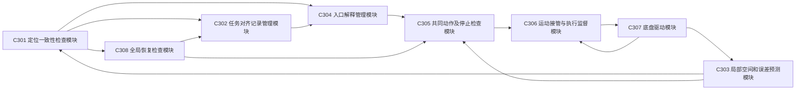
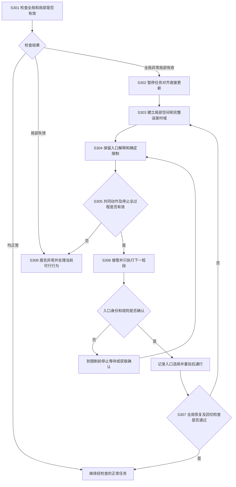

# 专利交底书 C：一种定位异常时保留候选入口并在确认前限制运动的移动平台导航接管方法

> 撰写依据：[专利交底书模板及注意事项](../template.md)。重写日期：2026-10-19。
> 建议类型：发明专利；以导航控制方法和系统为交底对象，电子设备及存储介质形式由代理人据实整理。
> 本文是设计草案，未完成本方案仿真、实机或统计验证；示例参数只用于解释，不代表实际产品能力。
> 发明人、申请人、实际研发形成日期和已公开情况：待根据真实记录填写。
> 历史材料：[原交底书](03_patent_c_local_frame_route_handover_disclosure_20261015.md)、[通俗技术详解](03_patent_c_sources_and_technical_principles_20261015.md)。本文独立描述，不要求先理解历史材料中的“共同前缀”和“动作承诺边界”。

## 一、本发明解决的技术问题是：

### 1.1 现有技术的缺点及产生原因

已有导航系统使用地图定位、局部避障和不确定性限速，使机器人在存在定位误差时执行任务。但在地图定位异常或相似入口无法区分的场景，对于未联合处理任务身份和停止条件的实现，仍存在以下问题：

1. **定位修正可能引起不合理的瞬态转向。** 原因是机器人实际位置没有突然变化，控制器却直接采用修正后的地图位置换算任务路线，导致参考位置与朝向突变。仅在输出端平滑，也不能保证中间路线始终避开障碍。
2. **几何可通过的入口可能并非正确或允许进入的入口。** 原因是局部避障只确认门口没有障碍，没有把不同位置解释对应的房间身份、任务连接和通行权限共同作为动作条件；只选最高分解释也不能排除相似场景误匹配。
3. **当前空间足够停车，仍可能无法覆盖实际停止全过程。** 原因是只按当前误差和距离判断，未预测局部运动误差、观测时效和动态障碍范围是否能持续覆盖切换、制动及要求的等待时间。

这些不足针对第二部分现有技术在缺少上述联合约束时的实现，不表示所有多假设导航方法都只选最高分位置或忽略安全性。

### 1.2 本发明的目的及要解决的技术问题

本发明的目的，是在地图定位不可信、但局部运动和感知仍有效时，保持底盘参考的可实现性，并在入口身份确认前保留各仍合理解释下的合法任务选项。

具体要解决的技术问题是：**如何把尚未排除的位置及入口解释转换为实际运动限制，并结合停止能力和局部信息有效时间，确定当前可以执行的动作及必须开始停车的时刻，避免定位异常直接引发急转或过早进入错误入口。**

### 1.3 针对上述缺点能够达到的技术效果

| 对应缺点 | 本发明的技术处理及其作用 | 对应技术效果 |
| --- | --- | --- |
| 第 1 项：参考突变或平滑后仍不可行 | 暂停全局修正对任务对齐记录的直接更新，在连续局部坐标下从实际状态检查接管和回切 | 阻止未经运动及空间检查的地图修正直接成为底盘控制参考 |
| 第 2 项：入口可通过但身份或权限不明 | 将各解释对应到同一真实入口，只允许共同合法动作，确认前不越过选择限制或等待线 | 排除仅凭几何空闲或最高分定位就提前进入尚未确认入口的动作 |
| 第 3 项：停车过程超出局部条件有效期 | 联合检查停止距离、全过程误差和局部可用时间，并将所需保持时段计入 | 拒绝空间足够但时间依据不足的候选，提前触发仍在有效范围内的停止 |

这些效果以候选解释、规则、局部误差及驱动能力覆盖实际情况为条件，不表示一定能够最终识别入口或在感知全部失效时继续导航。尚无本案定量性能结果。

## 二、详细介绍技术背景，并描述已有的与本发明最相近似的实现方案。

### 2.1 背景与统一用语

移动机器人通常同时使用全局地图和局部运动估计。全局地图用于说明“目标在哪里、各处如何连接”，局部运动估计和感知用于判断“机身现在如何移动、眼前能走哪里”。

同类系统通常由地图及任务存储、全局定位器、局部运动估计器、障碍感知、路径规划器、运动控制器和底盘组成。定位器把传感观测与地图匹配得到地图位置；任务规划器据此选择路线；局部规划器根据实时障碍调整运动；控制器跟踪局部路线。对于重复门口或相似走廊，同一观测可能与多个地图位置相符，因而还需要位置解释的维护和选择机制。

| 本文统一用语 | 通俗解释及与历史材料的对应 |
| --- | --- |
| 地图定位 | 相对整个地图的位置和朝向，可能经校正突然改变 |
| 局部运动估计 | 基于轮速、惯性、视觉或激光得到的连续位置和朝向估计，误差可能逐渐累计 |
| 任务对齐记录 | 专门供任务路线使用的地图到局部坐标换算关系；历史材料称“任务对齐副本” |
| 入口解释 | 一种尚有依据的位置、眼前门口身份和任务连接关系；历史材料称“出口假设” |
| 入口 | 门口、工位入口、道路分叉等任务选择点，不限于进入建筑物的门 |
| 共同允许动作 | 在每种仍合理解释下都不违规且保留相应合法任务选项的动作；历史材料称“共同前缀” |
| 选择限制边界 | 超过后会排除其他合理任务选项或违反某种解释下规则的位置/状态限制；历史材料称“动作承诺边界” |
| 等待线 | 无法可靠算出选择限制边界时，设在歧义入口前的保守停止限制 |
| 局部可用时间 | 眼前空间、动态障碍及误差判断还能支持计算结论多久，不是任意设置的超时数 |
| 入口选择记录 | 已依据证据选定哪个入口、依据及有效条件；历史材料称“提交记录”，不是代码提交 |
| 接管、回切 | 改用受限局部导航；全局恢复后重新使用经过检查的地图任务参考 |

“共同允许”不是将两条路线坐标平均，也不要求不同地图中的节点编号相同。“停下等待”也必须符合障碍、底盘能力和要求的保持时段，不能当成无条件可行动作。

### 2.2 坐标分离是已有规范

REP-105 [C-R1] 规定：`odom` 是局部里程计坐标系，机器人在其中的位置应连续，但漂移可以不断增长；`map` 是地图坐标系，定位可校正漂移，但允许位置跳变；`base_link` 固定在机身上。规范还规定了各坐标变换由哪个模块发布以及地图切换关系。

因此，仅使用地图与局部两套坐标、地图跳变时改用局部参考，不足以构成本案创新。连续局部坐标也不自动等于误差有界，本案必须另检查局部观测和误差在整个动作时段内是否有效。

### 2.3 主要对比方案：多位置解释动作规划的结构及工作原理

Agarwal、Tamjidi、Chakravorty 的 *Motion Planning for Global Localization in Non-Gaussian Belief Spaces* [C-R2] 针对相似门口等导致的位置多解，用多个高斯分量表示不同位置解释，规划能取得不同观测的动作，并随新观测逐步排除解释。

其第四部分 B 为不同解释生成候选控制、预测各解释下的观测与运动，并根据预期信息增益和碰撞代价选控制。该工作说明：保留多种解释、考虑同一动作在不同解释下的后果、主动获取信息，都不是本案首创。

该方案由多位置状态估计、候选控制生成、各解释下的运动与观测预测、控制评价选择和执行反馈等环节组成。其处理过程为：

1. 保存多个可能位置及相应权重，表示当前不能唯一确定位置。
2. 为不同位置解释选择有助于区分观测的目标，并生成通向目标的候选控制。
3. 将同一候选作用于各位置解释，预测观测变化及运动后果，计算信息增益并加入碰撞代价。
4. 选取评价较优的候选执行，利用新观测更新解释，再重复规划。

**针对本案问题的不足**：上述候选评价解决的是如何通过运动减少位置歧义；仅有信息增益及碰撞代价，并不能直接表达“每种仍合理解释下均不提前进入未经确认的入口”，也不能单独证明局部误差和观测条件覆盖整个切换、停车及等待过程。若将该评价结果直接用于任务入口通行，还需要把入口身份、规则和全过程停止条件作为实际动作限制。这里区分的是评价目标与本案控制条件，不断言该论文没有其他保守处理。

### 2.4 接近的地图适应和导航约束专利

- **US9612123B1 [C-R3]**：将多源观测对齐到地图，检测环境变化，更新地图并控制车辆；权利要求 3～5、16 涉及局部与存储地图差异、远程协助、混合地图及更新。说明地图差异检测、使用局部信息和请求协助均已有基础。
- **US12594960B2 [C-R4]**：在导航不确定时，依据置信信息设置横向和纵向限制，补入遮挡虚拟对象，并限制速度和横向偏移；相关从属项涉及优先减速。因此，“定位不确定就限速或少偏移”不能作为本案宽泛区别。
- **US11407409B2 [C-R5]**：轨迹时效、与当前状态的一致性、可执行性及备选轨迹检查已有公开，接管前重验不单独构成创新。

### 2.5 现有方案针对本发明技术问题的不足归纳

| 已有处理方式 | 针对本案场景仍需处理的关系 | 未处理时的不足 |
| --- | --- | --- |
| 地图与局部坐标分开管理 | 全局修正如何进入任务参考，接管及恢复过程如何检查 | 坐标系统分开并不自动阻止任务参考突变或中间路线穿障碍 |
| 保留多位置解释并选择获取信息的动作 | 每种解释对应的入口身份、任务选项和规则如何约束实际动作 | 评价较优或几何可通过不等于可以进入尚未确认的入口 |
| 不确定时设置横纵限制或减速 | 限制是否保证在选择之前停下，并覆盖局部误差及信息的整个有效时段 | 减速幅度可能仍不足以保留停止空间或可靠时间 |

因此，本发明在上述基础上，联合任务入口限制、局部物理空间及全过程停止条件，按短段批准接管和恢复动作。进一步检索及授权判断事项见第七部分。

## 三、本发明技术方案的详细阐述（核心的重点内容）：

### 3.1 最小实施对象及输入输出

选取单楼层、低速差速地面机器人，具备激光或深度感知、连续局部运动估计、地图定位和带入口身份及权限的任务连接图。任务连接图用节点表示走廊、房间或工位，用边表示允许通行关系。

输入包括：

1. 原始地图定位结果及其候选位置、观测匹配信息。
2. 局部位置、速度、误差范围及坐标版本。
3. 眼前障碍、门口、通道及其采集时间。
4. 剩余任务、入口身份及允许通行规则。
5. 驱动器实际状态、未完成指令及可实现制动和转向能力。

输出为下一段经检查的局部动作、停止/等待动作、入口确认请求或经检查的全局恢复动作。本文不要求重新发明定位器或语义识别器，但必须取得其质量、错误关联及适用范围信息。

### 3.2 图 1：结构组成及连接

| 标号及名称 | 实现内容和作用 |
| --- | --- |
| C301 定位一致性检查模块 | 比较地图与局部运动增量、实测几何和入口身份，区分全局异常与局部也失效 |
| C302 任务对齐记录管理模块 | 保存任务专用坐标换算及版本；异常时暂停直接更新，不修改原始定位发布 |
| C303 局部空间和误差预测模块 | 将时间对齐后的局部观测构造成允许通过的空间，并预测误差和动态障碍在未来的适用时间 |
| C304 入口解释管理模块 | 维护各位置解释到真实门口、任务节点和权限的对应，保存支持与反驳依据 |
| C305 共同动作及停止检查模块 | 找出各解释都允许的动作，检查选择限制边界、等待线、停车距离及全过程时间条件 |
| C306 运动接管与执行监督模块 | 从实际驱动状态规划连续可实现的动作，只批准下一小段，持续检查版本、时间和实际反馈 |
| C307 底盘驱动模块 | 执行左右轮等实际驱动控制，提供输入与执行反馈，并保留独立安全保护 |
| C308 全局恢复检查模块 | 核对定位恢复、入口身份及中间路线可行性，提出分步任务对齐更新并在检查通过后采用 |

### 3.3 图 2：主流程与失败分支

以上 S301～S308 对应下文步骤。正常路径也需保留已有避障与执行检查，图中不展开与本案无关的常规导航流程。

### 3.4 S301：同时检查运动、空间和身份

规定 $T_{AB}$ 表示把 B 坐标中的同一物理量换算到 A 坐标。地图、局部里程计、机身坐标分别记作 $M,O,B$：

$$
T_{MB}=T_{MO}T_{OB},\qquad T_{OM}=T_{MO}^{-1}.
$$

这些变换只改变坐标记法，不让机器人实际移动。`map`、`odom`、`base_link` 分别对应上述三种坐标。

将两种定位对齐到相同的相邻时刻，比较运动增量：

$$
\Delta T_M=T_{MB,k-1}^{-1}T_{MB,k},\quad
\Delta T_O=T_{OB,k-1}^{-1}T_{OB,k},\quad
r_\Delta=\operatorname{Log}(\Delta T_M^{-1}\Delta T_O).
$$

$k$ 是采样序号；$\operatorname{Log}$ 将刚体运动差异转换为平移和转角分量，不是直接取普通数字对数。对平移误差用 m 界、转角误差用 rad 界分别判定，或使用已校准的统计检验，不把两种单位无说明相加。

只看运动一致性还不够。持续比较实时墙面、门框、标识和通行连接与各位置解释能否相符。全局位置虽然平滑，但眼前房号与任务节点不符，也属于任务关联异常。

局部轮速打滑、观测缺失、里程计重置或误差增长也单独检查。局部条件无法限定时转 S308，不能把所有异常都归为“全局不可信但局部一定可靠”。

### 3.5 S302：暂停的是任务坐标换算更新，不是冻结机器人

C302 保存内部任务对齐记录 $\bar T_{OM}^{\rm task}$。地图目标点 $p_M$ 通过 $p_O=\bar T_{OM}^{\rm task}p_M$ 转成任务局部参考，并附对齐版本。

异常时暂停新地图修正对该内部记录的直接改写。机器人局部状态 $T_{OB}$ 仍更新，原始定位结果也保留用于诊断和恢复。负责定位的模块继续发布原始 `map -> odom`，负责里程计的模块发布 `odom -> base_link`；同一坐标关系不增加第二个发布者。

局部实时障碍按采集时间对齐到 $O$，不跟着任务参考的平滑或冻结移动。旧对齐产生的任务点不能与新对齐投影的地图障碍无版本核对地混用；失配地图中的障碍若仍使用，须说明其坐标及误差依据，否则作为未知条件处理。

### 3.6 S303：计算真实可通行空间和它能使用多久

由局部激光/深度观测生成空闲区、障碍区与未观测区。未观测区不直接视为空闲；移动障碍使用随时间变化的可能占用范围。

把机身、载荷、朝向及相对位置误差加入碰撞计算，得到每一未来时刻允许的位置和朝向范围，记为 $\mathcal C(t)$。它是有宽度和方向条件的可通行区域，不是一条中心线。

误差取机器人相对障碍和边界的误差。二者共享同一里程计或地图误差时不能无依据当成独立。经共同坐标线性化后，可用：

$$
\Sigma_{\rm rel}=\Sigma_{\rm obs}+\Sigma_{\rm robot}
-\Sigma_{\rm obs,robot}-\Sigma_{\rm robot,obs}.
$$

$\Sigma$ 是描述误差大小及关联的协方差矩阵，不是以米表示的确定最坏距离。交叉相关项未知时，不人为设成有利抵消；可直接使用经校准的位置误差集合，按所有允许相对偏移检查。

预测从现在直到动作结束并按要求等待期间的误差增长。局部可用时间取传感时效、障碍预测覆盖、坐标版本、误差界、动力模型和任务条件等各项有效期所允许的共同时间段。不是简单把历史一次“运行 5 秒没出问题”设为通用上界。

### 3.7 S304：保留入口解释并对应到同一个真实门口

每个入口解释至少保存：

| 内容 | 具体用途 |
| --- | --- |
| 解释编号、位置及方向范围 | 说明机器人可能对应地图上的哪里 |
| 任务节点、候选入口及连接 | 说明在该位置解释下，应选择哪个门口或后续通道 |
| 真实观测入口对应 | 使不同地图编号指向同一眼前门框或通道，而不是仅比较编号字符串 |
| 权限及运行规则 | 是否允许进入、单向通行、能否倒退或回转、规则来源与版本 |
| 支持与反驳依据 | 门牌、几何、时序、定位匹配等，注明质量和相关性 |
| 可退回条件、有效期及版本 | 判断当前动作是否仍保留合法后续选项，并在变化时撤销旧判断 |

用位置范围、观测误差和入口几何筛选可能对应关系；身份不能确定时保留多种解释，必要时增加“地图或入口未知”分支。只有依据经验证的不相容条件，才排除某解释；分数低或重复出现多帧本身不等于已排除。

候选数超过预算时，合并为覆盖被省略解释的保守未知分支，限制在确认过的等待区，不仅保留最高分继续进门。

**主实施例中的有限计算方法：**

1. 对每种解释，从任务连接图列出目前仍合法的后续入口或等待节点；无法确认的连接保持未知，不填成可通行。
2. 将入口区域与眼前物理门框/通道对应，在局部空间标出各解释下不能提前进入的区域。
3. 对所有解释共同保留的当前走廊段，取一个可以停车等待的区域。
4. 如未证明进入某一歧义门口后仍能合法、安全地退回，直接把该门口之前的线作为保守等待线。这种方法无需先求完整的全局可恢复集合。

对普通岔路，若已验证在当前空间、时间、动力和规则下可安全退回，则可以进一步计算较宽的共同动作范围；没有该依据时不假设能够回退。门禁权限已经违反后，即使物理上能倒车，也不能说选项一直被保留。

### 3.8 S305：求共同动作并同时检查空间和时间

为每种解释 $H_i$ 定义允许的候选动作集合 $\mathcal A_i$：动作在实际局部空间中可执行，不违反该解释下规则，并保留在限定运行条件内的合法后续任务或等待选项。下一动作从交集 $\bigcap_i\mathcal A_i$ 中选择。

在主实施例中，不需要对无限种动作抽象求交。可枚举现有局部规划器给出的有限候选，例如沿当前走廊直行若干控制周期、减速或停车；对每个候选逐一检查：

1. 在每种解释下，它都没有提前进入不允许或尚待确认的入口。
2. 根据当前速度、转动速度、未完成驱动输入和输入变化限制，候选能够实现。
3. 候选后仍可在等待线或选择限制边界前停止，并在要求的时间内保持。
4. 上述全过程的机身、载荷及误差范围均处于 $\mathcal C(t)$ 内。
5. 每种解释仍有已确认的合法后续动作或等待状态；无法证明时不扩大候选范围。

若交集中没有继续通行候选，可选择经检查的停止；若停止也无法确认，转 S308。任务需要获取更多信息时，转动观察等动作也必须经过相同检查，不能因为叫“主动定位”就绕过边界。

对水平直行、切换前不加速的必要筛查，使用：

$$
v\tau+\frac{v^2}{2b}+e_\parallel+m_d\le d_c.
$$

$v$ 为速度（m/s），$\tau$ 为决定后旧输入退出及制动建立时间（s），$b>0$ 为保证减速度（m/s²），$e_\parallel$ 为整个停止过程最大纵向相对误差界（m），$m_d$ 为附加余量（m），$d_c$ 为机身前沿到限制的沿路线净距离（m）。机身尺寸已经体现在净距离时，不再重复扣除。

当 $d_c-e_\parallel-m_d\ge0$ 时，可倒推必要速度上限：

$$
v_{\max}=-b\tau+\sqrt{(b\tau)^2+2b(d_c-e_\parallel-m_d)}.
$$

净距离不足、转弯、坡道、旧输入仍在加速或制动变化较慢时，用实际平台动态预测替代该简式；这一项通过不代表整体可行。

若从现在还计划继续执行 $T_{\rm continue}$，局部可用时间还须满足：

$$
T_{\rm local}\ge
T_{\rm continue}+T_{\rm switch}+T_{\rm stop}+T_{\rm hold}.
$$

四个右侧项依次为继续当前候选、切换生效、制动和要求等待的时间。误差及障碍范围覆盖相同时段；不能空间上能停住，就忽略停止前局部条件可能失效。

### 3.9 S306：从真实执行状态接管，按短段批准

将无法取消的已下发指令纳入预测，求新控制生效状态范围。差速底盘使用状态 $[p_x,p_y,\psi,v,\omega]$，同时限制左右轮速度、加速度、力矩及机身旋转空间；转弯不能只检查中心点。

已有局部优化器可生成候选，但初态采用真实范围，不用理想路线起点。控制变化限制放在规划和检查内部，不先输出突变参考再靠末端滤波宣称可行。

形成一次动作批准，至少绑定：局部坐标及任务对齐版本、入口解释及规则版本、局部空间/误差条件、驱动批次与允许进度、生效状态、等待线或边界、轨迹、停止及保持要求、最迟决定时刻。

每个控制周期仅执行下一小段。若下一周期继续将无法满足空间或时间余量，现在就启动已验证停止，而不是等到超过边界才制动。实际反馈、版本或局部条件不符时取消追加批准，转 S308 处理。

**入口身份的确认与动作批准分开：** 门牌、可靠几何关联、恢复的全局匹配或授权人员更新任务等新依据，可用来选定入口；但还须核对来源、权限、时效和与其他解释的冲突。不能仅凭定位分数变高或同一误匹配重复多次进门。

入口选择记录保存选择的真实入口、任务节点、证据、解释/规则版本和有效期。越界前出现反证时取消选择并重查停止；越界后按真实当前位置重新规划和报告事件，不能用危险倒车“撤销历史”。

### 3.10 S307：全局恢复后分步更新，而不是混合两条路线

恢复要求地图定位、局部运动、实时几何及入口身份在经标定的观测窗口内一致。窗口时长不是必然正确的证明，相关重复误匹配不能当成独立证据。

对任务对齐记录，可生成下一个候选：

$$
\bar T_{OM}^{k+1}=\bar T_{OM}^{k}
\operatorname{Exp}\!\left[
\operatorname{clip}_{\mathcal V\Delta t}
\operatorname{Log}\!\left((\bar T_{OM}^{k})^{-1}T_{OM}^{\rm raw}\right)
\right].
$$

raw 表示原始定位目标关系，$\Delta t$ 为更新周期，$\mathcal V$ 分别限制平移和转角变化率。读法是“算当前差多少—限制这一步修正多少—更新内部任务对齐”。平移用 m、转角用 rad，不混成一个无单位限幅。

该式只提出候选参考，C305 和 C306 仍检查中间路线、当前障碍、任务入口及驱动可执行性，通过后才采用。不移动真实局部障碍，不覆盖原始坐标变换，也不将两条可能绕过障碍两侧的路线做坐标平均。

中间或最终参考穿过新围栏时，暂停回切，保留当前仍可执行的局部停止或另行规划。不能因为最后对齐位置正确，就默认中间更新都安全。

### 3.11 S308：失败分支及恢复条件

| 事件 | 处理及边界 |
| --- | --- |
| 仅新全局参考不可信，局部条件仍有效 | 在共同允许范围内短段执行或停车等待，不直接采用失配参考 |
| 各解释无共同继续动作 | 使用已验证停止并请求确认；停止也不成立则报告无可行解 |
| 局部误差将于停车前越界 | 应提前减速；已来不及则标记原保证丢失并减风险，不能补发“安全停车”标签 |
| 动态行人进入共同空间 | 重新检查实际空间和停车控制；任务解释共同允许不覆盖碰撞风险 |
| 坐标重置、换地图、跨楼层 | 变更环境及坐标版本，重新建立观测、入口和任务对应，不拼接为同一空间 |
| 全局反复正常/异常 | 保留经标定的恢复条件及切换限制，必要时停止并请求人工处理 |
| 入口已选定但新增可靠反证 | 越界前撤销；越界后遵守当前规则选可行恢复并记录任务或权限事件 |

电梯内观测连续不能证明原楼层地图仍适用。移动地板、自动呼梯或无人机三维控制不由本稿的一层地面模型覆盖。

### 3.12 实施例一：医院相似门口，物理可进不等于任务可进

机器人要配送至 301 病房。眼前门口 D 有两种尚未排除的解释：

- H1：D 是 301 病房门，任务允许进入。
- H2：D 是未经授权不得进入的药品库门，301 病房尚在其他位置。

实时激光在两种解释下都只显示门口空闲，不能区分身份。系统将 D 对应为同一个物理门框，在门外走廊设等待线。两种解释都允许在走廊内减速等待，却只有一种允许进门，因此不批准进门。

假设机身宽 0.60 m，走廊宽 1.40 m；门外到限制净距离 1.20 m。速度 0.80 m/s，保证减速度 0.60 m/s²，切换时延 0.20 s，纵向误差与附加余量共 0.25 m；横向误差及附加余量各 0.10 m。

$$
d_{\rm need}=0.80\times0.20+
\frac{0.80^2}{2\times0.60}+0.25=0.94333\ {\rm m}.
$$

每侧横向余量为 $(1.40-0.60)/2-0.10-0.10=0.20$ m。直行距离和宽度必要检查通过，但仍不能进门，因为身份尚未确认。

| 立即决定停车后的时间 | 动作和距离 |
| --- | --- |
| 0.20 s | 最坏开始减速，已前进 0.16 m |
| 1.53333 s | 完成停车，制动又前进 0.53333 m，累计 0.69333 m，加误差余量为 0.94333 m |

若局部可用时间为 1.40 s，连停车结束都覆盖不到，原条件不成立；应在更早时刻减速。若要求停住后等待 2 s，局部、障碍和误差依据还须至少覆盖 3.53333 s；不足时需规划更早且具备有效保持条件的停车位置，不能把等待段漏掉。

这些时间和距离是恒速等待、恒定减速度假设下的算例，不是完整控制器验证结果。

### 3.13 实施例二：回切路线数值平滑但穿过围栏

机器人在局部坐标内已停在施工围栏前。全局定位恢复，但旧地图路线位于围栏另一侧。C308 即使每步只修正很小距离，C305 仍发现某一步任务参考不在当前可通行空间中，因此不采用该步，维持已验证停止或重新规划。

该例区分“修正连续”和“中间动作可执行”，不能仅以转向曲线平滑作为验收。

### 3.14 部署及平台替换

可以在已有定位器和局部规划器之间增加 C301、C302、C304、C308，在驱动入口前增加 C305、C306。无需修改定位算法内部，也不要求语言模型直接控制底盘。

首版使用单楼层任务图、人工核验入口身份、经标定的局部误差范围及有限候选动作，先验证门外停止，再测试接管和恢复。车辆改用含转角、制动响应和侧偏适用条件的模型；全向、足式或飞行平台须分别加入实际力学和结束状态条件，不通过更换坐标名称就获得支持。

## 四、本发明的关键点和欲保护点是：

按重要性排序：

1. **入口解释转换为共同允许的物理动作限制**：把不同地图位置解释对应到同一实时入口，结合任务连接和规则，限制尚未可靠确认前可以执行的动作，不以几何可通行代替任务可进入。
2. **选择限制与完整停止时域共同约束下一动作**：根据仍合理解释下的合法选项确定限制或保守等待线，同时检查停止空间、未来误差、局部可用时间和要求保持时段，决定下一获准短段。
3. **任务对齐隔离及实际驱动接管关联**：异常时暂停原始全局修正对内部任务对齐的直接作用，但持续使用真实局部运动和障碍；从实际生效状态检查可实现接管。
4. **入口选择与恢复的反证处理**：入口选择绑定身份依据及版本；越界前出现反证则撤销；回切候选经过空间、身份和执行器检查后才采用。

坐标分离、多位置解释、主动消歧、不确定时限速和轨迹平滑不单独作为创新点。回切可由代理人根据检索结果考虑列为从属步骤，不为扩大范围删去主流程必要的停止与任务限制关系。

## 五、与第二部分所属的最好的现有技术相比，本发明的优点：

以第二部分的多位置解释动作规划 [C-R2] 为主要对比，并结合导航不确定性约束方案 [C-R4]，本发明具有以下优点：

1. **入口动作同时满足空间和任务条件。** 把每种仍合理解释下的入口身份和规则设为动作允许条件，因此不会仅凭空闲门口、较高定位分数或信息收益批准进门。
2. **停车判断覆盖距离和可靠时间。** 同时检查边界前停止能力、未来误差及局部可用时间，因此能排除“距离够但停车完成前判断依据已失效”的动作；要求等待时也计入保持时间。
3. **接管和恢复均检查实际运动过程。** 任务对齐更新先生成候选，再从真实状态检查空间和执行器限制，因此地图修正不会未经检查直接成为底盘参考，平滑但穿过围栏的中间路线也会被拒绝。

上述优点以第三部分的解释覆盖、规则、误差和驱动条件成立为前提，属于技术推理而非实测统计；保守限制可能增加等待次数。

## 六、针对第三部分中的技术方案，是否还有别的替代方案？

1. **定位和入口信息替代**：可用激光、视觉、惯性、卫星定位或人工确认来源。各来源仍需质量和适用条件，不能用未经校准的识别分数直接证明门口身份或权限。
2. **解释表示替代**：可用多个位置区间、多个高斯分量、粒子集合或有限任务状态集合。合并和裁剪须保留其最不利规则及未知风险，不能只保留平均位置。
3. **共同动作计算替代**：可用第三部分有限候选逐一检查，也可在有限任务图上建立分支树求共同控制段。不同图编号须先对应到真实空间，不仅求编号字符串公共部分。
4. **限制边界替代**：可由单向门禁、通道宽度和退回动态计算，也可在首个歧义入口前设置保守等待线。后者更容易实施但可能更早停车；不能把保守等待线说成精确最优边界。
5. **误差表示替代**：可用已校准集合界，或在明确分布和风险条件下用统计模型。协方差不是确定边界，统计覆盖需说明跨时刻风险，相关性不明时不能有利抵消。
6. **恢复更新替代**：机器人停稳后可直接提出新的任务对齐候选，再完整重新规划检查；不必始终使用渐进更新公式。直接采用也不能跳过中间执行过程的可实现性或任务身份核验。
7. **停止之外的获取信息动作**：在共同允许空间内转头、旋转或移动至可辨识标识处，可替代被动等待；仍检查旋转载荷、权限、未来停止与完整时间条件。
8. **平台替代**：汽车式转向、全向底盘或足式平台可复用解释及任务管理，但运动预测、制动、接触和结束条件分别重建。三维飞行不是本稿地面停止算式的直接替代。

仅选择最高分位置继续通行、对两条路线直接坐标平均或仅做输出低通滤波，是可比较的简化方法，不视为与本方案有相同约束效果。

## 七、其他有助于专利代理人理解本技术的资料：

### 7.1 检索和迭代记录

检索与访问日：2026-10-19。关键词包括 `robot localization ambiguity multimodal belief planning`、`common prefix navigation`、`REP-105 map odom` 及相关专利号。

| 迭代 | 核读依据 | 对本稿的改进 |
| --- | --- | --- |
| 第一轮：核对坐标规范 | [C-R1] 坐标定义、发布分工及换地图语义 | 明确地图和里程计分离不是创新；暂停任务参考更新不覆盖原始坐标发布 |
| 第二轮：追查多解释导航早期工作 | [C-R2] 摘要、第四部分 B、候选控制及碰撞代价处理 | 不再把多假设或主动消歧当作新机制；补充有限候选共同检查的实际实现 |
| 第三轮：逐件核对专利原文 | [C-R3] 权利要求 1、3～5、16；[C-R4] 权利要求 1、7、12～20；[C-R5] 状态及可执行性检查 | 将“地图变化”和“不确定就减速”列为已有技术；收窄到入口规则、停止全过程与局部时间的联合控制 |
| 第四轮：按反例复核 | 相似病房/药品库、局部时间不足、恢复穿围栏 | 分清物理可行与任务正确、当前可停与全过程有效、参考连续与真实动作可行 |

部分搜索自动摘要将两件专利误配成“多假设定位”标题，没有采纳；本稿按对应专利号的原文题名、实际权利要求纠正。没有把通用搜索解释当作本案新颖性证据。

### 7.2 可独立查找的来源及阅读层级

| 编号 | 书目及公开链接 | 本轮读取范围与限制 |
| --- | --- | --- |
| C-R1 | Wim Meeussen. *REP-105: Coordinate Frames for Mobile Platforms*. [官方规范](https://www.ros.org/reps/rep-0105.html)，创建于 2010-10-27 | 核读坐标定义、变换发布分工及跨地图部分；网页动态内容未固定提交；规范不提供本案误差或控制保证 |
| C-R2 | Saurav Agarwal, Amirhossein Tamjidi, Suman Chakravorty. *Motion Planning for Global Localization in Non-Gaussian Belief Spaces*. [arXiv:1511.04634](https://arxiv.org/abs/1511.04634)，首稿 2015-11-14，v2 2016-02-27 | [正文](https://arxiv.org/html/1511.04634)，重点第四部分 B 候选策略、各模式下预测、信息增益及碰撞代价；其物理机器人结果不是本案验证 |
| C-R3 | *Adaptive mapping to navigate autonomous vehicles responsive to physical environment changes*. [US9612123B1](https://patents.google.com/patent/US9612123B1/en)，授权公告日 2017-04-04，页面所列申请/优先权日 2015-11-04 | 核对书目、权利要求 1、3～5、16 及相关说明；不将 B1 日期等同于全部同族最早公开日期 |
| C-R4 | *Navigational constraint control system*. [US12594960B2](https://patents.google.com/patent/US12594960B2/en)，授权公告日 2026-04-07；同申请公开文本 US20240149912A1，2024-05-09 | 核对书目及最终权利要求 1、7、12～20；涉及虚拟遮挡对象和横纵限制，不误写成专门多模态定位专利 |
| C-R5 | *System and method for trajectory validation*. [US11407409B2](https://patents.google.com/patent/US11407409B2/en)，授权公告日 2022-08-09 | 核对最终权利要求 1～5、6～10 及相关说明；不据此认定本案可自由实施 |

官方规范源文本入口本轮不可访问，已改用可访问的官方规范网页核读，没有把失败入口记为已读。专利核对依据公开文本，法律状态、完整同族和审查意见仍需官方档案。

### 7.3 对照试验和验收

| 故障或反例 | 必须观察的行为 | 记录指标 |
| --- | --- | --- |
| 全局位置突然跳变，物理机身未跳 | 原始定位仍保留，任务参考不直接跳变，接管满足底盘变化限制 | 参考/实际轨迹、轮速、转速、加速度和最小间距 |
| 位置信息平滑但门口身份错误 | 保留未排除解释，不仅因几何可通过而进门 | 错误入口选择、权限越界、解释保留及排除依据 |
| 当前空间够，但局部时间不足 | 在条件仍有效时提前停止，不等待误差已经越界 | 触发时刻、预计与实际停车结束时刻、误差覆盖 |
| 普通岔路可安全退回 | 不把所有岔路一律认定物理不可逆，保守实现的额外停车如实统计 | 可回退条件、过度停止和任务完成情况 |
| 新反证发生在入口选择前后 | 越界前取消；越界后按真实状态处理并保留事件 | 选择、反证、撤销和越界时间线 |
| 全局恢复但中间路线有围栏 | 拒绝穿障碍的中间参考，不仅检查最终对齐 | 中间候选、拒绝原因、障碍距离 |
| 局部坐标重置或楼层变化 | 旧动作和入口对应不能直接跨版本复用 | 坐标/环境版本和重新确认记录 |

对照直接追踪全局参考、只做位置低通、只选最高分解释、无完整局部时间检查、本方案。在相同感知、误差、规则、动态模型和计算预算下，分别统计碰撞、任务错误、权限越界、不可行、超时及保守停车，不能仅看位置误差或平均速度。

验证先从离线回放和人造定位异常开始，再做闭环仿真及封闭场地低速测试；使用软障碍和独立接管条件，不在真实患者通行区域直接测试未标定控制器。

### 7.4 申请前需补齐的资料及当前结论

- 任务图、入口身份和规则的真实来源及更新机制，歧义候选的构建和排除记录。
- 局部运动、障碍误差随时间增长的标定及相关性处理依据，制动和驱动反馈记录。
- 实际接管与恢复原型、相似门口及施工围栏反例，成功和失败的完整时间线。
- 发明人贡献、形成与公开时间、数据和软件权属资料。
- 由代理人继续检索信念空间任务规划、多假设容错导航、停止可达性和入口权限耦合的最接近论文与专利，完成官方权利要求比对。

当前结论：本文使代理人能按步骤理解并讨论方案，但尚未证明“共同动作＋停止时域＋任务入口限制”满足授权要求，也不作自由实施或法律状态结论。
