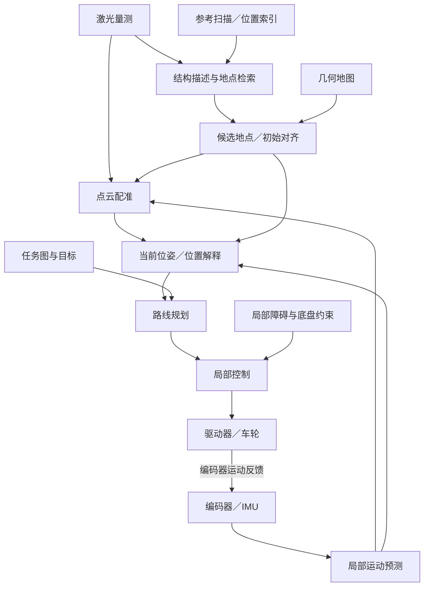
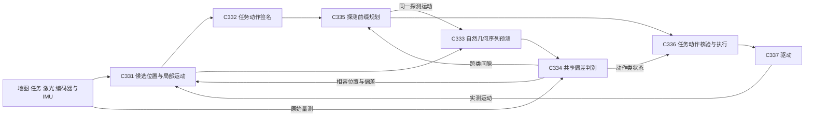
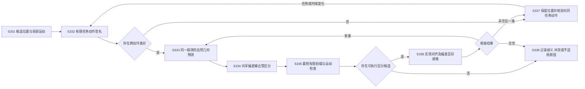

# 专利交底书 C：重复通道中基于任务动作签名与共享偏差序列判别的机器人主动定位方法及系统

> 重写日期：2026-11-05。本文全部按当前方案编写。
> 撰写要求依据：用户提供的[发明、实用新型技术交底书模板](</media/xiefangyu/文档/xie.fangyu/documents/专利/发明、实用新型技术交底书模板.doc>)；七部分正文结构同时参照仓库[专利交底书模板](../template.md)。第二部分独立说明现有结构、原理、工作过程及相关不足，不以文献列表替代技术背景。
> 建议类型：发明专利；交底对象为主动定位方法及系统，可据实整理电子设备、计算机可读存储介质权利要求。
> 主场景：有有效地图的地下管廊／隧道重复横通道或检修凹室；使用现有激光、编码器／惯性测量单元（IMU），不新增必需硬件。
> 配套材料：[技术详解与资料依据](03_patent_c_sources_and_technical_principles_20261015.md)、[说明书草案](03_patent_c_specification_20261105.md)、[离线算法复算程序](03_patent_c_interval_sequence_demo_20261105.py)。
> 验证边界：常值标量数学内核已通过14项标准库测试，数值实施例为合成输入；真实任务图、地图射线引擎、点云接入、控制器及完整停止后缀尚未实现或验证，未进行公开数据回放及闭环实机试验。算法候选不等于整机可部署或已证明可授权。
> 发明人、申请人、实际研发形成日期、已公开情况及拟申请法域：按真实记录补齐，不以文档日期替代研发或公开日期。

## 核心摘要

机器人面对多个相似横通道时，可能不能唯一确认地图位置，但下一任务动作未必需要区分全部位置。本方案首先根据各候选位置下的有限任务动作可行向量形成“任务动作签名”，仅要求不同签名的位置被探测区分，具有相同签名的位置仍分别保留。

探测规划将同一短运动作用于各候选位置，通过地图自然结构射线预测激光量程序列；以“一段序列只有一个共享偏差”及有界样本误差构造输出管，选择跨动作类输出管首次严格分离且满足运动条件的最短已枚举前缀。实际运动后，按实测里程和时间逐样本收紧各位置的偏差相容区间。剩余位置非空且仅属一个任务动作类时，结束本次消歧，但不报告尚未确认的精确位置；后续任务动作仍须独立核验。

拟保护的是**物理任务动作分区、同一运动的自然几何预测、共享偏差序列区分、有限探测前缀选择及类内位置保留之间的闭环关系**。主动定位、任务相关压缩、序列匹配和区间交本身均已有先例。

## 一、本发明解决的技术问题是：

### 1.1 缺点及原因

在已有地图的地下重复通道中，单帧结构检索可能产生多个候选位置。平行墙面还可能造成局部配准沿通道方向退化；局部退化与全局重复位置歧义不是同一问题。本方案主要处理后者，以有效的短时局部运动估计为前提。

1. **最高分位置不能可靠决定下一任务动作。** 多个位置可能观测相似却对应不同巡检连接；最高分不排除相似结构误匹配。
2. **强求全局唯一可能导致无必要探测。** 某些位置虽然不同，却在当前岔口允许相同下一动作；为区分类内位置继续运动，不一定改善当前任务决定。
3. **逐帧独立拟合偏差会破坏序列一致性。** 每帧分别匹配时，一个错误位置可能需要不断改变偏差；短时共同物理条件实际上无法解释整段读数。
4. **单纯差分丢掉绝对误差界证据。** 差分抵消常值偏差，但整体偏移是否超出允许范围的信息也随之消失。
5. **信息得分不足以决定可执行探测。** 需要同时考虑自然结构可观测性、实际运动、采样处理时间和各前缀停止能力，而不是先选最有信息的路径再假定机器人能走。

上述问题针对具体实现缺口，并非认定所有既有主动定位或模型判别技术均存在这些不足。

### 1.2 目的及输出

在候选覆盖、有效地图、任务关联和有界误差模型成立时，寻找能够决定下一任务动作的短探测，排除与整段共享偏差不相容的位置，保留仍相容的位置及各自偏差范围。输出明确区分：

- 多个任务动作类仍相容：`ambiguous`，即仍歧义。
- 相容位置非空且只剩一个动作类：`task_resolved`，即任务动作类确定，位置仍可能不唯一。
- 全部位置不相容：`model_conflict`，即候选／地图／误差模型冲突。

无需探测、无可执行区分候选、观测未知及模型不适用由规划／监督接口另行记录，不冒充上述成功状态。

## 二、详细介绍技术背景，并描述已有的与本发明最相近似的实现方案。

本部分使用的C-R11—C-R22均在第2.8节直接列出编号、书目、公开入口及实际读取范围；编号为本文资料标识，阅读本部分不需要查阅其他配套文档。下文就近出处与第2.8节对应，论文、专利和软件资料分别注明类型，不将摘要阅读等同于全文核验。

### 2.1 应用背景与需要区分的两个问题

地下巡检机器人沿主通道行驶，在指定横通道转向或到检修位置执行任务。机器人不仅需要知道“附近有没有障碍”，还需要知道“当前横通道在任务地图中是哪一条、是否应在此转向”。重复墙面、相同间距的凹室及外形相似的岔口，会使不同地图位置产生近似量测。地下环境通常不能依赖连续卫星定位；照明、粉尘和反射还可能影响视觉或激光观测。

激光雷达测量不同方向到物体的距离，多个距离组合成点云。编码器测量车轮转动，据此估计短时行程；惯性测量单元（IMU）测量角速度和加速度，用于辅助姿态及运动估计。编码器／IMU提供的是相对运动，不是无漂移的绝对位置。

需要区分：

- **局部配准退化**：在长直通道内，沿通道前后平移可能仍与平行墙面很好重合，当前扫描对地图的校正对这一方向约束弱。
- **全局重复歧义**：即使局部短时运动估计有效，当前扫描仍可能对应地图中两个或多个不同横通道，无法确认任务节点身份。

本发明主要处理第二个问题，前提是局部运动和量测误差有适用界。不能通过任务分区解决任意打滑、完全无特征或无限周期重复结构的不可观测性。

### 2.2 同类平台的结构、数据链路及基本工作过程

#### 2.2.1 硬件与软件组成

为了说明现有技术如何工作，以下给出**已有常用组件形成的典型轮式导航结构**，不是声称某一个公开产品或某篇文献完整采用了所有组件。结构检索、配准和任务路由分别可由C-R13、C-R22／C-R11及C-R21所述技术承担；地下多传感平台实例见C-R18。

| 部分 | 结构与连接 | 所承担的作用 |
| --- | --- | --- |
| 轮式底盘 | 电机、驱动器、车轮及轮编码器；驱动器接收车载计算机的速度指令 | 执行前进／转向，反馈轮速和运动状态 |
| 传感组件 | 激光固定安装于机身，IMU与机身有已知安装关系；量测带时间戳传至计算机 | 提供附近结构、短时运动和姿态信息 |
| 车载计算机 | 保存传感器标定，运行局部估计、地图定位、规划和控制程序 | 对齐数据，估计状态，生成实际控制 |
| 地图及位置索引 | 保存几何地图或参考扫描，以及地图位置与检索描述子的对应 | 将当前结构匹配到已知地点 |
| 任务图及规划组件 | 图节点表示岔口／工位，边表示可走连接，可附加方向、速度和任务操作信息 | 从当前节点到目标求路线并决定转向或停驻 |
| 局部控制与避障 | 使用估计位姿、规划路径、附近障碍和底盘约束 | 把路线转换为速度；检查当前运动是否受障碍限制 |

**图B1 典型已有导航结构的数据关系（技术背景示意，非本发明模块图）**

图B1中，位置检索回答“可能在哪里”，配准回答“扫描在该候选附近怎样对齐”，任务图回答“从该节点到目标怎样连接”，局部控制回答“这段运动怎样执行”。这些问题相互关联但不是同一个判断。图中“当前位姿／位置解释”既可为单一输出，也可保留多候选；并非所有已有系统都强制选唯一位置。

#### 2.2.2 一次导航周期如何工作

1. 读取激光、编码器和IMU，对齐时间并补偿已知安装关系；由短时运动估计预测机器人当前状态。
2. 将当前扫描与附近地图配准；若需要全局定位或重定位，则先检索相似参考扫描，得到一个或多个候选地点及粗对齐。
3. 在候选地点附近进一步配准，结合匹配结果和运动连续性更新位置解释。某些实现向下游提供最佳位姿，另一些保留概率分布、多粒子或分支。
4. 路线规划器把位置对应到任务图节点／边，结合目标及边条件计算路线；节点到达或边切换时触发相应任务操作。
5. 局部控制器结合路线与真实附近障碍产生底盘速度，驱动器执行，下一周期用传感反馈继续更新。

这种链路能处理一般有辨识度的环境，但**局部无碰撞不等于任务节点身份正确**。例如，在两个外形相似的横通道中，局部控制都可以顺利左转；其中一个可能并非本次巡检允许进入的节点。错误任务动作的原因是位置与任务连接判断不足，不是底盘缺少左转能力。

### 2.3 最接近的地点检索、配准和被动序列方案

#### 2.3.1 Scan Context地点检索与ICP对齐

C-R13的Scan Context是一种激光点云全局描述子，地点识别包括“描述”和“搜索”。作者库明确描述两级搜索：先使用环键（用于快速检索的紧凑索引）及KD树（一种近邻检索结构）提出候选，再对候选描述子与当前描述子进行逐对距离比较；粗偏航对齐用于比较不同朝向的再次访问。

在图B1这种导航应用中，地图端预存参考扫描描述子和地点索引；机器人端生成当前描述子，检索相似项并提供候选。随后可用迭代最近点配准（ICP）或其他配准器对齐当前点云与候选地图。ICP的基本原理是反复建立点／局部结构对应关系、求使对应误差较小的位姿变换，再更新对应，直到满足收敛条件。C-R22提供模块化ICP实现，C-R11则针对可定位性不足加入方向分析和约束。

**与本技术问题相关的不足及边界：** 地点描述和几何配准优先判断结构匹配，而不是当前任务动作是否应不同。重复横通道可能给出多个相容候选；若应用只把最相似地点交给任务模块，可能把未确认身份当作已知节点。沿平行墙方向的弱几何约束还可能造成局部对齐不足。X-ICP用于应对配准可定位性问题，但局部配准处理不能直接等同于全局任务节点消歧。

这不表示Scan Context不能输出候选或与任务结合，也不表示ICP本身一定错误；本案所针对的是**尚未建立任务相关探测与序列一致性约束的上述导航应用链**。

出处：C-R13，[Scan Context作者库](https://github.com/gisbi-kim/scancontext_tro)，README的地点识别流程；C-R22，[libpointmatcher](https://github.com/norlab-ulaval/libpointmatcher)；C-R11，[X-ICP正文](https://arxiv.org/html/2211.16335)，II-B、II-C相关段。

#### 2.3.2 SeqSLAM等被动序列地点识别

C-R14的SeqSLAM利用连续局部观测匹配，而非孤立地判断每个当前观测属于哪个地点。其工作思想是把当前经过的一段观测，与参考路线中各段连续观测比较；单帧有多个相似位置时，前后观测的顺序和变化可能使整段匹配更明确。它是视觉路线识别先例，不是本案激光算法的实机验证。

序列输入需要随机器人运动逐步获得，匹配模块保存近期观测及参考序列关系，并根据序列一致性识别路线位置。这个原理解释了为什么多帧有时能优于单帧，也说明“利用观测序列定位”不是本案首创。

**与本技术问题相关的不足及边界：** 对已经走过的序列进行匹配，不能直接回答“现在应选择哪一个可执行短运动，使不同任务动作类获得区分”；完全重复的序列也可能持续歧义。在含共同物理偏差的激光应用中，还需明确跨帧误差模型，不能仅因一串单帧分数较高就认定一个位置能够解释整段。

这些是被动序列思想用于本案时需要额外解决的问题，不声称SeqSLAM采用逐帧独立偏差，也不凭摘要断言其全部实现没有任务或运动机制。

出处：C-R14，Milford、Wyeth，ICRA 2012，1643–1649，[大学存档及摘要](https://eprints.qut.edu.au/51538/)，[DOI](https://doi.org/10.1109/ICRA.2012.6224623)。目前读取到书目及摘要元数据，未核全文细节。

### 2.4 最接近的主动模型区分方案：C-R16

#### 2.4.1 组成与工作原理

《Optimal Input Design for Affine Model Discrimination with Applications in Intention-Aware Vehicles》将不同可能行为表示为有限个离散时间仿射模型。每个模型包含状态、可设计的输入、无法直接控制的输入、过程扰动及测量扰动；“仿射”指状态／输入的线性关系加常量项。初始状态和扰动有允许范围，而不是默认已知精确值。

其算法组成可理解为：**候选模型库→有限时域状态／输出预测→约束与区分条件→输入优化器→执行输入并根据量测判断模型**。这里是算法结构，不是地下机器人专用硬件结构。文中示例针对交叉口或变道中的车辆意图辨认，不直接提供本案管廊地图接口。

被动判断只等待已有输入产生可区分输出；主动方法则选择输入，使不同模型在允许不确定性下的输出不同。若两模型在某输入下仍可能产生相同量测，单凭该量测不能可靠排除其中一个；应寻找满足约束的另一个输入，使二者不再具有共同可能输出。

文中把最优区分输入设计写成双层优化，并给出混合整数线性规划（MILP）或二次目标下的混合整数二次规划（MIQP）重构方式。混合整数规划同时包含连续变量和离散选择变量，用于编码不同区分条件；其目标是在保持区分及适用状态／输入条件的同时优化输入代价。作者明确讨论了非保守最优方案相对于先前保守方案的计算复杂度代价。本案不能据有限标量内核简单宣称优于其计算或优化能力。

#### 2.4.2 与本案最接近之处及尚需核实的差异

该方案已具备有限模型、不确定变量、主动设计输入及可靠区分输出等要素，因此“同一动作在各假设下预测”“输出管不相交”不是本案独有。

将其用于本案时，需要进一步给出：地图位置如何形成自然几何预测；同一真实横通道下的任务动作如何定义；哪些位置必须互相区分；如何在任务类确定后保留类内位置；真实量测如何与共享偏差和底盘运动对齐。本案第三部分对此给出具体实现，但这些属于**本案的应用构造和区别候选**，不是已证实C-R16无法实现的功能。

本案采用经标定的短时常值标量偏差和预设有限运动库，因此能用区间端点复算，并找最早满足要求的已枚举前缀；同时牺牲了任意多参数模型和连续输入全局优化范围。两者的模型及最优性范围不同，不能把“公式更简单”本身当作创造性或性能优势。

出处：C-R16，[论文正文](https://arxiv.org/html/1702.01112)，摘要、引言主要贡献及II节模型相关段；作者Ding、Harirchi、Yong、Jacobsen、Ozay。非全文核读，相关差异仍须代理师补检完整方法、引用链及专利。

### 2.5 任务相关压缩与任务路由方案

#### 2.5.1 面向决策质量的POMDP压缩

部分可观测马尔可夫决策过程（POMDP）描述“真实状态不能直接观察，需依据动作和观测决定下一行为”的问题。一般用信念表示对各状态的可能性判断；策略依据该信息选择动作，并考虑后续收益。

C-R15研究压缩状态／信念，同时尽量不影响决策质量。其摘要指出，能准确预测策略预期未来收益的压缩不会影响决策质量，并据此研究无损线性压缩、寻找有损线性压缩的迭代程序及结构化表达。这是一种算法表达和决策评价方法，不是额外传感器或机器人底盘。

**与本案相关的限制：** 这说明“只保留影响任务决策的信息”已有成熟思想。本案有限动作可行向量只刻画同一物理岔口、同一动作库及短时域，不等价于准确保留全部未来收益，也不能替代精确工位身份。如何用真实激光和可执行运动取得足够任务证据，仍需本案的具体预测和解码构造；但不能凭摘要断言C-R15及后续研究未包含类似分区启示。

出处：C-R15，Poupart、Boutilier，NeurIPS 2002，[会议摘要](https://papers.neurips.cc/paper_files/paper/2002/hash/14ea0d5b0cf49525d1866cb1e95ada5d-Abstract.html)。未核全文推导。

#### 2.5.2 Nav2 Route Server任务图路由

C-R21使用预定义路线图，节点／有向边分别表示地点和连接，通过搜索求到目标的路线。边评分插件可增加距离、时间等代价或将边标为无效；操作插件可在到达节点、进入／离开边时触发等待、开门、调速等行为；元数据保存相应语义。输入可为节点编号或起终点位姿，输出可为节点／边路线及密集路径，运行中还可反馈进度或重规划。

这已能表达“同一个几何动作在不同任务节点有不同条件”。但是任务图动作规则与位置感知证据属于不同接口：**以某个起始位姿求得合法路线，不等于已证明该位姿是唯一真实解释**。若下游只接收一个未经排他确认的位置，路线在该地图解释下合法，仍可能在真实重复岔口执行错误任务动作。

本案利用图连接来构造多个位置的动作签名，再反向驱动探测；不是把已有边权限或节点操作当作新算法。Route Server插件可扩展，也不能认定其无法加入本案功能。

出处：C-R21，[官方README](https://api.nav2.org/nav2-rolling/html/md_nav2_route_README.html)，接口、边评分、操作插件及元数据说明。

### 2.6 地下现有平台与隧道定位方案

C-R18的CERBERUS公开数据说明展示了已有地下多传感机器人配置，包括激光、IMU、标定与轨迹资料。它说明地下自主导航及现有传感融合并非新应用本身；其足式平台运动能力不能直接转为本案轮式底盘能力，数据回放也不能验证未执行主动运动。

C-R19的US11656083B2涉及测距传感器、里程观测和导航处理。其相关权利要求利用平行墙结构判断隧道条件，在隧道中采用里程导航，并处理离开隧道后的测距导航切换。工作重点是根据环境几何选择适用导航信息源，而不是只更换一个定位器名称。本案仍需证明多个重复横通道位置与当前任务动作的关系；不能把“在隧道用编码器”或“检测平行墙”当作区别。

C-R20的CN117408289A涉及自动激光瞄准、参考点及位置标签，并结合往返误差修订得到隧道位置。其思路利用外部参考及测量校正链建立位置，不同于本案以现有激光自然结构及短运动为必需输入的方案。对不配置该类参考或瞄准条件的本案最低场景，需要另行取得自然几何证据；这属于部署前提差异，不能认定该专利精度或实施性不足。

出处：C-R18，[CERBERUS数据说明](https://github.com/leggedrobotics/cerberus_darpa_subt_datasets)；C-R19，[US11656083B2](https://patents.google.com/patent/US11656083B2/en)，权利要求1—6、11—12；C-R20，[CN117408289A](https://patents.google.com/patent/CN117408289A/zh)，权利要求1。C-R20最新授权文本及同族未核，不作法律状态结论。

### 2.7 本发明针对的具体缺口及比较边界

| 相关现有实现 | 在本场景中仍需解决的问题／原因 | 第三部分的对应技术手段 |
| --- | --- | --- |
| 结构检索、配准后仅交付最佳位置的应用链 | 几何相似不排除任务节点不同，局部可左转不保证应在此转 | 多候选任务动作签名及逐位置任务核验 |
| 被动序列识别 | 观察已执行路线，不直接决定下一短运动；完全重复可能一直不分 | 同一候选运动的天然几何预测和有限前缀搜索 |
| 在激光序列应用中逐帧独立拟合偏差 | 每帧可行不保证同一物理偏差解释整段 | 共享偏差区间交及跨类输出管判据 |
| 在序列应用中仅保留差分 | 常值被消除时绝对偏移界证据也丢失 | 同时保留共享偏差先验与全部量测约束 |
| 通用主动模型区分C-R16 | 本场景还需物理任务分区、自然几何预测、类内保留和执行接口 | 限定模型下的完整闭环构造；不认定通用算法无法实现 |
| 决策质量压缩C-R15及图路由C-R21 | 信息简化／任务合法性本身不完成真实地点证据确认 | 任务签名驱动探测，解码后独立核验动作和身份 |

表中“逐帧独立偏差”“仅差分”和“最佳位置应用链”是明确的比较实现，不虚构为C-R13—C-R16论文的固定做法。本案也不声称解决无限重复结构、全部误差模型或任意矿区工况。

方法最接近的重点比较对象为C-R16；任务信息简化重点比较C-R15，地点序列重点比较C-R13／C-R14，部署场景重点比较C-R18—C-R20。必须检查这些资料及组合启示，不能将“各自不完整描述本案接口”直接推导为创造性成立。

另有“多阶段主动模型判别与自适应分区”的接近线索尚未核全文，题名、入口和核验限制在本部分第2.8节单列。该线索须优先补检，不据本节资料阅读范围作授权结论。

### 2.8 本部分参考文献、专利及软件资料

以下资料于2026-11-05检索或核读。编号保持固定，公开日期、授权公告日期及版本日期分开列示；软件网页为动态资料，不据其当前内容认定最早公开日。阅读范围为实际核验记录，不补写未核实作者、出版细节或性能结论。

| 本文编号 | 题名、书目及公开入口 | 实际读取范围与限制 |
| --- | --- | --- |
| C-R11 | Tuna等，*X-ICP: Localizability-Aware LiDAR Registration for Robust Localization in Extreme Environments*，论文预印本[arXiv:2211.16335](https://arxiv.org/abs/2211.16335)，v1 2022-11-29、v4 2024-02-18；[正文](https://arxiv.org/html/2211.16335) | 摘要、II-B及II-C相关段；退化方向检测与约束配准。非全文核读，其试验结果不是本案验证 |
| C-R12 | Falanga、Foehn、Lu、Scaramuzza，*PAMPC: Perception-Aware Model Predictive Control for Quadrotors*，论文预印本[arXiv:1804.04811](https://arxiv.org/abs/1804.04811)，v1 2018-04-13、v2 2018-07-10 | 书目及摘要；感知与动力运动联合优化。飞行结果不构成地面机器人验证 |
| C-R13 | Kim、Kim，*Scan Context*，IROS 2018；Kim等，*Scan Context++: Structural Place Recognition Robust to Rotation and Lateral Variations in Urban Environments*，论文预印本[arXiv:2109.13494](https://arxiv.org/abs/2109.13494)，2021-09-28；[作者软件库](https://github.com/gisbi-kim/scancontext_tro) | 2021论文摘要及README中的书目、环键KD树候选、逐对比较和粗偏航对齐流程；未读2018论文全文，不继承召回或速度指标 |
| C-R14 | Milford、Wyeth，*SeqSLAM: Visual route-based navigation for sunny summer days and stormy winter nights*，ICRA 2012，1643–1649；[大学存档](https://eprints.qut.edu.au/51538/)，[DOI:10.1109/ICRA.2012.6224623](https://doi.org/10.1109/ICRA.2012.6224623) | 存档HTML书目及摘要元数据；连续匹配序列辨认路线。未核全文，不据摘要排除更多技术重叠 |
| C-R15 | Poupart、Boutilier，*Value-Directed Compression of POMDPs*，NeurIPS 2002；[会议论文摘要](https://papers.neurips.cc/paper_files/paper/2002/hash/14ea0d5b0cf49525d1866cb1e95ada5d-Abstract.html) | 摘要；策略评价、预期未来收益及线性压缩。未核全文推导，本案有限动作签名不等于全POMDP无损压缩 |
| C-R16 | Ding、Harirchi、Yong、Jacobsen、Ozay，*Optimal Input Design for Affine Model Discrimination with Applications in Intention-Aware Vehicles*，论文预印本[arXiv:1702.01112](https://arxiv.org/abs/1702.01112)，v1 2017-02-03、v3 2019-01-02；[正文](https://arxiv.org/html/1702.01112) | 摘要、引言主要贡献及II节模型相关段；仿射模型、未控输入／扰动、双层优化及MILP／MIQP重构。非全文核读，是主要组合风险，不据此认定其不能表达本案分区 |
| C-R17 | *Active Particle Filter Networks: Efficient Active Localization in Continuous Action Spaces and Large Maps*，论文预印本[arXiv:2209.09646](https://arxiv.org/abs/2209.09646)，v1 2022-09-20、v2 2022-10-14 | 摘要；粒子滤波与学习的连续动作主动定位。未核全文，不主张主动运动消歧首创 |
| C-R18 | [CERBERUS DARPA SubT数据集维护库](https://github.com/leggedrobotics/cerberus_darpa_subt_datasets)，数据／软件资料，关联2022年论文及2021年决赛采集 | README传感器、数据、标定和真值说明；未下载或运行。轨迹参考非完全独立于激光，足式能力和被动日志不构成本案主动闭环验证 |
| C-R19 | Intel，*Autonomous tunnel navigation with a robotic system*，专利[US11656083B2](https://patents.google.com/patent/US11656083B2/en)，授权公告2023-05-23；该申请公开文本[US20200149892A1](https://patents.google.com/patent/US20200149892A1/en)，公开2020-05-14 | B2书目及权利要求1—6、11—12；平行墙判断及里程／测距导航切换。不作现时法律状态或完整同族判断 |
| C-R20 | *一种隧道定位方法*，专利公开文本[CN117408289A](https://patents.google.com/patent/CN117408289A/zh)，公开2024-01-16 | 书目及权利要求1步骤1—7；激光瞄准、参考点／位置标签与往返校正。A文本不是最新授权权项，B文本及同族另核 |
| C-R21 | *Nav2 Route Server*，[官方软件接口说明](https://api.nav2.org/nav2-rolling/html/md_nav2_route_README.html) | README任务图、边评分、操作插件、元数据及请求／输出接口。动态资料，不确定最早公开日，不认定插件无法扩展本案功能 |
| C-R22 | *libpointmatcher*，[软件维护库](https://github.com/norlab-ulaval/libpointmatcher) | README模块化ICP和C++／Python接口，旧地址重定向至维护库。未安装或集成，不作为自研组件或实测依据 |

**待补检线索（不列为已核文献）：** *Active model discrimination: A multi-stage approach with adaptive partitions*（检索所示作者Niu、Shen、Yong），搜索指向2026年Automatica的[出版入口](https://www.sciencedirect.com/science/article/pii/S0005109826002517)。原页访问返回403，未核全文、完整书目及正式出版细节。其分区与多阶段主动判别与本案接近，须优先取得原文及补检相关先例；不能将访问失败当作未披露本案的证据。

## 三、本发明技术方案的详细阐述：

### 3.1 系统组成及数据关系

| 标记 | 模块 | 输入、计算及输出 |
| --- | --- | --- |
| C331 | 候选位置与局部运动模块 | 地图、点云、里程及IMU→候选位置、位姿范围和短时运动范围 |
| C332 | 任务动作签名模块 | 同一物理岔口、有限动作库和任务连接→各位置可行向量及跨类对 |
| C333 | 自然几何序列预测模块 | 同一候选运动、各地图位置及射线角度→预测量程及误差包络 |
| C334 | 共享偏差判别模块 | 预测、共享偏差界及样本界→输出管间隙；实测序列→位置偏差相容区间 |
| C335 | 探测前缀规划模块 | 跨类间隙、实际运动约束→最短已枚举可执行前缀或拒绝原因 |
| C336 | 任务动作核验与执行模块 | 解码位置集合、任务规则和实际状态→获准任务动作或冲突／不适用状态 |
| C337 | 驱动模块 | 获准控制→实际运动，并反馈执行状态 |

**图1 系统结构与数据关系**

图中C331—C337与说明书使用相同模块标记。普通单个位姿接口不足以承载本方案；原始量测、候选位置及其偏差范围须保留。

### 3.2 输入、坐标及适用条件

初始化输入为有效几何地图、任务连接、候选位置范围、激光角度／量程／时间戳、传感器安装变换、局部运动范围、有限探测库、偏差与样本误差界、通行域和实际停止能力。

规定 $T_{AB}$ 将B系坐标转换至A系，地图、连续局部、机身分别记为 $M,O,B$，满足 $T_{MB}=T_{MO}T_{OB}$。每个位置解释保留自己的地图到局部关系；真实障碍和量测按采样时间在局部坐标中描述，不能被候选地图变换“移动”。

地图、候选、任务和误差模型使用一致版本。未知通行条件不填为允许，未知几何不填为零，漏候选不能靠分数裁剪掩盖。局部估计连续不意味着其误差为零。

### 3.3 S331—S332：候选位置与任务动作签名

获取尚未排除的候选位置 $H_i$，在同一实测岔口及有限预测时域定义动作库 $a_1,\ldots,a_Q$，如停等待、当前横通道左转及越岔口直行。按每个位置的任务连接、权限和运动约束计算有限允许动作集 $\mathcal A_i$：

$$
\sigma_i=(\mathbf1[a_1\in\mathcal A_i],\ldots,\mathbf1[a_Q\in\mathcal A_i]),
\quad \mathcal P=\{(i,j):\sigma_i\ne\sigma_j\}.
\tag{1}
$$

全向量相同才归为同类，动作先核验指向同一真实通道，不能只比较“左转”字符串。未知动作条件先澄清或停止授权，不作为已确定签名使用。

同类仅减少本次必须区分的解释对，不删除、平均位置或偏差。任务、动作库、预测时域改变后重新分区。若任务必须确认工位身份，则身份条件须进入任务表达或最终核验，不能因转向相同而报告精确到站。

$\mathcal P$ 为空时跳过本次消歧，直接检查所有剩余位置共同允许的动作；不在空集合上求最小值，不报告全局定位唯一。

### 3.4 S333：同一运动的自然几何序列预测

候选探测 $c$ 包含底盘短运动和现有激光射线采样角度。将同一运动增量分别传播至各候选位置，得到

$$
f_{i,k}(c)=\operatorname{RayRange}(\mathcal M,x_{i,k}(c),\theta_k).
\tag{2}
$$

差速平台可用 $\dot p_x=v\cos\psi,\dot p_y=v\sin\psi,\dot\psi=\omega$，并纳入轮速、加速度、安装及里程误差。实际解码依据实测运动，不把未执行理想位置当真。

二维最小地图为墙面线段，射线原点 $o$、单位方向 $d$ 和墙段端点 $p,q$ 满足

$$
o+\lambda d=p+\mu(q-p),\quad \lambda>0,\quad0\le\mu\le1.
\tag{3}
$$

取所有相容墙段的最近正向命中距离，而不是要求垂直命中。平行、未命中、多关联或遮挡报告未知或保守包络；姿态和地图误差跨墙段边界时包络全部相容命中。玻璃、积水及粉尘不能默认视为稳定墙面。

### 3.5 S334：共享偏差模型与区间解码

短时常值标量主模型为

$$
y_k=f_{i,k}+\beta_i+\epsilon_{i,k},\qquad
|\beta_i|\le B,\quad|\epsilon_{i,k}|\le e.
\tag{4}
$$

$\beta_i$ 是在位置解释 $i$ 下能够解释整段的同一偏差；不同位置可有不同可行偏差，同一位置不能每帧重置。$e$ 覆盖量测、地图及短时运动预测的剩余误差，单位均为m。该模型不要求扰动概率独立，但要求真实误差被集合覆盖。

适用性来自相应传感通道、提取方式、表面和时间窗的标定。角度相关误差、漂移或里程比例误差不能自动用一个量程常值代替；界不适用时报告原因，不缩小界以获得“成功”。

实测序列得到

$$
I_i^{(n)}=[-B,B]\cap\bigcap_{k=1}^{n}
[y_k-f_{i,k}-e,\ y_k-f_{i,k}+e].
\tag{5}
$$

端点取所有下界最大值与上界最小值。下界大于上界为空交，排除依据只在当前声明模型有效时成立。全部空交报告模型冲突，不选择最小残差的已经不相容位置。

### 3.6 跨类输出管严格分离

输出管指某位置在全部允许偏差及样本误差下可能产生的整段量程序列集合，不是单帧置信分数。令 $\delta_{ij,k}=f_{i,k}-f_{j,k}$，两管重叠等价于

$$
J_{ij}=[-2B,2B]\cap\bigcap_k
[\delta_{ij,k}-2e,\delta_{ij,k}+2e]\ne\varnothing.
\tag{6}
$$

计算

$$
L_{ij}=\max(-2B,\max_k(\delta_{ij,k}-2e)),\quad
U_{ij}=\min(2B,\min_k(\delta_{ij,k}+2e)),\quad
g_{ij}=L_{ij}-U_{ij}.
\tag{7}
$$

$g>0$ 严格分离，$g=0$ 仍接触。以设计裕量 $\gamma>0$ 要求所有跨类对 $g_{ij}\ge\gamma$。这是本对称标量模型的精确判据，不推广为任意多参数非线性模型的精确消元。推导见技术详解第6节。

逐帧独立偏差会扩张输出管并掩盖整段冲突；仅作差分则丢失绝对偏差界。本方案保留区间交的两种证据，但不以区间交本身主张原创。

### 3.7 S335：最短有限前缀及实际运动条件

枚举短直行、停驻或允许的轻微转向，逐前缀预测并记录首次达到跨类设计裕量的前缀。对通过质量、通行、驱动及停止检查的候选 $\mathcal F$，按

$$
c^*=\operatorname{lexmin}_{c\in\mathcal F}
\left(T_c,s_c,-\min_{(i,j)\in\mathcal P}g_{ij}(c),\operatorname{id}(c)\right)
\tag{8}
$$

选择，其中 $T_c$ 包含采样和处理时间。最短仅指已枚举库和声明模型，不是连续空间全局最优。

每个获准前缀都应在共同通行区域内，覆盖仍作用的旧输入、控制生效、机身扫掠和适用停止／有限保持过程。对于恒速直线的必要筛查：

$$
v(T_c+\tau)+\frac{v^2}{2b}+m\le d_c,\qquad
T_c+\tau+\frac vb+T_{\rm hold}\le T_{\rm local}.
\tag{9}
$$

$\tau$ 为制动建立时延界，$b$ 为保证减速度，$m$ 为位置误差及余量，$d_c$ 为机身前沿净距离。处理期间继续运动必须计入。该式不代替完整停止后缀和转动／变速扫掠体检查，原型仅实现此必要筛查。

无区分候选、超时或运动条件未知时输出原因，只允许仍有效的共同动作或平台适用停止机制；不能以探测需要为由越过未许可分支。

### 3.8 S336—S338：实测解码、动作核验与失败处理

**图2 方法步骤及主要分支**

S336将量测与原始角度、时间及实测里程对齐，增量更新式（5）。缺帧只使用有效子序列并重算区分能力，不继承完整序列结论；模型不适用不等同于量测支持某一位置。

S337在相容位置仅属一类时结束本次消歧，逐位置重新核验同一物理任务动作、权限和实际运动，再执行。正常接近重复节点时即可启动，无需先发生定位异常。

S338处理仍歧义、全空、无区分前缀及模型失效，分别记录原因。共同动作许可和底层反馈不能因上层解码结束而丢失。重开窗口须有重新建立候选／模型的依据，不能通过无依据清空偏差约束复活错误位置。

### 3.9 合成地下几何实施例

固定侧向射线，机器人沿中心线前进。各位置侧壁用下表 $(s,f_i(s))$ 顶点间线段连接，因此量程序列可由式（3）生成。复算程序使用预给预测表，尚未实现真实射线引擎。

| 候选位置 | 0 m | 0.10 m | 0.20 m | 0.40 m | 等待／左转／直行签名 |
| --- | --- | --- | --- | --- | --- |
| H1 | 2.00 m | 2.04 m | 2.10 m | 2.00 m | (1,1,0) |
| H2 | 2.00 m | 2.00 m | 2.00 m | 2.00 m | (1,0,1) |
| H3 | 2.05 m | 2.09 m | 2.15 m | 2.05 m | (1,1,0) |

设 $B=0.10$ m、$e=0.02$ m、$\gamma=0.01$ m，跨类最小间隙随样本为-0.08、-0.04、+0.02、+0.02 m，前三样本即前进0.20 m首次满足。H1与H3的任务连接在合成例中相同，真实任务图须另行验证。

速度0.20 m/s、处理0.10 s、响应0.20 s、减速度0.60 m/s²、余量0.10 m、净距离0.80 m、保持1 s、局部有效时间4 s：

| 前进量 | 判断完成时间 | 必要停止距离 | 停止与保持全时域 | 跨类分离 |
| --- | --- | --- | --- | --- |
| 0 m | 0.10 s | 0.19333 m | 1.63333 s | 否 |
| 0.10 m | 0.60 s | 0.29333 m | 2.13333 s | 否 |
| 0.20 m | 1.10 s | 0.39333 m | 2.63333 s | 是，首次 |
| 0.40 m | 2.10 s | 0.59333 m | 3.63333 s | 是，但更长 |

所有行只通过本例直线必要筛查，不表示真实控制器已具备完整停止保证。0.20 m前缀处理期间仍前进0.02 m，该项已计入距离。

实测前三帧为(2.01,2.05,2.11) m：

- H1：[-0.01,0.03] m。
- H2：[0.09,0.03] m，空交。
- H3：[-0.06,-0.02] m。

输出 `task_resolved` 并保留H1、H3，不报告位置唯一或精确工位确认。

## 四、本发明的关键点和欲保护点是：

按重要性排列：

1. **完整方法关系**：同一物理任务动作签名→跨类位置对→同一运动的自然几何序列→共享偏差输出管区分→可执行有限前缀→实测相容解码→类内位置保留和独立动作核验。
2. **共享偏差序列约束**：同一位置整段仅一个偏差变量，区分条件与实际解码使用一致界和模型。
3. **任务相关区分而不删位置**：动作类确定不等于全局位置唯一；新任务／时域重新分区，精确身份要求不能被省略。
4. **严格分离及有限最短前缀**：接触不算分离，带正裕量；最短限定在已枚举可执行库。
5. **支撑限定**：真实射线与运动误差覆盖、缺帧重算、模型冲突、实际生效和各前缀停止检查、现有硬件地下场景。

系统、设备和介质保护围绕同一方法实现，不堆砌通用模块。不独立主张区间交、任务压缩、序列定位、地下导航或SDK封装首创。

## 五、与第二部分所属的最好的现有技术相比，本发明的优点：

| 比较对象 | 条件成立时的预期作用 | 依据和边界 |
| --- | --- | --- |
| 最高分单位置 | 避免将多个相容位置强行压为一个位置 | 保留完整候选；候选召回不足仍可能失效 |
| 强求全定位的探测 | 不为当前动作相同的位置继续求区分 | 跨类对缩减；不保证所有任务均减少行程 |
| 逐帧独立偏差 | 拒绝不能由同一偏差解释整段的位置 | 式（5）及已运行对照测试；常值模型须成立 |
| 只保留差分 | 保留绝对偏差界提供的冲突证据 | 超界常值偏移对照；不表示差分方法一概不足 |
| 只按信息分数选探测 | 选择声明运动条件内可执行的短前缀 | 有限候选排序和必要筛查；完整运动验证待实现 |

相对于第二部分最接近的C-R16，本案的作用是把通用模型区分具体连接到重复通道任务、天然几何量测及类内位置保留，并在有限标量模型下直接复算前缀；没有证据证明比其更一般、更快或区分能力更强。相对于C-R15，本案只保证当前有限动作类的辨认，不主张完整策略收益无损。两项比较的具体构造见第2.4—2.5节，仍需补检组合是否显而易见。

这些是模型内推导和合成内核结果，不是真实隧道定位率、任务成功率、计算提速或安全认证效果。与C-R15、C-R16等的组合差异仍需全文及专利检索判断。

## 六、针对第三部分中的技术方案，是否还有别的替代方案？

1. **地图结构**：二维墙段可替换为三维表面或经标定的稳定几何量，仍须预测同一运动和相容结构，处理未知及误差包络。
2. **候选生成**：可替换结构描述子、配准器或粒子候选生成器，但保留全部未排除位置、原始量测及模型依据。
3. **误差模型**：经验证的缓慢漂移可用偏差时序区间递推；多参数可用共享参数多面体和可行性检查，不能继续套用标量精确判据。扩展尚未实现。
4. **探测运动库**：可增加停驻、轻微转向或分段速度；相应重算运动、射线和停止条件，不由直线例推断任意路径可执行。
5. **任务表达**：签名可扩展当前必需的工位身份或动作前提，但须明示有限范围。任务动作类不替代完整未来策略或最终身份核验。
6. **工程工具**：可复用Nav2任务图、ICP库及数据回放，算法关键关系不因ROS消息或模块划分改变而省略。

上述替代不引入新的必需硬件，也不是声称所有替代形式已验证。

## 七、其他有助于专利代理人理解本技术的资料：

### 7.1 阅读入口及术语

- [技术详解](03_patent_c_sources_and_technical_principles_20261015.md)：资料表、公式证明、边界反例、实现接口及权利要求支持。
- [说明书草案](03_patent_c_specification_20261105.md)：15项权利要求、50段正文和5幅附图。
- [离线复算程序](03_patent_c_interval_sequence_demo_20261105.py)：标准库有理数内核和14项测试。

任务动作签名是有限动作可行向量；输出管是允许误差下的整段序列集合；相容区间是能解释全部有效量测的共同偏差范围；探测前缀是已枚举运动的部分序列。四者不是描述子分数、概率置信度、平均位置或完整导航路线。

### 7.2 实施进度与证据

已运行14项测试，包括严格分离／接触、单帧歧义、同类保留、另一任务类量测、全空、误差扩大、逐帧独立偏差及纯差分对照、非法输入、有限最短候选，以及243组边界／零值误差组合中真偏差保留。有限组合测试不替代连续集合证明。

真实候选构造、任务图求签名、射线包络、控制及完整停止检查均待实现。程序不发机器人控制命令，不包含公开数据或实机测量结果。

### 7.3 申请及验证需补齐的资料

- 真候选覆盖及未丢弃未知分支的依据。
- 任务图、物理横通道关联、权限及工位身份要求。
- 地图误差、激光通道共同偏差、样本误差、时间同步及里程界的真实标定。
- 驱动响应、运动扫掠及停止／保持验证。
- 完全重复、漂移、遮挡、漏候选、误差变宽及身份要求改变的反例结果。
- 与最高分单位置、被动序列、全定位主动探测、逐帧独立偏差的公平对照。
- 最接近主动模型区分和任务相关压缩文献全文、相关专利同族及当前权利要求。

公开被动日志只能验证已记录运动，不能验证未执行主动候选。受控闭环试验须有场地和平台独立保护，不在真实危险作业区验证未标定方案。
