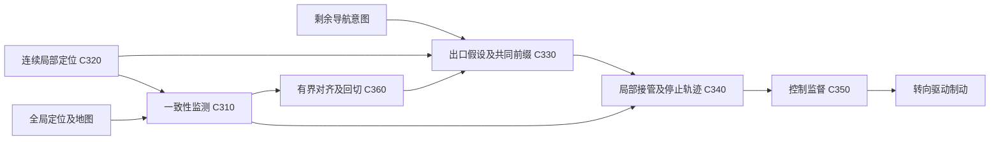
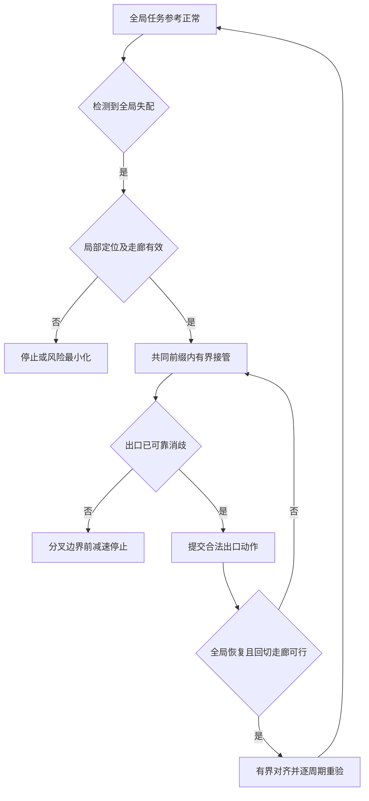

# 专利交底书 C：一种地图定位失配下基于任务出口假设共同前缀的移动机器人及车辆局部导航连续接管方法

> 版本：V2.0，2026-10-15；扩展室内外移动机器人及车辆的任务分叉与局部接管。
> 建议申请类型：发明专利；方法、自主导航控制系统、电子设备及存储介质。
> 运行设计域：具有可感知通行走廊、可用局部相对定位及可验证终端动作的室内外环境。
> 成熟度：可实施技术草案，未进行本案道路、仿真或硬件在环验证。
> 配套阅读：[03_patent_c_sources_and_technical_principles_20261015.md](03_patent_c_sources_and_technical_principles_20261015.md)。

## 1. 技术领域与摘要

涉及服务、配送、仓储及巡检机器人的任务导航、局部走廊、定位完整性监控与运动控制接管，也适用于车辆。失配来源包括相似走廊误重定位、地图改建、门口语义错配、GNSS 多径和回环修正。任务出口既可为道路分叉，也可为房间入口、门禁门、坡道或泊靠入口，不限定为公路车道。

摘要建议：获取地图定位与连续局部里程计，检测其运动增量及实时通行几何一致性；失配时隔离全局修正对任务控制参考的直接作用，在局部坐标系中建立带相对误差界的可行走廊，维护剩余任务对应的多个出口及权限假设；确定共同可执行前缀和最早任务承诺边界，生成在完整局部有效时域内满足终端动作及控制变化率限制的接管轨迹；歧义未解时不提交越界动作，恢复后经有界参考对齐和几何、拓扑、权限重验回切地图任务参考。

## 2. 现有技术与检索依据

| 编号 | 来源及时间 | 已读内容与本案关系 |
| --- | --- | --- |
| L03 | Faraci、Camurri、Fontanelli、Palopoli，UNSEEN: Uncertainty-aware Navigation via Sparse Estimation in Unknown Environments；2026-06-18 | [摘要](https://arxiv.org/abs/2606.20755)、[正文](https://arxiv.org/html/2606.20755v1)；III-VII 已读，包含 SLAM 不确定性向地图、规划传播和感知质量优化；其验证主要为 RGB-D 无人机、静态室内场景，不代表道路车辆已实现 |
| L08 | Gogoi、Janjos、Yang、Look，Uncertainty Matters: Structured Probabilistic Online Mapping for Motion Prediction in Autonomous Driving；2026-03-20 | [摘要](https://arxiv.org/abs/2603.20076)、[正文](https://arxiv.org/html/2603.20076v1)；III、IV、V 已读，LRPD 表示地图元素内部相关性，评估在线建图及运动预测；不等同于闭环控制安全验证 |
| L10 | Wang 等，Change-Robust Online Topological Memory for Long-Term Relocalization and Semantic Navigation；首稿 2026-05-04，v2 更新 2026-10-02 | [摘要](https://arxiv.org/abs/2605.02227)；CROSS 在地图提交前维护并验证连续位姿多假设，只将持续分支提升为闭环关联；本轮未完成全文逐式核对 |
| P04 | Zoox，Adaptive mapping to navigate autonomous vehicles responsive to physical environment changes；US9612123B1，2017-04-04；页面列申请/优先权日期 2015-11-04 | [全文](https://patents.google.com/patent/US9612123B1/en)；浏览器核验摘要、权利要求 1-5、16；已涉及局部/存储地图差异、混合地图、更新及远程请求 |
| P05 | Nissan North America，Navigational constraint control system；US20240149912A1，2024-05-09；US12594960B2，2026-04-07；优先权 2022-11-03 | [全文](https://patents.google.com/patent/US12594960B2/en)；权利要求 1、7、12-20 已读；已涉及导航不确定性、虚拟遮挡对象、横向及纵向偏移限制、优先减速 |
| P02 | Zoox，System and method for trajectory validation；US11407409B2，2022-08-09，A1 公开 2021-02-18 | [全文](https://patents.google.com/patent/US11407409B2/en)；已披露轨迹一致性、状态投影和可行性验证 |
| D01 | Wim Meeussen，REP-105: Coordinate Frames for Mobile Platforms；创建于 2010-10-27，规范状态 Active | [官方源文本](https://raw.githubusercontent.com/ros-infrastructure/rep/master/rep-0105.rst)；已读 Coordinate Frames、Frame Authorities、Transitions Between Maps；`odom` 连续可无界漂移、`map` 可跳变及变换分工均是已知约定 |

P04 的 B1 文本及公开日已核验；本文未独立核实其完整优先权链和所有相关申请的最早公开日，不把 B1 日期称作专利族最早公开日。Google Patents 页面不是权利状态法律意见。

## 3. 技术问题与现有不足

全局定位修正可使地图坐标下车辆位置突然移动，而车辆物理位置并未跳变。如果局部规划器直接按修正位姿重投影原地图车道，横向误差可能突变，继而触发不合理的急转向。另一方面，仅切换到感知车道跟随也不解决导航：分叉处可能有多个满足“右转”的出口，局部几何可行不代表已到达正确路口。

拟解决三个互相关联的问题：如何隔离全局位姿跳变；如何在局部定位仍有效时延续有限距离导航；如何在出口假设未消歧时保留停止余量，防止车辆平滑地驶向错误或无法返回的出口。

## 4. 拟保护的最小技术组合

1. 用全局与局部运动增量及几何残差识别失配，隔离全局定位修正，不中断连续局部状态。
2. 将剩余导航意图转为局部出口假设集，而不是把失配地图中心线继续当硬参考。
3. 对仍合理的出口假设求共同可执行前缀，显式标记最早不可逆分叉边界。
4. 在共同前缀内同时约束局部相对定位误差、停止余量和接管控制变化率；三者不能同时满足时不放行继续前进。
5. 回切全局导航时只缓变修正全局至局部的对齐关系，重新验证走廊和出口映射，不直接混合两条可能跨越障碍的路径。

局部坐标系、地图失配检测、置信度限速和轨迹平滑均是已知技术。创新假设在“出口共同前缀限定接管轨迹，并由不可逆边界反算停止约束”的完整闭环。

## 5. 系统结构与数据定义

| 模块 | 输入 | 输出 |
| --- | --- | --- |
| C310 失配监测 | 地图定位、局部里程计、道路几何、时戳 | 全局可用性、局部可用性及失配类型 |
| C320 连续局部定位 | 相机/激光雷达、IMU、轮速 | 连续局部位姿、误差界与局部地图 |
| C330 出口假设管理 | 剩余路口序列、实时道路拓扑、交通规则证据 | 合理假设集、共同前缀及分叉边界 |
| C340 接管轨迹生成 | 局部走廊、状态及执行器约束 | 接管轨迹和停止后备轨迹 |
| C350 控制监督 | 局部误差、轨迹与版本、出口消歧状态 | 放行、停车、人工接管或回切 |
| C360 全局回切 | 全局重定位结果、局部走廊及稳定观测窗口 | 对齐更新和经过重验的全局任务参考 |

定义 `RouteHypothesis`：`hypothesis_id`、当前道路拓扑节点候选、剩余导航动作、局部出口序号、规则适用性、支持/反驳证据、共同前缀终点及状态。序号相对于当前局部拓扑，不依赖错误的全局车道 ID。

定义 `HandoverBundle`：局部坐标版本、拓扑版本、入口状态管、轨迹、备份、控制变化率界、停止边界、有效期、假设集版本。激活与回切必须整体更新，不能只换参考路径。

## 6. 具体技术方案

### 6.1 S301：区分全局失配与局部失效

设地图坐标为 $M$，连续局部里程计坐标为 $O$，平台基座坐标为 $B$，$T_{AB}$ 将 B 系量变换至 A 系。机器人可分别采用 `map`、`odom`、`base_link`；局部规划和跟踪使用 $T_{OB}$，地图任务参考经 $T_{OM}$ 进入局部系。按 D01，连续里程计不自动具有有界误差，后续完整性检查不可省略。

比较相邻全局位姿的相对增量与局部里程计增量，使用统一的车辆相对运动表达：

$$
r_{\Delta}=\operatorname{Log}\!\left[
(T_{MB,t-1}^{-1}T_{MB,t})^{-1}
(T_{OB,t-1}^{-1}T_{OB,t})\right].
$$

结合地图边界与实测边界的几何残差、GNSS 完整性及时间对齐，判定失配。可采用白化残差门限，但全局和局部估计共享传感器时应计入相关项；无法估计相关性时使用标定的保守一致性界，不直接套独立卡方检验。

若局部里程计同时因弱纹理、滑移或时间同步故障失效，本案不允许继续“无地图导航”，应进入停止或风险最小化。失配无法归因时，不以选择较小协方差来源的方式贸然决定哪个定位正确。

### 6.2 S302：冻结全局修正通道并构建局部走廊

检测到全局失配后，冻结的是全局修正注入通道的 $T_{OM}$，不是冻结车辆 $T_{OB}$。车辆局部位姿继续依据相对观测更新。立即重新检查原轨迹下一控制段是否仍处于实时确认的空闲空间；不能仅为平滑而继续执行已撞向障碍的原轨迹。

工程实现中，定位器继续发布原始 `map -> odom`，参考管理器保留独立的 $\bar T_{OM}$ 任务对齐副本，冻结/缓变作用于该副本及绑定版本的任务参考，不覆盖原始定位结果，也不为同一 TF 边增加第二发布者。局部实时障碍继续使用时间对齐的 `odom` 观测；禁止将不同版本参考与地图障碍混用。

从实时感知构建局部空闲域、道路边界与障碍占用，得到走廊 $\mathcal C_k$。未知区域不视为空闲；施工标志、可见禁行规则及静态障碍属于不能由导航意图覆盖的约束。

用相对误差集 $\mathcal E_{{\rm rel},k}$ 与车辆扫掠几何收缩走廊。若采用高斯近似，相对位置 $p_b-p_v$ 的协方差为：

$$
\Sigma_{\rm rel}=\Sigma_b+\Sigma_v-\Sigma_{bv}-\Sigma_{vb}.
$$

跨点、跨时刻及位姿与地图之间的相关性不得忽略。优选共同刚体偏移参数或集合式共享误差表达；不把同源误差重复膨胀，也不能擅自抵消未知相关项。概率模型未经校准时退回保守误差集，并在预测误差超过走廊余量前停车。

### 6.3 S303：生成和维护出口假设

将导航任务转换为拓扑意图，例如“通过当前节点后选择右侧第二个合法出口，再进入直行段”。用车端感知的连接关系、交通标志和最后可信拓扑位置构建候选匹配，不强制与已失配的地图坐标重合。

维护至少一个“地图拓扑或意图已不可信”的未知假设。分类网络输出概率只能排序；未获反证的安全相关假设不得仅因低概率删除。候选过多超过算力预算时，使用包含被裁剪候选的未知分支并减速，而非只保留最高分出口然后继续。

对每个合理假设生成有规则约束的局部候选路径。采用拓扑边序列前缀树识别其最后共同边；将该边内的空间/时间可行区域作为共同前缀走廊。共同前缀指相同可执行拓扑动作，不是几条曲线距离的算术平均。

L10 已表明在地图关联提交前维护和检验多位姿分支属于公开方向，本案不主张其首创。本案保留不同位姿模式与局部出口的对应关系；一串相似观测可能来自同一误匹配，不能仅按重复帧数独立累积置信度后删除其他合理出口。新增反证、拓扑冲突或几何走廊变更时，撤销相关出口可提交状态并重算共同前缀，而不是只修正最终地图。

### 6.4 S304：确定不可逆分叉和停止边界

不可逆分叉指：越过后，在当前道路规则、障碍与车辆运动限制下，不能在有效局部域内保持全部仍合理出口选项的边界。由各假设的可行入口、车道转换能力和局部连接关系求出，并取最早者。若无法可靠计算，则以第一个歧义分叉入口减去保守裕量作为边界。

共同前缀为空时，只允许当前已验证的停止动作或不改变出口选项的局部避障，不允许因为某出口更顺滑就跨入它。共同前缀不能用于无限循环等待；设置任务级超时并停车请求确认。

令距最早停止边界的可用纵向距离为 $d_c$，接管及制动建立保守时延为 $\tau$，保证可实现减速度为 $b>0$，沿路方向相对误差及几何裕量为 $e_{\parallel}+m$。恒速等待、水平直道的筛查条件为：

$$
v\tau+\frac{v^2}{2b}+e_{\parallel}+m\le d_c.
$$

可得到筛查速度上界：

$$
v\le-b\tau+\sqrt{(b\tau)^2+2b(d_c-e_{\parallel}-m)}.
$$

若根号内条件或剩余距离不成立，禁止正向任务放行。车辆弯道、下坡、侧偏及非零加速度情况下，用动态模型与停止距离表替代筛查式。距离统一以车体最前沿至边界的沿路径净距离计算，避免漏掉车长。

上述 $e_{\parallel}$ 应取接管至停止全过程的预测最大纵向相对误差界，而非当前帧误差。横向误差也须在完整停止时域内仍小于走廊余量；若预估在 $t_{\rm loss}$ 时局部走廊将失效，应在能够使停止完成时刻早于 $t_{\rm loss}$ 的时刻触发停车。无法给出该增长界时，不能据当前余量继续放行；局部漂移已经越界后的停车只是风险最小化，不再带原可行性保证。

### 6.5 S305：生成连续而不越界的接管轨迹

在连续 $O$ 系下生成从当前车辆状态与执行器状态开始的轨迹，初值包含 $v,a,\delta$；目标只能位于共同前缀走廊。以跟踪、进展和控制变化为目标，硬约束包含车辆动态、障碍扫掠和停止可达性。

例如转角和加速度变化率限制为：

$$
|\delta_{k+1}-\delta_k|\le\dot\delta_{\max}\Delta t,
\quad |a_{k+1}-a_k|\le j_{\max}\Delta t.
$$

本案不通过先输出不连续参考、再末端低通滤波来获得“平滑”，因为滤波后的轨迹可能已越过障碍约束。优选将执行器动态放入优化和过渡管验证；控制器积分状态采用实际执行量初始化或抗积分饱和处理。

约束冲突时，碰撞风险与车辆稳定性优先于舒适性；可放宽舒适加加速度目标但不突破硬件极限。没有可行解必须报告，不为满足连续性强行穿过错误车道。

### 6.6 S306：局部执行与出口提交

监督模块持续核验局部相对误差、可感知走廊长度、假设集版本和停车能力。局部位姿绝对误差可以增长，但相对走廊误差必须仍受界，且车辆必须能在有效局部域内停止。

只在出口身份被可靠证据唯一确认，或人工明确更新任务且通行规则可验证时，提交不可逆出口动作；否则停在边界前。证据可包括清晰车道标志、稳定连续的出口连接及恢复的全局匹配，不能仅依靠语言模型猜测“看起来像正确路口”。

出口提交记录绑定假设集、拓扑、规则与局部坐标版本；激活前再次检查各版本及停车余量。已提交但尚未越过不可逆边界时若出现反证，应撤销提交并回到共同前缀停止策略；已经越界时不得通过自动倒车或突然跨线恢复旧任务，而应遵守当前道路规则稳定停车或重新导航。

### 6.7 S307：全局恢复与回切

全局定位在连续观测窗口内满足几何和运动一致性后，估计新的目标对齐 $T^*_{OM}$。在局部规划时钟下有界更新：

$$
T_{OM}^{k+1}=T_{OM}^{k}
\operatorname{Exp}\!\left(\operatorname{clip}_{\mathcal V\Delta t}
\operatorname{Log}[(T_{OM}^{k})^{-1}T^*_{OM}]\right).
$$

$\mathcal V$ 为对齐平移及角度变化率界，具有相应单位，不等同于底盘转角率。该式只更新任务参考的坐标对齐，不修改局部障碍物的物理位置，也不保证中间道路参考合法；每次更新均重新检查走廊、拓扑出口映射和控制可行性。中间参考不可行时暂停回切，保持局部停车策略。

恢复条件可选 2 秒一致窗口、连续不少于 20 帧；属于示例标定值，必须结合采样相关性、误匹配风险和时效确定，不能以帧数替代完整性证明。

### 6.8 故障与失效边界

| 故障 | 处理 |
| --- | --- |
| GNSS 跳变但局部定位可靠 | 隔离全局修正，按共同前缀及停止约束接管 |
| 地图道路结构改变 | 保留多出口及未知假设，停止后确认或更新任务 |
| 局部轮速和视觉共同漂移 | 局部有效性失效，禁止继续依赖共同前缀 |
| 道路规则无法识别 | 不提交路口动作，维持可停车前缀 |
| 行人进入共同前缀 | 几何安全监控优先，更新备份或风险最小化 |
| 全局反复恢复与失配 | 滞回并限制切换次数，严重时人工确认 |

### 6.9 室内机器人任务出口与动作承诺边界

对医院配送、酒店服务或仓库 AMR，将任务表示为“当前走廊节点、候选门口、目标房间/工位、通行权限、后续动作”的图。相似外观可对应不同地图节点；每个合理位姿模式对应自己的门口和权限解释，不能在几何可行后跳过任务身份检查。该扩展不要求 GNSS，也不要求道路车道线。

“不可逆分叉”在机器人实施例中具体化为本轮运行约束下不能保持其他合理任务选项的动作承诺边界：例如跨过单向门禁、进入无掉头空间的窄门或开始精确泊靠。允许安全退出的普通岔路并非天然不可逆；应根据回退可达性、任务权限和局部有效时域求边界，无法求出则保守停在第一个歧义入口前。足式过坎还须验证落足及支撑，不能只检验基座平面走廊。

差速 AMR 的接管初值为基座位姿、线/角速度及驱动器状态；用左右轮约束而非汽车转角模型控制。矩形机身旋转时检查完整扫掠体；通道窄于该外形及误差裕量时禁止原地转向。机器人停止可逆不意味着可以未经权限进入房间或门禁后再倒退纠错。

楼层、升降机或移动地板变化涉及地图版本及参考系语义切换；不能把“电梯内局部观测连续”当作“原楼层地图仍适用”。本版要求识别环境模式并在楼层未确认时禁止提交出梯任务；自动电梯操作的机械与权限交互不在本案已充分展开的实施范围内。

## 7. 实施例与数值说明

### 7.1 城市峡谷位姿跳变

以 $5\,\mathrm{m/s}$ 行驶时，GNSS 解发生 $1.8\,\mathrm m$ 横向修正，局部视觉/激光与 IMU 增量未支持该物理横移。系统隔离全局修正，继续依据局部车道及障碍控制，不把 1.8 m 误差直接转成转向请求。该数值为故障注入设计，不是实测事件。

局部走廊宽 $3.6\,\mathrm m$、车宽 $1.9\,\mathrm m$，每侧基本几何余量 $0.85\,\mathrm m$；相对横向误差界 $0.25\,\mathrm m$、附加裕量 $0.20\,\mathrm m$，中心轨迹每侧剩余 $0.40\,\mathrm m$。如误差界增加到 $0.70\,\mathrm m$，可用余量为 $-0.05\,\mathrm m$，不能继续按原速度行驶；应在误差越界前利用预留停止能力降级。

此例的 0.25 m 界须覆盖完整接管及停止时域；若仅代表当前帧，不能由该数值推断停车过程有效。

### 7.2 两个右转出口尚未消歧

局部拓扑存在两个右转出口，剩余意图在 H1 下指向第一个、在 H2 下指向第二个。两者只有分叉前 9 m 共同前缀。取 $b=2\,\mathrm{m/s^2}$、$\tau=0.25\,\mathrm s$、$e_{\parallel}=0.4\,\mathrm m$、$m=0.6\,\mathrm m$，筛查速度上界为：

$$
v_{\max}=-0.5+\sqrt{0.25+32}=5.179\,\mathrm{m/s}.
$$

当前速度 $5\,\mathrm{m/s}$ 时所需距离 $1.25+6.25+1.0=8.5\,\mathrm m$，仍须随距离减少立即减速，不表示可以恒速驶完整个 9 m。当前速度 $6\,\mathrm{m/s}$ 时需 $11.5\,\mathrm m$，原放行条件不成立，必须报告余量不足并执行风险最小化或现有有效备份，不能宣称此时必能在 9 m 内停下。

### 7.3 回切存在障碍

定位恢复后，全局地图中心线落在施工围栏内。即使对齐更新公式数值连续，走廊检查仍将拒绝该中间及最终参考。系统保持局部停止，不沿两条轨迹的插值穿过围栏。

### 7.4 医院差速配送机器人相似门口

两种合理位姿模式将同一个可见门框分别解释为目标房间门和限制进入门，机器人不得仅凭连续视觉匹配提交进门。共同走廊到承诺边界剩余 1.20 m，速度 0.80 m/s，保证减速度 0.60 m/s²，时延 0.20 s，完整停止时域内纵向误差及附加裕量合计 0.25 m，则停止必要距离为 $0.80\times0.20+0.80^2/(2\times0.60)+0.25=0.9433$ m。

机器人宽 0.60 m，走廊宽 1.40 m，横向误差界及附加裕量各 0.10 m，中心轨迹每侧余量 0.20 m。即使当前几何与距离均通过，完成接管及停止还需至少 $0.20+0.80/0.60=1.5333$ s；若可监督的局部有效时域只剩 1.40 s，该状态仍不得得到带完整保证的放行。应更早降低速度或触发停止，而不是等漂移越界后再宣称安全停车。

## 8. 附图说明

图 1 表示全局修正隔离与局部导航执行通道。

图 2 表示导航动作的提交与回切状态机。

## 9. 区别特征及创新风险

| 对比对象 | 不能作为独立创新的内容 | 本案拟限定机制 | 风险与边界 |
| --- | --- | --- | --- |
| L03 | 定位、地图和规划的不确定性传播；局部可见域内规划 | 全局失配的接管/回切、道路出口共同前缀及不可逆边界 | 不能仅把无人机模型改为车辆模型就认定创造性 |
| L08 | 地图几何相关性及低秩协方差 | 使用相关误差检验局部接管走廊，而非发明 LRPD 本身 | 原文结论已展望下游安全规划，“把协方差用于规划”仍过宽 |
| P04 | 地图差异检测、局部与全局混合、更新与远程协助 | 隔离修正后保留出口假设、共同前缀停止和有界回切 | 地图失配及局部地图本身不新颖 |
| P05 | 导航不确定性驱动横纵限制、优先减速及虚拟遮挡对象 | 不可逆分叉由仍合理假设的共同选项决定，继而约束局部接管和停止 | 仅“定位不确定就限速限偏移”已高度重合，必须保留完整关系 |
| P02 | 轨迹一致性、状态投影与切换可行性 | 导航拓扑歧义显式决定前缀边界与提交条件 | 控制连续性只是必要实施要素，不单独主张首创 |
| L10 | 提交地图关联前验证多位姿分支，拒绝物理不一致分支 | 将仍合理位姿/出口映射转换成车辆不可逆分叉前的共同控制前缀及停止约束 | 不主张多假设或延迟提交本身；地图提交与底盘出口提交的耦合仍有创造性组合风险 |
| D01 | 连续 `odom`、可跳变 `map`、帧权限及跨地图切换 | 任务对齐副本、出口/权限共同前缀和完整局部有效时域下的动作承诺 | map/odom 分离本身是公开规范，不作为创新点；机器人扩展须另核查任务导航先例 |

预期技术效果是减少定位修正引发的瞬态转向，以及出口歧义未解时的不当提交；需分别通过故障注入和出口任务完成率对照验证，不能只展示一条平滑轨迹作为充分证据。

## 10. 权利要求建议稿

### 10.1 独立方法权利要求骨架

一种移动机器人或车辆的局部任务导航接管方法，包括：

1. 比较地图定位与连续局部里程计的相对运动增量，结合实时通行几何及任务身份一致性判定地图定位失配；
2. 在局部定位仍有效时隔离全局位姿修正对控制参考的直接作用，在连续局部坐标系下建立带相对误差界的可行走廊；
3. 根据剩余任务、实时通行连接及适用权限形成多个仍合理的任务出口假设，确定共同可执行前缀和在运行约束下无法保持其他合理选项的最早动作承诺边界；
4. 以边界前终端动作的可达性、完整执行及终端时域内的局部误差界和执行器变化率为约束，生成从当前平台及执行器状态开始且位于共同前缀内的接管轨迹；
5. 控制平台仅执行满足所述约束的前缀，出口或权限未可靠消歧时不越过边界，局部有效性或终端可达性不满足时启动平台适用的停止或风险最小化；
6. 全局定位恢复后，逐周期有界更新全局至局部对齐关系，并在走廊及出口映射重验通过后回切全局任务参考。

正式申请时可将回切放入从属项以评估独立项必要性，但说明书保留完整双向流程；保护范围应由实际最接近现有技术决定。

### 10.2 从属项方向

1. 冻结全局修正注入而保持局部位姿连续更新，并绑定坐标版本。
2. 合理出口假设包含拓扑未知分支，候选裁剪不能删除未知风险。
3. 共同前缀由拓扑边前缀树求得，不采用轨迹算术平均。
4. 将位姿与地图交叉相关性纳入相对误差，未知时采用保守集合界。
5. 分叉边界考虑车辆变道能力、交通规则和局部可见域，不仅取几何岔口。
6. 控制变化率由执行器动态和过渡段可行性约束，不仅靠输出滤波。
7. 回切暂停条件包括中间参考越界、障碍占用和出口映射不一致。
8. 误差界预测覆盖接管直至停止，出口提交绑定假设、拓扑及规则版本，新增反证时在越过不可逆边界前撤销提交。
9. 对室内机器人，将出口映射至门口、工位或门禁动作，接管采用差速/全向底盘实际约束；对齐冻结作用于独立任务参考副本，原始定位 TF 发布权限保持唯一。

系统项由 C310 至 C360 及其数据关系支撑，设备与介质项引用方法。

## 11. 可实现性与验证计划

优先复用已有视觉/激光惯性里程计、道路边界感知、路由拓扑和 MPC 跟踪器；不要求新建高精地图，也不要求模型直接输出底盘指令。全局修正与局部连续位姿分离可以在现有定位接口外增加版本化参考管理实现，但必须核查原定位是否真能提供连续局部系。

推荐局部状态与监督 100 Hz、局部几何 10-20 Hz、出口假设管理 5-10 Hz，作为待测配置。局部漂移域应同时限定最长时间和最长距离，例如先在 5 秒、25 m 内验证；到达任一上限仍未恢复时停车，不将示例上限写成任意道路都适用。

| 测试 | 对照或消融 | 判据 |
| --- | --- | --- |
| 全局位姿跳变 | 直接使用全局解、仅平滑全局解、完整方案 | 转角及横摆峰值、走廊越界、碰撞，不只比较定位误差 |
| 相邻出口错配 | 单一最高分出口与完整假设集 | 误提交次数、分叉前停止率、正常导航完成率 |
| 误匹配持续与提交撤销 | 相似场景连续多帧误匹配、提交后边界前出现反证 | 不将相关帧当独立证据；正确撤销提交，不进行危险倒车恢复 |
| 相关几何误差 | 忽略相关项与保守共同误差 | 走廊误放行、过度停车和误差覆盖 |
| 停止期间误差增长 | 当前走廊有效但停止结束前漂移越界 | 提前触发停车，不能只用当前协方差判定完整停止过程 |
| 局部也失效 | 轮速滑移叠加弱纹理与 GNSS 多径 | 必须退出局部继续模式，记录触发提前量 |
| 施工及回切 | 回切路径插值与逐周期走廊重验 | 是否穿越围栏、是否拒绝错误地图参考 |
| 接管与回切消息乱序 | 旧坐标版本、新拓扑、新轨迹混用 | 跨版本激活次数为零，降级行为可复现 |

离线数据可评估几何与定位，闭环任务必须在车辆模型仿真中验证；nuScenes 离线预测分数不能代替接管控制测试。封闭场地按低速、软目标和可人工接管顺序逐级开展。

机器人验证增加相似门口错配、门禁权限冲突、无 GNSS、矩形机身原地转向、SLAM 回环跳变、地图/楼层版本更新及局部有效期短于停止时长。详解给出 ROS 帧/消息分工、假设前缀算法和逐周期实现，不把配套说明当作已部署代码或安全认证。

## 12. 迭代记录与申请前补证

- V0：考虑地图失配后感知驱动导航，L03 及 P04 表明方向过宽，删去“无地图导航首创”。
- V0.1：考虑定位置信度驱动限速和横向限制，P05 的 2026 年授权权利要求构成直接近似，放弃该宽泛主张。
- V1.0：将出口假设共同前缀、不可逆分叉停止边界、局部控制连续接管和走廊重验回切耦合；依据 L08 加入相关几何误差处理。
- V1.1：第二轮加入 2026-10-02 更新的 L10，将多假设与延迟提交明确归入已有方向；增加出口提交撤销、相关帧误匹配和完整停车时域误差增长约束及测试。
- V2.0：扩展至室内外机器人任务图和门口/门禁承诺，加入 D01 坐标规范，区分原始定位 TF 与任务对齐副本；补差速 AMR 完整时间/空间实例、权限失配及环境模式边界，并另建来源和原理详解。
- 待补：地图失配导航接管的更近专利、歧义假设完备性与出口消歧证据规则、局部相对误差标定、执行器状态初始化、真实场地对照数据、发明人贡献记录。

本案创新性属于基于本轮已核验资料的待检验判断；不得承诺授权，不替代自由实施分析。若全局与局部均无可靠观测，本案不提供继续自主行驶能力。