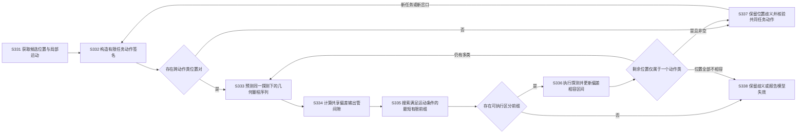
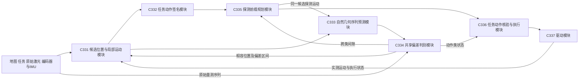
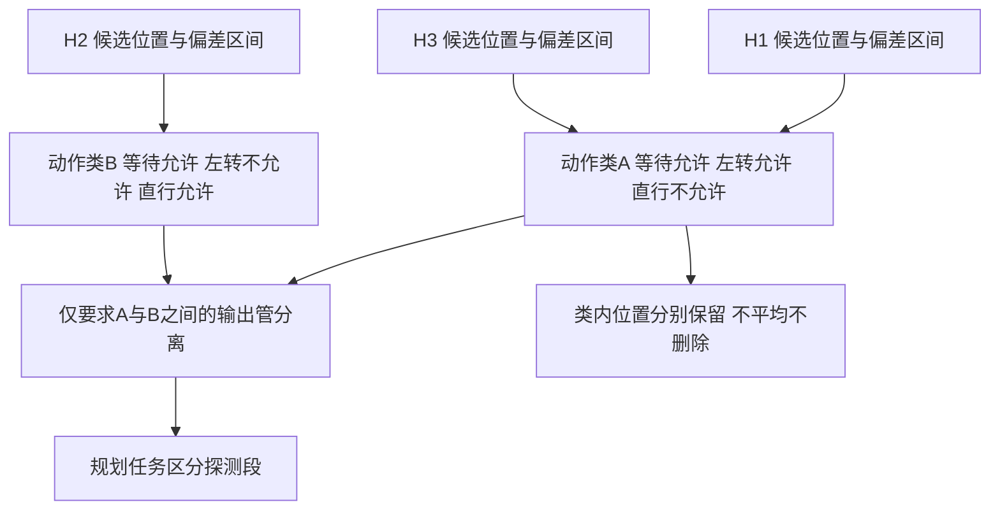
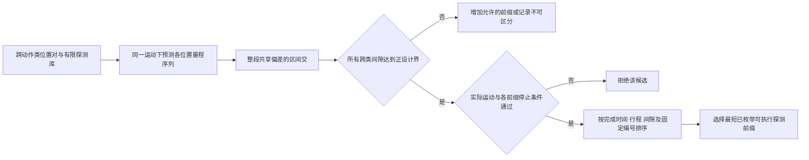
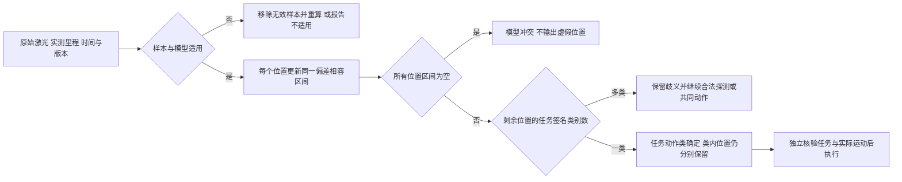
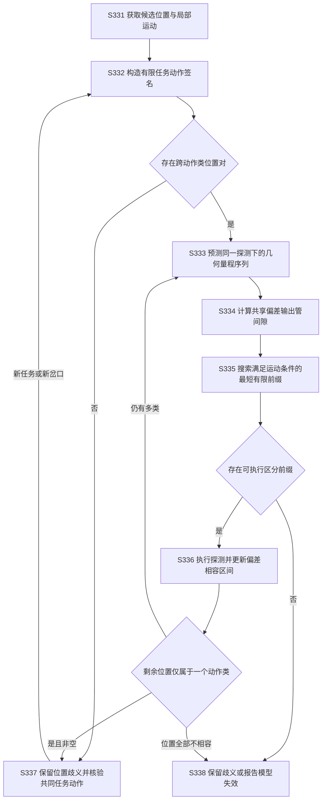
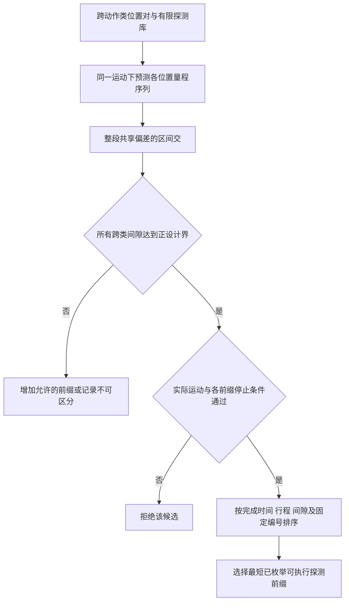
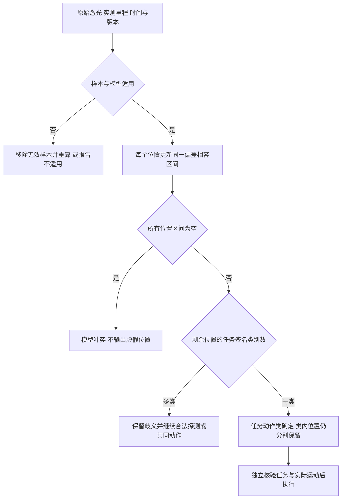

# 重复通道中基于任务动作签名与共享偏差序列判别的机器人主动定位方法及系统

> 专利申请文件草案，编制日期：2026-11-05。
> 编制依据：[专利3交底书](03_patent_c_disclosure_template_rewrite_20261019.md)、[技术详解与资料依据](03_patent_c_sources_and_technical_principles_20261015.md)。结构参考[专利2说明书](02_patent_b_specification_20261021.md)。[2026-11-04说明书](03_patent_c_specification_20261104.md)为历史方案，旧权利要求及段号不与本文混用。
> 适用范围：用户确认地下管廊／隧道主场景，使用现有激光和编码器／IMU，无新增必需硬件。本文不是全面矿区自主作业、安全认证或跨平台运动保证。
> 验证边界：[离线程序](03_patent_c_interval_sequence_demo_20261105.py)已验证常值标量区间判别及合成直线算例，未接真实地图射线、点云、驱动或完整停止后缀，未进行公开数据集实验及隧道闭环实机验证。摘要、权利要求、说明书及Mermaid附图为合并审阅稿，正式提交前须转换附图、核验格式并由代理师结合实际研发及接近技术审查；不保证新颖性、创造性、授权或自由实施。

## 一、说明书摘要

本发明公开一种重复通道中的机器人主动定位方法及系统。根据各候选位置下的有限任务动作可行向量构造动作签名，保留类内位置并确定跨动作类的位置对；预测同一候选探测运动下的自然结构激光量程序列，以整段共享偏差及有界逐样本误差构造输出管，计算跨类输出管不相交的裕量；在满足实际运动和停止条件的有限候选中选择先达到区分裕量的探测前缀；按实测运动对齐量测，逐样本收紧各候选位置的偏差相容区间，在剩余位置属于同一任务动作类时结束本次消歧，并独立核验后续任务动作。本发明用于地下管廊等重复横通道的下一动作辨认，不以任务动作确定代替全局位置唯一。

## 二、摘要附图

图1为方法流程图，亦为摘要附图。

**图1 任务相关主动序列定位方法流程图**



## 三、权利要求书

**1.** 一种重复通道中的机器人主动定位方法，应用于具有测距传感器、局部运动估计装置和驱动机构的地面移动机器人，其特征在于，包括：

获取机器人在地图中至少两个尚未排除的候选位置、局部运动状态及任务连接关系，在同一局部物理通道及有限预测时域内，分别确定各候选位置下预设有限任务动作的可行性，根据所述可行性向量形成任务动作签名，在保留具有相同签名的各候选位置的条件下，将不同签名的候选位置对确定为待区分的跨动作类位置对；

针对候选探测运动，将同一局部运动分别作用于各候选位置，根据地图中的自然结构和测距传感器的射线几何预测量程序列，对每个候选位置以整段量程序列共享的有界偏差变量及有界逐样本误差构造预测输出管，所述共享偏差变量在该段序列内不得按每个样本独立重新赋值；

对所述跨动作类位置对计算其预测输出管是否不相交及相应区分裕量，在满足局部通行、驱动及停止条件的有限候选探测运动中，选择先达到所述区分裕量要求的探测前缀并执行；

将实际量测与实测局部运动及采样时刻对齐，根据各候选位置的预测量程序列，逐样本收紧同一偏差变量的相容范围，保留具有非空相容范围的候选位置及其偏差范围；当保留的候选位置非空且仅属于一个任务动作类时，结束本次任务相关消歧，仍保留类内位置歧义，并仅在后续任务动作对所述保留位置通过任务及实际运动核验后执行该动作；

在跨类输出管不能区分时保留相应位置歧义，不将未形成区分前缀视为精确定位；在全部候选位置与量测不相容或误差模型不再适用时输出模型冲突或不适用原因，不选择已经不相容的位置执行任务。

**2.** 根据权利要求1所述的方法，其特征在于，所述任务动作签名为停等待、在当前实测横通道转向或沿主通道继续等有限任务动作的布尔可行性向量；可行性依据候选位置下的任务图连接、权限和运动约束确定，签名比较之前核验动作关联到同一物理通道；任务、动作库或预测时域改变时重新生成签名，不将相同签名视为全局位置相同或整个未来任务等价。

**3.** 根据权利要求1所述的方法，其特征在于，地图自然结构采用墙面线段或局部表面表示，沿预测传感器位姿和所选射线方向求与相容结构的最近正向交点获得预测量程；将候选位姿、里程、安装及地图误差纳入预测包络，未命中、错误关联、遮挡或地图变化时将相应预测置为未知，不以零距离填补。

**4.** 根据权利要求1所述的方法，其特征在于，在短序列常值标量偏差模型下，以偏差先验区间与每个有效样本的“实测量程减预测量程再加减逐样本误差界”所得区间求交，形成各候选位置的偏差相容区间；同一候选位置在一段序列中仅使用该交集所包含的共同偏差值，不对每帧另行使用独立偏差拟合值。

**5.** 根据权利要求4所述的方法，其特征在于，对跨动作类位置对形成逐样本预测量程差，将差偏差先验区间与各预测量程差加减两位置逐样本误差界之和所得区间求交；以所有下界的最大值与所有上界的最小值之差表征区分裕量，严格正间隙表示输出管不相交，间隙为零时保留区间接触导致的歧义。

**6.** 根据权利要求1所述的方法，其特征在于，对有限候选运动逐步增加观测前缀长度，记录跨动作类位置对均达到正设计裕量的第一个前缀，在通过实际运动及停止检查的候选中，按完成时间、行程及分离裕量进行确定性排序；所述最短前缀限定于已枚举候选和声明误差模型，不将其解释为连续运动空间的全局最短解。

**7.** 根据权利要求1所述的方法，其特征在于，具有相同任务动作签名的候选位置仍分别保留其位姿范围、地图关联及偏差相容范围，并分别参与后续运动及任务约束检查；输出结果区分任务动作类已确定与全局位置已唯一，不因动作类已确定而平均位置、删除类内解释或报告尚未确认的工位身份。

**8.** 根据权利要求1所述的方法，其特征在于，量测样本缺失或不满足质量条件时，仅使用有效样本重新计算相容范围和跨类区分能力；全部候选相容范围为空时输出模型冲突，不能以最小残差或最高检索分数选取已经不相容的候选位置；新窗口不能通过无依据重置偏差界而使不相容的位置自动恢复有效。

**9.** 根据权利要求1所述的方法，其特征在于，探测运动执行和量测解码关联至采样时间、实测里程、地图及误差模型版本，在最终采用探测或任务动作前核对实际执行状态；预测包络计入时间同步、运动状态及数值误差，偏差常值假设或有界误差适用条件失效时停止沿用对应区分结论并输出原因。

**10.** 根据权利要求1所述的方法，其特征在于，对探测各获准前缀核验仍会作用的旧输入、控制生效、停止及有限保持过程，在共同允许区域和局部信息有效时域内具备适用停止后缀后执行该前缀；探测处理时延计入实际前进及停止预测，不仅在探测终点名义状态检查停车。

**11.** 根据权利要求4所述的方法，其特征在于，共同偏差界和逐样本误差界来源于相应传感通道、结构提取方法、表面和时间窗口的标定或覆盖依据，逐样本误差界覆盖量测、地图和短时运动预测误差；超出适用工况时输出未知或不适用，不通过缩小所述界来获得区分裕量，不以协方差或单帧识别分数直接替代确定误差界。

**12.** 根据权利要求1所述的方法，其特征在于，所述重复通道为地下管廊或隧道中具有地图覆盖的重复横通道或检修结构，采用已有激光测距及编码器或惯性局部运动观测，不以新增人工标识或全局卫星定位为必要条件；在进入需要不同任务动作的通道节点前启用所述主动定位，而不以已经发生定位异常为必要启动条件。

**13.** 一种重复通道中的机器人主动定位系统，其特征在于，包括：

候选位置与局部运动模块，用于提供地图候选位置及局部运动范围；

任务动作签名模块，用于在同一物理通道和有限时域形成各候选位置的有限任务动作可行向量，确定跨动作类位置对并保留类内位置；

自然几何序列预测模块，用于根据同一候选探测运动及地图射线几何预测各位置的量程序列和误差条件；

共享偏差判别模块，用于构造整段共享偏差的输出管、计算跨类区分裕量，并根据实测序列更新候选位置的偏差相容范围；

探测前缀规划模块，用于在满足实际运动及停止条件的有限候选中，选择先达到区分裕量要求的前缀；

任务动作核验与执行模块，用于执行获准探测、将量测关联至实测运动，在剩余位置属于一个动作类时保留位置歧义并核验实际任务动作，在模型冲突或适用条件失效时输出原因；

驱动模块，用于执行获准控制及反馈实际状态；

其中，所述共享偏差判别模块不逐帧独立重置同一序列的偏差变量，所述任务动作核验与执行模块不以任务动作类确定替代全局位置唯一。

**14.** 一种电子设备，包括处理器、存储器及用于连接机器人测距、局部运动估计和驱动机构的接口，其特征在于，存储器存储有计算机程序，处理器执行该程序时实现权利要求1至12中任一项所述的方法。

**15.** 一种计算机可读存储介质，其上存储有计算机程序，其特征在于，所述程序被处理器执行时实现权利要求1至12中任一项所述的方法。

## 四、说明书

### 4.1 技术领域

[0001] 本发明涉及地面移动机器人地图定位、主动感知及任务运动规划，尤其涉及在重复通道中，按任务动作对位置解释分区，利用同一探测运动下的自然几何序列及共享偏差一致性进行主动定位的方法及系统。

### 4.2 背景技术

[0002] 地下管廊的横通道、检修凹室及墙面结构可能重复，单帧激光检索产生多个地图位置解释。低照度不利于视觉，平行墙面可能使局部配准沿通道方向退化；局部位姿退化与多个全局位置的重复歧义是不同问题。即使局部短时运动有效，机器人仍可能不清楚当前应该在哪个横通道转向。

[0003] X-ICP（arXiv:2211.16335）已有方向退化检测和约束配准；Scan Context及Scan Context++（arXiv:2109.13494）已有结构位置检索；SeqSLAM（ICRA 2012）已有序列位置辨认。PAMPC（arXiv:1804.04811）已有感知与动力动作联合优化，APFN（arXiv:2209.09646）已有连续动作主动定位。因此，本发明不以多帧激光、序列匹配或主动运动本身主张区别。

[0004] 《Value-Directed Compression of POMDPs》（NeurIPS 2002）已有面向决策质量的状态压缩；《Optimal Input Design for Affine Model Discrimination with Applications in Intention-Aware Vehicles》（arXiv:1702.01112）已有不确定初态、输入及噪声下的主动输出轨迹区分和优化输入设计。任务相关简化、输出管不相交及区间交本身均非本发明首创。

[0005] US11656083B2已有隧道平行墙检测及测距／里程计导航切换，CN117408289A已有基于位置标签、自动激光瞄准及往返误差修订的隧道定位。CERBERUS公开资料已有地下机器人感知、导航和数据集；地下应用或软硬件融合本身不构成新场景、新架构的充分区别。

[0006] 若实现只选择最高分单位置，可能在重复横通道处作错任务动作；若始终要求全局位置唯一，可能在下一动作对多个位置相同时仍做无必要的长距离消歧。若每帧重新拟合传感或模型偏差，则多个看似匹配的读数未必能由同一个短时物理条件解释。反之，只对量程作差分虽然抵消常值偏差，却可能丢失绝对偏差范围所提供的区分信息。

[0007] 本发明提出一种限定的工程组合，不表示上述既有研究均忽视任务或相关误差。若接近技术已完整覆盖任务分区、共享扰动序列区分、有限探测优化和相容位置保留，不能仅因迁移至管廊、改用线段射线或增加接口名称而主张创造性。

### 4.3 发明内容

#### 4.3.1 所要解决的技术问题

[0008] 本发明解决的技术问题为：在重复通道中，如何选择能够区分下一任务动作的短运动，并使序列匹配与整段共享误差条件一致，在不虚假删除候选位置的前提下，避免把任务动作确定与全局位置唯一混为一谈。

#### 4.3.2 技术方案

[0009] 本发明根据有限任务动作可行向量对候选位置分区，利用同一实际探测运动下的地图射线预测自然结构量程序列，以共享偏差和有界样本误差构造位置输出管，只对跨任务动作类的位置对求严格分离裕量；从可执行有限运动库选择最早达到该裕量的前缀；实测后以偏差区间交解码，保留非空相容位置。动作类唯一时结束本次消歧但保留位置歧义，重新核验实际任务动作；无法区分或模型不适用时输出明确状态。

**图1 任务相关主动序列定位方法流程图**


#### 4.3.3 有益效果及适用条件

[0010] 在候选位置覆盖真位置、地图及任务关联有效、量测和运动误差处于声明模型内时，本方案可拒绝需要逐帧改变共同偏差才能解释的错误位置，并只为影响当前任务动作的不同位置类求探测。有限库搜索能比较不同前缀实际耗时及区分能力，不以高信息分数抵消运动限制。

[0011] 所述条件成立时，跨类输出管严格分离使合法量测至多与一个动作类相容，但不保证类内位置唯一。输出空集合属于模型冲突而非成功定位。本发明不保证无特征、完全周期结构或任意粉尘、打滑工况下能够自主恢复；未提供真实隧道定位率、任务成功率或计算提速。

### 4.4 附图说明

[0012] 图1为方法流程及摘要附图；图2为系统模块和双向数据关系图；图3为位置解释与任务动作分区图；图4为共享偏差序列区分与前缀选择图；图5为实测序列相容性解码及输出状态图。

[0013] 附图标记：C331，候选位置与局部运动模块；C332，任务动作签名模块；C333，自然几何序列预测模块；C334，共享偏差判别模块；C335，探测前缀规划模块；C336，任务动作核验与执行模块；C337，驱动模块。S331—S338为方法步骤。H1—H3为示例位置解释，A和B为任务动作类，不是新增硬件。

### 4.5 具体实施方式

#### 4.5.1 平台、输入和初始化

**图2 系统模块和双向数据关系图**



[0014] 主实施平台为已有激光、编码器及惯性测量单元的低速差速机器人，运行于有有效地图、平整静态结构及可验证局部运动误差的地下单层通道。自然结构在容许探测范围内须具有足够差异。积水反光、粉尘遮挡、陡坡或严重滑移超出原模型时不使用本实施例的定位保证。

[0015] 如图2所示，C331复用已有局部估计和多位置检索，不直接以最高分取唯一结果；C332依据任务图反馈动作签名；C333和C335对同一真实运动迭代预测；C334计算跨类间隙并解码原始量测；C336核验执行和任务结果，C337反馈实际运动。这种双向接口是算法所需的数据关系，不因使用ROS或已有路由服务器而自动具备。

[0016] 初始化取得激光角度及量程标定、安装变换、时间误差、有效地图、自然结构提取方式、轮距和轮半径、驱动响应及制动能力，并建立短窗口共同偏差和剩余误差的覆盖依据。既有ICP或描述子可提供候选，但单一TF或最终协方差不能替代原始量测及其误差范围。

[0017] 数据记录包括候选位置及地图变换、任务动作库和签名、探测运动及采样安排、预测量程序列和共同偏差界、逐样本误差界、相容偏差区间、实际控制批次及有效期限。记录固定模型和地图版本；改变版本需重新核验，不将不同窗口的约束无依据拼接。

#### 4.5.2 S331：多位置与局部运动

[0018] 用已有结构位置检索或重定位器取得多个候选位置，并结合局部里程／IMU传播位置范围。局部物理通道与地图候选的对应不唯一时保留相容关联，不以地图编号相同或不同替代物理几何核验。遗漏真位置会使后续解码全部不相容，不能据此强选最高分。

[0019] 规定 $T_{AB}$ 将B坐标量转换至A坐标。地图、连续局部和机身分别为 $M,O,B$，满足 $T_{MB}=T_{MO}T_{OB}$。每个位置解释有自己的地图到局部关系，而真实激光按采样时刻在局部坐标中表示。任务对齐变化不移动真实障碍；局部位姿连续仍不表示没有漂移。

#### 4.5.3 S332：有限任务动作签名

**图3 位置解释与任务动作分区图**



[0020] 在同一实测岔口和有限时域定义 $Q$ 个动作原语，例如停等待、在当前横通道左转及越过该岔口沿主通道继续。对每个候选位置，在任务连接、通行规则和运动约束下验证这些动作，定义

$$
\sigma_i=(\mathbf1[a_1\in\mathcal A_i],\ldots,\mathbf1[a_Q\in\mathcal A_i]),
\qquad \mathcal P=\{(i,j):\sigma_i\ne\sigma_j\}.
\tag{1}
$$

$\mathcal A_i$ 限定为本有限动作库中允许的动作，不是无限未来策略。未知权限不能填为允许；未知地图分支不能因缺少预测而从候选集中移除。

[0021] 如图3所示，向量全等才归为同类。相同签名不意味着相同位置、目标身份或未来价值；H1和H3仍分别保存。若任务必须唯一辨认工位身份，则该身份要求须进入签名或最终任务核验，不能因转向相同而提前报告到站。新的任务、动作库或时域重新分区，不能将单时域分区称为全POMDP无损压缩。

#### 4.5.4 S333：真实运动与自然几何射线序列

[0022] 对候选探测 $c$，将同一运动增量作用于各候选位置，按相同采样角度预测量程：

$$
f_{i,k}(c)=\operatorname{RayRange}(\mathcal M,x_{i,k}(c),\theta_k).
\tag{2}
$$

可用短直行、停驻或许可的轻微转向配合现有激光射线；不要求新增云台或人工地标。对差速机器人采用

$$
\dot p_x=v\cos\psi,\quad\dot p_y=v\sin\psi,\quad
\dot\psi=\omega,
\tag{3}
$$

并结合轮速、加速度、驱动状态及误差传播，不能将理想运动直接作为实际采样位置。

[0023] 二维最小实现以墙面线段表示地图，射线原点 $o$、单位方向 $d$ 与墙段端点 $p,q$ 满足

$$
o+\lambda d=p+\mu(q-p),\qquad \lambda>0,\quad 0\le\mu\le1.
\tag{4}
$$

对所有相容结构取最近正向命中的 $\lambda$。射线平行、未命中或遮挡时不返回零距离冒充量测；位姿和地图误差跨越墙段边界时须包络全部相容命中。三维表面可替代线段，但本例不据此获得任意姿态和坡地能力。

[0024] 主内核模型为

$$
y_k=f_{i,k}(c)+\beta_i+\epsilon_{i,k},\qquad
|\beta_i|\le B,\quad|\epsilon_{i,k}|\le e.
\tag{5}
$$

偏差和误差单位为m。$\beta_i$ 是在位置解释 $i$ 下能够解释整段的同一个常值，$e$ 包络测量、地图及短时运动预测的剩余误差。不同位置可有不同可行偏差，但同一位置不得每帧换偏差。这里不假设样本随机误差在概率上独立，只要求声明集合覆盖真实误差。

[0025] 常值模型须适用于相应通道、结构提取、表面和时间窗。里程比例误差、角度相关偏差或表面变化不能自动用该常值替代，应使用包含它们的保守包络或另行验证模型。未知时不通过缩小界或删样本来得到分离。

#### 4.5.5 S334：共享偏差输出管及严格分离

[0026] 根据式（5），实测样本使偏差满足

$$
I_i^{(n)}=[-B,B]\cap\bigcap_{k=1}^{n}
[y_k-f_{i,k}-e,\ y_k-f_{i,k}+e].
\tag{6}
$$

以所有下界的最大值和上界的最小值表示区间；下界大于上界则该位置与本模型不相容。先验及旧约束在同一窗口中不能逐帧清空。

[0027] 对预测序列，令 $\delta_{ij,k}=f_{i,k}-f_{j,k}$。两位置输出管重叠恰好等价于存在同一个差偏差 $\eta=\beta_j-\beta_i$ 使所有样本误差差相容，即

$$
J_{ij}=[-2B,2B]\cap\bigcap_k
[\delta_{ij,k}-2e,\delta_{ij,k}+2e]\ne\varnothing.
\tag{7}
$$

该等价关系只在本对称标量常值偏差及逐样本有界误差模型成立；不据此宣称一般相关非线性模型可被精确区间化。

[0028] 计算

$$
L_{ij}=\max(-2B,\max_k(\delta_{ij,k}-2e)),\quad
U_{ij}=\min(2B,\min_k(\delta_{ij,k}+2e)),\quad
g_{ij}=L_{ij}-U_{ij}.
\tag{8}
$$

当 $g_{ij}>0$ 两输出管严格分离，$g_{ij}=0$ 为接触而非分离。跨类探测要求

$$
\min_{(i,j)\in\mathcal P}g_{ij}(c)\ge\gamma,\qquad\gamma>0.
\tag{9}
$$

没有跨类位置对时不对空集合求最小值，直接转共同任务动作检查。真实数值误差计入包络或外向取整和设计裕量。

[0029] 共享偏差给出时序约束：某错误位置即使每帧分别可通过偏差拟合，仍可能不存在一个偏差解释整段。仅作差分会消去共同常值，但也消去其绝对界；式（6）和式（7）同时保留形状变化及绝对界信息。区间相交和输出管分离属于已知数学方法，本发明主张的候选区别为其与物理任务分区及探测搜索的特定关系。

#### 4.5.6 S335：最短有限探测前缀与运动检查

**图4 共享偏差序列区分与前缀选择图**



[0030] 如图4所示，在有限运动库中按前缀增加样本，增量更新式（8）端点，记录首次满足式（9）的前缀。对可执行候选作字典序优化：

$$
c^*=\operatorname{lexmin}_{c\in\mathcal F}
\left(T_c,\ s_c,\ -\min_{(i,j)\in\mathcal P}g_{ij}(c),\ \operatorname{id}(c)\right).
\tag{10}
$$

$\mathcal F$ 为通过预测质量、区分和运动条件的候选集，$T_c$ 包含采集和处理时长，$s_c$ 为行程。最短仅在该候选库和误差模型内成立，不作为连续控制全局最优结论。

[0031] 候选及每个获准前缀应在共同通行区域内，包含残余旧输入、接管响应、外形扫掠体和后续停止／有限保持检查。对恒速直线特例，必要筛查为

$$
v(T_c+\tau)+\frac{v^2}{2b}+m\le d_c,\qquad
T_c+\tau+\frac vb+T_{\rm hold}\le T_{\rm local}.
\tag{11}
$$

$d_c$ 为机身前沿净距离，$m$ 为完整位置误差及余量，$\tau$ 为决定至制动建立的上界。该式计入处理期间继续前进，仍不替代真实转动、变速和采样间扫掠体的检查。模型和后缀未知时拒绝候选并报告原因。

[0032] 无区分候选时，可执行仍被所有剩余位置共同允许且已检查的动作，或使用适用停止后缀，不将“无区分候选”视为定位成功。未知地图分支无法预测时始终保留，不能以未参与计算为由删除。有限候选超时须报告，不能等待求解而超出原运动许可。

#### 4.5.7 S336：实测对齐、偏差递推与结果状态

**图5 实测序列相容性解码及输出状态图**



[0033] 如图5所示，实测激光依据原始角度、时间及实测运动对齐，不以未执行的理想里程重新排序量测。对有效样本递推式（6），记录每个排除的区间、模型版本和样本依据。缺帧及遮挡只使用有效子序列并重算分离能力，不继承完整序列结果。

[0034] 剩余位置非空且仅属一个签名时，输出任务动作类已确定和各位置偏差范围；如果类内仍有两个位置，不输出位置唯一。多个动作类仍存时输出歧义。全部区间空时输出模型冲突，检查候选漏失、地图、量测及误差模型，不选择最小残差的不相容位置。

#### 4.5.8 S337—S338：任务动作、正常启用及失败边界

[0035] 任务动作核验从剩余位置逐一检查同一物理横通道、任务连接、权限及实际生效状态。动作签名是本有限时域的摘要，不取代控制全过程检查。任务或下一通道改变则重算签名，先前同类位置可重新成为跨类对，不把类内歧义永久压掉。

[0036] 主动探测可在接近重复节点且下一任务动作可能分歧时预先启用，无需先发生定位故障。若所有位置已允许同一下一动作，可继续运动而不强求全定位。若任务要求精确确认某工位或检测点身份，则独立身份条件未满足前不报告完成。

[0037] 完全周期重复、允许范围内无几何差异、粉尘造成未知量测、共同偏差改变、严重运动漂移或地图变化时，不声称凭主动动作必然恢复。停止批准相关任务不等于切断底层反馈；适用停止控制仍运行，若原保证已经丢失则明确报告并调用平台减风险机制。本文不处理任意矿区危险作业认证。

#### 4.5.9 可执行的标量内核实施例

[0038] 以下几何、界和运动参数为合成输入，不是真实隧道测量。机器人在相同侧向射线通道采集前进里程0、0.10、0.20、0.40 m处的量程；各位置局部侧墙按相应里程与侧壁距离的点作线段连接，从而式（4）可产生下表，不是无法由几何生成的任意序列。

| 候选位置 | 0 m | 0.10 m | 0.20 m | 0.40 m | 等待／左转／直行签名 |
| --- | --- | --- | --- | --- | --- |
| H1 | 2.00 m | 2.04 m | 2.10 m | 2.00 m | (1,1,0) |
| H2 | 2.00 m | 2.00 m | 2.00 m | 2.00 m | (1,0,1) |
| H3 | 2.05 m | 2.09 m | 2.15 m | 2.05 m | (1,1,0) |

[0039] H1和H3的任务连接均允许同一实测横通道左转，H2要求沿主通道继续。设置 $B=0.10$ m、$e=0.02$ m、$\gamma=0.01$ m。最小跨类间隙随一至四个样本分别为-0.08、-0.04、+0.02、+0.02 m，因此三样本、0.20 m首次达到设计界。H1与H3的相同签名不要求全局位置相同。

[0040] 速度0.20 m/s、处理预算0.10 s、响应0.20 s、保证减速度0.60 m/s²、停止位置余量0.10 m、前沿净距离0.80 m、保持1 s、有效时间4 s时，0.20 m探测实际判断完成时间为1.10 s，处理期间继续前进0.02 m。式（11）的结果为

$$
d_{\rm need}=0.20(1.10+0.20)+\frac{0.20^2}{2(0.60)}+0.10
=0.39333\ {\rm m},\quad
T_{\rm full}=1.10+0.20+0.20/0.60+1.00=2.63333\ {\rm s}.
\tag{12}
$$

0.40 m候选亦通过本例必要筛查，但更长。完整机身运动、响应和停止后缀仍待真实控制器验证，不以式（12）称为整机保证。

[0041] 实测前三样本为(2.01,2.05,2.11) m时，H1相容偏差区间[-0.01,0.03] m、H2为空交[0.09,0.03] m、H3为[-0.06,-0.02] m。输出任务动作类A已确定，但H1、H3仍保留。这避免先选最高分H1再虚构定位成功。

[0042] 一种离线实现用有理数精确计算式（6）和式（8），输出候选行程、完成时间、跨类间隙、直线必要筛查及解码结果。已运行14项标准库测试，包括区间接触、误差变宽、同类保留、全部不相容、逐帧独立偏差对照、差分丢失绝对界证据、无效输入，以及三位置、三种偏差和三帧扰动端点／零值共243组输入中真位置不误删。测试与区间推导相符，但不替代真实数据、连续运动或整机闭环实验。

#### 4.5.10 算法流程与实现费用

[0043] 常值标量模型下的算法伪代码如下。输入包含未排除候选位置集合H、地图M、有限任务动作库A、任务信息G、局部运动范围X、有限探测库C、偏差界B、样本误差界e、设计裕量γ和计算期限D。候选位置仍分别保存位姿范围和地图关系；检查函数返回通过、拒绝或未知及原因，只有通过才允许执行。伪代码是完整工程流程的实现说明，不表示离线内核已实现全部接口。

```text
PROCEDURE ActiveTaskLocalization(H, M, A, G, X, C, B, e, γ, D):
    REQUIRE H ≠ ∅ AND B ≥ 0 AND e ≥ 0 AND γ > 0
    IF NOT Applicable(H, M, G, X, B, e):
        RETURN ReportAndProtect("not_applicable", H, 适用性检查原因)
    V ← 固定当前地图、任务、误差模型及坐标版本

    FOR EACH i IN H:
        σ[i] ← TaskSignature(i, A, G, X)   // 同一物理岔口及有限时域
        IF σ[i] 含未核清的动作条件:
            RETURN ReportAndProtect("not_applicable", H, 动作条件原因)
    P ← {(i, j) | i < j AND σ[i] ≠ σ[j]}
    IF P = ∅:
        RETURN VerifyTaskAction(H, σ, "no_probe_needed", V)

    F ← ∅
    FOR EACH c IN C:
        FOR EACH (i, j) IN P:
            L[i,j] ← -2B
            U[i,j] ←  2B
        FOR n ← 1 TO SampleCount(c):
            IF Now() ≥ D OR VersionChanged(V):
                RETURN ReportAndProtect("planning_interrupted", H, 超时或版本原因)
            FOR EACH i IN H:
                f[i,n] ← PredictRayRange(M, i, c, n, X)
            IF 任一预测未知或其误差不能由声明模型覆盖:
                RecordRejection(c, n, 预测原因)
                BREAK                       // 本候选无完整有效预测
            FOR EACH (i, j) IN P:
                δ ← f[i,n] - f[j,n]
                L[i,j] ← MAX(L[i,j], δ - 2e)
                U[i,j] ← MIN(U[i,j], δ + 2e)
            g_min ← MIN{L[i,j] - U[i,j] | (i,j) IN P}
            IF g_min < γ:
                CONTINUE
            p ← Prefix(c, n)
            check ← CheckAllPrefixes(p, H, X, V)
            IF check ≠ PASS:
                RecordRejection(c, n, check.reason)
                CONTINUE
            key ← (DecisionTime(p), TravelLength(p), -g_min, FixedID(p))
            F ← F ∪ {(p, key)}
            BREAK                           // 本候选首次可执行区分前缀

    IF F = ∅:
        RETURN ReportAndProtect("no_separating_probe", H, 已记录拒绝原因)
    p* ← F中key按字典序最小的前缀
    IF RecheckActualState(p*, H, X, V) ≠ PASS:
        RETURN ReportAndProtect("execution_rejected", H, 实际状态检查原因)
    InstallVerifiedStopSuffixes(p*)
    ExecuteApprovedPrefix(p*)                // 仅执行获准段，停止监督独立运行

    FOR EACH i IN H:
        I[i] ← [-B, B]                      // 已核验的本次观测窗口先验
    K_valid ← ∅
    FOR EACH 实际采样事件k，直到p*观测及处理预算结束:
        IF VersionChanged(V) OR NOT CurrentModelApplicable():
            RETURN ReportAndProtect("not_applicable", H, 版本或模型原因)
        sample ← AlignToMeasuredMotion(k)   // 原始角度、时间、实测里程
        IF sample无效或缺失:
            RecordInvalidSample(k, 原因)
            CONTINUE
        f_actual[i] ← 按sample实测运动对每个i ∈ H调用PredictAtMeasuredMotion
        IF 任一f_actual[i]未知或超出模型覆盖:
            RecordInvalidSample(k, 原因)
            CONTINUE                        // 不加入约束，不假定完整序列分离
        K_valid ← K_valid ∪ {k}
        FOR EACH i IN H:
            I[i] ← I[i] ∩ [sample.y - f_actual[i] - e,
                            sample.y - f_actual[i] + e]
        S ← {i IN H | I[i] ≠ ∅}
        IF S = ∅:
            RETURN ReportAndProtect("model_conflict", ∅, 区间与样本排除依据)

    S ← {i IN H | I[i] ≠ ∅}
    IF K_valid = ∅:
        RETURN ReportAndProtect("observation_unavailable", H, 无有效量测)
    RecomputeSeparationOnValidSamples(P, K_valid, 实测运动, B, e)
    IF |{σ[i] | i IN S}| > 1:
        RETURN ReportAndProtect("ambiguous", {(i, I[i]) | i IN S}, 仍有多个动作类)
    RETURN VerifyTaskAction({(i, I[i]) | i IN S}, σ, "task_resolved", V)
```

其中，`CheckAllPrefixes`包含共同通行、驱动实际生效、观测处理时延、各获准前缀的机身扫掠、停止及有限保持条件，未知时不通过。`ReportAndProtect`显式记录状态与原因，只允许仍有效共同动作或适用停止；不在保证失效时返回成功许可。`VerifyTaskAction`保留各位置及偏差范围，逐位置独立核验同一真实任务动作和身份要求，通过后才执行；任务或时域变化则重新构造签名。缺帧后的区分能力根据有效样本重算，最终解码以实测相容集合为准，不沿用完整预测结论。再次探测须重新核验窗口和先验依据，不复活已排除位置或无依据清空同窗偏差约束。

[0044] 标量解码计算量为 $O(NK)$，跨类预测间隙为 $O(C|\mathcal P|K)$，其中 $N$ 为位置数、$C$ 为候选数、$K$ 为样本数；任务签名、射线包络和运动检查另有费用。增量端点更新可复用旧前缀结果，但该费用表达式不是实时控制频率或相对现有系统提速的实测结论。

#### 4.5.11 替代形式及验证路线

[0045] 自然结构可由二维墙段、三维表面或经标定的稳定几何量表示；不同射线或误差通道须相应改变共享模型，不能只改变字段名称继续套常值界。缓慢漂移可用有界偏差递推，多参数误差可用共享参数多面体及可行性检验；这些扩展本轮未实现，不据常值标量程序宣称已验证。

[0046] 类内位置不可删除、未知分支不可省略、实际运动须有覆盖误差这三项不因替换SLAM或描述子而取消。轮式平台在平整通道的运动模型不能自动迁移至足式或坡地。现有库和ROS接口可复用，但需另行实现自然几何预测、误差适用性和原始序列闭环。

[0047] 验证分为合成内核、被动数据回放及受控主动闭环三层。公开CERBERUS数据说明包含激光、IMU和地图／轨迹信息，适合评估已记录运动的候选及模型覆盖；日志不能验证未走过的主动候选，也不能将激光配准生成的轨迹真值视为完全独立测量。本轮未下载或运行该数据。

[0048] 对照至少包括最高分单位置、被动序列、要求全定位的主动探测、逐帧独立偏差及完整算法。记录真候选误删、错误任务动作、误报精确位置、探测时长／行程、模型越界、计算耗时及保守拒绝；不只看定位RMSE或平均任务时间。

[0049] 反例须覆盖完全重复、空量测、偏差变化、误差扩大、类内身份要求不同、地图漏候选及动态遮挡。声明界内的模型试验应保留真位置并正确区分任务类；超出界时应明确报告不适用而非维持虚假成功。受控实机须采用平台及场地的独立保护，不在危险真实作业中检验未验证方案。

[0050] 本方法由处理器执行程序实现，存储器保存多位置、动作签名、探测和偏差区间，接口连接激光、局部运动估计与驱动。实现划分可调整，但任务签名驱动跨类区分、共享偏差序列一致性、有限探测前缀选择及类内位置保留关系不因模块封装改变而省略。

## 五、说明书附图

以下汇总正文已展示的同一组图，图号及图源一致，均为技术关系示意。图1对应第4.3.2节，图2对应第4.5.1节，图3对应第4.5.3节，图4对应第4.5.6节，图5对应第4.5.7节。

### 图1 任务相关主动序列定位方法流程图（摘要附图）



### 图2 系统模块和双向数据关系图


### 图3 位置解释与任务动作分区图


### 图4 共享偏差序列区分与前缀选择图



### 图5 实测序列相容性解码及输出状态图


