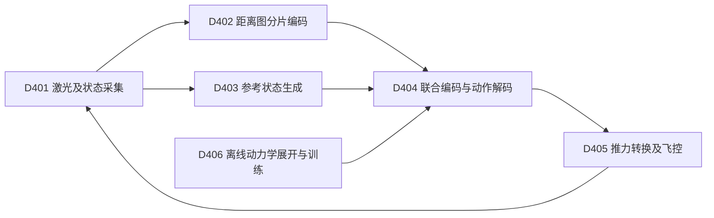
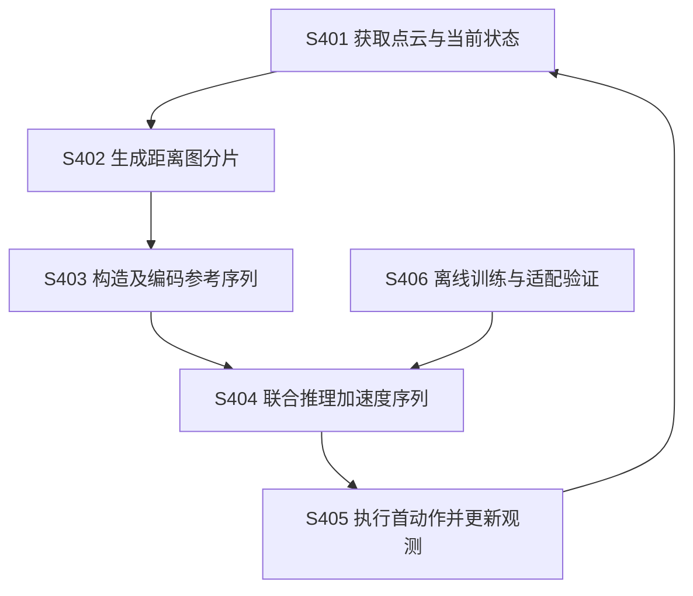

# 技术交底书 D：基于激光距离图分片与加速度序列预测的无人机避障导航方法

> 2026-10-20。按[模板](../template.md)整理，配套[详细技术说明](04_transnav_direct_adoption_technical_20261020.md)。
> 编写口径：直接采用 TransNav 公开技术主体，仅将实施场景写为园区巡检，并对设备参数、训练数据和速度范围作适配说明；不另行设计改进算法。
> 来源：Zhu 等，TransNav，arXiv:2610.23635v1，2026-10-16。本文为已公开方案的交底式整理，不将论文贡献认定为申请人原创；尚无申请人实测结果。真实发明人、研发记录和可申请的未公开差异待确认。

## 一、本发明解决的技术问题是：

### 1.1 现有技术缺点和原因

无人机在园区树木、立柱和临时移动物体之间巡检，需要同时根据周围几何和目标方向持续改变飞行速度。

1. 原始激光点较多，逐点复杂处理会增加从感知到动作的延迟；简单压缩又可能丢失窄通道和细障碍信息。
2. 一些方案主要针对静态环境优化，遇到移动物体时反应不足；另一些动态避障策略在密集静态障碍中表现下降。原因包括输入表示、训练分布和动作生成方式不适配两类场景。
3. 只预测当前一个动作，容易过度追求立即靠近目标；训练高维动作序列时，专家示范生成成本高，常规强化学习也可能不稳定。

以上是来源论文提出的技术背景，不是本稿发现的新增缺陷，也不表示所有现有导航方法都存在这些问题。

### 1.2 针对上述缺点的目的及技术问题

本发明目的：在不增加复杂多级规划链路的前提下，基于激光距离图分片和动作序列预测，实现可实时执行的无人机避障导航。

本发明要解决的技术问题是：如何把大量激光测量与目标状态压缩为固定规模输入，并在同一策略中输出可滚动执行的短期加速度序列，使系统同时具备可计算性、响应性和轨迹平顺性。

### 1.3 技术效果及条件

| 缺点 | 对应手段 | 效果的因果说明 |
| --- | --- | --- |
| 数据量和几何保留难兼顾 | 角度距离图及局部分片编码 | 将点云压缩为固定大小输入，同时保留各片内部空间布局 |
| 静态与动态场景适应不一致 | 环境/参考融合并反复输出动作序列 | 根据新观测持续改变下一动作，不固定跟踪一次生成的长轨迹 |
| 单步短视、序列训练困难 | 质点模型展开和轨迹代价梯度训练 | 未来状态直接参与训练，不依赖另行生成的专家动作标签 |

这些机理和论文实验均来自公开方案。本文尚未验证园区适配后的效果，不声称存在额外提升，也不把软距离代价当作无碰撞的数学保证。

## 二、详细介绍技术背景，并描述已有的与本发明最相近似的实现方案。

### 2.1 技术背景

无人机导航系统通常由激光/深度传感器、位姿估计器、局部运动生成器、推力控制器、飞控和电机组成。感知模块描述障碍，运动生成器决定如何飞行，控制系统转为推力和姿态。近距巡检要求这些环节及时处理障碍与目标变化，并避免突变动作。

### 2.2 现有技术方案及缺点

**方案及不足。** 传统分级方案先建图、搜索路径再优化轨迹，便于显式设置约束，但多环节处理和更新会增加延迟；学习式方案直接从观测和目标生成动作，仍需协调环境特征、参考运动及平台响应。

**最相近方案。** TransNav [D-R1] 把激光距离图分片编码，与参考位置/速度特征一起输入 Transformer，输出加速度序列；训练时结合引导、避障和平顺性代价，部署每次只执行首动作再重新计算。它为上述需求提供了本稿直接采用的结构，具体参数见第三部分。原文 IV-A、V 明确未显式预测动态障碍；软损失训练也不等于运行时硬安全保证，效果仍受感知、模型和训练范围限制。园区巡检适配不消除这些局限。文献出处见第七部分 [D-R1]。

## 三、本发明技术方案的详细阐述（核心的重点内容）：

### 3.1 实施范围、输入输出

对象为具备三维激光、位姿估计和期望加速度接口的多旋翼。采用论文结构实现原型，先在隔离场地验证，再决定是否适用于实际巡检。

输入：点云、当前运动状态、目标状态；输出：未来加速度序列，其中只有首动作转交实际控制。训练阶段另需完整障碍距离场；该信息不能假定部署时同样存在。

### 3.2 图 1：部件及连接

| 标号 | 实现职责 |
| --- | --- |
| D401 | 采集激光、位姿和速度并按设备接口对齐，提供当前状态 |
| D402 | 角度分格取最近距离、分片、卷积及线性投影 |
| D403 | 由起终状态计算五次多项式并采样位置/速度 |
| D404 | 联合环境与参考特征，解码有限长度加速度序列 |
| D405 | 首动作转换为推力/姿态要求，经既有飞控执行 |
| D406 | 生成训练场景、展开运动、计算损失并更新网络参数 |

### 3.3 图 2：运行流程

### 3.4 S401、S402：从点云生成固定大小输入

将点转换到约定的机体坐标，按水平角和俯仰角定位距离格，同格取最近有效回波。保持原文 30×80 网格和 100 个 3×8 分片，每片经两层卷积、展平和线性层得到 128 维向量。

原卷积配置按“输出通道、卷积核、步长、填充”分别为 [32,2,1,1]、[64,2,1,0]。与训练一致地处理有效测距范围和无回波值。原文当前核读段落不足以确定所有设备异常填充值，复现时需核对作者代码及传感器接口，不在这里臆定。

按实际时间使用位姿和测量，防止接口错配；这是普通采集适配，不新增逐格年龄约束算法。

### 3.5 S403：构造五次参考

每轴使用：

$$
p(t)=c_0+c_1t+c_2t^2+c_3t^3+c_4t^4+c_5t^5.
$$

对给定持续时间，以起点和终点的位置、速度、加速度六个条件求六个系数。持续时间须由同一参考生成规则确定并与训练一致，不能只给终点就声称曲线唯一。

从参考采样 30 个状态，每个含三维位置和速度，得到 30×6 输入，经线性层映射到 128 维。参考是希望运动的方向，不是已经经过障碍检查的通行保证。

### 3.6 S404：融合并输出动作

把 100 个环境特征和 30 个参考特征拼接，使用两层、每层两注意力头、前馈宽度 512 的编码器。取参考对应的 30 个输出特征，经两层多层感知机得到 30×3 加速度。

网络所有向量必须遵循训练约定的坐标和归一化。部署不能把世界系速度直接当机体系速度，或给未训练的新传感通道。

### 3.7 S406：离线训练

对网络输出加速度，用简化模型传播位置和速度：

$$
p_{k+1}=p_k+v_k\Delta+\tfrac12a_k\Delta^2,\qquad
v_{k+1}=v_k+a_k\Delta.
$$

在固定局部坐标中计算；体坐标输出需按一致的姿态约定转换。损失按论文由四类加权项构成：

$$
L=\lambda_gL_g+\lambda_sL_s+\lambda_aL_a+\lambda_jL_j.
$$

- \(L_g\)：预测速度与朝目标期望速度的偏差，加终点偏差。
- \(L_s\)：沿预测状态评价最近障碍距离和靠近趋势，距离由训练用有符号距离场提供。
- \(L_a\)：加速度平方和。
- \(L_j\)：相邻加速度差除以时间间隔后的平方和，即抑制突变。

论文权重为 1.0、1.5、0.005、0.0005。它们不能无视状态尺度直接迁移为通用最优参数。安全代价是软损失，不把它写成一定满足的硬约束。

通过动力学链式求导，得到损失对网络参数的梯度。论文在递推状态梯度项上乘 \(e^{-\alpha\Delta}\)，\(\alpha=0.9\)，以抑制长时间递推的梯度累积。它是训练技巧，不是障碍风险衰减公式。

原文从十个静态随机环境各采一万样本，批量 16、50 轮训练，使用 Adam。原始静态训练而动态测试的设定保留为基线；换成园区数据时另记录，不能把重新采样后的效果归为原文实测。

### 3.8 S405：控制转换及更新

仅取首个期望加速度，由推力控制器结合重力和状态转换为飞控可接受的推力、姿态等命令，具体转换使用平台既有控制器并标定。期望偏航可按水平速度方向生成。

反复采集、推理、执行，不将整段 1.5 s 序列不经观测全部下发。若目标已到达，按飞行任务状态机结束或悬停；传感器无效、状态异常或推理超时，向上层报告并使用平台已有故障处置，不能继续下发过期输出。上述故障处置是集成要求，不是论文新增避障能力。

### 3.9 小幅适配和算例

本稿把任务描述具体化为园区近距巡检，结构保持不变。以低速封闭验证为起点，目标速度范围依据平台标定确定；若改变训练目标速度，须重训或验证，不能宣称把原文 7 m/s 设定改小就一定安全。

算例：当前位置 0 m、速度 1 m/s，首段期望加速度 0.5 m/s²，预测步长 0.05 s，则：

$$
p_1=0+1(0.05)+\tfrac12(0.5)(0.05)^2
=0.050625\ {\rm m},\qquad
v_1=1.025\ {\rm m/s}.
$$

这是训练展开的算例，不是飞控实际运动精度。100 个环境特征加 30 个参考特征共 130 个 token，解码只使用后者对应的 30 个特征。

## 四、本发明的关键点和欲保护点是：

技术核心按重要性列出，均应注明为 TransNav 已公开内容：

1. 激光角度距离图的局部分片编码与参考状态联合表示。
2. 联合编码后一次输出有限时域加速度序列，运行时循环执行首动作。
3. 基于简化动力学展开、轨迹级损失和时间梯度衰减的训练。

本稿只进行了场景及参数适配，没有识别出可独立主张的未公开保护点。不得把以上原论文技术核心直接标为申请人新发明；真实后续差异由研发和代理人另行确认。

## 五、与第二部分所属的最好的现有技术相比，本发明的优点：

第二部分最相近方案就是 TransNav，本稿直接采用，**没有证据声称优于该方案**。所实现的效果来自同一公开机制：

1. 固定距离图分片减少输入规模，联合编码保留局部及跨区域关系。
2. 序列训练把后续状态纳入动作学习，首动作滚动执行使策略及时响应新观测。
3. 动力学展开直接提供训练梯度，避免依赖专家动作标签。

改成园区任务或降低目标速度本身，不构成新的技术优点证明。

## 六、针对第三部分中的技术方案，是否还有别的替代方案？

1. 换用视野和角分辨率相近的激光设备，但必须重新验证距离图转换、盲区、测距范围及输入分布。
2. 园区树木、杆件等可替换训练障碍形状，网络和训练方式不变；覆盖更多场景不自动意味着更好泛化。
3. 目标可以来自航点或上层任务系统，仍转成同结构的五次参考状态。
4. 机载计算平台可替换，但须验证数值精度、端到端延迟及控制频率。量化和模型转换不得改变输出含义。
5. 更换网络、显式预测障碍或增加硬约束优化器将不再是本稿所述的少量适配，不能混称为原方法复现。

## 七、其他有助于专利代理人理解本技术的资料：

### 7.1 文献和读取情况

Zhu、Li、Zhang、Sun，*TransNav: Transformer-Based End-to-End Navigation Method for Static and Dynamic Quadrotor Obstacle Avoidance*：

- [书目及提交日期](https://arxiv.org/abs/2610.23635)，2026-10-16。
- [v1 全文](https://arxiv.org/html/2610.23635v1)，核读 III-A～C、IV-A～C、V。
- DOI：10.1109/LRA.2026.3734893；网页列 RA-L 2026 年 11 月卷期，本次按已公开 v1 取材。
- [作者代码入口](https://github.com/jhzhubit/TransNav)，原文提供；本轮未下载或验证运行，不声称已经复现。

论文原图和源码未复制入本稿，附图为本稿自行绘制的结构概括。

### 7.2 采用与修改对照

| 项目 | 本稿处理 |
| --- | --- |
| 距离图、分片、特征维度、序列网络 | 直接采用原结构 |
| 动力学展开及四项训练损失 | 直接采用原方法并解释含义 |
| 场景叙述 | 具体化为园区近距巡检 |
| 设备和速度范围 | 仅列适配与标定要求，未虚构已选参数或效果 |
| 此前拟新增的测量年龄预测及序列修正 | 已移除，不属于本稿 |

### 7.3 复现及申请边界

复现顺序：距离图与坐标检查→参考生成与张量维度→动力学及损失测试→静态仿真→动态仿真→低速隔离实机。记录成功率、碰撞、平均速度、路径长度和端到端延迟，不只记录网络推理时间。

直接采用已公开技术并更换场景、设备或常规参数，通常不足以支持新的新颖性/创造性主张。本文首先是便于实现和沟通的交底材料，不是已经具备授权条件的申请文本。
