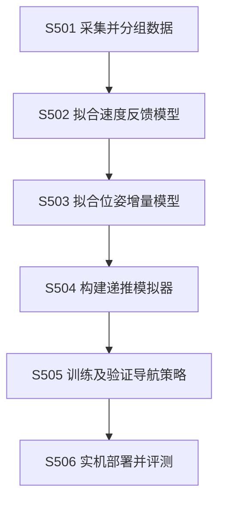

# 技术交底书 E：基于位姿增量与速度反馈分离建模的移动机器人导航训练方法

> 2026-10-20。按[模板](../template.md)整理，配套[详细技术说明](05_eida_direct_adoption_technical_20261020.md)。
> 编写口径：直接采用 EIDA 主体，实施对象具体化为带既有速度控制器的差速巡检机器人，仅调整目标平台数据、命令范围和接口。未增加主动辨识或故障归因算法。
> 来源：Qian 等，EIDA，arXiv:2610.01219v1，2026-10-01。公开贡献归原论文，本文不将其认定为申请人原创；无申请人复现或实测结果。真实研发记录及可申请差异待确认。

## 一、本发明解决的技术问题是：

### 1.1 现有技术的缺点及原因

移动机器人导航策略可在模拟器中快速训练，但实际部署时，同一条速度命令可能产生与仿真不同的位移、转向和速度报告。

1. **理想速度命令与真实运动不一致。** 原因是速度命令还要经过平台低层控制器、电机及接触响应，不能简单把“要求 1 m/s”当作“已经以 1 m/s 移动”。
2. **实际位移和策略收到的速度反馈含义不同。** 原因是估计器的反馈包含自身的处理方式；若只用一个理想速度量同时更新几何和策略输入，可能无法匹配真实闭环。
3. **完整重建低层执行器较复杂。** 逐一模拟电机、传动和接触会增加建模与计算成本，而导航主要关心相对障碍的运动和策略实际看到的反馈。

这些问题及采用分离建模的解决思路均来自来源论文。

### 1.2 针对上述缺点的目的及技术问题

本发明目的：在不重建全部底层执行器细节的前提下，构建能用于导航策略训练的执行接口模型，提升仿真训练与实机部署的一致性。

本发明要解决的技术问题是：如何分别描述“命令导致的真实位姿变化”和“策略可见的速度反馈变化”，并在同一轻量模拟器中联合使用这两类模型，以减少导航策略的仿真到实机落差。

### 1.3 对应效果

| 缺点 | 对应技术手段 | 机理效果 |
| --- | --- | --- |
| 理想命令不等于真实运动 | 从真实执行数据拟合机体系位姿增量 | 模拟碰撞、激光和目标几何使用更贴近平台的运动 |
| 几何与反馈混用 | 独立拟合速度反馈，并提供短时反馈历史 | 策略接收的数据含义与实机估计器输出更一致 |
| 低层建模复杂 | 在速度命令接口处建模，不替换低层控制器 | 聚焦导航相关响应，保留轻量并行训练形式 |

不保证任意平台、任意指令范围或长期预测均改善。原论文结果是其试验条件下的证据，本文未重复获得。

## 二、详细介绍技术背景，并描述已有的与本发明最相近似的实现方案。

### 2.1 技术背景

移动机器人导航系统包括激光雷达、定位和速度估计器、导航策略、速度控制器及轮端驱动器。策略根据障碍、目标和反馈输出速度命令，低层控制器实际执行。模拟训练既要复现机器人走了多少、转了多少，也要复现策略下一时刻收到的速度反馈；两者不能互相替代。

### 2.2 现有技术方案及缺点

**方案及不足。** 理想模拟器直接把命令速度积分为位姿，计算快，却忽略真实响应和反馈差异；完整物理模拟器需要大量参数，也不一定准确复现策略所见的执行接口。只拟合运动而沿用理想速度反馈，仍会使模拟训练条件与实机不同。

**最相近方案。** EIDA [E-R1] 采集目标平台的命令、速度反馈、参考位姿和时间，分别拟合位姿增量模型及下一时刻速度反馈模型，在模拟器中分别更新几何和策略输入，再训练导航策略。部署时只运行策略，两个拟合模型均不在线运行。原文 IV-A、V-B 说明确定模型未显式表达定位及预测不确定性，验证集改善也不代表所有部署工况均改善。本稿直接采用该结构，差速平台仍须验证数据覆盖及策略表现，不声称已解决这些局限。文献出处见第七部分 [E-R1]。

## 三、本发明技术方案的详细阐述（核心的重点内容）：

### 3.1 输入输出及实施前提

主实施对象为支持前向速度和偏航速度命令的差速机器人，命令维度 \(m=2\)。机器人能记录参考平面位姿、速度估计和实际发出命令，已有可工作的低层控制器。

训练输出依次为位姿增量模型、速度反馈模型和最终导航策略。实机输出只有策略产生的速度命令，不把训练用模型误写成在线控制器。

### 3.2 图 1：系统结构

| 标号 | 实现职责 |
| --- | --- |
| E501 | 记录命令、可用速度、参考位姿、时间间隔，形成连续有效轨迹组 |
| E502 | 归一化并加权回归，拟合下一速度反馈 |
| E503 | 由相邻参考位姿构造机体系增量，进行单步及多步网络训练 |
| E504 | 分别更新几何及反馈，计算激光、目标与奖励 |
| E505 | 以固定模拟器训练导航策略，保存验证通过的检查点 |
| E506 | 使用真实激光、目标和反馈历史运行策略，经原低层控制器执行 |

### 3.3 图 2：流程

### 3.4 S501：数据与目标构造

每条样本保存：

“当前参考位姿 \(p_t,\psi_t\)、下一参考位姿、当前速度估计 \(s_t\)、当前及历史命令、下一可用速度 \(s_{t+1}\)、区间长度 \(\Delta t_t\)、轨迹组编号”。

在区间起点机体系构造标签：

$$
\delta p_t=R(\psi_t)^{\mathsf T}(p_{t+1}-p_t),\qquad
\delta\psi_t=\operatorname{atan2}
(\sin(\psi_{t+1}-\psi_t),\cos(\psi_{t+1}-\psi_t)).
$$

即先算世界位移，再转回机器人当时前后左右方向。角度包装避免把从 179° 到 −179° 误算成转了 −358°。

采集组合人工激励和导航式轨迹，保留完整命令历史，定位缺口不插值成正常数据。相近重复轨迹放在同一组再划分训练/验证，防止重复样本泄漏。归一化统计只使用训练集。

### 3.5 S502：先拟合速度反馈

按论文形式：

$$
\widehat s_{t+1}=A_s s_t+A_u u_t+b.
$$

采用加权岭回归，正则参数原文为 \(10^{-3}\)。完整矩阵允许不同速度轴之间有耦合；不能机械只保留对角项。

差速实例中 \(s,u\) 各为两维，因此 \(A_s,A_u\) 为 2×2，\(b\) 为两维。这里是速度反馈预测，不将其直接积分成模拟器几何。拟合后冻结供后续训练使用。

### 3.6 S503：位姿增量网络及损失

输入：

$$
x_t=[s_t^{\mathsf T},u_t^{\mathsf T},\ldots,
u_{t-H_u}^{\mathsf T}]^{\mathsf T},\qquad
\widehat\delta_t=f_\theta(x_t,\Delta t_t).
$$

\(H_u\) 是历史命令数，当前命令另计；不含时间间隔时特征维度为 \((H_u+2)m\)。输出为两维平移和一维偏航增量。

原位姿网络有两个宽度 256 的隐藏层，使用 SiLU 激活和三维线性输出。原 Jackal 为 14 个非时间特征、Go2 为 21 个；对这里的 \(m=2\)，取 \(H_u=5\) 时为 14，再追加一个时间间隔，实际网络输入为 15 维。该示例沿用原结构，不声称所有平台都必须用同一历史长度。

单步损失对预测与真实增量差除以各分量训练标准差，再计算加权 Smooth-L1。误差小于 1 的归一化部分按二次项，大误差按线性项，降低异常值对训练的影响。

多步训练以记录命令递推，不再在每步喂真实未来速度，而使用已固定反馈模型的预测。比较累计端点位姿，按 \(\sqrt h\) 与目标尺度归一化。先单步训练，再交替做单步和多步更新，避免只在“每步都知道真反馈”条件下效果好。

### 3.7 S504：两类状态分开更新

模拟器持有平面几何位姿和策略速度反馈两个状态：

$$
\widehat p_{t+1}=\widehat p_t+
R(\widehat\psi_t)\widehat{\delta p}_t,\qquad
\widehat\psi_{t+1}=
\operatorname{wrap}(\widehat\psi_t+\widehat{\delta\psi}_t).
$$

位姿增量已经是一个区间内的位移，不再乘 \(\Delta t_t\)。用该位姿算激光射线、相对目标、碰撞和奖励；用 E502 模型产生下一速度输入。命令历史和反馈历史分开维护。

不能为了简化把位姿输出除以时间后冒充策略反馈；这会取消论文核心分离关系。

### 3.8 S505：策略输入、动作和训练

策略输入为 30 个激光扇区最近距离、目标距离/相对朝向、当前及短历史速度反馈。使用论文所述带可学习偏置的距离倒数变换编码，强调近障碍；实际实现需核对原代码中的数值约定，不能任意用 \(1/r\) 造成近零溢出。

归一化动作映射为物理命令：

$$
u_t=u_{\min}+\tfrac12(a_t+\mathbf1)
\odot(u_{\max}-u_{\min}),\qquad a_t\in[-1,1]^m.
$$

奖励为碰撞惩罚、到达奖励和普通情况下的目标距离缩短；同一时刻碰撞优先。原文到达奖励为 10、进度比例为 2，碰撞惩罚为负；本次核读部分未明确该负值具体数值，不臆造。

采用软演员—评论家训练，演员和评论家分别为四层宽 128 的隐藏网络，批量 512、学习率 \(3\times10^{-4}\)、折扣 0.99，作为原文复现起点。两接口模型固定，不通过模拟器反传策略梯度。

### 3.9 S506：部署和普通接口适配

部署输入是真实激光、定位得到的目标几何和真实速度历史；只运行策略，速度命令交给已有控制器。两个拟合模型留在训练端，不在线预测替代实测值。

差速平台只使用前向和偏航命令；按真实限速及激光安装重新采集数据。新任务开始清空/正确初始化历史，传感器失效、时间断裂或定位异常时报告并转既有故障控制，不继续使用过期历史。

这属于平台落地适配，不增加主动试验动作选择、故障分类或在线模型热更新。

### 3.10 可手算示例

机器人初始朝向为 90°，世界坐标从 (2,3) m 变成 (2,3.1) m，朝向不变。世界位移为 (0,0.1) m，转回起点机体系为 (0.1,0) m，偏航增量为 0。

若该区间为 0.1 s，网络标签仍是 0.1 m，不是 1 m/s。模拟器应平移 0.1 m；若再次乘 0.1 s，就错误缩为 0.01 m。

命令范围若为前向 [0,1] m/s，归一化动作 0 映射为 0.5 m/s；偏航范围 [−0.6,0.6] rad/s 时，归一化动作 0 映射为 0 rad/s。以上仅用于解释接口，不表示平台参数已经选定。

## 四、本发明的关键点和欲保护点是：

以下是 EIDA 已公开的技术核心：

1. 位姿增量与速度反馈分开学习、分别承担模拟器几何和策略观测更新。
2. 位姿模型使用命令历史，策略使用反馈历史，多步拟合递推使用预测反馈。
3. 拟合接口支持轻量模拟训练，实机仍用真实传感和既有低层控制器。

本稿只更换目标平台及数据接口，没有证明新增可保护点。不得把这些公开内容或普通数据清洗改写为申请人原创。

## 五、与第二部分所属的最好的现有技术相比，本发明的优点：

最接近方案为 EIDA，本稿直接采用，因此不声称有额外优点。原公开机制在本实施中对应：

1. 位姿数据决定几何，避免将命令误当实际位移。
2. 反馈单独建模，避免仿真策略收到含义不同的速度输入。
3. 只拟合导航接口，保留轻量训练和原低层控制器，不必先重建全部执行器。

上述机制在目标巡检机器人上是否有效，仍须复现与实测。

## 六、针对第三部分中的技术方案，是否还有别的替代方案？

1. 可换成支持横向速度命令的平台，调整 \(m\) 及输入输出维度，保留分离建模。
2. 参考位姿可来自平台已有可靠定位或外部定位，须核对坐标、时间和质量，不要求增加主动辨识专用系统。
3. 命令范围、历史长度和数据权重按目标平台验证调整，不能不重训就沿用其他平台模型。
4. 可更换并行模拟器或机载算力，但射线、奖励、碰撞仍应使用同一模拟几何。
5. 改为在线模型辨识、显式反馈延迟分类或不确定性规划，将超出本稿的直接采用范围。

## 七、其他有助于专利代理人理解本技术的资料：

### 7.1 原始来源

Qian、Wang、Hu、Zhang、Zhang，*EIDA: Execution-Interface Dynamics Adaptation for Real-to-Sim-to-Real Robot Navigation*：

- [书目和日期](https://arxiv.org/abs/2610.01219)，2026-10-01。
- [v1 全文](https://arxiv.org/html/2610.01219v1)。
- 本轮核读 IV-A～C、V-A～C、摘要和结论；未把未读取的作者代码细节补写为已知事实。

原文完整验证集预测改善、100 个 BARN 仿真环境测试和 Go2 20 次静态实机试验，都不是本稿目标平台的测试结果。原文指出 Go2 部署范围内位置精度未始终改善，引用时一并保留。

### 7.2 采用和少量调整

| 内容 | 处理 |
| --- | --- |
| 位姿 MLP、反馈 ARX、两类历史、递推训练 | 直接采用 EIDA |
| 主实施平台 | 具体化为差速巡检机器人，按 \(m=2\) 解释 |
| 命令限幅、采样间隔、数据集 | 按目标硬件采集和标定 |
| 此前拟增加的主动辨识和变化归因 | 已移除 |

### 7.3 验证与申请边界

先验证坐标增量、动作映射、历史维度，再验证单步和多步误差，最后对比理想模拟器训练策略与拟合接口训练策略在同条件下的导航表现。按轨迹组留出，不能只报告训练误差。

公开方法加常规平台适配不自动具备新颖性或创造性。本文是按模板完整说明技术的材料；只有真实存在未公开、非显而易见的差异时，才进一步确定可申请保护内容。
