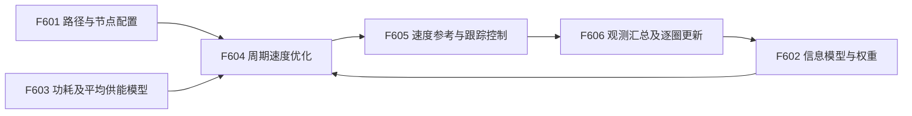
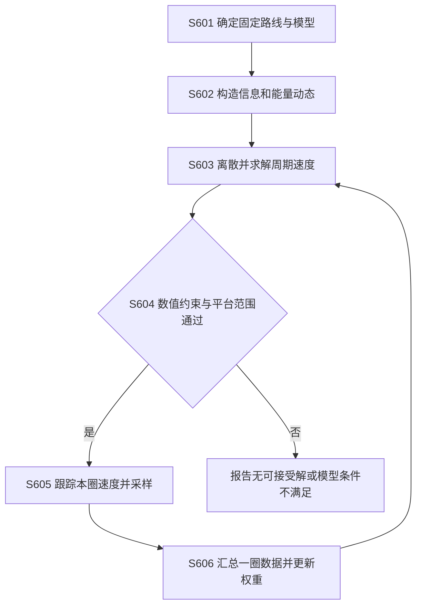

# 技术交底书 F：可持续供能巡检机器人能量与信息质量联合速度规划方法

> 2026-10-20。按[模板](../template.md)整理，配套[详细技术说明](06_energy_information_direct_adoption_technical_20261020.md)。
> 编写口径：直接采用来源论文的固定闭合路径、信息动态、平均能量约束及速度优化，应用叙述具体化为园区湖面水质巡检；仅调整路径、监测权重及标定参数。
> 来源：Govindarajan 等，arXiv:2610.20875v1，2026-10-14。公开方法归原论文，本文没有新增遮光储备、复测硬期限或新的滚动控制算法。无申请人实验，未确认可申请的未公开差异。

## 一、本发明解决的技术问题是：

### 1.1 现有技术缺点及原因

可持续供能机器人沿路线反复监测温度、盐度等环境量。环境持续变化，旧测量会逐渐失去可靠性；推进功耗通常也会随速度明显变化。

1. **固定速度不能充分利用不同位置的观测价值。** 重要区域可能值得停留更久，而长时间停留又会延长其他位置的重访间隔。
2. **单独追求低推进功耗不能保证监测效果。** 速度过低会使整圈变长，远处信息变旧；速度过高又可能超出持续供能能力。
3. **只看单次到达目标不能表示长期巡检质量。** 原因是持续监测需要多圈重复，信息的积累和衰减必须纳入同一规划问题。

上述问题及对应优化框架来自论文，不是本稿新增的技术发现。

### 1.2 针对上述缺点的目的及技术问题

本发明目的：在固定闭合巡检路线下，通过速度规划同时兼顾信息质量和供能可持续性，避免仅按固定速度运行。

本发明要解决的技术问题是：如何把位置相关感知、信息自然衰减、速度相关功耗和圈长时间放入同一优化模型，得到可重复执行的速度分布并支持逐圈更新。

### 1.3 对应效果

| 缺点 | 技术手段 | 效果说明 |
| --- | --- | --- |
| 匀速不区分信息价值 | 位置相关感知和节点权重 | 速度分配可以随重点监测位置改变 |
| 能耗与信息分开优化 | 超线性功耗和信息动态联合优化 | 避免只按最短时间或最低推进功率单独决策 |
| 缺少长期重复条件 | 信息状态周期约束和每圈能量平衡 | 在模型假设下形成可重复的巡检速度策略 |

这些是原公开方法的效果。本稿不声称平均能量平衡能保证有限电池途中始终有电，也不声称每个监测点都有硬性复测期限。

## 二、详细介绍技术背景，并描述已有的与本发明最相近似的实现方案。

### 2.1 技术背景

持续监测机器人通常包括定位系统、监测传感器、推进控制器、电池与能量采集装置、路线存储及规划单元。固定路线决定经过哪里，速度决定到达时间和停留时长；传感信息会随时间变旧，推进功耗又随速度变化，因此速度安排需兼顾监测质量和供能。

### 2.2 现有技术方案及缺点

**方案及不足。** 固定速度容易执行，但难以同时照顾不同节点的信息价值和速度相关功耗；只追求快速复测可能长期耗电，只按节能降速又可能使重要节点的信息过时。

**最相近方案。** *Optimally Trading Energy for Information through Speed Trajectory Optimization of Sustainably Powered Mobile Robots* [F-R1] 沿固定闭合路径建立节点信息更新/衰减与速度相关功耗模型，在周期信息状态及每圈电量不减少条件下优化平均信息质量，离散为非线性规划求解，并可用上一圈观测更新权重。其局限是只优化速度，采用恒定平均供能且假定途中电池储备充足，不能保证逐时电量安全；非凸求解也不保证全局最优。湖面巡检适配直接保留这些边界，不新增路线优化或逐时电池约束。文献出处见第七部分 [F-R1]。

## 三、本发明技术方案的详细阐述（核心的重点内容）：

### 3.1 实施对象和输入输出

对象为沿既定闭合路线进行水质监测的可持续供能水面机器人，已有定位和速度跟踪功能。

输入：路径长度及节点、感知强度分布、信息衰减参数、节点权重、推进功耗函数、平均输入功率和平台速度范围。输出：沿路径的速度参考、对应圈长时间和预测信息质量。

底盘/艇体功耗及传感模型须独立标定。论文系数不直接作为园区设备真值。

### 3.2 图 1：结构

| 标号 | 实现 |
| --- | --- |
| F601 | 保存闭合路径弧长坐标和环境节点，将实际位置投到路线 |
| F602 | 根据传感及过程模型提供信息动态、感知分布和节点权重 |
| F603 | 标定速度功耗，配置平均输入功率和模型有效范围 |
| F604 | 离散速度、积分信息，求解周期信息及平均能量约束 |
| F605 | 将当前路线位置对应速度交给已有跟踪控制器 |
| F606 | 汇总一圈观测，更新下一圈权重并重新求解 |

### 3.3 图 2：流程

### 3.4 S601：固定路线与平台参数

用弧长 \(s\in[0,L]\) 标记路线。初版不增加新的支路选择；各节点对应要监测的空间位置。

标定 \(S_j(s)\)：机器人位于 \(s\) 附近时，传感器对节点 \(j\) 的估计能改善多少。标定信息衰减参数，描述环境随时间变动；配置非负权重 \(\gamma_j\)，表示关注程度。

平均输入功率 \(P_{\rm in,avg}\) 来自任务条件下的估计，不把它说成每一秒都能得到的下界。仅在电池储备足以缓冲输入波动的前提下应用原平均模型。

### 3.5 S602：信息动态

沿用论文形式：

$$
\dot s=u,\qquad
\dot q_j=S_j(s)(1-q_j)^2-\alpha q_j^2.
$$

\(q_j\) 为归一化估计质量，感知使其增加，自然变化使其衰减；\(S_j,\alpha\) 在该归一化约定下具有每秒的尺度。原文以协方差相关指标说明清晰度，应用前需统一估计量和方差尺度，不将带量纲原始方差直接相加。

当不观测、\(S_j=0\) 时，信息仍会随时间衰减；在重点节点放慢能提高该处质量，却也延长其他节点等待。因此不能仅凭某一点“测得更久”判断总目标一定更好。

### 3.6 S602：能量与圈长

按原功耗示例：

$$
\dot b=P_{\rm in,avg}-P_{\rm out}(u),\qquad
P_{\rm out}(u)=k_h+k_m u^3.
$$

这里若功率为 W，则 \(b\) 用 J；若实现用 Wh，能量微分应除以 3600。\(k_h\) 为基础功率，\(k_m\) 单位为 W/(m/s)³。

一圈时间：

$$
T(u)=\int_0^L\frac{1}{u(s)}\,ds.
$$

采用平台正速度范围 \(0<u_{\min}\le u\le u_{\max}\) 作为实现参数，避免空间域除零。它是平台约束，不是新增优化机制。原模型不在路线中安排零速充电等待。

### 3.7 S603：周期优化

目标及约束为：

$$
\max_u\quad
\frac1T\int_0^T\sum_j\gamma_jq_j(t)\,dt,
\qquad
q_j(T)=q_j(0),\quad b(T)\ge b(0).
$$

路径起终点分别为 \(s(0)=0,s(T)=L\)，\(T\) 随速度变化。信息周期条件表示关注可重复巡航的稳定状态，不意味着实际开机第一圈天然处于该状态。

空间域实现可积分：

$$
\frac{dq_j}{ds}
=\frac{S_j(s)(1-q_j)^2-\alpha q_j^2}{u(s)},
\qquad
\int_0^L\frac{P_{\rm out}(u(s))-P_{\rm in,avg}}{u(s)}\,ds\le0.
$$

目标也必须按 \(ds/u(s)\) 转为时间积分，不能用距离平均代替时间平均。

### 3.8 S603、S604：有限维求解及检查

1. 将闭合路径分为有限段，段内速度作为决策变量，保留原文分段常数离散思路。
2. 给定候选速度，计算各段时间并积分各节点信息状态。
3. 将周期初始信息状态一并求解，或先迭代到周期稳定后评价；不任意把所有节点初值固定为 1。
4. 计算时间平均目标及全圈净能量，使用 IPOPT 一类非线性规划求解器。
5. 检查约束残差、速度范围、积分网格收敛和不同初值结果。求解器结束不等于证明全局最优。

分段常数速度是数值近似。实际跟踪存在加减速过程；若控制器不能近似实现，需细化网格、减小参考变化并用实际响应重新评价，不能宣称该近似已保证执行器可行。若需要正式加入加速度/电池硬约束，那将超出本稿直接采用的范围。

### 3.9 S605、S606：执行和逐圈更新

机器人根据实时路线位置读取速度参考，交给已有控制器，并记录实际位置、速度、采样和能量。在一圈结束后，根据监测量和任务关注区更新 \(\gamma_j\)，求下一圈速度。

论文案例用上一圈观测更新特定盐度关注区；本稿替换为园区水质关注权重时，保留“观测→权重→下一圈求解”的形式，具体阈值由任务确定。不新增每个点必须在几分钟内复测的硬期限。

若天气、储备电量、障碍绕行或控制误差使原假设不成立，明确报告并交给既有任务/能量保护系统处理，不能继续声称平均模型保证本次巡检。无解时也不静默放松能量约束。

### 3.10 手算及参数适配

假设功耗 \(P(u)=20+5u^3\) W，平均输入 60 W，路线 200 m。仅考虑匀速作核对：

- 速度 2 m/s，时间 100 s；功耗 60 W，输入与消耗相等，各约 1.66667 Wh。
- 速度 2.5 m/s，时间 80 s；功耗 98.125 W，消耗约 2.18056 Wh，输入约 1.33333 Wh，全圈亏约 0.84722 Wh。

该例说明持续供能限制，未计算信息动态，不能由此认定 2 m/s 就是信息最优速度。真实参数需用艇体、传感器和能量采集装置标定。

少量适配只包括园区湖面路线、节点和水质关注权重；优化结构保持原样，不引入此前拟议的遮光进入储备、等待搜索和复测截止时间。

## 四、本发明的关键点和欲保护点是：

以下是来源论文已公开的核心：

1. 位置相关感知、信息衰减、速度相关功耗和圈长时间的联合表示。
2. 在周期信息和每圈能量平衡条件下最大化加权时间平均信息质量。
3. 固定闭合路线的分段速度优化，以及按上一圈观测更新下一圈权重。

本稿没有识别出新的未公开保护点。园区场景、监测量名称和常规标定系数不能自动成为独立创新，正式申请需另有真实技术差异及证据。

## 五、与第二部分所属的最好的现有技术相比，本发明的优点：

最相近方案就是 F-R1，本稿直接采用，不主张超过该方案。原方法带来的效果为：

1. 速度作为决策变量，使停留时间和重访时间参与信息优化，而非固定匀速。
2. 将功耗与信息放在同一目标/约束体系，避免只追求快或只追求推进省电。
3. 周期条件描述重复巡检，使规划评价不局限于单次到达。

这些效果仍受平均供能、充足电池储备和固定路径等假设约束，没有新增的逐时电量或超期保护。

## 六、针对第三部分中的技术方案，是否还有别的替代方案？

1. 盐度可替换为温度、电导率等监测量，但需重新建立信息状态、感知和衰减参数，不直接复用原物理系数。
2. 路径可替换为其他已知闭合路线，优化仍只选择速度；遇到新绕行路线需重新配置模型。
3. 功耗函数可用平台实测的单调凸函数或数据表近似替代；原理论性质依赖假设，替换后须重新检查，不能全部照搬。
4. 可换用其他非线性规划器，或提高离散网格精度，比较目标和约束收敛；不将求解器名称当作方法差异。
5. 加入随机天气、电池中途硬下界、几何路径选择或连续滚动优化均属实质扩展，本次不纳入。

## 七、其他有助于专利代理人理解本技术的资料：

### 7.1 原始来源与读取层级

Govindarajan、Panagou、Vermillion，*Optimally Trading Energy for Information through Speed Trajectory Optimization of Sustainably Powered Mobile Robots*：

- [书目](https://arxiv.org/abs/2610.20875)，v1 2026-10-14。
- [v1 PDF](https://arxiv.org/pdf/2610.20875v1)。
- 本轮下载 PDF 提取全文，核读信息模型、周期优化、数值验证、Chesapeake Bay 仿真和结论。
- HTML 抓取只返回证明片段，因此实际方法核验依据 PDF；未将仿真写成现场实验。

### 7.2 采用及修改

| 内容 | 本稿处理 |
| --- | --- |
| 信息动态、自由圈长、时间平均目标、周期及能量约束 | 直接采用 |
| 固定路线和分段速度数值优化 | 直接采用 |
| 应用对象 | 园区湖面水质巡检，属于场景具体化 |
| 路线、节点、权重、功耗系数 | 待目标平台标定，不冒充原文参数 |
| 遮光储备、补能等待和复测硬期限 | 已移除，不是原论文方法 |

### 7.3 验证与申请边界

复现先做匀速能量和信息动态算例，再验证周期残差及网格收敛，最后与相同平均能量预算的匀速方案比较。记录信息质量、圈长、能量、求解耗时及模型假设失效情况。

原论文公开结果不能作为申请人原始实验。直接采用加场景/参数调整通常不足以成立新的新颖性、创造性；本文作为完整、易懂的技术交底材料使用，不保证可授权。
