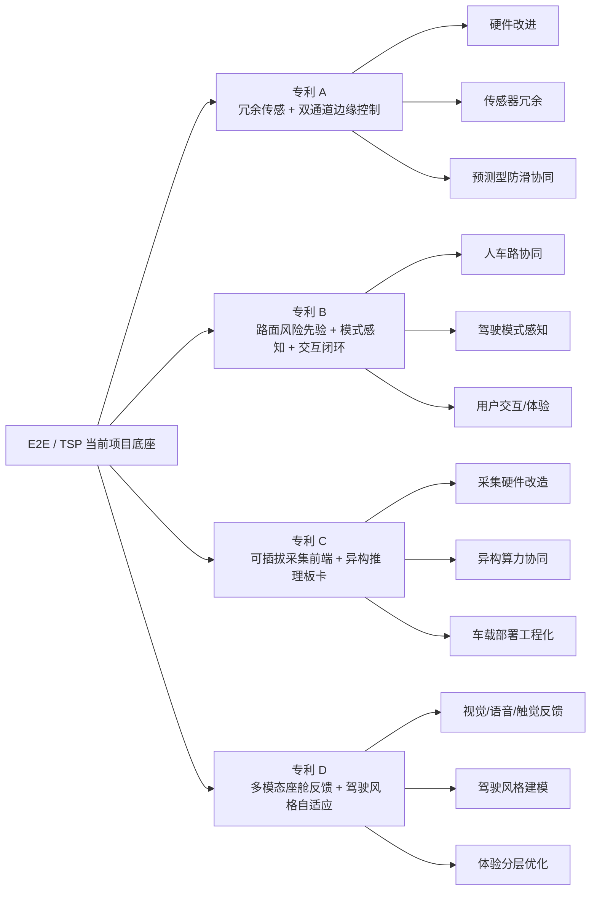
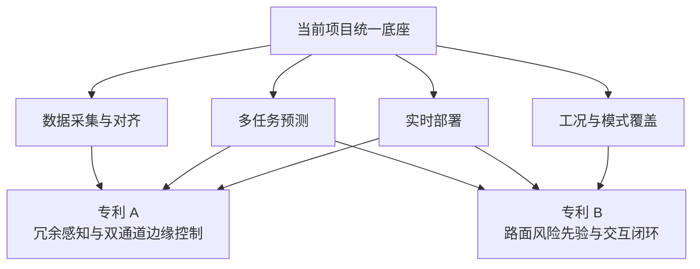

# E2E TSP 专利选题总览

> 日期：2026-04-02
> 范围：`e2e` 总项目中的 `tsp/torque_predict` 任务域
> 目标：围绕当前项目规划并起草四篇专利的技术方案介绍稿与交底书草案
> 说明：本文件用于统一四篇专利的边界、证据来源、检索策略和交付清单

---

## 1. 结论先行

本轮建议优先布局四篇专利，其中前两篇已完成首轮草案，后两篇聚焦新增的硬件改进与用户交互方向：

1. **专利 A**：基于冗余传感与双通道边缘控制器的前瞻性扭矩-防滑协同控制系统及方法。
2. **专利 B**：基于路面风险先验、驾驶模式与可解释交互的人车路协同预测型扭矩控制方法。
3. **专利 C**：基于可插拔采集前端与异构推理板卡协同的车载扭矩预测边缘硬件系统及方法。
4. **专利 D**：基于多模态座舱反馈与驾驶风格自适应的预测型扭矩交互体验优化方法。

| 方向 | 一句话总结 | 当前最接近公开检索入口 | 近似方案简介 |
| --- | --- | --- | --- |
| 专利 A | 采用多源冗余感知、可信度评分与双通道边缘仲裁方法，实现低附着和局部信号异常场景下的前瞻性扭矩-防滑协同控制。 | [Google Patents](https://patents.google.com/?q=traction+control+redundant+sensor+wheel+slip+torque) | 更接近“基于轮速/IMU 冗余输入的牵引力控制与故障降级”类方案，常见做法是在轮速差或滑移率异常后触发限扭、制动或主备切换。 |
| 专利 B | 采用路面风险先验、驾驶模式感知与可解释交互耦合方法，实现不同路况下预测型扭矩策略生成与用户体验闭环优化。 | [Google Patents](https://patents.google.com/?q=road+friction+estimation+drive+mode+torque+control+HMI) | 更接近“路面附着估计 + 模式扭矩映射 + HMI 风险提示”类方案，常见做法是先识别附着水平，再给出固定模式切换或提示策略。 |
| 专利 C | 采用可插拔采集前端、硬件状态感知与异构板卡协同调度方法，实现车载扭矩预测系统的低改造接入与高可迁移边缘部署。 | [Google Patents](https://patents.google.com/?q=vehicle+sensor+front-end+CAN+edge+inference+board) | 更接近“模块化车载采集盒/采集板 + 固定推理板卡”类方案，常见做法强调总线接入或单板部署，但较少把前端模块化与运行时调度联动设计。 |
| 专利 D | 采用预测结果驱动的多模态反馈与驾驶风格自适应策略，实现风险提示、模式建议和交互体验的分层优化。 | [Google Patents](https://patents.google.com/?q=multimodal+vehicle+HMI+driver+style+haptic+feedback+warning) | 更接近“单模态风险告警 + 个性化驾驶辅助提示”类方案，常见做法是视觉或语音单模态提示，个性化调整能力有限。 |

四篇专利的组合逻辑如下：

- 专利 A 偏向软硬件结合、硬件改进、传感器冗余、故障降级与边缘控制器协同。
- 专利 B 偏向人车路协同、驾驶模式感知、用户交互与用户体验提升。
- 专利 C 偏向采集硬件前端、异构板卡、边缘推理硬件协同与工程部署改造。
- 专利 D 偏向驾驶员触觉/视觉/语音反馈、模式建议、体验分层与交互闭环。
- 四篇专利共享当前项目的数据、模型和实时推理底座，但核心发明点分四个层级切开。

---

## 2. 项目内技术底座与证据矩阵

| 技术底座 | 当前项目已实现能力 | 主要证据文件 | 可支撑的专利抓手 |
| --- | --- | --- | --- |
| 多源采集与解码 | 已具备 BLF/ASC 解码、DBC 信号解析和批处理解码优化 | [../../../dataset/script/candecode.py](../../../dataset/script/candecode.py)、[../../deploy/can_receiver.py](../../deploy/can_receiver.py) | 传感器多源输入、信号分类处理、边缘采集链路 |
| 按信号类型对齐 | 连续量线性插值、离散量 ZOH、二值量裁剪，且已明确 age 思路 | [../../../dataset/docs/dataset_plan.md](../../../dataset/docs/dataset_plan.md)、[../../deploy/interpolate_utils.py](../../deploy/interpolate_utils.py) | 冗余传感融合、信号可信度管理、信息新鲜度建模 |
| 派生特征工程 | 已支持滑移率、轴速差、扭矩变化率、合加速度等派生特征 | [../../torque_predict/dataset_handler.py](../../torque_predict/dataset_handler.py)、[../../torque_predict/config/signals.yaml](../../torque_predict/config/signals.yaml) | 前瞻性打滑识别、扭矩变化趋势建模 |
| 多任务模型 | 已支持统一输入、扭矩回归头、前后轴打滑分类头的联合训练 | [../../torque_predict/README.CN.md](../../torque_predict/README.CN.md)、[../../README.CN.md](../../README.CN.md) | 扭矩-防滑协同预测、模式感知策略生成 |
| 实时推理部署 | 已具备实时接收、插值对齐、在线预处理、推理和性能监控 | [../../deploy/realtime_infer.py](../../deploy/realtime_infer.py) | 双通道边缘控制器、在线仲裁、低延迟控制闭环 |
| 车型与模式配置 | 已具备车型配置加载、信号映射和模式信号保留 | [../../torque_predict/vehicle_config.py](../../torque_predict/vehicle_config.py)、[../../torque_predict/config/signals.yaml](../../torque_predict/config/signals.yaml) | 多车型适配、驾驶模式感知、人机交互策略配置 |
| 工况覆盖矩阵 | 已覆盖冰、雪、分离附着、坡道、棋盘路、交叉轴等工况 | [../../../dataset/docs/condition_list.md](../../../dataset/docs/condition_list.md) | 路面风险先验、工况级策略切换、人车路协同 |
| 关键场景评估 | 已具备高变化区段加权与关键工况误差评估 | [../../../TODO.md](../../../TODO.md)、[../reports/compare_experiment_result_report_20260319.md](../reports/compare_experiment_result_report_20260319.md) | 预测型控制收益论证、关键工况优先优化 |

---

## 3. 外部检索策略与当前结论

### 3.1 检索主题桶

| 检索桶 | 目标主题 | 代表关键词 |
| --- | --- | --- |
| 扭矩/运动控制 | 电驱扭矩控制、扭矩分配、预测型控制 | torque control, traction control, torque distribution, predictive control |
| 防滑/打滑预测 | 防滑控制、牵引力控制、滑移率预测 | anti-slip, slip prediction, traction control, slip ratio |
| 冗余传感/故障降级 | 轮速/IMU/扭矩信号冗余、故障切换 | redundant sensor, failover, degraded control, fault tolerant |
| 人车路协同/交互 | 路面附着估计、V2X、模式感知、HMI 反馈 | road friction estimation, V2X, drive mode, HMI, driver interaction |

### 3.2 自动检索执行记录

2026-04-02 已尝试通过以下公开入口进行自动化初筛：

- Google Search
- Bing Search
- Google Patents
- Justia Patents

当前自动检索存在以下限制：

1. 搜索结果页内容无法通过现有网页抓取工具稳定提取。
2. 部分专利站点存在 Cloudflare 或反爬限制，终端抓取被拦截。
3. 因此本轮先形成“主题级现有技术初筛 + 最近公开检索入口 + 人工补检清单”，后续由人工补齐具体专利号、公开日与链接。

### 3.3 主题级现有技术初筛

| 现有技术主题 | 行业内常见做法 | 与本项目的关系 | 本轮拟申请方案的区别点 | 撞车风险 |
| --- | --- | --- | --- | --- |
| 轮速/IMU 触发式牵引力控制 | 基于阈值或规则进行被动防滑控制 | 与专利 A 有交集 | 本案强调预测型协同、冗余传感可信度和双通道边缘控制器 | 中 |
| 驾驶模式相关扭矩分配 | 按经济/舒适/运动模式切换扭矩策略 | 与专利 B 有交集 | 本案增加路面风险先验、预测模型和可解释交互闭环 | 中 |
| 多传感器冗余与故障切换 | 采用主备传感器或主备控制器提升可靠性 | 与专利 A 高相关 | 本案强调多源时序信号融合、预测模型结果参与仲裁、物理可行性检查 | 高 |
| 附着估计与路面识别 | 基于轮速、加速度或摄像头估计附着水平 | 与专利 B 高相关 | 本案强调与驾驶模式、用户交互和扭矩预测联动，而非仅做附着识别 | 中 |
| HMI 风险提示 | 通过仪表、语音或触觉反馈告知驾驶员 | 与专利 B 中相关 | 本案强调预测结果驱动的交互分级、模式建议和数据回流闭环 | 低 |

### 3.4 人工补检建议

后续人工补检时，优先补齐以下三类公开专利：

1. 与“冗余轮速/IMU + 牵引力控制 + 故障切换”最接近的公开专利。
2. 与“驾驶模式切换 + 扭矩分配 + 防滑控制”最接近的公开专利。
3. 与“路面附着估计/V2X + HMI 风险提示 + 车辆扭矩控制”最接近的公开专利。

---

## 4. 四篇专利的边界切分

| 维度 | 专利 A | 专利 B | 专利 C | 专利 D |
| --- | --- | --- | --- | --- |
| 主问题 | 传感器异常、单通道控制失效、打滑控制滞后 | 路面风险未知、模式切换生硬、用户缺少可解释反馈 | 采集前端固定、边缘推理硬件耦合度高、部署迁移成本大 | 交互反馈单一、体验不连续、不同驾驶风格下提示不匹配 |
| 核心输入 | 轮速、IMU、扭矩、模式、冗余通道状态 | 车辆状态、驾驶模式、工况标签、路侧风险信息、用户交互输入 | 传感器采样流、板卡资源状态、模型版本、延迟监控数据 | 驾驶员操作、模式状态、预测结果、风险等级、用户反馈记录 |
| 核心输出 | 冗余控制器仲裁结果、前瞻性扭矩与防滑协同命令 | 风险先验、模式建议、预测型扭矩策略、用户反馈提示 | 采集前端切换策略、异构板卡调度结果、最优推理链路 | 交互反馈策略、个性化模式建议、体验等级控制命令 |
| 重点硬件 | 双通道边缘控制器、冗余传感器、执行器约束模块 | 车端边缘节点、路端信息接口、HMI 交互模块 | 可插拔采集前端、异构推理板卡、硬件监测模块 | 座舱显示、语音单元、振动执行器、用户输入终端 |
| 重点创新 | 可信度融合、故障降级、预测结果参与控制仲裁 | 路面风险先验、模式感知、可解释交互与闭环优化 | 软硬件解耦、异构算力协同、可迁移车载推理架构 | 多模态反馈、驾驶风格自适应、交互体验闭环 |

---

## 5. 当前交付文件清单

本轮在 `tsp/docs/patient` 下生成如下文件：

1. `00_patent_topic_map_20260402.md`
2. `01_patent_a_redundant_sensor_edge_controller_ppt_report_20260402.md`
3. `01_patent_a_redundant_sensor_edge_controller_disclosure_20260402.md`
4. `02_patent_b_human_vehicle_road_interaction_ppt_report_20260402.md`
5. `02_patent_b_human_vehicle_road_interaction_disclosure_20260402.md`
6. `03_patent_c_pluggable_edge_hardware_ppt_report_20260402.md`
7. `03_patent_c_pluggable_edge_hardware_disclosure_20260402.md`
8. `04_patent_d_multimodal_ux_feedback_ppt_report_20260402.md`
9. `04_patent_d_multimodal_ux_feedback_disclosure_20260402.md`
10. `01_patent_a_signal_confidence_scoring_technical_doc_20260423.md`

---

## 6. 写作边界说明

为避免夸大，本轮文档统一遵循以下边界：

1. 已在代码或文档中落地的能力，按“已实现基础”表述。
2. 尚未在代码中落地、但能够由当前架构自然扩展的能力，按“扩展方案”表述。
3. 不把当前研发原型表述成已具备量产、功能安全认证、主动自愈或完整车路协同落地能力。

以上边界同样适用于后续正式权利要求撰写。

---

## 7. 待确认项

1. 专利 A 是否最终主张“双边缘控制器硬件主备”还是“单硬件双通道软件冗余”为主要硬件边界。
2. 专利 B 是否最终把“路侧信息接入”写入独立权利要求，还是仅保留为从属权利要求中的扩展方案。
3. 四篇专利当前已补充最接近主题的公开检索入口，但具体公开号、公开日期和申请人仍需人工核实。
4. 专利 C 是否把“可插拔采集前端”限定为板卡形态，还是扩大到采集盒/模块化 ECU 形态。
5. 专利 D 是否把“多模态反馈”限定为视觉+语音+触觉三模态，还是允许车型按资源选取其中任意两种或一种。

注：以上待确认项主要用于后续补专利检索、收敛硬件边界和细化权利要求范围。

---

## 8. 四方向专业论证说明

### 8.1 专利 A：冗余传感与双通道边缘控制的前瞻性扭矩-防滑协同

#### A. 技术方案

本方案拟建立一种面向低附着及局部信号异常场景的前瞻性扭矩-防滑协同控制体系。其核心不在于单纯增加冗余传感器，而在于将轮速、IMU、电机转速、目标/实际扭矩及驾驶模式等多源信号纳入统一时序处理框架，基于信号类型差异实施差异化对齐与可信度建模，并将扭矩回归结果、打滑分类结果与双通道边缘控制器输出仲裁耦合为一个连续控制链路。该方案实质上形成“冗余感知层—语义融合层—预测与仲裁层—执行保护层”的分层结构，重点解决单通道依赖、打滑介入滞后以及执行层与预测层脱节的问题。

#### A. 维权点

本方向的保护重点应落在控制链路的组织关系，而非泛化的“预测防滑控制”功能描述。建议围绕以下要素建立保护边界：第一，多源异步信号的语义化对齐及可信度评分机制；第二，基于可信度衰减的异常通道降权、切换或补偿逻辑；第三，扭矩/打滑联合预测结果参与主备通道输出一致性比对与控制仲裁的机制；第四，执行前的物理约束检查及故障降级状态机。上述要素形成的是系统级控制结构，具有较高的侵权比对价值和较强的抗规避能力。

#### A. 当前竞品方案

现有同类方案大致分为三类：一类是基于轮速差、滑移率阈值或 ESC/TCS 规则库的反应式防滑控制；一类是主备传感器或主备控制器的可靠性冗余架构；另一类是局部引入预测控制或状态估计的高阶控制方案。其共同特征在于，传感冗余、预测模型和执行保护通常由不同模块分别实现，缺少统一的预测驱动仲裁链路。因此，竞品虽然成熟，但更多强调被动控制或单点冗余，尚未系统性覆盖本案所主张的“可信度融合 + 联合预测 + 双通道仲裁 + 执行保护”闭环结构。

#### A. 技术壁垒判断

本方向具备建立中高强度技术壁垒的潜力。其壁垒基础一方面来源于项目当前已经具备的多源采集、语义对齐、特征工程和实时推理底座，另一方面来源于一旦形成量产方案后所对应的控制架构、标定体系和安全验证成本。需要强调的是，若权利要求仅停留在“预测型防滑”或“冗余传感控制”的抽象层面，则壁垒强度会明显下降；只有将系统链路、关键输入集合和仲裁逻辑写入独立权利要求，才能形成较强的技术防守力。

### 8.2 专利 B：路面风险先验、驾驶模式与可解释交互的人车路协同控制

#### B. 技术方案

本方案拟构建一种基于路面风险先验、驾驶模式感知与可解释交互的人车路协同预测型扭矩控制方法。其核心在于将冰雪、坡道、分离附着、棋盘路等工况信息抽象为风险标签和风险等级，并与车端动态状态、驾驶模式状态、扭矩/打滑预测结果共同输入决策层，进而生成风险感知的扭矩控制建议及可解释交互内容。该方案并非单纯的路况识别或 HMI 提示，而是试图将路面先验、模式因子、控制决策与驾驶员反馈闭环连接为统一的策略系统。

#### B. 维权点

本方向的维权核心在于“风险先验如何进入控制决策”和“控制决策如何转化为可解释交互”两个层面。建议重点保护：第一，场景标签到风险先验的映射机制；第二，驾驶模式由静态模式表升级为动态控制因子的生成机制；第三，预测结果、模式状态与风险等级共同驱动扭矩控制策略的决策逻辑；第四，控制原因、风险提示和模式建议之间的交互生成机制；第五，驾驶员反馈结果回流至下一轮策略更新的闭环逻辑。上述要素共同决定了本案不应被理解为单纯的“路面附着估计”或“模式提示”方案。

#### B. 当前竞品方案

当前竞品方案通常采取“附着估计 + 固定模式表 + HMI 提示”或“路侧提示 + 车端独立控制”的分层模式。其典型做法是先估计附着水平或识别场景，再按既有规则切换经济、舒适、运动或雪地模式，并在必要时通过仪表、语音或提示文本向驾驶员反馈风险状态。该类方案工程实现路径清晰，但控制侧和交互侧多为串联关系而非闭环关系，驾驶员虽然收到提示，却未必获得与控制动作一致的原因解释和操作建议。

#### B. 技术壁垒判断

本方向可以建立中等强度技术壁垒，但其壁垒属性更偏向控制策略与用户体验的一体化差异化，而非底层平台级壁垒。其保护价值更多体现在形成产品层面的“可解释控制体验”门槛，而不是像控制器架构或硬件接口那样具有天然的高迁移成本。由于大量实现细节隐藏在策略逻辑和交互引擎内部，其外部侵权取证难度相对较高，因此更适合作为核心控制专利组合的补强项，而不宜单独承担全部防守任务。

### 8.3 专利 C：可插拔采集前端与异构推理板卡协同的边缘硬件系统

#### C. 技术方案

本方案拟构建一种基于可插拔采集前端与异构推理板卡协同的车载扭矩预测边缘硬件系统。其核心不在于单一模型加速，而在于建立面向车载部署的统一软硬件接口体系：前端通过模块化采集接口接入轮速、IMU、扭矩、模式等信号，中间层通过统一特征缓冲与部署接口承接不同模型后端，后端则支持 CPU、GPU、量化链路或其他车载算力板卡的动态选择，并由性能监控、延迟评估和异常回退机制实施运行时调度。该方案强调的是“采集—部署—调度—回退—记录”这一完整工程链路的统一设计。

#### C. 维权点

本方向最有价值的维权点是模块接口和调度机制，而非简单的“支持多板卡”。建议优先保护以下内容：第一，可插拔采集前端的标准接口及可替换结构；第二，面向不同推理硬件后端的统一模型部署接口；第三，基于时延、吞吐、资源占用、温升或异常状态的运行时链路选择机制；第四，异常场景下的备链路回退及状态记录机制；第五，实验室验证与车端部署共享同一数据/推理/保存链路的一体化验证方法。上述内容具有较强结构性，适合形成稳定且可举证的权利边界。

#### C. 当前竞品方案

当前主流竞品多采用“固定采集硬件 + 固定算力板卡 + 固定部署软件”的组合模式。部分高端方案虽然支持多个硬件版本，但通常仍依赖人工选型、静态配置和项目定制开发，较少形成可在运行时按硬件状态自动切换的部署机制。换言之，竞品更擅长解决“在某一指定平台上完成部署”的问题，而不擅长解决“在不同平台、不同资源状态下用统一架构实现稳定迁移”的问题。

#### C. 技术壁垒判断

本方向是四个方向中最有可能建立高强度技术壁垒的一项。其原因在于，该方案天然接近产品架构、部署平台和验证体系，一旦进入实际量产平台，替换成本、接口兼容成本和回归验证成本均显著上升。同时，其侵权判断可以围绕硬件接口、部署结构、调度逻辑和异常回退流程展开，举证路径相对清晰。因此，从平台化和工程化防守角度看，专利 C 具备作为核心基础专利布局的价值。

### 8.4 专利 D：多模态座舱反馈与驾驶风格自适应的交互体验优化

#### D. 技术方案

本方案拟建立一种基于多模态座舱反馈与驾驶风格自适应的预测型扭矩交互体验优化方法。其基本思路是以扭矩/打滑预测结果和风险等级为触发源，以驾驶风格画像、模式状态和场景标签为调节因子，动态选择视觉、语音、触觉中的反馈组合，在控制动作发生前或发生时向驾驶员输出解释信息、风险提示和模式建议，并将驾驶员响应行为继续回流到交互策略优化模块。其本质是构造“预测事件—交互策略—用户响应—策略更新”的体验闭环。

#### D. 维权点

本方向不宜将保护重点落在“显示了什么提示”之类弱保护点上，而应放在交互触发机制和个性化调节逻辑上。建议重点保护：第一，风险事件到交互模态选择的映射规则；第二，驾驶风格画像对提示时机和提示强度的调节机制；第三，预测结果到原因解释与模式建议的生成关系；第四，用户响应回流到策略更新模块的闭环逻辑。只有当权利要求覆盖“触发—选择—反馈—回流”的完整链路时，才具备相对较强的抗规避能力。

#### D. 当前竞品方案

当前市场上大量交互方案仍停留在单模态提示阶段，例如仪表图标、蜂鸣、语音播报或 ADAS 文本提示。部分方案能够根据用户偏好调整提示等级，也有少量产品具备基于驾驶行为的个性化提醒功能，但这类方案多数并未与底层扭矩预测、打滑预测和模式控制形成强耦合，更少形成从交互结果反向优化控制体验的闭环机制。

#### D. 技术壁垒判断

本方向能够形成的壁垒强度总体为中低。其主要价值在于扩大专利保护面、增强产品体验差异化叙事，并为未来座舱智能交互方向预留保护位。其不足在于交互方案天然容易被竞争者通过模态替换、文案替换、交互节奏调整等方式规避，且外部侵权取证通常难以直接获取内部画像模型与触发逻辑。因此，专利 D 更适合作为外围组合专利，而不宜作为技术壁垒的唯一支点。

---

## 9. 正式汇报体表格

| 发明主题 | 核心技术方案 | 独立权利要求建议 | 竞品路线 | 壁垒等级 | 布局建议 |
| --- | --- | --- | --- | --- | --- |
| 专利 A：基于冗余传感与双通道边缘控制器的前瞻性扭矩-防滑协同控制系统及方法 | 通过多源冗余感知、语义化时序对齐、可信度评分、扭矩/打滑联合预测及双通道边缘仲裁，实现低附着和局部信号异常场景下的前瞻性扭矩-防滑协同控制。 | 以“多源输入集合 + 可信度评分 + 联合预测 + 主备仲裁 + 执行保护”作为独立系统权利要求主链路。 | 轮速阈值触发式 TCS/ESC、防滑后限扭、主备传感器或主备控制器切换。 | 中高 | 作为核心控制专利布局，优先保证系统链路完整性，避免写成泛化的预测防滑。 |
| 专利 B：基于路面风险先验、驾驶模式与可解释交互的人车路协同预测型扭矩控制方法 | 通过场景标签生成风险先验，将驾驶模式、车端状态和预测结果耦合为动态扭矩策略，并输出可解释提示、模式建议和回流闭环。 | 以“风险先验生成 + 模式动态因子 + 预测驱动控制 + 可解释交互生成”作为独立方法权利要求主链路。 | 附着估计 + 固定模式表 + HMI 提示，或路侧提示 + 车端独立控制。 | 中 | 作为控制策略与体验一体化补强专利，建议与 A 组合布局。 |
| 专利 C：基于可插拔采集前端与异构推理板卡协同的车载扭矩预测边缘硬件系统及方法 | 通过标准化可插拔采集前端、统一部署接口、异构推理板卡运行时选择、性能监控和异常回退机制，建立可迁移的车载边缘硬件系统。 | 以“可插拔前端接口 + 异构后端部署接口 + 硬件状态感知调度 + 回退机制”作为独立系统权利要求主链路。 | 固定采集盒/采集板 + 固定推理板卡 + 静态部署配置。 | 高 | 作为平台级基础专利优先布局，可承担中长期技术防守骨架。 |
| 专利 D：基于多模态座舱反馈与驾驶风格自适应的预测型扭矩交互体验优化方法 | 通过风险事件触发、多模态反馈选择、驾驶风格画像调节和用户响应回流，实现预测驱动的交互体验分层优化。 | 以“风险触发规则 + 模态选择机制 + 风格自适应调节 + 交互回流闭环”作为独立方法权利要求主链路。 | 单模态仪表/语音提示、简单个性化提醒、通用 ADAS 交互管理。 | 中低 | 作为外围体验专利和组合防护专利布局，不建议单独承担核心防守任务。 |

---

## 10. 面向专利代理人的权利要求抓手清单

### 10.1 专利 A 抓手清单

#### A. 独立权利要求优先抓手

1. 多源输入集合：轮速、IMU、电机转速、目标/实际扭矩、驾驶模式、冗余通道状态。
2. 按信号类型实施差异化时序对齐的预处理机制。
3. 基于信号质量、一致性或时效性生成可信度评分的机制。
4. 基于扭矩回归结果和打滑分类结果的联合预测控制机制。
5. 主通道和备通道控制器输出一致性比对及仲裁机制。
6. 执行前的扭矩限幅、变化率约束和稳定性保护机制。
7. 信号异常触发降级模式并记录故障状态的控制状态机。

#### A. 从属权利要求可展开抓手

1. 连续量、离散量和二值量分别采用不同对齐策略。
2. 可信度评分包含时间新鲜度、跨传感器一致性或物理可行性指标。
3. 主备通道可采用双硬件主备或单硬件双软件实例两种实施方式。
4. 联合预测输出可直接映射为限扭、扭矩分配或防滑协同命令。
5. 异常工况包括冰、雪、分离附着、坡道和高激励工况。

### 10.2 专利 B 抓手清单

#### B. 独立权利要求优先抓手

1. 基于工况标签、路面类别和历史经验生成风险先验的机制。
2. 将驾驶模式从静态模式开关转换为动态控制因子的机制。
3. 基于风险先验、模式状态和预测结果联合生成扭矩控制策略的机制。
4. 将控制原因、风险等级和模式建议转化为可解释交互输出的机制。
5. 驾驶员响应或用户反馈回流至下一轮策略更新的闭环机制。

#### B. 从属权利要求可展开抓手

1. 路面风险先验可来源于车端识别、路侧输入或云端历史统计。
2. 驾驶模式至少包括经济、舒适、运动和雪地模式。
3. 交互输出可为视觉、语音、触觉中的任一种或组合。
4. 风险等级可对模式建议、提示强度和扭矩约束程度产生联动调节。
5. 数据回流内容包括驾驶员接受、忽略、反向操作或模式修改行为。

### 10.3 专利 C 抓手清单

#### C. 独立权利要求优先抓手

1. 面向轮速、IMU、扭矩和模式信号的标准化可插拔采集前端结构。
2. 采集前端与推理后端之间的统一数据缓冲或接口映射机制。
3. 面向 CPU、GPU、量化引擎或多类车载板卡的统一部署接口。
4. 基于时延、吞吐、内存、温升或功耗状态的运行时链路选择机制。
5. 当前推理链路超限时切换至备选链路的异常回退机制。
6. 开发测试环境与车端部署环境共享同一推理、监测与保存链路的一体化验证机制。

#### C. 从属权利要求可展开抓手

1. 可插拔采集前端可以是板卡、采集盒或模块化 ECU 形态。
2. 推理链路切换前后均记录板卡状态和切换原因。
3. 模型部署接口可支持编译、量化或多后端推理格式。
4. 性能监控指标至少包括延迟、吞吐、资源占用中的两类以上。
5. 输出结果可同步或异步写入日志系统，用于下一轮硬件配置优化。

### 10.4 专利 D 抓手清单

#### D. 独立权利要求优先抓手

1. 基于预测结果和风险等级识别交互触发事件的机制。
2. 根据驾驶风格画像和当前模式选择交互模态及提示强度的机制。
3. 将风险原因、控制解释和模式建议生成多模态反馈内容的机制。
4. 记录驾驶员响应并用于更新交互策略的闭环机制。

#### D. 从属权利要求可展开抓手

1. 交互模态包括视觉、语音和触觉中的任一种或组合。
2. 驾驶风格画像可基于油门、制动、模式切换或响应偏好形成。
3. 场景模板可对应冰雪、坡道、分离附着和高激励工况。
4. 提示级别可区分轻提示、强提示和静默记录。
5. 交互回流结果可用于调整提示时机、提示强度或模态组合。

---

## 11. 综合布局结论

若以“专利强度、可举证性、可落地性、平台黏性”四项指标综合判断，四个方向的技术壁垒潜力排序可概括为：专利 C 最高，专利 A 次之，专利 B 居中，专利 D 最弱。专利 C 属于平台部署型壁垒，专利 A 属于控制链路型壁垒，专利 B 属于策略与体验一体化壁垒，专利 D 属于交互层补强壁垒。

从专利组合布局角度，更合理的方式不是四件并列，而是以 A + C 作为核心专利组合，以 B + D 作为外延保护组合。前者承担中长期控制与平台防守任务，后者承担场景化、体验化和交互化的保护扩展任务。
