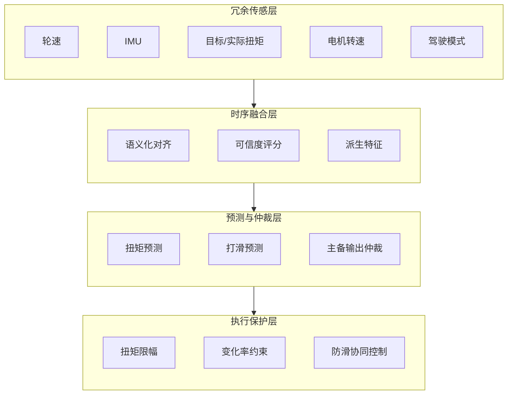
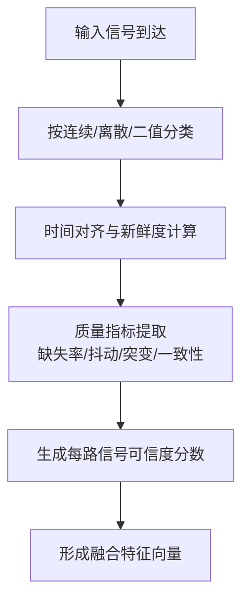
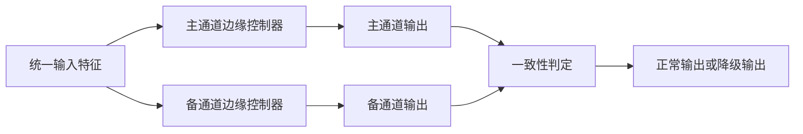
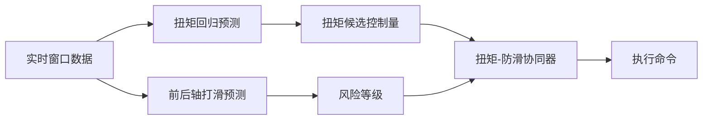
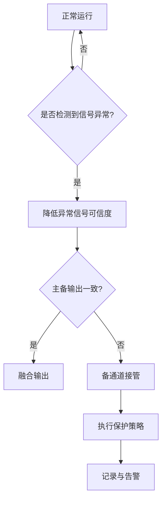

# 专利 A 交底书草案

> 题目建议：基于冗余传感与双通道边缘控制器的前瞻性扭矩-防滑协同控制系统及方法
> 日期：2026-04-02
> 对应项目：`e2e/tsp/torque_predict`
> 说明：本交底书中“已实现基础”与“扩展方案”已明确区分，便于后续整理权利要求
> 一句话总结：采用多源冗余感知、可信度评分与双通道边缘仲裁方法，实现低附着和局部信号异常场景下的前瞻性扭矩-防滑协同控制。

---

## 1. 检索报告

### 1.1 检索目标

本次检索聚焦以下主题：

1. 车辆扭矩控制与防滑协同控制。
2. 冗余传感器、主备控制器与故障降级控制。

### 1.2 检索策略

| 检索维度 | 检索关键词 |
| --- | --- |
| 扭矩控制 | vehicle torque control, torque distribution, traction torque |
| 防滑预测 | slip prediction, anti-slip control, traction control |
| 冗余与降级 | redundant sensor, failover control, fault tolerant controller |
| 低附着场景 | road friction, split-mu, low adhesion, wheel slip |

### 1.3 当前最接近的公开检索入口（待人工核实具体公开号）

- 检索入口：[Google Patents](https://patents.google.com/?q=traction+control+redundant+sensor+wheel+slip+torque)
- 近似方案简介：当前更接近“基于轮速/IMU 冗余输入的牵引力控制或故障降级控制”类公开方案，通常在轮速差或滑移率超过阈值后触发限扭、制动或主备切换。
- 与本案差异重点：本案把多源时序可信度建模、扭矩/打滑联合预测和双通道边缘仲裁纳入同一控制闭环，而不是只做阈值触发或硬件主备切换。

### 1.4 当前检索结果说明

2026-04-02 已尝试使用公开搜索页和公开专利站点做自动化初筛。当前在工具受限条件下，可稳定补充的是“最接近公开检索入口”和主题级差异分析；具体公开号、公开日和申请人仍需在可稳定访问的专利库中人工核实。

### 1.5 主题级检索初筛结论

| 主题族群 | 现有公开方案常见重心 | 与本案关系 | 本案区别点 | 当前状态 |
| --- | --- | --- | --- | --- |
| 牵引力控制/防滑控制 | 依赖轮速或滑移率阈值触发限扭 | 高相关 | 本案强调预测型控制而非纯反应式控制 | 已识别 |
| 冗余传感器与故障切换 | 关注传感器主备切换或控制器主备切换 | 高相关 | 本案强调多源时序融合 + 预测结果参与仲裁 | 已识别 |
| 电驱扭矩分配 | 关注前后轴扭矩分配或四驱协调 | 中相关 | 本案将扭矩预测、打滑预测和边缘控制器仲裁统一到一个链路 | 已识别 |
| 预测型车辆控制 | 关注模型预测控制或状态预测 | 中相关 | 本案增加语义化对齐、冗余感知和降级保护 | 已识别 |

### 1.6 检索结论

与本案最接近的现有技术预计会落在“冗余传感器主备切换”和“低附着路面扭矩/防滑控制”两类公开专利中。为了提升新颖性与创造性，本案应重点突出以下差异：

1. 不是简单的传感器主备切换，而是**多源信号的可信度融合与预测驱动仲裁**。
2. 不是简单的牵引力控制，而是**扭矩预测与打滑预测联合驱动的前瞻性控制**。
3. 不是单控制器保护，而是**双通道边缘控制器在预测结果参与下的主备协同和降级保护**。

---

## 2. 发明创新点

本发明的主要创新点包括：

1. 提出一种面向低附着与复杂工况的多源冗余感知框架，对轮速、IMU、电机转速、目标/实际扭矩和模式信号进行语义化对齐与可信度建模。
2. 提出一种双通道边缘控制器协同架构，使主通道和备通道不仅共享输入，而且在预测结果的参与下完成输出一致性仲裁。
3. 提出一种扭矩回归与打滑分类联合驱动的前瞻性控制策略，在打滑发生前给出扭矩调整建议。
4. 提出一种预测输出的物理约束后处理模块，使模型输出在进入执行器之前经过扭矩上限、变化率和稳定性边界检查。
5. 提出一种从“信号质量异常”到“通道降级接管”的连续流程，增强极端工况与异常工况下的控制连续性。

---

## 3. 发明内容

### 3.1 与本专利最接近的现有技术及其缺陷

最接近的现有技术主要包括以下两类：

1. **基于轮速阈值的防滑控制方案**。该类方案在检测到轮速差或滑移率超过阈值后触发限扭或制动介入，优点是结构简单，但本质上属于反应式控制。
2. **基于主备传感器或主备控制器的冗余方案**。该类方案重点在故障切换，但往往不结合预测结果进行协同仲裁，也不关注多源时序语义差异。

上述现有技术存在以下缺陷：

1. 只能在打滑发生后进行控制，前瞻性不足。
2. 不区分连续量、离散量和二值量的时间语义，容易把无效动态当成有效信息。
3. 冗余主要停留在硬件切换，缺乏与预测模型和执行保护的统一协同。
4. 当部分信号异常但未完全失效时，缺乏细粒度可信度下降与柔性降级机制。

### 3.2 上述技术问题的原因分析

造成上述问题的根本原因主要有以下几点：

1. 现有方案把传感器、预测模型和执行器看作分离模块，缺少统一的时序控制视角。
2. 对多源异步信号的处理通常采用统一重采样，忽略了不同信号类型的物理语义。
3. 冗余设计更多关注“能否切换”，而较少关注“如何在切换前持续保持控制质量”。
4. 执行器保护和模型输出之间缺少桥接层，导致预测结果难以直接用于工程控制链路。

### 3.3 本专利的附图说明及附图

#### 图 1：本专利总体系统架构图

#### 图 2：多源信号可信度融合图

#### 图 3：双通道边缘控制器仲裁图

#### 图 4：前瞻性扭矩-防滑协同流程图

#### 图 5：故障降级状态机图

### 3.4 专利技术方案

#### 3.4.1 专利技术发明点及其与现有技术的区别点

| 发明点 | 现有技术常见做法 | 本案区别点 |
| --- | --- | --- |
| 信号输入处理 | 统一重采样，不区分语义 | 按连续/离散/二值进行差异化处理，并引入可信度 |
| 冗余设计 | 仅做主备切换 | 多源可信度建模 + 主备边缘控制器仲裁 |
| 控制策略 | 打滑后限扭 | 利用预测结果进行前瞻性扭矩-防滑协同 |
| 输出执行 | 直接下发或本地限幅 | 增加模型输出的物理约束后处理 |

#### 3.4.2 实施步骤

本发明的方法可以按如下步骤实施：

**步骤 S101**：采集车辆轮速、IMU、前后电机转速、前后电机目标/实际扭矩以及驾驶模式信号，并送入统一的信号缓存区。

**步骤 S102**：对步骤 S101 获取的各路输入信号执行可信度（新鲜度、缺失率、抖动、突变、物理边界、跨信号一致性）生成处理，所述可信度生成处理优选包括以下子步骤：

**步骤 S102A**：根据信号物理语义和控制用途，将各路输入信号划分为连续量信号、离散状态量信号和二值量信号，并为不同类别信号分别配置对应的更新时间基准、允许缺失比例、允许抖动范围、允许突变范围及一致性校验规则。

**步骤 S102B**：针对各路输入信号，提取其最近一次真实更新时刻、窗口内真实采样点数量、补点数量、时间戳分布和相邻采样差分信息，得到用于表征该路信号新鲜度、缺失率和抖动程度的基础质量参数；其中，所述真实更新时刻用于表征该路信号距离当前控制时刻的老化程度。

**步骤 S102C**：针对连续量信号，根据其数值变化率、相邻采样差分、与预设物理上下限之间的关系以及与允许变化率边界之间的关系，提取突变指标和物理可行性指标；针对离散状态量信号，提取其异常翻转次数、非法状态跳变次数和状态持续时间；针对二值量信号，提取其毛刺次数、去抖失败次数及逻辑翻转异常指标。

**步骤 S102D**：将每路输入信号分别与至少一路物理相关信号执行一致性校验，得到跨信号一致性指标；所述一致性校验包括但不限于轮速与车速之间的一致性、前后轴速度之间的一致性、目标扭矩与实际扭矩之间的一致性、电机转速与扭矩变化之间的一致性以及模式状态与整车运行状态之间的一致性。

**步骤 S102E**：根据步骤 S102B 至步骤 S102D 得到的基础质量参数、突变指标、物理可行性指标和跨信号一致性指标，将各项指标映射为表征对应路输入信号可靠程度的多个子分数；所述多个子分数优选归一化至统一数值区间，并按照信号类别采用不同的权重配置或不同的融合规则进行组合，以得到该路输入信号在当前时刻的原始可信度分数。

**步骤 S102F**：对步骤 S102E 得到的原始可信度分数执行时间平滑、滞回限制或场景修正处理，生成每路输入信号的最终可信度分数；其中，所述场景修正处理根据当前工况类别、路面附着风险等级或车辆运行模式，对各项指标阈值、权重参数或可信度上下限进行自适应调整。

**步骤 S103**：根据步骤 S102A 至步骤 S102F 得到的每路输入信号最终可信度分数，对对应输入信号执行降权、加权融合、特征增强或异常隔离处理，并与滑移率、轴速差、扭矩变化率等派生特征共同组成统一的时序输入向量。

**步骤 S104**：将统一输入向量同时送入主通道边缘控制器和备通道边缘控制器，分别运行扭矩回归与打滑预测模型，得到主备两套预测结果。

**步骤 S105**：对主备两套输出执行一致性比对；若二者差异在允许范围内，则输出融合结果；若差异超出阈值，则结合各输入信号可信度确定是否由备通道接管或进入降级模式。

**步骤 S106**：对仲裁后的控制输出施加扭矩上限、变化率约束和稳定性保护，形成最终的扭矩-防滑协同控制命令，并下发给执行层。

**步骤 S107**：将运行状态、异常信息和控制结果同步记录，供后续数据回流、模型复训和参数优化使用。

作为优选实施方式，步骤 S102 至步骤 S105 中的可信度评分、融合和仲裁处理可进一步按以下方式实现。

#### 3.4.3 可信度评分模块的优选数学实施方式

在本实施方式中，对每一路输入信号 $i$ 于当前时刻 $t$ 生成原始可信度分数 $c_{raw,i}(t)$，并进一步生成最终可信度分数 $c_i(t)$。所述可信度分数优选归一化至 $[0,1]$ 区间，其中数值越大表示该路信号在当前时刻越可靠。

每路信号的可信度分数优选由如下几类子分数构成：

1. 新鲜度子分数 $q_{age,i}$，用于反映该路信号距离最近一次真实更新时刻的老化程度。
2. 缺失率子分数 $q_{miss,i}$，用于反映该路信号在当前滑动窗口内真实采样点与补点、填充值之间的比例关系。
3. 抖动子分数 $q_{jitter,i}$，用于反映该路信号相邻真实采样时间间隔的稳定程度。
4. 突变子分数 $q_{spike,i}$，用于反映该路信号是否存在异常跳变、毛刺或非法翻转。
5. 物理边界子分数 $q_{phys,i}$，用于反映该路信号的数值或变化率是否超出物理可行范围。
6. 一致性子分数 $q_{cons,i}$，用于反映该路信号与其他物理相关信号之间的匹配程度。

其中，基础质量参数优选由以下量构成：当前时刻 $t_{now}$、该路信号最近一次真实更新时刻 $t_{last,i}$、窗口内真实采样点数 $n_{real,i}$、窗口内补点数量 $n_{fill,i}$、真实采样时间戳序列 $T_{real,i}$、以及该路信号在窗口内的数值序列 $x_i[1..N]$。基于上述参数，可定义：

$$
age_i=t_{now}-t_{last,i}
$$

$$
miss\_rate_i=\frac{n_{fill,i}}{n_{real,i}+n_{fill,i}}
$$

$$
jitter_i=std(\Delta t_{arrive,i})
$$

其中 $\Delta t_{arrive,i}$ 表示该路信号相邻真实采样时间间隔序列。

对于连续量信号，优选进一步计算一阶差分、二阶差分、超出物理上下界的幅度以及超出允许变化率上界的幅度，并据此定义突变比例和物理偏离程度：

$$
spike\_ratio_i=\frac{abnormal_{diff_{count_i}}}{N}
$$

$$
phys\_dev_i=boundary_{excess_i}+rate_{excess_i}
$$

对于离散状态量信号，优选统计非法状态值出现次数、不合逻辑的状态跳变次数、单位时间内频繁翻转次数以及状态持续时间异常情况。对于二值量信号，优选统计毛刺次数、去抖失败次数以及不符合逻辑的短时翻转比例。

在跨信号一致性方面，优选将每路输入信号分别与至少一路物理相关信号执行一致性校验。所述一致性校验优选包括：单轮轮速与平均车速之间的一致性、单轮轮速与前后轴平均速度之间的一致性、前后轴速度差与滑移率之间的一致性、目标扭矩与实际扭矩之间的一致性、电机转速变化与扭矩变化率之间的一致性、纵向加速度与车速变化率之间的一致性、横摆角速度与方向盘角之间的一致性以及模式状态与整车运行状态之间的一致性。可定义一致性残差为：

$$
cons\_err_i=\sum_j \alpha_{ij} \cdot normalized\_residual(i,j)
$$

其中，$normalized\_residual(i,j)$ 表示信号 $i$ 与相关信号 $j$ 的归一化残差，$\alpha_{ij}$ 表示对应一致性约束项的权重。

在本优选实施方式中，上述各类质量指标可进一步映射为子分数，优选采用如下形式：

$$
q_{age,i}=\exp\left(-\frac{age_i}{\tau_{age,i}}\right)
$$

$$
q_{miss,i}=1-\min\left(1,\frac{miss\_rate_i}{\rho_{miss,i}}\right)
$$

$$
q_{jitter,i}=\exp\left(-\frac{jitter_i}{\gamma_{jitter,i}}\right)
$$

$$
q_{spike,i}=\exp\left(-\frac{spike\_ratio_i}{\eta_{spike,i}}\right)
$$

$$
q_{phys,i}=\exp\left(-\frac{phys\_dev_i}{\beta_{phys,i}}\right)
$$

$$
q_{cons,i}=\exp\left(-\frac{cons\_err_i}{\kappa_{cons,i}}\right)
$$

其中，$\tau_{age,i}$、$\rho_{miss,i}$、$\gamma_{jitter,i}$、$\eta_{spike,i}$、$\beta_{phys,i}$ 和 $\kappa_{cons,i}$ 分别表示该路信号对应的新鲜度、缺失率、抖动、突变、物理边界及一致性参数。不同信号类别优选采用不同参数配置。

对于子分数的融合，优选采用乘性加权方式，以避免单项严重异常被其他高分项掩盖。原始可信度分数可表示为：

$$
c_{raw,i}=\exp\left(\sum_k w_{i,k}\ln(\max(q_{i,k},\epsilon))\right)
$$

其中，$w_{i,k}$ 为第 $i$ 路信号第 $k$ 项子分数对应的融合权重，且优选满足各项权重之和为 1；$\epsilon$ 为防止对数运算失效的极小正数。优选地，连续量信号的一致性、物理边界和新鲜度权重更高；离散状态量信号的新鲜度、非法跳变和上下文一致性权重更高；二值量信号的新鲜度、毛刺和逻辑一致性权重更高。

为避免复杂工况下可信度分数频繁误判，原始可信度分数优选进一步经过场景修正、时间平滑和滞回限制处理。场景修正优选根据当前工况类别、路面附着风险等级或车辆运行模式，对阈值和权重执行自适应调整，例如：在棋盘路、交叉轴或高激励工况下，放宽轮速和 IMU 的突变阈值；在冰雪、分离附着和坡道工况下，收紧轮速、扭矩和滑移率之间的一致性约束；在模式切换瞬间，提高离散状态量的短时变化容忍度。

时间平滑优选采用指数平滑方式：

$$
c_i(t)=\lambda_i c_i(t-1)+(1-\lambda_i)c_{raw,i}(t)
$$

其中，$\lambda_i$ 表示第 $i$ 路信号的平滑系数，优选取值范围为 0.7 至 0.9。进一步地，为避免频繁进入和退出降级状态，优选设置双阈值滞回机制：当 $c_i<th_{low,i}$ 时判定该路信号为低可信；当 $c_i>th_{high,i}$ 时判定该路信号恢复可信；当 $th_{low,i}\le c_i \le th_{high,i}$ 时保持上一状态。

#### 3.4.4 可信度分数在技术方案中的使用路径

在本发明的优选实施方式中，步骤 S103 中得到的最终可信度分数不只用于显示或诊断，而是直接参与后续融合、仲裁与降级处理。优选包括以下使用方式：

1. 作为模型附加输入：对每一路原始信号增加对应可信度通道，使模型在训练或推理时直接感知输入可靠程度。
2. 作为冗余融合权重：对语义相近或相互冗余的多路输入按可信度执行加权融合，优选可表示为：

$$
x_{fused}=\frac{\sum_i c_i x_i}{\sum_i c_i}
$$

1. 作为主备通道仲裁依据：优选为每个控制通道计算通道级可信度，优选可表示为：

$$
C_{channel}=\sum_i \omega_i c_i
$$

其中，$\omega_i$ 表示各路关键输入在通道级可信度聚合中的权重。当主通道输出与备通道输出差异超限时，优先保留通道级可信度更高的一侧输出，或者直接切换到降级模式。

1. 作为异常隔离依据：当单路信号可信度低于预设阈值时，优选对该路信号执行降权、隔离或仅保留诊断用途处理，而不再作为主控制链路的高权重输入。

在一种优选实施方式中，可将单路信号可信度划分为多个等级，例如：高于 0.85 时为高可信并正常参与控制，介于 0.60 至 0.85 时为可用但需降权，介于 0.30 至 0.60 时为低可信并仅参与保守控制或诊断，低于 0.30 时为极低可信并执行隔离或仅做故障记录。应当理解，前述分级阈值仅为优选实施方式示例，并不构成对本发明保护范围的限定。

#### 3.4.5 双通道边缘控制器的具体含义与实施形态

本案中的“双通道边缘控制器”并非仅指两块简单并联的控制板卡，也并非仅指传统故障切换意义上的主机/备机，而是指部署在车端、能够在控制周期内并行生成候选控制输出并接受统一仲裁的两条独立控制通道。其核心特征在于“边缘部署、并行求解、统一仲裁、可降级接管”。

其中，“边缘”是指控制计算位于车端本地，直接连接 CAN/CAN FD 总线、传感器输入和执行输出链路，不依赖云端远程计算，从而满足毫秒级或亚秒级实时性要求；“双通道”是指至少存在两条彼此相对独立的控制求解路径，二者能够基于同一时刻或同一窗口的统一输入特征，分别生成主通道候选输出和备通道候选输出。

在优选实施方式中，双通道边缘控制器至少包括以下功能单元：

1. 通道输入接口单元，用于接收经语义化对齐、可信度评分和特征增强后的统一输入向量。
1. 主通道控制单元，用于执行完整预测控制链路，优选运行扭矩回归、打滑风险预测、物理约束后处理及控制量生成逻辑。
1. 备通道控制单元，用于执行独立于主通道的候选控制求解，优选为简化预测模型、保守规则控制器、物理机理控制器，或者与主通道异构实现的轻量化模型。
1. 仲裁单元，用于对主通道输出与备通道输出进行一致性判定、通道可信度比较、超时检查和降级决策。
1. 执行输出单元，用于输出仲裁后的最终扭矩-防滑协同控制命令。

在一类优选实施方式中，主通道更偏向性能与精度，主要负责利用多源特征和预测模型实现前瞻性扭矩-防滑协同控制；备通道更偏向鲁棒性与保守性，主要负责在主通道异常、输入可信度下降、输出超时或主备差异过大时，提供可验证、可执行的后备控制输出。因此，备通道并不要求与主通道采用完全相同的模型结构，其重点在于提供一条计算路径、依赖关系和失效模式与主通道不完全相同的独立候选输出链路。

进一步地，双通道边缘控制器可具有如下几种实施形态，且均应落入本案保护范围：

1. 两套物理独立控制单元：例如主控制器和备控制器分别部署于两块车端计算单元，二者共享部分输入但具有相对独立的计算资源、电源域或通信链路。
1. 单控制器内的双软件通道：在同一车端控制器内部，以相互隔离的任务、进程、容器或运行时实例实现主通道与备通道。
1. 异构处理器协同形态：例如主通道部署在高算力处理器上运行预测模型，备通道部署在 MCU、功能安全核或轻量计算板上运行保守控制逻辑。

也就是说，本案中“双通道”的本质不是硬件数量本身，而是是否能够形成两条可独立求解、可交叉校验、可在异常时执行接管或降级的边缘控制路径。

在本发明的方法步骤中，步骤 S104 所述“将统一输入向量同时送入主通道边缘控制器和备通道边缘控制器”优选应理解为：同一控制周期内，两条边缘控制通道基于统一输入特征并行生成各自候选控制量、通道状态信息和通道级可信度；步骤 S105 所述“一致性比对”优选不仅包括输出数值差异比较，还包括输出时延、输入完整性、通道健康状态和关键约束是否满足的联合判定。

作为进一步优选实施方式，仲裁单元可至少基于以下因素生成最终决策：

1. 主通道与备通道输出差值是否超过允许阈值。
1. 主通道与备通道各自的通道级可信度高低。
1. 各自输出是否满足扭矩上限、变化率、稳定性等执行约束。
1. 通道是否存在超时、卡滞、输入缺失或关键特征不可用情形。

因此，本案中的双通道边缘控制器应理解为一种“预测控制通道 + 保底控制通道”或“高性能通道 + 高鲁棒通道”的车端协同控制架构，而不是普通意义上的静态热备份结构。其发明价值在于：即使在局部输入异常、部分传感器可信度下降或主通道输出不稳定的情况下，系统仍可通过备通道和仲裁机制维持连续控制能力，并将风险收敛到可接受范围内。

#### 3.4.6 基于当前项目架构的具体实现方式

若基于当前项目进行工程实现，优选不是一次性直接上“两块独立控制器 + 全异构软件栈”，而是按“单进程双通道验证 -> 单控制器双任务部署 -> 双控制单元分离部署”三步逐步落地。对当前代码底座而言，最直接可行的第一阶段实现方式如下。

第一步，保留当前车端输入主链路不变，以 [tsp/deploy/can_receiver.py](tsp/deploy/can_receiver.py) 为统一采集入口，持续接收轮速、IMU、电机转速、目标/实际扭矩和驾驶模式信号；随后通过 [tsp/deploy/interpolate_utils.py](tsp/deploy/interpolate_utils.py) 对连续量、离散量和二值量进行统一时间轴对齐；再在对齐结果基础上执行可信度评分与派生特征生成。其中，派生特征优选直接复用 [tsp/torque_predict/dataset_handler.py](tsp/torque_predict/dataset_handler.py) 中已具备的车速均值、前后轴速度、前后轴速度差、滑移率、扭矩变化率等量，作为主备通道共用输入和仲裁参考依据。

第二步，在当前实时推理主程序 [tsp/deploy/realtime_infer.py](tsp/deploy/realtime_infer.py) 中，将原先“单模型推理”的主循环拆分为以下 5 个逻辑阶段：

1. `build_shared_inputs`：从 CAN 缓冲区生成统一时间窗输入，输出 `df_sync`、可信度分数、派生特征和场景标签。
1. `run_main_channel`：运行主通道边缘控制器，生成主通道候选扭矩输出、打滑风险输出和主通道健康状态。
1. `run_backup_channel`：运行备通道边缘控制器，生成备通道候选输出、备通道健康状态和保守控制标志。
1. `arbitrate_outputs`：比较主备输出差异、通道级可信度、执行约束满足情况和超时状态，生成最终控制输出。
1. `apply_output_guard`：对仲裁后的输出施加扭矩限幅、变化率限制和稳定性保护，然后再送执行层并记录日志。

第三步，主通道优选直接复用当前项目已有的预测推理能力，即由 [tsp/deploy/realtime_infer.py](tsp/deploy/realtime_infer.py) 中加载的模型负责输出扭矩回归结果和打滑分类结果。为了使主通道适合本案架构，建议增加以下三个改造点：

1. 在模型输入侧拼接每路信号可信度或通道级质量标志，使主通道模型能够显式感知输入可靠程度。
1. 在模型输出侧增加物理后处理，将回归得到的目标扭矩限制在允许上下界之内，并对扭矩变化率执行限坡处理。
1. 为主通道输出补充健康状态字段，例如 `timeout`、`nan_detected`、`low_input_confidence`、`constraint_violation`，用于后续仲裁。

第四步，备通道不建议简单复制主通道模型，而应实现为一条更保守、更可解释、更容易在低算力单元上运行的后备控制链路。基于当前项目底座，优选有两种实现方式：

1. 规则型备通道：直接基于滑移率、前后轴速度差、扭矩变化率和关键输入可信度生成保守扭矩修正量。例如当 `max(|SlipRatio|)`、`|FrontRearSpdDiff|` 或 `1 - min(confidence_i)` 超过阈值时，按预设规则降低前后轴扭矩目标，并触发更严格的扭矩变化率限制。
1. 轻量模型型备通道：采用比主通道更小的模型，或采用机理/规则混合模型，仅输出保底扭矩建议和风险等级，重点保证可运行性、低延迟和可解释性。

对于工程首版，优选先实现“主通道为当前深度学习模型，备通道为规则型保守控制器”的结构，因为该结构与现有代码耦合最小、验证成本最低、也最符合专利中的“高性能通道 + 高鲁棒通道”定义。

第五步，仲裁器优选设计为一个独立函数或独立模块，而不是散落在主循环中的若干 `if/else`。该仲裁器至少接收以下输入：

1. 主通道候选输出 `y_main`。
1. 备通道候选输出 `y_backup`。
1. 主通道级可信度 `C_main`。
1. 备通道级可信度 `C_backup`。
1. 主备输出差异量 `|y_main - y_backup|`。
1. 主通道和备通道的健康状态标志。

其推荐决策逻辑为：若主通道超时、输出无效或关键输入可信度过低，则直接进入备通道接管；若主备输出差异在允许范围内，则可按可信度加权融合；若主备输出差异超限，则优先保留通道级可信度更高且满足执行约束的一侧；若两侧均不满足条件，则进入降级模式并输出保守控制命令。

第六步，软件组织上建议先按单进程多模块方式落地，再根据硬件资源演进为双任务或双控制单元。对当前项目，推荐优先新增以下模块：

1. `signal_confidence.py`：计算每路信号可信度及通道级可信度。
1. `backup_controller.py`：实现规则型或轻量模型型备通道。
1. `arbiter.py`：实现主备一致性判定、融合、接管和降级决策。
1. `output_guard.py`：实现扭矩限幅、变化率限制和稳定性保护。
1. `channel_health.py`：管理超时、无效值、关键特征缺失和约束违规等健康状态。

第七步，运行时序上优选采用如下执行顺序：采集 CAN 数据 -> 时间对齐 -> 可信度评分 -> 派生特征生成 -> 主通道求解 -> 备通道求解 -> 主备仲裁 -> 输出保护 -> 执行与记录。当前项目中的 [tsp/deploy/deploy_utils.py](tsp/deploy/deploy_utils.py) 已具备异步结果保存能力，因此可直接扩展日志字段，将主备输出、仲裁结果、通道可信度、接管原因和降级原因同步记录，作为后续标定、复盘和专利可视化展示依据。

第八步，在硬件部署层面，第一阶段可在同一车端计算单元内以两个独立任务实现主通道和备通道；第二阶段可将备通道迁移到 MCU 或独立安全核；第三阶段再扩展为双物理控制单元。也就是说，本案的“具体实现”并不要求一开始就完成最终硬件形态，而是允许先在当前单控制器架构上完成双通道软件化验证，再逐步演进到双硬件控制单元。

综上，若从当前项目直接起步，最现实的落地版本应理解为：以 [tsp/deploy/can_receiver.py](tsp/deploy/can_receiver.py) 和 [tsp/deploy/interpolate_utils.py](tsp/deploy/interpolate_utils.py) 为统一输入底座，以 [tsp/deploy/realtime_infer.py](tsp/deploy/realtime_infer.py) 中现有模型作为主通道，以新增规则型保守控制器作为备通道，以独立仲裁器实现主备切换/融合/降级，并通过 [tsp/deploy/deploy_utils.py](tsp/deploy/deploy_utils.py) 记录全链路运行结果。这就是本专利在当前项目上的最小可实现闭环。

### 3.5 专利技术中的名词解释

| 名词 | 解释 |
| --- | --- |
| 冗余传感 | 指轮速、IMU、扭矩、电机转速、模式等多源输入在时序上互相补充，而非仅指同类型双份硬件 |
| 双通道边缘控制器 | 指部署在车端本地的两条独立控制求解通道，可表现为两套物理控制单元、单控制器内两套隔离软件实例或异构处理器协同结构；两通道分别生成候选控制输出，并由仲裁模块统一执行一致性判定、接管或降级决策 |
| 可信度评分 | 指根据信号缺失率、时间新鲜度、抖动和一致性计算的输入可靠性指标 |
| 前瞻性扭矩-防滑协同 | 指利用未来时刻扭矩与打滑状态预测结果，在打滑发生前进行扭矩调整 |
| 降级控制模式 | 指在部分输入异常或主备输出不一致时，系统退回更保守、更受约束的控制模式 |

---

## 4. 与当前项目的关系说明

### 4.1 已实现基础

1. 多源信号采集与缓存。
2. 按信号类型对齐与派生特征生成。
3. 扭矩回归与前后轴打滑分类联合预测。
4. 实时推理部署与性能监控。

### 4.2 扩展方案

1. 可信度评分模块。
2. 双通道边缘控制器和仲裁器。
3. 输出层物理约束保护模块。
4. 面向故障降级的状态机与告警流程。

上述扩展方案均可在当前项目架构上演进实现，但不应表述为当前代码已经全部完成。

---

## 5. 已知假设与待确认项

1. 本交底书默认边缘控制器可部署为两套物理控制单元，若后续硬件约束更倾向单控制器双软件实例，可在实施例中替换表述。
2. 可信度评分的具体数学形式、仲裁阈值和物理约束阈值可在后续实施例中进一步参数化，不影响本案核心发明点。
3. 当前已补充最接近主题的公开检索入口，但具体公开号、公开日、申请人和来源链接仍需人工核实。
