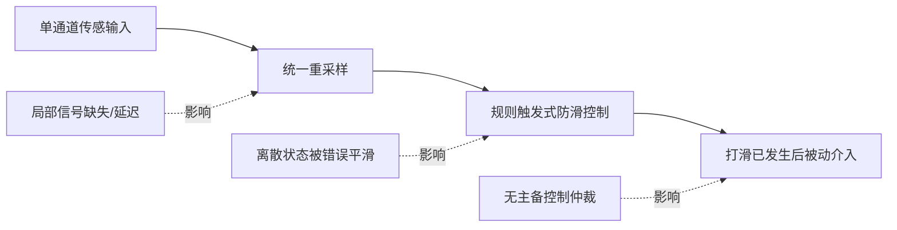
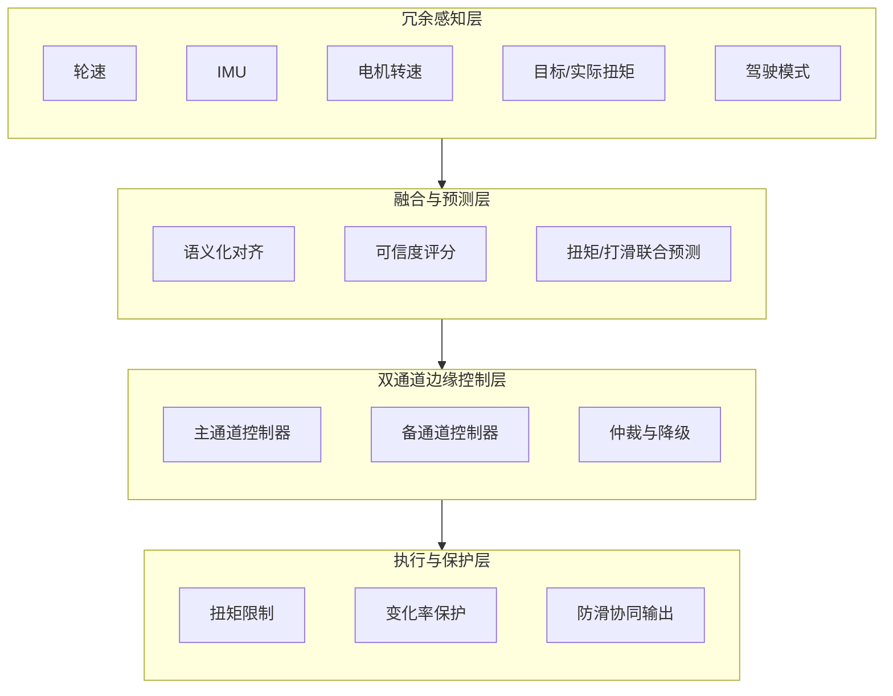
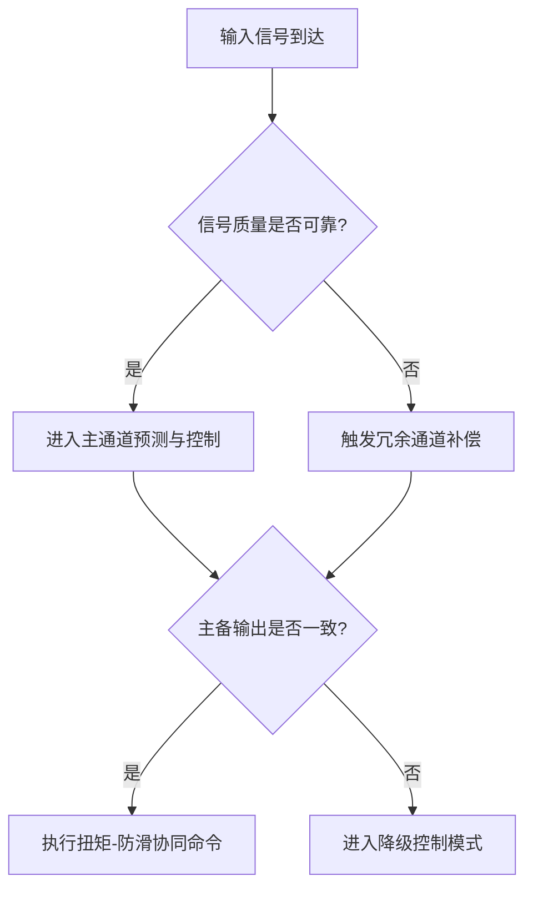
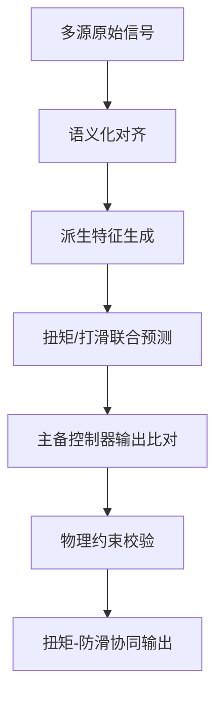
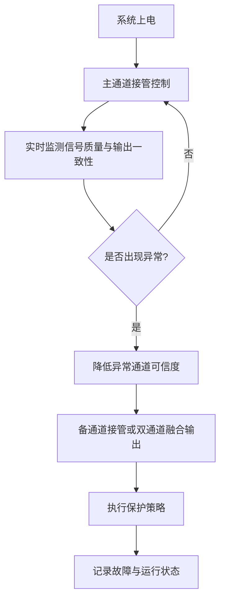

# 专利 A 技术方案介绍稿

> 题目建议：基于冗余传感与双通道边缘控制器的前瞻性扭矩-防滑协同控制系统及方法
> 形式：章节级 PPT 方案稿
> 适用对象：技术管理层、控制算法专家、专利代理人
> 依托底座：[../../torque_predict/README.CN.md](../../torque_predict/README.CN.md)、[../../../dataset/docs/dataset_plan.md](../../../dataset/docs/dataset_plan.md)、[../../deploy/realtime_infer.py](../../deploy/realtime_infer.py)

---

## 1. 现有技术缺陷

### 1.1 现有方案的主要问题

当前车辆扭矩控制与防滑控制中，行业常见方案主要存在以下不足：

1. **单通道感知依赖强**：轮速、IMU 或扭矩信号中的任一关键通道出现延迟、缺失或异常时，控制效果容易显著波动。
2. **控制逻辑多为被动触发**：许多方案在打滑已经发生后才触发限扭或制动介入，前瞻性不足。
3. **多频率信号语义未被区分**：连续量、离散状态量和二值标签往往被统一重采样处理，容易引入伪动态信息。
4. **边缘控制链路缺少主备协同**：现有方案通常关注单控制器闭环，缺少面向预测模型与故障降级的双通道仲裁机制。
5. **执行层物理约束与预测层脱节**：预测模型输出未必直接受电机扭矩、变化率和稳定性边界约束。

### 1.2 与当前项目的差距定位

当前项目已经具备多源采集、信号类型化对齐、多任务预测和实时推理底座，但尚未把这些能力进一步扩展为“冗余传感 + 双通道边缘控制 + 故障降级仲裁”的完整专利方案。

| 维度 | 当前项目基础 | 本专利拟扩展点 |
| --- | --- | --- |
| 采集与对齐 | 已具备多源采集与按信号类型对齐 | 增加传感器可信度评分与冗余切换 |
| 预测能力 | 已具备扭矩/打滑联合预测 | 让预测结果直接参与主备控制器仲裁 |
| 边缘部署 | 已具备实时推理框架 | 增加双通道边缘控制器与故障降级逻辑 |
| 执行约束 | 已有模型输出与性能监控 | 增加物理可行性校验与安全包络 |

---

## 2. 本专利技术亮点

### 2.1 核心创新点

1. **冗余传感可信度融合**：利用轮速、IMU、扭矩、驾驶模式等多源信号构建实时可信度评分，而不是单点依赖某一路信号。
2. **双通道边缘控制器仲裁**：在车端设置主通道和备通道边缘控制器，预测模型结果同时参与两通道输出一致性检查与仲裁。
3. **前瞻性扭矩-防滑协同控制**：利用扭矩回归结果和前后轴打滑预测结果，提前调整扭矩分配与限扭策略。
4. **语义化时序处理**：连续量、离散量和二值量分别采用不同对齐策略，并显式保留信号新鲜度信息。
5. **物理约束后处理**：在输出层增加扭矩上限、变化率和稳定性约束，避免预测值直接冲击执行系统。

### 2.2 与现有技术的差异化表达

| 比较项 | 常见方案 | 本专利亮点 |
| --- | --- | --- |
| 信号处理 | 统一重采样、规则触发 | 按语义对齐 + 可信度建模 |
| 控制结构 | 单控制器闭环 | 双通道边缘控制 + 仲裁 |
| 防滑方式 | 打滑后被动介入 | 预测驱动的前瞻性协同控制 |
| 执行约束 | 控制器本地规则 | 预测结果 + 物理边界联合约束 |

---

## 3. 技术路线

### 3.1 总体技术路线

本专利的技术路线分为四层：

1. 冗余感知层：接收车轮速度、IMU、前后电机转速、目标/实际扭矩、驾驶模式等输入。
2. 语义融合层：按信号类型对齐，生成可信度评分、滑移率、轴速差、扭矩变化率等特征。
3. 预测与仲裁层：运行扭矩/打滑联合预测模型，并在主备边缘控制器之间执行输出一致性比对与仲裁。
4. 执行保护层：在输出执行前增加扭矩限幅、变化率保护和稳定性约束，最终生成防滑协同命令。

### 3.2 可信度评分技术方案细化

可信度评分模块优选部署在“语义化对齐之后、派生特征生成之前”，对每一路输入信号分别输出最终可信度分数和子分数明细。其核心不是单一阈值判定，而是把信号质量、多信号物理一致性和场景自适应约束统一建模。

可将每路信号可信度分数拆分为四层：

1. 基础质量层：评估新鲜度、缺失率和采样抖动。
2. 异常行为层：评估突变、毛刺、非法跳变和物理超界。
3. 一致性层：评估轮速、车速、扭矩、电机转速、IMU 和模式状态之间的物理匹配关系。
4. 场景修正层：在冰雪、分离附着、坡道、交叉轴和高激励工况下动态调整阈值、权重和平滑策略。

优选计算框架可表达为：

$$
c_{raw,i}(t)=Fuse(q_{age,i},q_{miss,i},q_{jitter,i},q_{spike,i},q_{phys,i},q_{cons,i})
$$

$$
c_i(t)=Smooth(SceneAdjust(c_{raw,i}(t)))
$$

其中，$q_{age,i}$ 反映最近一次真实更新时间与当前时刻之间的老化程度，$q_{miss,i}$ 反映滑动窗口内补点比例，$q_{jitter,i}$ 反映真实采样时间间隔抖动，$q_{spike,i}$ 与 $q_{phys,i}$ 反映数值突变和物理超界风险，$q_{cons,i}$ 反映与相关信号之间的一致性残差。融合后再通过场景修正、指数平滑和双阈值滞回，得到可直接用于控制链路的最终可信度分数。

该分数在本专利中的作用不只限于信号诊断，而是直接进入后续控制流程：

1. 作为模型附加输入，增强预测模型对异常输入的辨识能力。
2. 作为冗余信号融合权重，降低低可信信号对特征和控制结果的影响。
3. 作为主备通道仲裁依据，在输出差异超限时支持备通道接管或触发降级。
4. 作为异常隔离依据，在局部传感异常时保留系统连续控制能力。

### 3.3 主备冗余切换流程

### 3.4 与当前项目的映射

- 已实现基础：多源采集、语义化对齐、派生特征、多任务预测、实时推理。
- 重点扩展：可信度评分、双通道边缘控制器、主备输出仲裁、物理约束后处理。

---

## 4. 解决的核心问题

| 核心问题 | 对应方案 | 预期效果 |
| --- | --- | --- |
| 关键传感器失真或缺失导致控制不稳定 | 可信度评分 + 冗余传感补偿 | 提升低附着与异常场景鲁棒性 |
| 打滑控制滞后，介入时机偏晚 | 预测型扭矩/打滑联合输出 | 提前限扭或调整控制分配 |
| 单控制器失效时缺少可用后备通道 | 双通道边缘控制器 + 仲裁 | 提供故障降级与连续控制能力 |
| 预测输出可能与执行器边界冲突 | 输出层物理约束检查 | 降低异常扭矩命令风险 |

---

## 5. 建议的 PPT 拆页方式

如需后续拆成正式 PPT，可按以下页序展开：

1. 背景与问题定义
2. 现有技术缺陷
3. 本专利总体架构
4. 冗余感知与可信度融合
5. 双通道边缘控制与仲裁
6. 扭矩-防滑协同预测
7. 物理约束与降级保护
8. 核心效果与应用场景

当前稿件为章节级方案稿，可直接作为后续 PPT 排版底稿。

---

## 6. 已知假设与待确认项

1. 当前文稿默认车辆侧存在主通道与备通道边缘控制器，但实际落地时也可以采用单硬件双实例的冗余实现。
2. 可信度评分、主备仲裁与物理约束后处理为本轮专利主张的扩展实现，不宜描述为现有代码已全部落地。
3. 与本案最接近的公开专利号仍需在后续人工检索中补齐。
