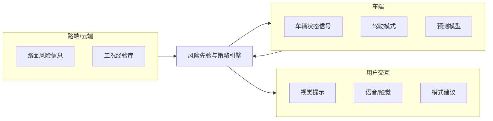
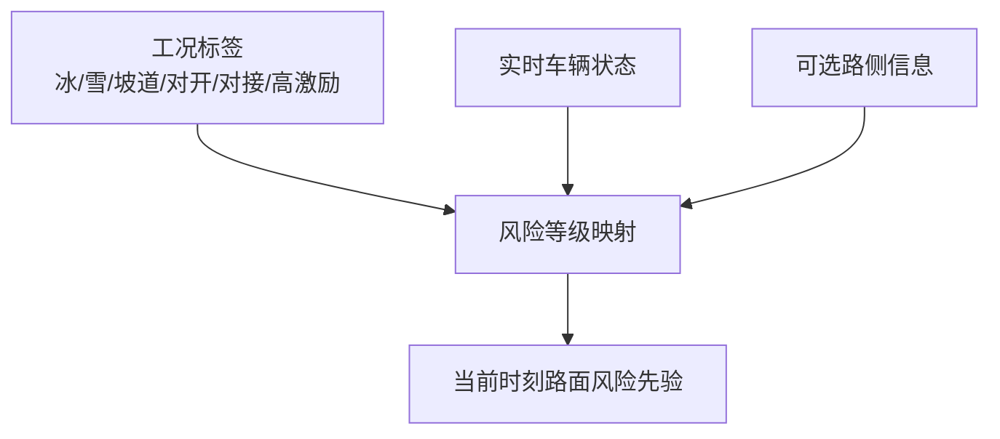
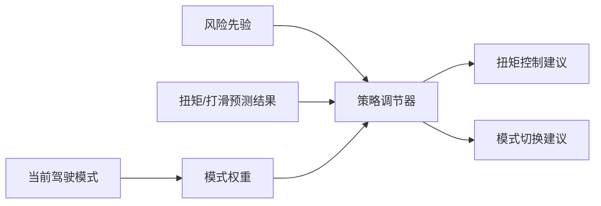
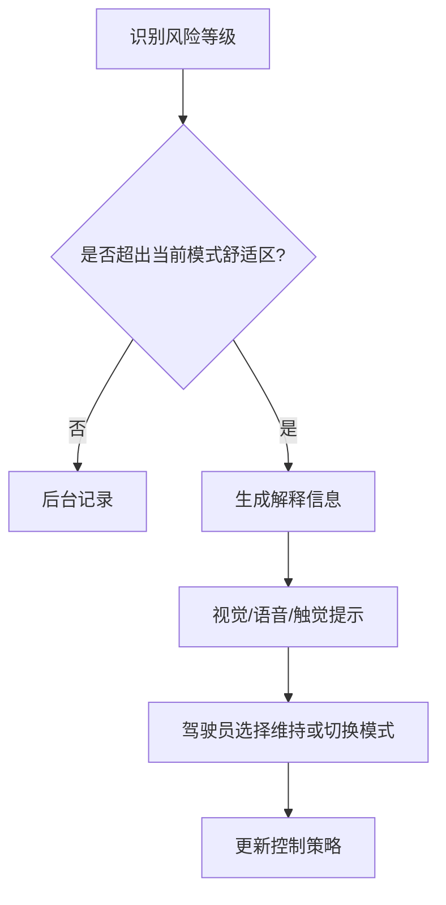
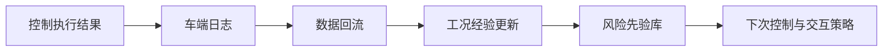

# 专利 B 交底书草案

> 题目建议：基于路面风险先验、驾驶模式与可解释交互的人车路协同预测型扭矩控制方法
> 日期：2026-04-02
> 对应项目：`e2e/tsp/torque_predict`
> 说明：本交底书重点把“当前项目已具备的车端预测底座”和“拟申请的人车路协同扩展主张”分开描述
> 一句话总结：采用路面风险先验、驾驶模式感知与可解释交互耦合方法，实现不同路况下预测型扭矩策略生成与用户体验闭环优化。

---

## 1. 检索报告

### 1.1 检索目标

本次检索聚焦以下主题：

1. 驾驶模式感知的车辆扭矩控制。
2. 路面附着、路况风险与扭矩/防滑控制联动。
3. 车端、路端与用户交互联动的控制或提示系统。

### 1.2 检索策略

| 检索维度 | 检索关键词 |
| --- | --- |
| 模式感知扭矩控制 | drive mode torque control, mode-aware torque management |
| 路面风险先验 | road friction estimation, road risk prior, low adhesion control |
| 人车路协同 | V2X control, road condition cooperation, vehicle-road coordination |
| 交互反馈 | HMI traction control, driver feedback, explainable vehicle control |

### 1.3 当前最接近的公开检索入口（待人工核实具体公开号）

- 检索入口：[Google Patents](https://patents.google.com/?q=road+friction+estimation+drive+mode+torque+control+HMI)
- 近似方案简介：当前更接近“路面附着估计 + 模式扭矩映射 + HMI 风险提示”类公开方案，通常先估计附着水平或风险等级，再触发固定模式切换、扭矩调整或座舱告警。
- 与本案差异重点：本案强调风险先验、模式感知、预测结果和可解释交互的联合闭环，而不是只做附着识别、模式表切换或结果展示。

### 1.4 当前检索结果说明

2026-04-02 已尝试对公开搜索页和公开专利站点做自动化初筛。当前在工具受限条件下，可稳定补充的是“最接近公开检索入口”和主题级差异分析；具体公开号、公开日和申请人仍需在可稳定访问的专利库中人工核实。

### 1.5 主题级检索初筛结论

| 主题族群 | 现有公开方案常见重心 | 与本案关系 | 本案区别点 | 当前状态 |
| --- | --- | --- | --- | --- |
| 驾驶模式扭矩映射 | 依据模式切换固定扭矩响应曲线 | 中相关 | 本案引入风险先验和预测结果，而非静态模式表 | 已识别 |
| 附着估计/路面识别 | 识别当前路面附着或摩擦系数 | 高相关 | 本案把风险先验与扭矩预测和交互闭环耦合 | 已识别 |
| V2X/路侧协同控制 | 路端向车端提供道路信息 | 中相关 | 本案强调与模式感知和用户交互共同驱动控制决策 | 已识别 |
| HMI 风险提示 | 向用户提示打滑或风险状态 | 中相关 | 本案强调预测型提示、模式建议和体验闭环 | 已识别 |

### 1.5 检索结论

与本案最接近的现有技术预计会出现在“路面附着估计”和“模式相关扭矩管理”两类公开专利中。为突出本案新颖性，应重点强调：

1. 本案不是单点的附着识别，而是**路面风险先验、模式感知和预测控制的联合方案**。
2. 本案不是简单的人机界面提示，而是**预测结果驱动的可解释交互与策略调整闭环**。
3. 本案不是纯车路协同通信，而是**将车端预测底座、路端风险信息和用户交互统一纳入控制链路**。

---

## 2. 发明创新点

本发明的主要创新点包括：

1. 提出一种面向扭矩控制的路面风险先验构建方法，使多种路面工况、模式状态和外部风险信息共同参与控制策略生成。
2. 提出一种模式感知的预测型扭矩控制方法，使经济、舒适、运动、雪地等模式不再是静态映射，而是与风险等级和预测结果联动。
3. 提出一种可解释交互生成机制，根据预测结果与风险等级动态输出驾驶模式建议、风险提示和交互反馈。
4. 提出一种人车路三方闭环结构，把车端控制效果、路面风险信息和用户反馈回流到数据系统中。
5. 提出一种面向典型低附着与高激励场景的场景化控制与交互映射框架，提升体验一致性与安全冗余。

---

## 3. 发明内容

### 3.1 与本专利最接近的现有技术及其缺陷

最接近的现有技术主要包括以下三类：

1. **模式驱动的扭矩控制方案**：通过经济、舒适、运动等模式切换扭矩曲线，但多数不考虑当前路面风险和预测结果。
2. **路面附着识别或风险评估方案**：重点在识别附着水平，却没有把识别结果进一步转成驾驶模式建议和可解释交互。
3. **HMI 风险提示方案**：更多是对控制介入结果进行提示，而不是在控制前或控制中提供预测性解释和建议。

这些方案存在以下缺陷：

1. 模式和路面风险之间缺少联合建模。
2. 用户只能被动接受控制结果，缺少原因解释和操作建议。
3. 车端、路端和用户之间的信息闭环不完整，难以持续优化。
4. 对冰、雪、坡道、分离附着和高激励等不同场景缺少统一的风险抽象与映射方式。

### 3.2 上述技术问题的原因分析

造成上述问题的根本原因主要有以下几点：

1. 现有扭矩控制与人机交互通常由不同系统分别设计，缺少统一数据底座。
2. 路面场景信息难以直接进入控制链路，因此模式调节往往停留在静态策略层。
3. 交互模块多是“结果显示器”，而非参与控制解释与建议的决策组件。
4. 多工况经验未被沉淀为统一的风险先验，导致跨场景控制策略切换不自然。

### 3.3 本专利的附图说明及附图

#### 图 1：人车路协同总体架构图

#### 图 2：路面风险先验生成图

#### 图 3：模式感知控制策略图

#### 图 4：可解释交互流程图

#### 图 5：人车路数据回流闭环图

### 3.4 专利技术方案

#### 3.4.1 专利技术发明点及其与现有技术的区别点

| 发明点 | 现有技术常见做法 | 本案区别点 |
| --- | --- | --- |
| 模式控制 | 固定模式映射 | 模式与风险先验、预测结果联动 |
| 路面信息利用 | 仅用于附着识别或地图提示 | 直接进入扭矩控制和交互决策 |
| 用户提示 | 控制后提示或简单告警 | 预测型、解释型、可建议式交互 |
| 数据回流 | 仅保存日志 | 将用户反馈和场景结果回流到经验库 |

#### 3.4.2 结合附图详细描述专利技术方案

本发明的方法可以按如下步骤实施：

**步骤 S201**：采集车辆轮速、IMU、前后电机扭矩、驾驶模式等车端状态信息，并识别当前所处路面工况或由路侧/云端提供路面风险信息。

**步骤 S202**：根据工况类别、附着风险等级、车辆状态和驾驶模式，生成当前时刻的路面风险先验；其中，风险先验可以包括低附着风险、偏航风险、扭矩突变风险和体验不平顺风险中的一种或多种。

**步骤 S203**：将风险先验与扭矩/打滑联合预测结果共同输入模式感知控制策略模块，生成当前场景下的扭矩控制建议、模式建议或保护阈值调整量。

**步骤 S204**：根据控制建议与当前模式状态，判断是否需要向驾驶员输出解释信息；若需要，则生成风险原因说明、模式切换建议或交互反馈指令。

**步骤 S205**：将交互结果、驾驶员操作、控制执行效果和场景标签一并记录，形成可用于后续数据回流和经验库更新的闭环数据。

**步骤 S206**：在后续相似场景中，调用更新后的风险先验与经验库，提高控制策略与交互策略的一致性和适配性。

### 3.5 专利技术中的名词解释

| 名词 | 解释 |
| --- | --- |
| 路面风险先验 | 指在控制前或控制中，对当前路面附着、坡度、分离附着、高激励等风险形成的先验约束信息 |
| 模式感知控制 | 指驾驶模式不再是静态标签，而是参与控制权重调整的动态变量 |
| 可解释交互 | 指系统向驾驶员说明控制原因、风险等级和建议动作，而非仅显示结果 |
| 人车路闭环 | 指车端状态、路端信息和用户反馈统一进入同一优化回路 |
| 工况经验库 | 指从历史运行场景中沉淀出来的风险、策略和交互经验集合 |

---

## 4. 与当前项目的关系说明

### 4.1 已实现基础

1. 已采集和定义多类复杂工况，包括冰、雪、坡道、分离附着和高激励路面。
2. 已保留驾驶模式信号，并建立多任务预测与实时推理框架。
3. 已具备数据回流和工况级评估的工程基础。

### 4.2 扩展方案

1. 路侧风险信息或云端场景先验接入。
2. 风险先验生成与模式感知策略引擎。
3. 驾驶员可解释交互模块。
4. 用户反馈参与经验库更新的闭环机制。

上述扩展内容能够建立在当前项目底座上，但不应表述为当前代码已经全部实现。

---

## 5. 已知假设与待确认项

1. 本交底书默认允许路侧或云端提供路面风险信息；若短期只考虑车端落地，可将该部分下沉为从属实施方式。
2. 可解释交互的座舱输出形式和驾驶员反馈采集方式需结合目标车型 HMI 资源进一步细化。
3. 当前已补充最接近主题的公开检索入口，但具体公开号、公开日、申请人和来源链接仍需人工核实。
