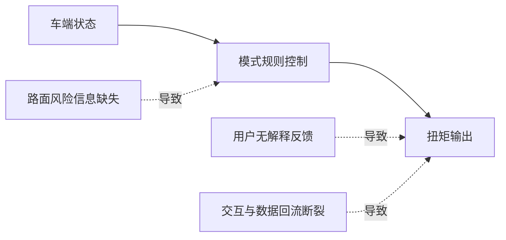
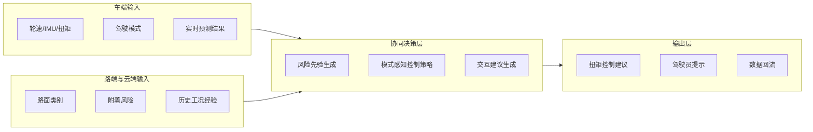
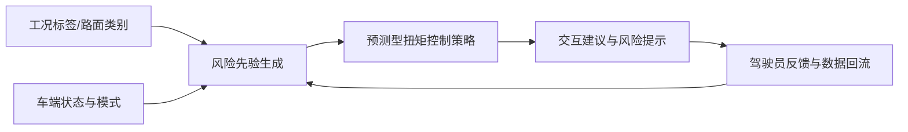
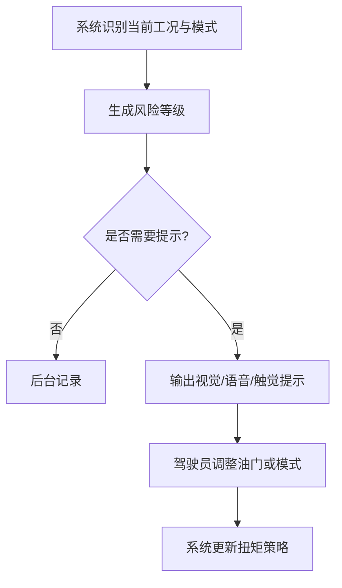

# 专利 B 技术方案介绍稿

> 题目建议：基于路面风险先验、驾驶模式与可解释交互的人车路协同预测型扭矩控制方法
> 形式：章节级 PPT 方案稿
> 适用对象：技术管理层、控制算法专家、专利代理人
> 依托底座：[../../../dataset/docs/condition_list.md](../../../dataset/docs/condition_list.md)、[../../torque_predict/config/signals.yaml](../../torque_predict/config/signals.yaml)、[../../deploy/realtime_infer.py](../../deploy/realtime_infer.py)

---

## 1. 现有技术缺陷

### 1.1 现有方案的主要问题

当前很多车辆扭矩控制方案虽然能够根据驾驶模式做扭矩响应调整，但仍然存在以下不足：

1. **缺少路面风险先验**：控制策略主要依赖车端实时状态，无法提前利用冰雪、分离附着、坡道或高激励路面的风险信息。
2. **驾驶模式与风险认知脱节**：经济、舒适、运动、雪地等模式切换往往是静态规则，未与路面风险和预测结果联动。
3. **用户交互不可解释**：驾驶员通常只能感知到车辆“突然限扭”或“突然稳定控制介入”，但不知道原因和建议动作。
4. **缺少人车路闭环**：车端、路端与驾驶员之间的信息流不统一，难以形成体验优化与数据回流闭环。

### 1.2 当前项目与专利机会点

当前项目已经具有以下基础：

1. 已采集多种低附着、分离附着和高激励工况。
2. 已保留驾驶模式信号 `RunMode_342`、`RunMode2_342`。
3. 已具备扭矩/打滑联合预测与实时推理能力。

因此，本专利的机会点不在于重复写一篇纯预测模型专利，而在于把当前项目底座扩展为“路面风险先验 + 模式感知 + 可解释交互”的协同控制方案。

---

## 2. 本专利技术亮点

### 2.1 核心创新点

1. **路面风险先验建模**：综合工况标签、路面类别、附着风险等级以及可选路侧信息，形成扭矩控制的先验风险约束。
2. **模式感知策略生成**：把驾驶模式从静态开关升级为风险感知条件下的可调策略因子。
3. **预测驱动的交互输出**：基于扭矩/打滑预测结果，生成可解释的提示信息、模式建议或触觉/视觉反馈。
4. **人车路信息闭环**：把车端状态、路端风险和用户反馈统一纳入同一闭环，用于持续优化控制策略与体验。
5. **场景化体验优化**：针对冰、雪、坡道、对开、对接、棋盘路等场景，给出差异化的控制与交互策略。

### 2.2 与现有技术的差异化表达

| 比较项 | 常见方案 | 本专利亮点 |
| --- | --- | --- |
| 驾驶模式 | 固定模式映射 | 风险感知的动态模式策略 |
| 路面信息 | 依赖实时状态被动判断 | 融合路面风险先验与历史工况经验 |
| 用户交互 | 事后提示或无提示 | 预测驱动的可解释交互与建议 |
| 闭环优化 | 车端单点控制 | 车端、路端、用户三方闭环 |

---

## 3. 技术路线

### 3.1 总体技术路线

本专利的技术路线分为四个阶段：

1. 场景底座构建：基于已有工况清单，把冰、雪、分离附着、坡道、棋盘路等场景转成风险标签和风险等级。
2. 风险先验生成：融合车端动态状态、当前驾驶模式、可选路端风险信息，形成当前时刻的风险先验。
3. 模式感知预测控制：结合扭矩/打滑联合预测结果，生成符合当前模式和风险等级的扭矩控制建议。
4. 可解释交互闭环：把风险等级、模式建议和控制原因反馈给驾驶员，并将执行结果回流到数据系统中。

### 3.2 用户交互流程

### 3.3 与当前项目的映射

- 已实现基础：多工况数据集、模式信号、预测模型、实时推理。
- 重点扩展：路侧风险输入、风险先验建模、交互提示模块、用户反馈回流机制。

---

## 4. 解决的核心问题

| 核心问题 | 对应方案 | 预期效果 |
| --- | --- | --- |
| 路面风险只在打滑后被感知 | 引入路面风险先验与场景标签 | 提前约束扭矩控制策略 |
| 模式切换与场景不匹配 | 模式感知的动态策略生成 | 提升多模式下的稳定性与体验一致性 |
| 控制介入不透明，用户难理解 | 输出可解释交互与模式建议 | 降低突兀感，提升信任感 |
| 车端、路端与用户信息断裂 | 建立人车路三方闭环 | 支撑持续迭代与体验优化 |

---

## 5. 建议的 PPT 拆页方式

如需后续拆成正式 PPT，可按以下页序展开：

1. 背景与问题定义
2. 现有技术缺陷
3. 路面风险先验与模式感知架构
4. 预测型扭矩控制链路
5. 可解释交互设计
6. 人车路数据回流闭环
7. 典型工况应用示例
8. 核心价值与实施边界

当前稿件为章节级方案稿，可直接作为后续 PPT 排版底稿。

---

## 6. 已知假设与待确认项

1. 当前文稿默认路面风险先验既可来源于车端工况识别，也可来源于路侧或云端信息，后续可根据实际部署范围收敛保护边界。
2. 可解释交互可采用视觉、语音、触觉中的任一种或组合方式，具体 HMI 形态仍需结合车型座舱方案确认。
3. 与本案最接近的公开专利号仍需在后续人工检索中补齐。
