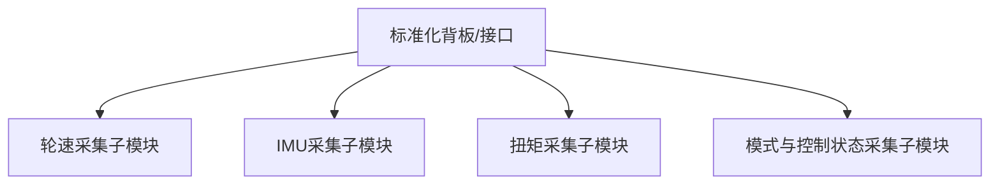
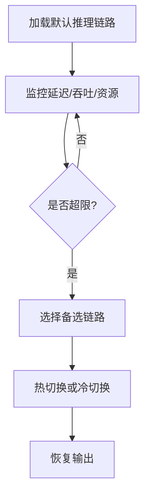

# 专利 C 交底书草案

> 题目建议：基于可插拔采集前端与异构推理板卡协同的车载扭矩预测边缘硬件系统及方法
> 日期：2026-04-02
> 对应项目：`e2e/tsp/deploy`
> 一句话总结：采用可插拔采集前端、硬件状态感知与异构板卡协同调度方法，实现车载扭矩预测系统的低改造接入与高可迁移边缘部署。

---

## 1. 检索报告

### 1.1 检索目标

1. 车载边缘推理硬件部署。
2. 模块化采集前端与 CAN/传感器接入。
3. 异构板卡调度与车载 AI 推理硬件协同。

### 1.2 检索策略

| 检索维度 | 检索关键词 |
| --- | --- |
| 采集硬件 | modular acquisition unit, pluggable CAN front-end, vehicle sensor front-end |
| 边缘板卡 | heterogeneous inference board, in-vehicle AI board, edge accelerator |
| 动态调度 | hardware-aware scheduling, runtime fallback, multi-backend inference |

### 1.3 当前最接近的公开检索入口（待人工核实具体公开号）

- 检索入口：[Google Patents](https://patents.google.com/?q=vehicle+sensor+front-end+CAN+edge+inference+board)
- 近似方案简介：当前更接近“模块化车载采集盒/采集板 + 固定推理板卡”类公开方案，常见做法强调总线接入、信号采集或单板推理部署。
- 与本案差异重点：本案把可插拔采集前端、硬件状态监测和异构板卡运行时调度统一为一个工程化边缘部署系统，而不是分散的采集设备或单后端部署方案。

### 1.4 当前检索说明

当前公开专利自动抓取受搜索页提取限制与站点反爬限制影响。当前在工具受限条件下，可稳定补充的是“最接近公开检索入口”和主题级差异分析；具体公开号、公开日和申请人仍需在可稳定访问的专利库中人工核实。

### 1.5 主题级检索初筛结论

| 主题族群 | 常见重心 | 与本案关系 | 本案区别点 | 当前状态 |
| --- | --- | --- | --- | --- |
| 车载采集盒/采集板 | 数据采集与总线接入 | 中相关 | 本案进一步结合扭矩预测推理链路与可插拔结构 | 已识别 |
| 车载 AI 板卡部署 | 单板卡推理优化 | 高相关 | 本案强调异构板卡协同与动态切换 | 已识别 |
| 多后端推理框架 | 模型后端切换 | 中相关 | 本案强调与车载采集前端和硬件状态监测联合设计 | 已识别 |

---

## 2. 发明创新点

1. 提出一种可插拔采集前端结构，使不同传感器与总线输入能够通过标准化接口快速接入预测系统。
2. 提出一种面向扭矩预测任务的异构板卡协同架构，使 CPU、GPU、量化链路或其他加速链路能按状态动态切换。
3. 提出一种硬件状态感知的推理调度方法，基于时延、吞吐、内存和异常状态选择最优推理链路。
4. 提出一种开发验证到车端部署的一体化链路，把虚拟 CAN、实时推理、性能监控和结果保存统一在同一系统中。

---

## 3. 发明内容

### 3.1 与本专利最接近的现有技术及其缺陷

最接近的现有技术通常是固定采集前端配合固定推理板卡的部署方案。这类方案一般只解决“能否部署”，但存在以下缺陷：

1. 采集前端难以复用，换车型或换传感器需要重新适配。
2. 推理链路固定，当板卡负载异常或算力不足时缺少快速切换能力。
3. 硬件状态与推理调度脱节，无法在实时运行中选择最优链路。

### 3.2 上述技术问题的原因分析

1. 采集层、推理层和监控层接口定义不统一。
2. 现有方案更关注单次推理优化，而不关注车载运行中的动态资源变化。
3. 开发测试环境与车载部署环境不一致，导致工程闭环弱。

### 3.3 本专利的附图说明及附图

#### 图 1：系统总体硬件结构图

#### 图 2：采集前端模块化结构图

#### 图 3：异构板卡切换流程图

#### 图 4：开发到车端一体化验证图

### 3.4 专利技术方案

#### 3.4.1 发明点及其区别点

| 发明点 | 现有技术做法 | 本案区别点 |
| --- | --- | --- |
| 采集接口 | 固定采集链路 | 可插拔采集前端 |
| 推理部署 | 单一板卡固定 | 异构板卡协同 |
| 调度逻辑 | 静态配置 | 硬件状态感知动态切换 |
| 验证链路 | 开发与部署分离 | 实验室到车端一体化 |

#### 3.4.2 结合附图详细描述专利技术方案

**步骤 S301**：通过标准化背板或统一接口接入多个可插拔采集前端模块，以完成不同信号源的采集。

**步骤 S302**：将采集到的数据送入统一缓冲区，并根据当前任务配置装载对应的推理模型与推理后端。

**步骤 S303**：在运行时持续监控当前推理链路的时延、吞吐、内存和异常状态。

**步骤 S304**：当监测指标超过阈值时，调度器选择备选板卡或备选推理链路，并执行热切换或冷切换。

**步骤 S305**：将切换后的输出结果和切换原因同步记录，用于后续硬件选型与参数优化。

### 3.5 名词解释

| 名词 | 解释 |
| --- | --- |
| 可插拔采集前端 | 指可按接口标准快速更换的采集模块，可为板卡、采集盒或模块化 ECU |
| 异构推理板卡 | 指 CPU、GPU、量化推理引擎或其他不同算力形态的车载计算单元 |
| 硬件状态感知调度 | 指根据运行时延迟、吞吐和资源占用动态选择推理链路 |

---

## 4. 与当前项目的关系说明

### 4.1 已实现基础

1. CAN 接收与虚拟 CAN 测试。
2. 模型编译、量化与推理优化。
3. 性能监控与异步保存。

### 4.2 扩展方案

1. 标准化可插拔采集前端。
2. 异构板卡运行时调度器。
3. 面向车载硬件状态的自动回退逻辑。

---

## 5. 已知假设与待确认项

1. 当前文稿默认至少存在两条可切换推理链路，后续可按目标硬件平台收敛实施方式。
2. 具体板卡型号和总线硬件规格可在实施例中按车型定制，不影响本案核心发明点。
3. 当前已补充最接近主题的公开检索入口，但具体公开号和公开链接仍需人工核实。
