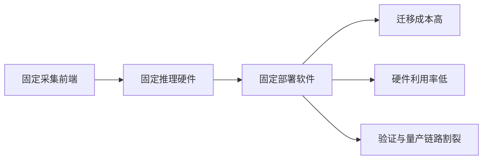
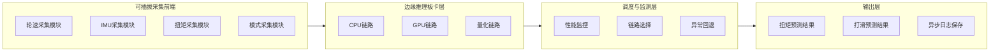
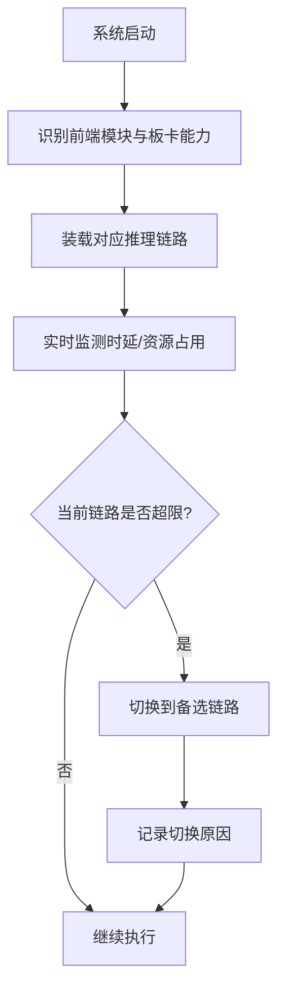

# 专利 C 技术方案介绍稿

> 题目建议：基于可插拔采集前端与异构推理板卡协同的车载扭矩预测边缘硬件系统及方法
> 形式：章节级 PPT 方案稿
> 适用对象：硬件架构专家、部署工程师、专利代理人
> 依托底座：[../../deploy/can_receiver.py](../../deploy/can_receiver.py)、[../../deploy/realtime_infer.py](../../deploy/realtime_infer.py)、[../../deploy/deploy_utils.py](../../deploy/deploy_utils.py)、[../../../utils/model_optimization.py](../../../utils/model_optimization.py)

---

## 1. 现有技术缺陷

### 1.1 现有方案的主要问题

现有车辆预测控制相关边缘部署方案在硬件层面通常存在以下不足：

1. 采集前端与推理单元强耦合，车型切换或传感器变化时迁移成本高。
2. 不同算力板卡之间缺少统一的推理调度与运行监测接口，难以兼顾时延与功耗。
3. 数据采集、同步、推理和结果保存之间缺少面向硬件资源状态的动态协同。
4. 开发测试阶段和车载部署阶段常使用两套不同架构，导致验证链路割裂。

### 1.2 当前项目与新增专利机会点

当前项目已经具备 CAN 接收、虚拟 CAN 测试、实时推理、模型编译与量化、异步保存和性能监控基础。因此，新的专利机会点不在于单独的算法，而在于把这些能力进一步结构化为“可插拔采集前端 + 异构推理板卡 + 硬件状态感知调度”的车载边缘硬件系统。

---

## 2. 本专利技术亮点

### 2.1 核心创新点

1. **可插拔采集前端**：把轮速、IMU、扭矩、模式等采集链路做成标准化前端模块，支持按车型或任务快速替换。
2. **异构推理板卡协同**：支持 CPU、GPU、量化推理引擎或不同车载算力板卡之间的动态选择。
3. **硬件状态感知调度**：根据时延、吞吐、内存占用、温升或功耗状态自动切换推理链路。
4. **开发-部署一体化验证链路**：通过虚拟 CAN、实时推理和异步存储构建从实验室到车端的一体化验证方法。
5. **软硬件解耦接口**：采集前端、推理板卡和结果存储三者通过统一接口连接，降低迁移成本。

### 2.2 与现有技术的差异化表达

| 比较项 | 常见方案 | 本专利亮点 |
| --- | --- | --- |
| 采集硬件 | 固定前端 | 可插拔采集前端 |
| 推理硬件 | 单一板卡固定部署 | 异构板卡动态协同 |
| 调度逻辑 | 人工选型、静态配置 | 硬件状态感知的自动切换 |
| 测试与部署 | 分离链路 | 实验室到车端一体化验证 |

---

## 3. 技术路线

### 3.1 总体技术路线

1. 把车辆状态采集做成标准化可插拔前端模块。
2. 统一输出到异构推理板卡接口，支持编译、量化和不同后端链路。
3. 通过性能监控模块实时测量延迟、吞吐和资源占用。
4. 根据运行状态动态选择最优推理链路，并在异常时回退到备选链路。
5. 将结果异步保存并回流用于下一轮硬件配置优化。

### 3.2 典型硬件协同流程

### 3.3 与当前项目的映射

- 已实现基础：CAN 接收、虚拟 CAN 测试、模型编译、量化、实时推理、性能监控、异步保存。
- 重点扩展：模块化采集前端、异构板卡调度、硬件资源感知与自动回退。

---

## 4. 解决的核心问题

| 核心问题 | 对应方案 | 预期效果 |
| --- | --- | --- |
| 采集硬件更换后迁移成本高 | 可插拔采集前端接口 | 提升车型和平台复用性 |
| 单一板卡难兼顾时延和功耗 | 异构板卡协同与动态选择 | 提高部署灵活性 |
| 推理链路异常时缺少快速回退 | 硬件状态监测与备链路回退 | 提升系统连续性 |
| 开发测试与车载部署链路割裂 | 虚拟 CAN 到车载部署一体化 | 缩短验证周期 |

---

## 5. 建议的 PPT 拆页方式

1. 背景与现有硬件部署缺陷
2. 可插拔采集前端设计
3. 异构推理板卡架构
4. 硬件状态感知调度逻辑
5. 开发到部署一体化验证链路
6. 核心价值与适配场景

---

## 6. 已知假设与待确认项

1. 当前文稿默认可插拔前端可以是板卡、采集盒或模块化 ECU 之一，后续可按申请边界收敛。
2. 异构板卡协同当前作为扩展方案主张，现有代码已具备编译、量化和性能监控基础，但尚未形成完整自动调度器。
3. 与本案最接近的公开专利号仍需后续人工检索补齐。
