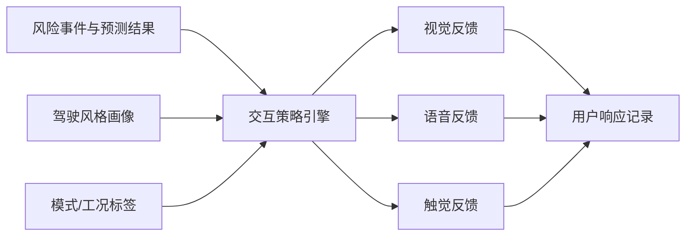
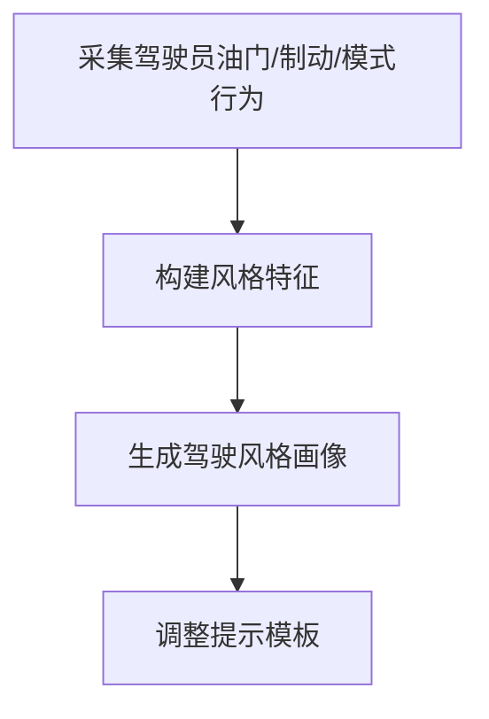
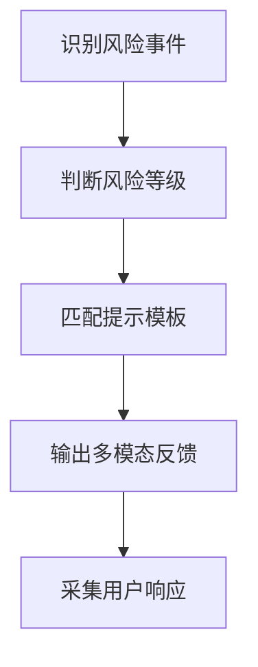
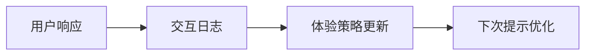

# 专利 D 交底书草案

> 题目建议：基于多模态座舱反馈与驾驶风格自适应的预测型扭矩交互体验优化方法
> 日期：2026-04-02
> 对应项目：`e2e/tsp/torque_predict`
> 一句话总结：采用预测结果驱动的多模态反馈与驾驶风格自适应策略，实现风险提示、模式建议和交互体验的分层优化。

---

## 1. 检索报告

### 1.1 检索目标

1. 座舱风险提示与控制交互。
2. 驾驶风格画像与个性化提示。
3. 预测型控制的人机交互体验优化。

### 1.2 检索策略

| 检索维度 | 检索关键词 |
| --- | --- |
| 座舱反馈 | multimodal HMI, in-vehicle feedback, haptic warning |
| 驾驶风格 | driver style adaptation, personalized vehicle feedback |
| 预测型交互 | predictive HMI, explainable control feedback |

### 1.3 当前最接近的公开检索入口（待人工核实具体公开号）

- 检索入口：[Google Patents](https://patents.google.com/?q=multimodal+vehicle+HMI+driver+style+haptic+feedback+warning)
- 近似方案简介：当前更接近“单模态风险告警 + 个性化驾驶辅助提示”类公开方案，常见做法是在风险发生前后提供视觉或语音提示，并按驾驶习惯做有限调整。
- 与本案差异重点：本案把扭矩/风险预测结果、视觉/语音/触觉多模态反馈和驾驶风格自适应调节整合到同一交互闭环，而不是单一提示或静态个性化设置。

### 1.4 当前检索说明

当前公开专利自动抓取仍受搜索页提取限制与站点反爬限制影响。当前在工具受限条件下，可稳定补充的是“最接近公开检索入口”和主题级差异分析；具体公开号、公开日和申请人仍需在可稳定访问的专利库中人工核实。

### 1.5 主题级检索初筛结论

| 主题族群 | 常见重心 | 与本案关系 | 本案区别点 | 当前状态 |
| --- | --- | --- | --- | --- |
| HMI 风险告警 | 视觉或语音提示 | 高相关 | 本案强调多模态联动和预测驱动触发 | 已识别 |
| 个性化驾驶辅助 | 驾驶习惯学习 | 中相关 | 本案强调与扭矩预测和控制解释联动 | 已识别 |
| 体验优化策略 | 提示强度调节 | 中相关 | 本案强调交互结果回流和长期优化 | 已识别 |

---

## 2. 发明创新点

1. 提出一种基于预测结果驱动的多模态交互反馈框架。
2. 提出一种根据驾驶风格自适应调整提示时机、强度和模态组合的方法。
3. 提出一种将用户交互结果反向回流到体验策略中的闭环更新机制。
4. 提出一种面向复杂工况的场景化交互模板体系。

---

## 3. 发明内容

### 3.1 与本专利最接近的现有技术及其缺陷

最接近的现有技术通常是单一视觉或语音告警系统，以及部分个性化驾驶辅助策略。但这些现有技术存在以下缺陷：

1. 提示模态单一，无法覆盖不同风险等级和不同用户偏好。
2. 交互策略通常与底层控制解耦，无法解释控制动作来源。
3. 个性化能力弱，难以针对不同驾驶风格提供差异化体验。
4. 缺少用户响应回流，交互策略无法持续进化。

### 3.2 上述技术问题的原因分析

1. 交互系统与预测控制系统分离设计。
2. 对驾驶风格和用户偏好缺少建模。
3. 对交互结果缺少结构化采集与回流机制。

### 3.3 本专利的附图说明及附图

#### 图 1：多模态交互总体架构图

#### 图 2：驾驶风格自适应流程图

#### 图 3：交互触发逻辑图

#### 图 4：体验回流闭环图

### 3.4 专利技术方案

#### 3.4.1 发明点及其区别点

| 发明点 | 现有技术做法 | 本案区别点 |
| --- | --- | --- |
| 提示方式 | 单一模态 | 多模态联动 |
| 用户建模 | 无或弱个性化 | 驾驶风格自适应 |
| 提示逻辑 | 规则或事后触发 | 预测驱动提前触发 |
| 策略优化 | 无回流 | 用户响应回流闭环 |

#### 3.4.2 结合附图详细描述专利技术方案

**步骤 S401**：识别当前时刻的风险事件、预测结果、驾驶模式和工况标签。

**步骤 S402**：根据驾驶员历史油门、制动、模式切换等行为生成驾驶风格画像。

**步骤 S403**：根据风险等级、驾驶风格画像和当前工况选择相应的提示模板和提示模态组合。

**步骤 S404**：输出视觉、语音或触觉反馈中的一种或多种，并在交互后记录驾驶员响应。

**步骤 S405**：将驾驶员响应写入体验日志，用于更新后续交互策略。

### 3.5 名词解释

| 名词 | 解释 |
| --- | --- |
| 多模态反馈 | 指视觉、语音、触觉中的一种或多种组合反馈形式 |
| 驾驶风格画像 | 指由驾驶员历史控制行为提炼出的偏好特征表示 |
| 预测型交互 | 指根据未来风险或未来控制事件提前生成交互提示 |

---

## 4. 与当前项目的关系说明

### 4.1 已实现基础

1. 多工况与多模式数据采集。
2. 风险相关预测能力。
3. 工况和模式信号基础。

### 4.2 扩展方案

1. 多模态座舱反馈模块。
2. 驾驶风格画像模块。
3. 交互回流与体验策略更新模块。

---

## 5. 已知假设与待确认项

1. 当前文稿默认支持视觉、语音、触觉三类反馈，后续可根据车型能力裁剪。
2. 驾驶风格画像与交互回流为扩展方案主张，现有项目未直接实现。
3. 当前已补充最接近主题的公开检索入口，但具体公开号和公开链接仍需人工核实。
