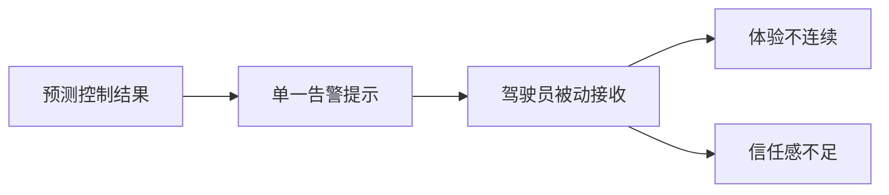
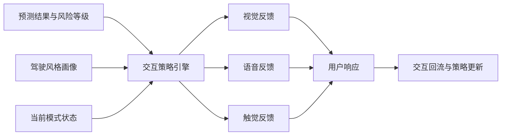
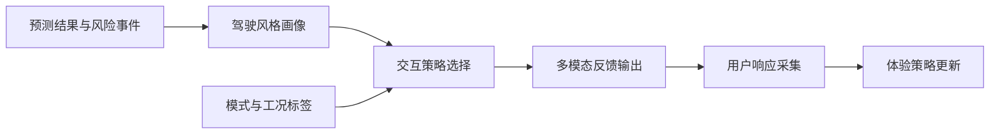
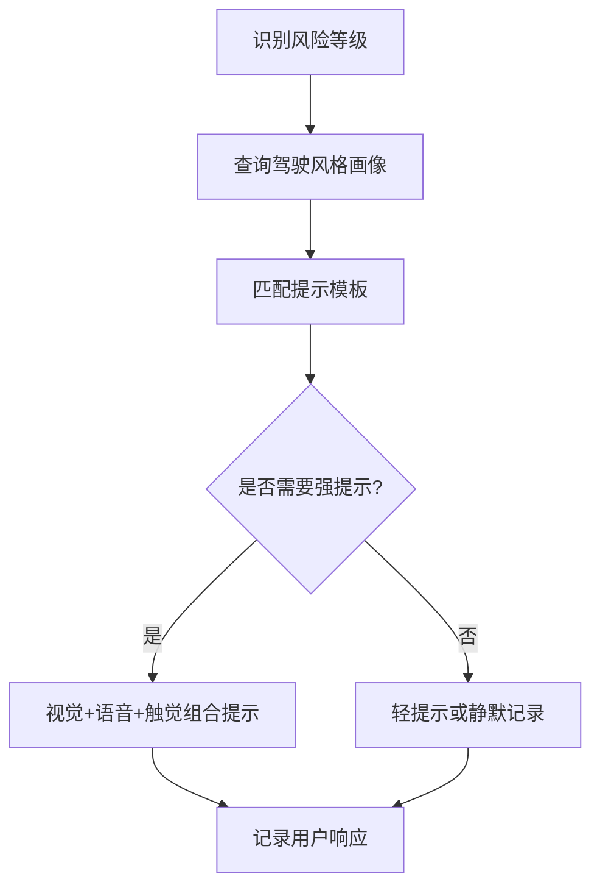

# 专利 D 技术方案介绍稿

> 题目建议：基于多模态座舱反馈与驾驶风格自适应的预测型扭矩交互体验优化方法
> 形式：章节级 PPT 方案稿
> 适用对象：座舱交互专家、控制策略专家、专利代理人
> 依托底座：[../../../dataset/docs/condition_list.md](../../../dataset/docs/condition_list.md)、[../../torque_predict/config/signals.yaml](../../torque_predict/config/signals.yaml)、[../../docs/reports/first_topic_report_20260313.md](../../docs/reports/first_topic_report_20260313.md)

---

## 1. 现有技术缺陷

### 1.1 现有方案的主要问题

现有车辆防滑或扭矩控制交互大多存在以下问题：

1. 交互反馈单一，往往只在仪表上显示告警，缺少语音或触觉协同。
2. 同一提示策略对不同驾驶风格用户一刀切，体验割裂。
3. 控制策略变化对用户不透明，导致“突然限扭”或“模式变化感知不一致”。
4. 交互模块只负责显示结果，而不参与体验优化闭环。

### 1.2 当前项目与新增专利机会点

当前项目已经具备多工况、驾驶模式和扭矩/打滑预测底座，但还没有把这些预测结果进一步转成“多模态座舱反馈 + 驾驶风格自适应”的用户体验系统。这构成了新的专利空间。

---

## 2. 本专利技术亮点

### 2.1 核心创新点

1. **多模态反馈联动**：对同一风险事件同时支持视觉、语音和触觉中的一种或多种反馈。
2. **驾驶风格自适应**：根据驾驶员对油门、制动、模式切换和响应偏好的长期特征，调整提示强度与提示时机。
3. **预测驱动的体验优化**：在控制动作之前或控制动作发生时给出原因解释和建议，而不是事后提醒。
4. **交互结果回流**：记录用户接受、忽略或反向操作等行为，用于下一轮交互策略优化。
5. **场景化提示模板**：针对冰雪、坡道、分离附着、高激励等不同场景生成不同的提示模板。

### 2.2 与现有技术的差异化表达

| 比较项 | 常见方案 | 本专利亮点 |
| --- | --- | --- |
| 反馈形式 | 单一视觉提示 | 多模态反馈联动 |
| 用户建模 | 统一提示策略 | 驾驶风格自适应 |
| 提示时机 | 事后告警 | 预测驱动的提前解释 |
| 优化闭环 | 无用户回流 | 交互结果回流优化 |

---

## 3. 技术路线

### 3.1 总体技术路线

1. 基于扭矩/打滑预测结果和风险等级识别当前潜在控制事件。
2. 基于驾驶风格画像、当前模式和场景标签，选择适合的交互模板。
3. 通过视觉、语音或触觉执行反馈。
4. 记录用户响应，用于后续更新提示策略和体验等级。

### 3.2 交互策略流程

### 3.3 与当前项目的映射

- 已实现基础：多工况标签、驾驶模式信号、扭矩/打滑预测。
- 重点扩展：驾驶风格画像、座舱多模态反馈、交互结果回流。

---

## 4. 解决的核心问题

| 核心问题 | 对应方案 | 预期效果 |
| --- | --- | --- |
| 控制介入突兀、用户难以理解 | 预测驱动的提前解释反馈 | 提升透明度与信任感 |
| 单一提示方式体验差 | 多模态反馈联动 | 提升可感知性 |
| 不同驾驶风格下提示不匹配 | 驾驶风格自适应 | 提升个性化体验 |
| 交互策略无法持续优化 | 交互结果回流闭环 | 支撑长期体验迭代 |

---

## 5. 建议的 PPT 拆页方式

1. 背景与现有交互缺陷
2. 多模态反馈总体架构
3. 驾驶风格自适应机制
4. 预测驱动的交互触发逻辑
5. 用户回流闭环与体验优化
6. 典型场景应用示例

---

## 6. 已知假设与待确认项

1. 当前文稿默认多模态反馈可选视觉、语音、触觉三类，后续可按车型能力裁剪。
2. 驾驶风格画像为扩展方案主张，现有项目尚未形成完整的风格画像模块。
3. 与本案最接近的公开专利号仍需后续人工检索补齐。
