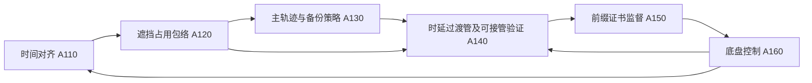
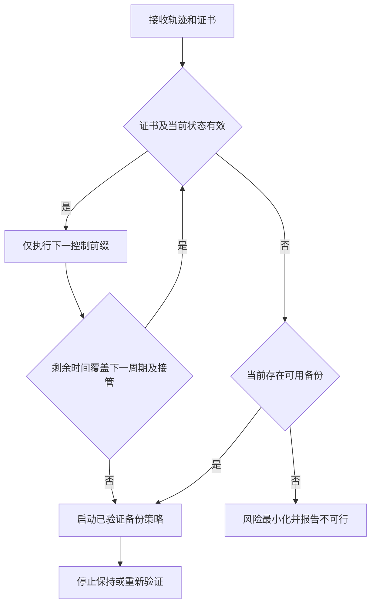

# 专利交底书 A：一种基于接管可达证书的遮挡场景车辆轨迹前缀放行与控制方法

> 版本：V1.1，2026-10-15；经两轮公开资料对比及技术一致性复核的草案。
> 建议申请类型：发明专利；方法、车载系统、电子设备及计算机可读存储介质。
> 成熟度：可实施设计，尚无本案仿真、硬件在环或实车试验结果。
> 发明人、申请人及首次形成日期应按实际研发记录填写，不以本文生成时间替代。

## 1. 技术领域与摘要

本方案涉及自动驾驶车辆局部轨迹规划、安全监控与底盘控制，适用于路口遮挡、路侧停放车辆遮挡和传感器短时失明场景。

摘要建议：获取带采集时间的可见空间与遮挡边界，构建潜在交通参与者的时变占用外包络；针对候选主轨迹的各执行前缀，计算车辆在监控、通信和执行器最坏接管时延内的状态可达管，并验证该可达管能否进入满足无碰撞及停止终端约束的备份控制可接管集合；根据验证结果、观测有效时域及执行器能力生成包含最迟切换时刻的接管可达证书；控制器仅执行证书覆盖的主轨迹前缀，并在余量耗尽前切换备份控制。该方案旨在降低轨迹生成时有效而实际接管时已不可行的风险。

## 2. 现有技术与检索依据

检索基准日为 2026-10-15。以下为已核验的直接相关资料，题名和日期以链接页面为准；来源编号与总台账一致。

| 编号 | 文献及时间 | 已读证据与本案关系 |
| --- | --- | --- |
| L01 | Zheng 等，Occlusion-Aware Contingency Safety-Critical Planning for Autonomous Driving；首稿 2025-02-10，v3 更新 2026-10-05；IEEE Transactions on Cybernetics 56(5), 2777-2790，2026 | [摘要](https://arxiv.org/abs/2502.06359)、[正文 v3](https://arxiv.org/html/2502.06359v3)；正文 II-A、III、IV、V 已读，披露遮挡可达性、探索及回退双轨迹、共享初始段和 ADMM |
| L02 | Yang 等，Safe and Nonconservative Contingency Planning for Autonomous Vehicles via Online Learning-Based Reachable Set Barriers；首稿 2025-09-09，v2 更新 2026-04-15 | [摘要](https://arxiv.org/abs/2509.07464)；披露事件触发意图集合学习与可达集屏障；未完成全文逐式核对 |
| L04 | Marques 等，Localized Conformal Safety Monitoring with Vision-Language Models for Autonomous Driving；2026-10-02 | [摘要](https://arxiv.org/abs/2610.02765)；条件覆盖依赖可交换性，不能替代本案物理可接管性验证 |
| P01 | Contingency planning and security；JP2022542277A，2022-09-30；JP7401650B2，2023-12-19；最早优先权 2019-07-31 | [全文](https://patents.google.com/patent/JP7401650B2/en)；权利要求 1、8 及图 22、26 相关说明已读；已披露遮挡速度规划、紧急能力及反应时间，不应声称本案首次引入时延 |
| P02 | Zoox，System and method for trajectory validation；US20210046923A1，2021-02-18；US11407409B2，2022-08-09；优先权 2019-08-13 | [全文](https://patents.google.com/patent/US11407409B2/en)；权利要求 1、6、16 及图 3、11 已读；已披露过期、准时、可行性检查和备份选择 |
| P07 | Zoox，Safe system operation using latency determinations；US20200201335A1，2020-06-25；US11099573B2，2021-08-24；优先权 2018-12-19 | [全文](https://patents.google.com/patent/US11099573B2/en)；权利要求 1、8-9、17-19 及图 6 已读；披露标签追踪时延、阈值异常及安全轨迹响应 |

P01 的索引申请人与全文所列主体存在差异，本文不据此认定当前权利归属，须查询官方登记。其同族公开线索包括 US20210031760A1、WO2021021269A1 和 CN114175023A；各法域权利要求不能直接视为相同。

## 3. 要解决的技术问题

规划器在时刻 $t_g$ 生成主、备份轨迹，但控制器实际执行时已经过感知处理、求解、消息排队及执行器响应。车辆沿主轨迹向前行驶的同时，隐藏车辆也可能从遮挡区驶出。因而“备份轨迹在生成时无碰撞”并不必然意味着“当前经过接管时延后仍可进入备份轨迹”。

拟解决的问题是：在规划与控制异步运行、观测有限时效且存在控制接管时延的条件下，如何计算主轨迹还允许执行多长，而不是在主规划超时后才发现车辆已越过备份轨迹的可接管边界。

## 4. 拟保护的最小技术组合

1. 以感知采集时间为起点，而非仅用轨迹生成时间，构造带时效的隐藏参与者占用外包络。
2. 对主轨迹前缀上的车辆状态集合，显式传播最坏接管时延内仍将执行的控制，计算接管结束状态管。
3. 验证上述状态管包含于备份反馈策略的可接管集合，并验证接管过渡段本身无碰撞。
4. 将验证结果反向转换成主轨迹最大可执行前缀与最迟切换时刻，交给控制侧独立倒计时执行。
5. 证书更新失败不能自动延长前缀；控制侧在余量耗尽前触发已验证备份策略。

“证书”是可复算的数据记录和判定结果，不是密码学证书，也不是无条件安全证明。区别点在上述因果链，而不是名称、时间戳或双轨迹结构。

## 5. 系统结构与数据接口

| 模块 | 输入 | 输出 |
| --- | --- | --- |
| A110 时间对齐模块 | 相机/激光雷达帧、IMU、轮速、采集时间及误差界 | 同一单调时钟下的状态与观测年龄 |
| A120 遮挡包络模块 | 道路几何、可见空闲空间、遮挡边界、参与者速度与加速度界 | 各时刻的潜在占用外包络及版本 |
| A130 候选规划模块 | 导航方向、车道走廊、障碍物与底盘限制 | 候选主轨迹和备份反馈策略 |
| A140 接管验证模块 | 主轨迹、备份策略、状态误差、时延上界 | 可接管集合、前缀上限及余量 |
| A150 控制侧监督模块 | 轨迹和证书、当前状态、时钟、底盘健康信息 | 前缀放行、备份接管或风险最小化请求 |
| A160 底盘控制模块 | 参考状态、反馈策略 | 转角、驱动与制动指令及执行确认 |

证书至少包含 `plan_id`、`backup_id`、`observation_id`、`frame_id`、`capability_version`、`generated_at`、`switch_deadline`、`prefix_end`、`latency_bound`、`state_error_bound`、`minimum_clearance` 和 `validation_status`。标识用于绑定本次几何、模型、时钟与控制资源，防止新主轨迹误配旧备份。

## 6. 具体技术方案

### 6.1 坐标、模型和假设

在车端连续局部坐标系下使用状态 $x=[p_x,p_y,\psi,v,a,\delta]^{\mathsf T}$，输入为纵向加加速度及转角变化率 $u=[j,\omega_\delta]^{\mathsf T}$。低中速实施例采用带执行器状态的自行车模型：

$$
\dot p_x=v\cos\psi,\quad \dot p_y=v\sin\psi,\quad
\dot\psi=\frac{v\tan\delta}{L},\quad \dot v=a,\quad
\dot a=j,\quad \dot\delta=\omega_\delta.
$$

$L$ 为轴距。模型离散化后为 $x_{k+1}=f(x_k,u_k,w_k)$，$w_k$ 覆盖跟踪误差和经标定的模型扰动；高速或侧偏显著时必须改用动态模型，不得沿用运动学模型的验证结论。

运行前需界定：观测位置误差、参与者最高合理速度与加速度、时钟同步误差、底盘可实现减速度、转角速率和时延上界。边界未经标定或已被观测推翻时，不得继续输出有效证书。

### 6.2 S101：构建时间对齐的占用外包络

将“已观测空闲”“已占用”“未知或遮挡”分开。仅在射线覆盖、量程和检测质量条件满足时，才用空闲观测缩小未知区域；无检测结果不等于空闲。

对于隐藏参与者 $q$，以最近有效观测时刻 $t_o$ 的可能初始状态集为起点，在道路约束和运动界内传播，得到 $\mathcal O_q(t)$。简化的一维距离扩张上界为：

$$
r_q(t)=r_{q,0}+v_{q,\max}(t-t_o)+\tfrac12a_{q,\max}(t-t_o)^2.
$$

该上界仅作外包络构造的一种实现；车辆尺寸、几何投影、采集时差和定位误差需同时包含。对行人使用二维可达区域，不沿用“保持车道中心”的车辆假设。多个入口取占用并集，不以低概率删除物理上仍合理的入口。

### 6.3 S102：生成备份策略及可接管集合

优先选择在冲突区前停止的反馈策略 $\pi_b$，亦可选择进入已确认空闲避险带的反馈策略。策略包括状态反馈、执行器限幅和终端保持，不是只有一条名义折线。

在每个离散绝对时刻 $t_k$ 构造鲁棒可接管集合 $\mathcal K_b(t_k)$：从该集合内任一状态出发，在允许扰动下执行 $\pi_b$，均满足底盘约束、车辆扫掠体与障碍包络不相交，并在有限时域内进入停止集合 $\mathcal S_{\rm stop}$。可通过离线网格可达性表与在线走廊裁剪实现，也可通过在线管束 MPC 验证。

停止集合必须位于冲突区外，并包含停车保持力约束。对移动障碍的无碰撞结论限定到验证时域；不能把“本车停住”视为其他车辆永远不会撞来的保证。

占用外包络、模型扰动界和底盘能力必须覆盖前缀执行、接管过渡及备份直至停止的完整验证时域。若某项证据只覆盖至接管开始，不能据此确认整个备份可执行；应缩短前缀、扩大包络，或拒绝签发证书。

### 6.4 S103：计算时延与接管过渡管

定义从监督模块作出切换决定至底盘开始执行备份控制的上界：

$$
\tau_h=\tau_{\rm monitor}+\tau_{\rm bus}+\tau_{\rm actuator}
+\tau_{\rm clock}+\tau_{\rm jitter}.
$$

若状态或观测已经过期，其年龄应在传播起点中处理，不再重复加入 $\tau_h$。若备份尚未预置或验证，则还需计入求解与下发时延；本案优选备份预置以减少该部分。

历史时延的均值、P99 或一次测试最大值不能直接当作确定性上界。优选由调度与总线预算、执行器标定及独立超时监控建立可监督的保守界；若只能取得统计时延，证书须标记统计假设及超界风险，不得输出确定性安全结论。P07 的时延异常统计检测可作为已知监控手段，不能替代本案执行前的接管可达性验证。

对主轨迹的候选前缀时长 $h$，先传播主轨迹至 $t+h$ 的状态集合，再在 $[t+h,t+h+\tau_h]$ 内使用已排队或仍可能生效的原控制及其误差界，得到过渡管 $\mathcal R_{\rm trans}(s;h)$ 与终态集合 $\mathcal R_h^{\rm end}$。若排队控制不可确定，应按允许输入集合外包络传播，而不是假设立刻松油或立刻制动。

### 6.5 S104：反算允许前缀

前缀放行必须同时满足：

$$
\mathcal R_h^{\rm end}\subseteq\mathcal K_b(t+h+\tau_h),
$$

$$
\operatorname{Footprint}(\mathcal R_{\rm trans}(s;h))
\cap\bigcup_q\mathcal O_q(s)=\varnothing,
\quad s\in[t+h,t+h+\tau_h].
$$

主轨迹在 $[t,t+h]$ 的扫掠体也必须无碰撞。对离散采样之间的运动用速度、角速度界扩张，或进行连续碰撞检测，不能仅检查采样点。

从短到长枚举控制周期整数倍的前缀，逐段累计验证；仅当所有更短前缀也有效时放行较长前缀。非单调道路几何下不直接假设可行性对 $h$ 单调。令最早出现验证失败之前的最大连续有效前缀为 $h^*$，证书最迟切换时刻为 $t+h^*$，并再扣除至少一个监督周期的工程裕量。

### 6.6 S105：控制侧执行与接管

监督模块每周期校验证书标识、坐标版本、剩余时间、当前状态是否落在证书误差管、执行器能力及潜在占用是否仍被包络覆盖。仅在全部满足时执行主轨迹下一小段。

若下一监督周期将越过最迟切换时刻，则立即向已预置的备份策略发出切换指令，在 $\tau_h$ 内完成接管。新证书只有在完成原子替换并与新主、备份策略一致时才能续期；未收到更新时沿原证书倒计时，而非保持巡航等待。

### 6.7 S106：异常处理

| 事件 | 必须采取的处理 |
| --- | --- |
| 规划超时，旧证书尚有效 | 只在旧证书覆盖范围内继续；达到预切换阈值即接管 |
| 新障碍超出原包络、附着突降或执行器故障 | 原证书立即失效；独立安全控制器重判并执行风险最小化，不再声称有原保证 |
| 时钟失同步、未来时间戳、消息乱序 | 拒绝证书，禁止因此延长前缀 |
| 备份轨迹自身受阻 | 若有另一个已验证策略则切换；否则稳定减速并上报风险，不能盲目跟随旧备份 |
| 无停止空间 | 在当前能力内最小化碰撞后果；记录“无可行解”，不输出“安全停止” |

## 7. 实施例与数值说明

### 7.1 遮挡路口示例

车辆以 $v_0=8\,\mathrm{m/s}$ 接近冲突区，距前保险杠可达停止边界 $d=14\,\mathrm m$。假定水平直道、接管前速度恒定、保证可实现的制动减速度为 $b=3\,\mathrm{m/s^2}$，接管时延上界 $0.20\,\mathrm s$，空间裕量 $m=1.5\,\mathrm m$；减速度建立过程已计入时延或制动距离保守表。

$$
d_{\rm need}=v_0\tau_h+\frac{v_0^2}{2b}+m
=1.6+10.667+1.5=13.767\,\mathrm m.
$$

静态停止边界下剩余距离仅 $0.233\,\mathrm m$，按该速度折合可继续等待约 $0.029\,\mathrm s$。若监督周期为 $0.01\,\mathrm s$，还必须扣除监督裕量；不能因为规划周期为 $0.1\,\mathrm s$ 就继续执行完整一周期。

当接管时延上升至 $0.30\,\mathrm s$，所需距离变成 $14.567\,\mathrm m$，该状态不再通过示例判据。实际算法还要与隐藏车辆的时变占用求交，因此该一维复算是必要条件演示，不是完整安全证书或试验结果。

### 7.2 感知更新中断示例

感知更新中断 $0.15\,\mathrm s$，隐藏车辆速度界 $10\,\mathrm{m/s}$、加速度界 $2\,\mathrm{m/s^2}$，占用包络增加至少 $1.5225\,\mathrm m$。若包络与旧备份走廊相交，禁止通过刷新轨迹时间戳续期。应使用原有效期内的提前停止策略，或判定原假设已失效。

## 8. 附图说明

图 1 表示数据、证书与控制指令的闭环；A110 至 A160 与第 5 节模块对应。

图 2 表示控制侧状态转换。恢复主轨迹必须经过重新验证，不能只以故障信号消失为条件。

## 9. 与现有技术的逐项区别及创新风险

| 对比对象 | 已有披露，不能独占 | 本案拟进一步限定 | 剩余风险 |
| --- | --- | --- | --- |
| L01 | 遮挡风险、双轨迹、共享前缀、平滑切换 | 用接管终态管包含关系求主轨迹连续有效前缀，并由控制侧倒计时执行 | 正文 V-B 已提出将来研究自适应共享时域，仅“自适应前缀”仍可能显而易见 |
| P01 | 反应时间、制动能力、遮挡前限速 | 显式验证排队控制下的整个接管过渡管及备份可接管集合 | 单纯把时延加进停止距离不构成足够区别 |
| P02 | 时间戳过期、准时性、当前状态可行性、备份存储与选择 | 主轨迹放行权依赖备份在未来接管时刻的集合包含关系，而非分别检查各条轨迹 | 与可达性安全监控或 Simplex 架构组合的创造性风险较高，需进一步检索 |
| P07 | 根据消息血缘计算时延，异常时减速或执行安全轨迹 | 即使时延尚未达到异常阈值，也可因未来接管管越界而禁止主轨迹继续执行 | “时延超时触发备份”已知，不能成为本案核心区别 |
| L04 | 概率校准的轨迹安全集合 | 不以模型标签或置信度替代底盘和几何可接管性验证 | 并非使用概率方法就不落入其他权利要求 |

本轮资料中尚未确认单一来源完整披露第 4 节组合；这只是待进一步验证的区别特征，不等同于已证明新颖性。第二轮已核验 P07；P02 相似文献表曾显示 B1 后缀，直接打开为 404，实际可读取文本为 US11099573B2，本稿已按正文纠正。仍需检索可达性安全监控及异步安全架构的更近先例。

## 10. 权利要求建议稿

### 10.1 独立方法权利要求骨架

一种车辆轨迹规划与控制方法，其特征在于，包括：

1. 获取具有观测时间的遮挡区域信息和车辆状态，生成潜在交通参与者在不同绝对时刻的占用外包络；
2. 获取主轨迹和备份反馈策略，确定所述备份反馈策略在各接管时刻的可接管状态集合；
3. 针对所述主轨迹的候选执行前缀，根据接管时延上界及在该时延内仍可能执行的原控制，计算接管过渡状态管和接管结束状态集合；
4. 在所述过渡状态管对应车辆扫掠体不与占用外包络相交，且接管结束状态集合包含于相应可接管状态集合时，将该候选前缀标记为可放行，并确定连续可放行前缀的终点；
5. 生成绑定所述主轨迹、备份反馈策略和观测版本且含最迟切换时刻的证书；
6. 控制器仅执行所述证书覆盖的主轨迹前缀，并在下一监督周期将不能满足证书的接管时间余量时启动所述备份反馈策略。

以上是交底骨架，不是经代理人定稿的正式权利要求。占用包络、可接管集合和时延控制传播不可仅以功能性名称替代具体技术限定。

### 10.2 从属权利要求方向

1. 接管时延由监控、总线、执行器、时钟误差及抖动上界合成，并采用单调时钟。
2. 备份反馈策略预置于控制侧，证书与主、备份策略以同一版本原子替换。
3. 对车辆和行人采用不同的隐藏参与者运动界与几何外包络。
4. 对离散验证间隔采用有界运动扩张或连续扫掠碰撞检查。
5. 观测中断时仅扩张占用外包络，不凭无检测结果缩小未知空间。
6. 执行器能力下降、状态离开误差管或时延越界时撤销证书并进入风险最小化。
7. 验证依据覆盖整个备份停止时域，并将仅统计成立的时延界与可监督的工程上界分开标记。

另设系统独立项，以第 5 节模块及其数据关系支撑；电子设备和存储介质项引用方法步骤，不新增无说明书支撑的效果。

## 11. 可实现性与验证计划

首版可采用现有车辆规划器生成候选，独立监督进程计算外包络和查表可接管集合；不依赖大模型、不要求新增路侧设施。C++ 实现，QP 可选 OSQP，非线性验证可选 acados；开源软件许可证及车规适用性另行审查。建议规划 10 Hz、监督 100 Hz，均为待测试工程配置而非已达到性能。

| 验证层级 | 场景或注入 | 对照与判据 |
| --- | --- | --- |
| 数值单元检查 | 时延由 0.10 s 增至 0.40 s；不同时钟误差 | 时延增大不应增加同条件可放行长度；复算第 7 节 |
| 闭环仿真 | 遮挡车辆、行人横穿、无感知更新、不同附着 | 对比 L01 类固定共享段及 P02 类固定过期阈值；统计误放行、碰撞、最小间距和通行时长 |
| 消融 | 去除过渡段碰撞检查、去除版本绑定 | 构造过渡段碰撞但终态有效、乱序备份等反例，必须被完整版拒绝 |
| 时域与时延反例 | 观测仅覆盖至切换时刻、统计时延偶发越界、未达固定异常阈值但接管已不可达 | 拒绝不完整时域证书；超界后撤证；识别固定阈值监控不能发现的误放行 |
| 硬件在环 | 注入通信排队、CPU 拥塞、制动建立延迟 | 记录最坏验证耗时和切换确认时间；越界应撤销证书 |
| 封闭场地 | 低速软目标遮挡，逐级增加速度 | 先证明各边界标定有效，再验证停止与接管；不直接开展开放道路试验 |

试验按相同场景、种子和底盘参数运行，至少覆盖 100 个随机种子并保留失败案例；“零碰撞样本”不等同于零风险。预期效果是减少时延导致的误放行，是否改善效率需用对照数据证明。

## 12. 本轮迭代记录与申请前补证

- V0：考虑“遮挡感知＋双轨迹＋不确定性阈值”。L01 已直接覆盖，放弃宽泛组合主张。
- V0.1：考虑“备份有效期＋时延”。P01 已有反应时间，P02 已有过期验证，删去“首次考虑时延或有效期”的说法。
- V1.0：聚焦接管过渡管、备份可接管集合、主轨迹前缀放行三者的反向耦合；增加包络被推翻时撤证与无解分支。
- V1.1：第二轮核验 P07 后明确“异常时延触发”并非创新；修正专利后缀，补充完整停止时域覆盖和统计时延不能冒充确定上界的实施约束及测试。
- 申请前补证：实际 ECU 的时延上界、车辆动态模型适用域、可接管集合求法和误差包络、最接近专利的官方全文及同族审查档案、真实发明人贡献记录。

创新性为基于当前已读资料的工程假设；专利授权前景和自由实施应分别开展专业检索与法律评价。