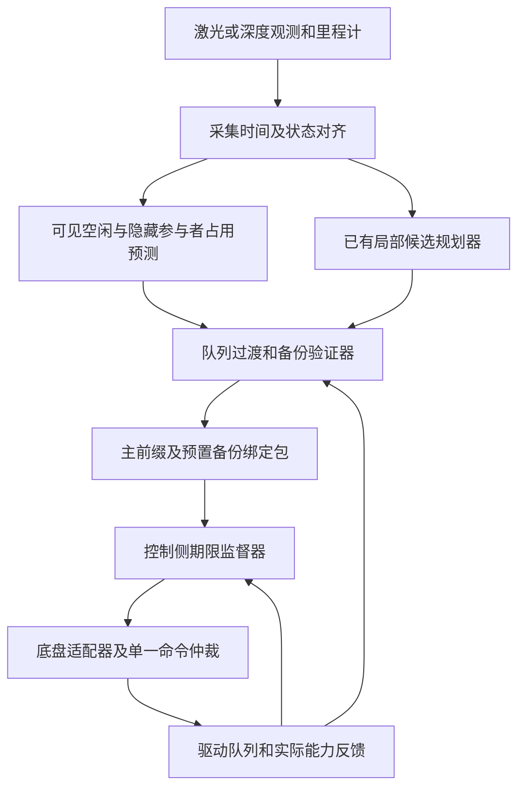

# A 案技术详解：遮挡环境中的接管可达性、执行队列与轨迹前缀

> 版本：V2.0 配套说明，2026-10-15。
> 对应交底书：[01_patent_a_occlusion_handover_certificate_disclosure_20261015.md](01_patent_a_occlusion_handover_certificate_disclosure_20261015.md)。
> 本文可独立阅读。公式是解释性设计，伪代码不是已完成的软件；全部本案数值为假设算例，不是论文实验或本案硬件结果。
> 创新判断：高风险。最大名义执行时长、备份可恢复性及证书倒计时已有直接先例；本案尚未证实具有可授权区别。

## 1. 用一个问题理解本案

仓储机器人经过货架盲角时，看不见另一侧的人。规划器给出“继续前进”和“必要时停车”两种动作。真正需要问的不是“现在刹车能否停住”，而是：

**再执行一小段主控制，发出接管决定后，旧命令还会执行一段时间；等新控制真正接手，是否仍能避开隐藏参与者并进入可保持状态？**

三个时刻不能混为一谈：观测采集、监督决定、执行器实际切换。备份在生成时可行，不代表未来接管时仍可行。假如驱动器还排有加速指令，仅用当前速度计算停车距离会偏乐观。

本案拟增加一个执行侧监督器：核验允许继续执行的有限前缀，把队列退出、接管和停车一起计算；新规划未到，不自动延长期限。它不是用论文名字包装的新算法，而是一个需要继续查新和实测的异步执行方案。

### 1.1 适用平台与不适用情形

| 平台 | 可以复用的结构 | 必须另建的模型/终端 |
| --- | --- | --- |
| 差速 AMR、配送/服务机器人 | 观测对齐、队列传播、前缀监督 | 左右轮耦合约束，直线及旋转停止，载荷扫掠体 |
| 阿克曼巡检机器人、车辆 | 同一监督结构 | 转向/制动动态、侧偏及轮胎能力适用范围 |
| 全向机器人 | 同一监督结构 | 轮系雅可比、各向异性摩擦与侧向加速限制 |
| 四足/轮足机器人 | 只能复用监督思想 | 足端接触、支撑相、全身动力学和稳定支撑终端 |
| 无人机 | 只能作为条件化扩展 | 三维动力学、推力/姿态、能量及悬停/着陆条件 |

本版最小原型选择地面差速 AMR；不声称已经给出足式或飞行平台的完整安全控制器。

## 2. 技术来源与逐项依据

### 2.1 来源不是创新证明

| 技术要素 | 来源及实际核读范围 | 本文采用方式 | 不能据此声称什么 |
| --- | --- | --- | --- |
| 遮挡参与者可达占用、探索与回退共享段 | L01，正文 II-A、III-V | 作为遮挡预测和候选轨迹的已有基础 | 双轨迹、共享前缀为本案首创 |
| 在线意图集/可达集适应 | L02，摘要 | 说明预测边界可更新，但更新须重验 | 已读其全部理论，或学习一定覆盖真实行为 |
| 备份展开、终端集合及隐藏占用验证 | L12，正文 II-IV、V-D | 直接紧邻先例；解释可恢复集合 | “遮挡＋备份＋终端”是本案独有 |
| 最长名义执行时长和有状态倒计时 | L13，正文 II-VI，尤其 V-B/V-C | 直接紧邻先例；限制本案主张 | gatekeeper 不考虑前缀，或本案首提倒计时 |
| 多类机器人探索/安全/应急轨迹 | L11，摘要 | 支持平台扩展的技术背景 | 从汽车换成机器人便产生创新 |
| 轨迹时效、能力和一致性验证 | P02，权利要求 1、6、16 及相关说明 | 设计版本和时效检查 | 时间戳和验证模块本身新颖 |
| 反应时间及遮挡停车能力 | P01，权利要求 1、8，图 22/26 | 构造物理反例的基础 | 首次将反应时间用于遮挡 |
| 时延血缘/统计阈值和安全响应 | P07，权利要求 1、8-9、17-19，图 6 | 作为已有时延监控手段 | P99 是确定时延上界，或超时切备份是新概念 |
| 下游速度过滤器 | D02，官方 README | 说明 ROS 2 中可安放监督器的位置 | Collision Monitor 自带可达性证明或安全认证 |

### 2.2 本案新增设计与已有部分的边界

本文提出把 `平台状态＋不可撤销队列＋代际＋执行游标＋备份预置/激活状态` 联合用于过渡预测，并让证书激活依赖真实驱动反馈。预期技术作用是：队列不同会改变未来速度、扫掠体及可放行时长，反馈失配会撤销继续执行资格。

这只是本次整理的方案合成，不是已经查明的独占发明点。L13 引用的原始 gatekeeper、鲁棒/时延安全过滤及异步架构专利仍可能覆盖该组合。单纯增加字段、握手或更保守的判断不自动具有创造性，须证明它们与物理控制结果的必要因果关系。

## 3. 系统框架与数据流



规划器负责提出动作，不享有绕过监督器的驱动通道。备份必须在需要使用前已装载；若临时求解备份，其耗时必须进入接管界。硬件急停等独立安全功能保留，软件监督不能替代它们。

### 3.1 建议接口

| 消息/数据 | 最小字段 | 由谁产生及校验 |
| --- | --- | --- |
| `ObservationBundle` | 采集时刻、时钟域、帧版本、可见空闲、占用及误差界 | 感知/对齐模块；验证器检查覆盖期 |
| `PlatformDescriptor` | 模型、外形/载荷、输入及速率界、终端条件、能力版本 | 标定/底盘适配器；换载荷须换版本 |
| `QueueSnapshot` | 快照 ID、代际、游标、已接受输入及其时间包络、不可撤销界 | 驱动适配器；不能由规划期望命令冒充 |
| `BackupArmedAck` | 策略版本、已预置状态、允许激活区间、接收时刻 | 驱动/控制侧；消息发送成功不是确认 |
| `PrefixCertificate` | 主/备份/观测/队列 ID、能力/帧版本、绝对决定期限、有效状态管 | 验证器签发，监督器每周期重验 |
| `ExecutionFeedback` | 实际代际/游标、输出或跟踪误差、策略激活状态 | 驱动器；超包络触发撤销 |

这些是设计接口，不是已发布的 ROS 标准消息。无队列读取接口时，须从驱动契约建立保守输入集合；无法界定则只能给出无保证的风险最小化，不伪造精确反馈。

## 4. 建模假设、变量与单位

| 符号 | 含义 | 单位/约束 |
| --- | --- | --- |
| $t_o,t_d$ | 观测采集时刻、当前验证起点 | s，同一单调时间基准 |
| $h$ | 验证起点到发出接管决定的名义时长 | s，非负 |
| $\tau_h$ | 决定到备份实际生效的上界 | s，不含已经传播的观测年龄 |
| $x,u,w$ | 平台状态、输入、模型扰动 | 分量按模型给定，$w$ 在经标定集合内 |
| $Q,e,c,a_b$ | 队列、代际、游标、备份状态 | 离散执行状态，不与位置误差混合取平均 |
| $\mathcal O(t)$ | 障碍物物理占用外包络 | m 表示的几何集合，随绝对时间变化 |
| $\mathcal K_b(t)$ | 按指定备份策略可恢复的状态集合 | 在其模型和时域条件下成立 |
| $\Delta_s$ | 控制侧监督周期及已界定抖动预算 | s，不能以平均运行周期代替 |

确定性结论要求：障碍行为被外包络覆盖、动态模型/外形正确、误差与时延有界、实际输入被包络覆盖、完整时域有效。某项只能统计描述时，明确标注概率/分布及越界风险，不把它转述成必然安全。

## 5. 从遮挡几何到占用预测

### 5.1 不检测到不等于没有

由传感器射线、量程和遮挡面得到确认空闲与未知空间。若货架挡住一条通道，应在入口放置“可能存在参与者”的初始状态集合，而不是只追踪已检测目标。

对于一个无方向先验的隐藏参与者，示例保守扩张可写为：

$$
\mathcal P_q(t)\subseteq\mathcal P_q(t_o)\oplus
\mathbb B\!\left(v_{q,\max}(t-t_o)+\tfrac12 a_{q,\max}(t-t_o)^2\right).
$$

$\oplus$ 为 Minkowski 和，$\mathbb B(r)$ 为半径 $r$ 的圆/球。参与者形状和初始位置误差还需加入物理占用。道路/通道约束可收紧集合，但必须是有效约束，不靠“行人通常不会横穿”删除合理运动。

### 5.2 只膨胀一次外形

一种实现直接检查平台扫掠体与障碍物理占用是否相交；另一种把障碍按平台形状及误差膨胀后，检查参考点。两种方式择一并保持定义一致，不能遗漏外形，也不要在两端无说明地重复计算同一尺寸。

观测过期使隐藏占用随时间扩张。更新若突然增大占用，必须重新认证当前状态；旧证书不因“新数据已到”自动有效。L12 的理论也具有预测覆盖、时序一致和更新后重验条件。

## 6. 为什么要验证备份反馈而不只验证折线

备份策略 $\pi_b$ 是随状态产生输入的反馈规则，例如沿当前安全走廊受限减速，同时把角速度降至可保持范围。名义停车折线只描述理想初态，不包含起点误差、执行器滞后或负载变化。

离散平台满足 $x_{k+1}=f_{\mathcal P}(x_k,u_k,w_k)$。设终端集合 $\mathcal S_N$ 在验证终端条件下可保持。对固定备份策略的一种保守反向构造为：

$$
\mathcal K_N=\mathcal S_N,\qquad
\mathcal K_k=\left\{x\in\mathcal C_k:\ 
f_{\mathcal P}(x,\pi_b(x),w)\in\mathcal K_{k+1},\ \forall w\in\mathcal W_k\right\}.
$$

$\mathcal C_k$ 包含碰撞、驱动能力、状态及接触限制；每步之间还需验证连续扫掠体。这是固定策略可恢复集，不是允许任意策略的完整生存域；不能把二者相等使用。实际可用离线小维度表或在线带外包络的备份展开，保守近似必须朝安全一侧。

地面停止终端至少包含位置位于冲突区外、线/角速度接近零、可保持制动/支撑能力。移动障碍仍可能撞向静止机器人，因此保证只覆盖已声明的预测时域或真正可保持的安全区域，不意味着永久无碰撞。

## 7. 队列过渡、前缀与期限的原理

### 7.1 接管前后的三段轨迹

1. 主段：在 $[t_d,t_d+h]$ 执行允许主策略。
2. 过渡段：在 $[t_d+h,t_d+h+\tau_h]$ 执行尚未退出的旧输入和可能的执行器响应。
3. 备份段：从真实接管状态集合开始执行 $\pi_b$，到达终端并满足保持条件。

联合状态 $z=(x,Q,e,c,a_b)$ 由驱动契约传播。不能假定过渡输入等于零；不能将接管后的状态偷换为切换决定时的状态。

令 $\mathcal R_{\rm trans}(s;h)$ 为过渡状态管、$\mathcal R_h^{\rm end}$ 为过渡终态集合。主要判据为：

$$
\operatorname{Sweep}(\mathcal R_{\rm nom}\cup\mathcal R_{\rm trans})
\cap\mathcal O=\varnothing,\qquad
\mathcal R_h^{\rm end}\subseteq\mathcal K_b(t_d+h+\tau_h).
$$

第一项按同一绝对时刻逐时比较，并非把所有时刻障碍任意相混。第二项要求所有允许接管终态都可恢复，不是仅看均值进入集合。

### 7.2 本案保守前缀与 gatekeeper 的差别

在 $0,\Delta,2\Delta,\ldots$ 的候选切换点逐个验证。若某个较短切换点失败，本实现不授权跨过它再等待较晚可行点，确保每个允许的中间监督决定都仍可接管。未验证的采样间隔应以运动界覆盖，或明确只在特定切换网格允许决策。

L13 的一般 gatekeeper 搜索最大可行切换时刻，且已有有状态期限管理。这里要求中间允许切换点全部可行只是额外保守条件，并非证明算法更先进或新颖；不可用单调性未知的二分法替代逐项检查。

### 7.3 绝对期限不能在收到消息时重置

设已验证连续时长为 $h_{\rm valid}$，扣除监督/抖动裕量得到绝对最迟决定时刻。证书携带该绝对时刻；传输耗时会消耗剩余时长，不是从接收时重新获得完整前缀。

接管时延已经在过渡管计算一次。执行侧只判断“到下一次监督是否仍不越决定期限”，不再扣同一 $\tau_h$。备份激活确认超出界时，原保证失效，必须进入明确标注的风险最小化。

## 8. 差速 AMR 的具体实现

状态 $x=[p_x,p_y,\psi,v,\omega]$，输入为线加速度 $a$ 和角加速度 $\alpha$：

$$
\dot p_x=v\cos\psi,\quad\dot p_y=v\sin\psi,\quad
\dot\psi=\omega,\quad\dot v=a,\quad\dot\omega=\alpha.
$$

轮半径 $R$、轮距 $W$ 时：

$$
\dot\phi_R=(v+W\omega/2)/R,\qquad
\dot\phi_L=(v-W\omega/2)/R.
$$

将轮速/轮加速度上限代入，得到线/角运动耦合限制。不能独立把 $v$ 与 $\omega$ 各自限幅后便认定轮端可行。若底盘只收速度指令，验证模型须覆盖底层速度环的响应、制动斜率和饱和。

矩形机身、伸出货箱及机械臂共同形成当前外形。拐角或原地旋转要检验旋转扫掠体；线速度为零但角速度未停仍不满足完整停止终端。侧滑、地面坡度或载荷使模型界失效时重验，不用低速无滑模型无限外推。

### 8.1 工程落地顺序

1. 获取底盘驱动契约、反馈可用性和载荷外形，标定最坏减速及角速度响应。
2. 统一传感器采集时刻和执行时钟，记录同步误差，建立输入/延迟外包络。
3. 复用已有 ROS 2/Nav2 候选规划或跟踪组件，在唯一驱动通道前加仲裁监督。
4. 先实现直走盲角的保守停车策略，再逐步加入转弯与更复杂备份。
5. 将验证器与控制侧监督分离；规划线程过载不能阻止期限检查。
6. 先做影子记录和离线回放，再闭环仿真、硬件在环，最后低速封闭场地。

D02 支持下游过滤这一已有架构，但其停止区/TTC 机制不替代上述可达性计算。多级过滤器须由单一仲裁协调；后级减速也会改变状态时序，必须处于已验证输入包络内。

## 9. 逐周期实现伪代码

```text
BuildCertificate(observation, state, candidate, driver_feedback):
    aligned = AlignToCommonClock(observation, state, driver_feedback)
    if not BoundsAndVersionsValid(aligned): return REJECT
    backup = ObtainPreloadedBackupAndAck(driver_feedback)
    occupancy = PropagateHiddenOccupancyThroughCompleteStopHorizon(aligned)
    accepted_duration = NONE
    for duration in IncreasingAllowedSwitchTimes():
        nominal_tube = PropagateCandidateWithTrackingBounds(aligned, duration)
        transition_tube = PropagateAcceptedQueueAndActivationBounds(nominal_tube)
        if not ContinuousSweepClear(nominal_tube, transition_tube, occupancy): break
        if not AllTransitionEndpointsRecoverable(transition_tube, backup): break
        accepted_duration = duration
    if accepted_duration is NONE: return REJECT
    return BindAbsoluteDeadlineAndExecutionEnvelope(accepted_duration, backup)

SupervisorTick(now, certificate, driver_feedback):
    if not CursorEpochAckAndStateInsideEnvelope(certificate, driver_feedback):
        RevalidateOrRequestRiskMinimization()
    else if NextSupervisionInstantExceedsDecisionDeadline(now, certificate):
        TriggerAlreadyArmedBackup()
    else:
        AuthorizeOnlyNextCertifiedCommandSlice()
```

新包先准备、核对允许游标区间和备份确认，再激活；激活失败继续依照旧包期限，而不是取消旧备份等待新包。首次启动无旧有效包时保持不放行。恢复到名义模式同样需要新验证，不因通信恢复自动解除。

## 10. 完整数值例：货架盲角与旧队列

假设 AMR 宽 0.60 m、长 0.80 m，沿直线匀速 1.20 m/s；冲突边界可用净距离 1.50 m 已考虑机身尺寸。保证减速度 $b=0.80$ m/s²，接管时延 0.15 s，额外误差/裕量 0.20 m。此处只做一维必要筛查。

$$
d_{\rm need}=v\tau_h+\frac{v^2}{2b}+m_d
=0.18+0.90+0.20=1.28\ \mathrm m.
$$

若主段仍保持同速，可等待的理论上界为 $(1.50-1.28)/1.20=0.18333$ s。监督周期 0.02 s，先扣一周期再向下取周期整数倍，得到 0.16 s，而不是向上取为 0.18 或 0.20 s。

| 相对时刻 | 发生事件 | 一维状态或距离 |
| --- | --- | --- |
| 0.00 s | 签发绝对期限 | 按原始时刻计时，不等收包重新起算 |
| 0.16 s | 最迟工程决定时刻 | 主段前进 0.192 m，触发备份 |
| 0.31 s | 最坏备份实际开始 | 过渡再前进 0.180 m，速度仍为 1.20 m/s |
| 1.81 s | 完成减速 | 再前进 0.900 m，累计 1.272 m，加 0.20 m 余量后为 1.472 m |

完整有效时域至少覆盖上述前缀、过渡与停止，还需终端保持条件。若接管延迟变为 0.35 s，即使现在切换也需 $0.42+0.90+0.20=1.52$ m，超过 1.50 m，应拒绝原证书；这不等于现实中必然碰撞，但原保证已不能成立。

### 10.1 同时延但不同队列的反例

另设过渡 0.15 s 内仍执行 $+0.30$ m/s² 加速。过渡距离为 $1.20\times0.15+0.5\times0.30\times0.15^2=0.183375$ m，接管速度为 1.245 m/s。后续停车距离为 $1.245^2/(2\times0.80)=0.968765625$ m，总需求为 1.352140625 m。

在“决定前主段仍匀速、决定后该加速队列生效”的假设下，扣一监督周期并向下取整后，前缀只能取 0.10 s；照旧放行 0.16 s 将需 $0.192+1.352140625=1.544140625$ m。可见只记录总时延而不传播输入会给出不同决策。真实队列时间关系须由驱动契约确认，不能把此假设当作所有驱动器的行为。

上述均未验证隐藏人运动、转向和二维碰撞，因此算术通过不是完整安全放行结果。

## 11. 为什么这条链在假设内成立

若名义及过渡全管不碰撞，实际状态始终在外包络内，过渡终态全包含于指定备份可恢复集，则接管后实际状态也在该集合内；按集合定义执行备份在完整时域内满足约束并到达终端。控制侧期限监督的作用是避免继续执行到未经该推理覆盖的时刻。

推理依赖集合外包络保守、队列契约有效和备份真实生效。任一条件失效，不能只执行一条“紧急停车”指令就宣称该推理仍成立。采样点通过也不排除采样间碰撞；可用连续碰撞检测、区间外包络或经标定 Lipschitz/速度扩张覆盖。

这是一条设计论证，不是本案已经完成的形式化证明；L12/L13 的理论不能不带原假设直接移植到本案网络、队列和切换实现。

## 12. 失败处理、对照实验与验收

| 故障/反例 | 要检查的行为 | 证据记录 |
| --- | --- | --- |
| 规划线程卡住 | 旧期限继续消耗，按时触发已预置备份 | 决定/发送/驱动生效时间线 |
| 旧代际命令迟到 | 拒绝追加或纳入原允许包络，不能静默执行 | 队列游标与代际轨迹 |
| 已确认备份被重载 | 旧证书失效，新版本须重新确认 | 策略 ID 与激活 ACK |
| 隐藏目标超出行为界 | 撤销确定性保证并风险最小化 | 预测外包络和首次越界点 |
| 外形增加、附着下降 | 重新验证停止和旋转扫掠体 | 能力/外形版本及误放行数 |
| 统计时延偶发超界 | 记录超界，不把历史 P99 当硬上界 | 分位数、超界频次及结果 |

对照组至少包括固定超时监督、无队列状态的相同验证、L13 类 gatekeeper 和具备可比假设的遮挡过滤器；对比需相同感知、模型、扰动及计算预算。不要求本案一定优于先例，重点检验队列状态是否真正改变误放行和接管结果。

先执行确定性反例，再做参数扫描与随机统计；报告碰撞/不可行/保守拒绝分别多少，不能只报告成功率。端到端最坏时间需在目标硬件测量并建立可监督预算，论文平均毫秒数不能拿来证明本案截止时间。

## 13. 本文参考文献与读取层级

统一访问日为 2026-10-15；编号与组合台账一致，以下资料足以独立查找。摘要级来源不支持“正文没有该机制”的断言。

| 编号 | 完整可检索书目信息与链接 | 核验与限制 |
| --- | --- | --- |
| L01 | Lei Zheng, Rui Yang, Minzhe Zheng, Zengqi Peng, Michael Yu Wang, Jun Ma. *Occlusion-Aware Contingency Safety-Critical Planning for Autonomous Driving*. [arXiv:2502.06359](https://arxiv.org/abs/2502.06359), 2025-02-10；v3 2026-10-05；页面列 IEEE TCyb 56(5), 2777-2790, 2026，DOI 10.1109/TCYB.2025.3632366 | [正文 v3](https://arxiv.org/html/2502.06359v3) II-A、III-V；其缩尺 Ackermann 机器人实验不等于本案实测 |
| L02 | Rui Yang, Lei Zheng, Shuzhi Sam Ge, Jun Ma. *Safe and Nonconservative Contingency Planning for Autonomous Vehicles via Online Learning-Based Reachable Set Barriers*. [arXiv:2509.07464](https://arxiv.org/abs/2509.07464), 2025-09-09；v2 2026-04-15 | 摘要；不转述未读理论为本案保证 |
| L11 | Kota Kondo, Mason Peterson, Nicholas Rober, Juan Rached Viso, Lucas Jia, Jialin Chen, Harvey Merton, Jonathan P. How. *DYNUS: Uncertainty-aware Trajectory Planner in Dynamic Unknown Environments*. [arXiv:2504.16734](https://arxiv.org/abs/2504.16734), 2025-04-23；v3 2025-05-18 | 摘要；页面投稿状态不当作已独立核实出版 |
| L12 | Taekyung Kim, Hun Kuk Park, Renya Wada, Nikolay Atanasov, Shumon Koga, Dimitra Panagou. *OcclusionCBF: Backup Control Barrier Functions for Safe Navigation Among Hidden Dynamic Obstacles*. [arXiv:2609.06342](https://arxiv.org/abs/2609.06342), v1 2026-09-06 | [正文](https://arxiv.org/html/2609.06342v1) II-IV、V-D；IV-E 说明采样实现边界，V-D 含 TurtleBot 硬件实验；不复制为本案成果 |
| L13 | Taekyung Kim, Aswin D. Menon, Akshunn Trivedi, Dimitra Panagou. *Backup-Based Safety Filters: A Comparative Review of Backup CBF, Model Predictive Shielding, and gatekeeper*. [arXiv:2604.02401](https://arxiv.org/abs/2604.02401), 2026-04-02；v2 2026-09-18 | [正文](https://arxiv.org/html/2604.02401v2) II-VI；综述，不把其介绍的旧算法当成 2026 首创；原始 gatekeeper 2023/2024 引文仅间接核对，尚未全文复核 |
| P01 | *Contingency planning and security*，同族题名含 *Contingency Planning and Safety Assurance*. [JP7401650B2](https://patents.google.com/patent/JP7401650B2/en)，2023-12-19；JP2022542277A 2022-09-30；优先权 2019-07-31；同族 US20210031760A1/WO2021021269A1 2021-02-04 | 权利要求 1、8 及相关说明；索引与全文 Nissan/Renault 主体差异待官方核对 |
| P02 | Zoox. *System and method for trajectory validation*. [US11407409B2](https://patents.google.com/patent/US11407409B2/en)，2022-08-09；US20210046923A1 2021-02-18；优先权 2019-08-13 | 权利要求及相关图文已读；未核现时权利状态和全部同族 |
| P07 | Zoox. *Safe system operation using latency determinations*. [US11099573B2](https://patents.google.com/patent/US11099573B2/en)，2021-08-24；US20200201335A1 2020-06-25；优先权 2018-12-19 | 权利要求及图 6 已读；实际 kind code 为 B2，不采用相似表中的错误 B1 |
| D02 | Navigation2 project. *Nav2 Collision Monitor*. [官方 README 源文](https://raw.githubusercontent.com/ros-navigation/navigation2/main/nav2_collision_monitor/README.md) | 已读 Features、Design、Metrics；`main` 动态分支未固定提交，不声称对应任意 ROS 发行版；明确非硬实时安全认证 |

## 14. 下一步补证与阅读结论

先补读原始 gatekeeper 和时延/鲁棒备份安全过滤文献，再逐项检索队列状态、激活确认和异步监督专利。若差异仅是工程常规加固，应据实放弃宽独立项，而非继续换术语。

技术上先做带驱动队列的直线 AMR 最小模型，复现第 10 节两种队列的差异，再逐步增加转弯、误差和动态隐藏目标。当前完成的是来源核验、方案解释及算术校验，未完成求解器实现、仿真、实机、认证或法律查新。