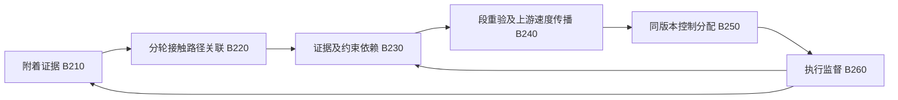
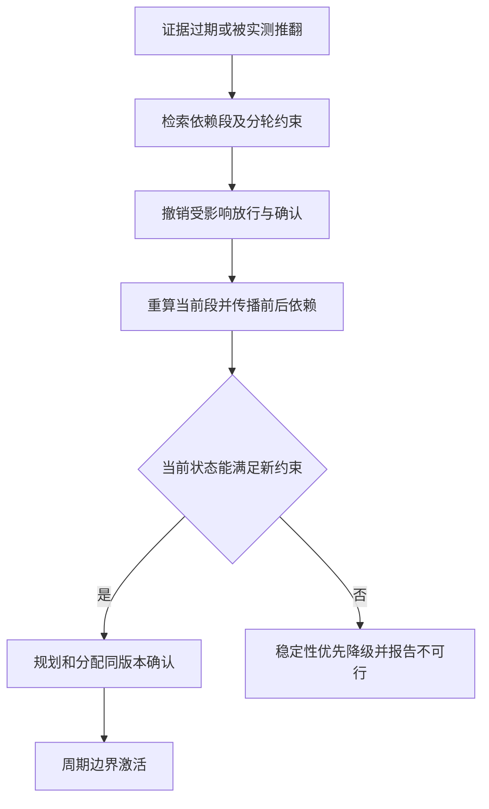

# 专利交底书 B：一种分轮附着证据驱动的车辆轨迹约束失效传播与一致执行方法

> 版本：V1.1，2026-10-15；经两轮现有技术比对及执行时序复核的草案。
> 建议申请类型：发明专利；方法、车载控制系统、电子设备与存储介质。
> 成熟度：可实施设计；数值示例不是仿真或实车试验结果。
> 不要求具有四个独立驱动电机，但要求控制分配器如实表达车辆可用的驱动、分轮制动与转向自由度。

## 1. 技术领域与摘要

涉及车辆局部路径规划、速度规划、轮胎力分配及路面附着不确定性管理，适用于冰雪、积水、左右分离附着和局部附着突变路段。

摘要建议：获取车辆轮速、轮端力矩、惯性及路面观测数据，形成与空间区域、车轮接触路径、时间及适用工况关联的附着证据记录；依据证据区间生成各轨迹段的轮胎力可行约束，并建立证据记录、轨迹段、控制分配约束的依赖关系；在证据过期、区域关联不确定或实测残差推翻原证据时，沿依赖关系撤销受影响段的放行资格，并在更新约束下向上游传播减速需求；规划器与控制分配器以同一约束版本确认可行后执行，版本不一致或实时不可行时进入稳定性优先的降级控制。

## 2. 现有技术与检索依据

| 编号 | 文献与时间 | 已读内容及关联 |
| --- | --- | --- |
| L05 | Song，Diffusion-Residual Model Predictive Steering Control for Vehicle Stabilization at the Limit of Handling under Model Uncertainty；2026-07-11，预印本 | [摘要](https://arxiv.org/abs/2607.10243)、[正文](https://arxiv.org/html/2607.10243v1)；II-IV、V-E、VI 已读，残差收紧稳定性约束且离线制表；其软约束 QP 可解不等于硬稳定域递归可行，不移植其效果数据 |
| L06 | Davydov 等，First, Learn What You Don't Know: Active Information Gathering for Driving at the Limits of Handling；首稿 2024-10-31，更新 2025-07-23 | [摘要](https://arxiv.org/abs/2411.00107)；主动采集、贝叶斯末层元学习、极限工况在线适应；已指出仅在线适应可能不够快 |
| L07 | Vaskov、Quirynen、Menner、Berntorp，Friction-Adaptive Stochastic Nonlinear Model Predictive Control for Autonomous Vehicles；2023-05-05 | [摘要](https://arxiv.org/abs/2305.03798)；贝叶斯轮胎附着学习及不确定性进入 SNMPC；作为基础先例，不属于“最新论文” |
| L09 | Gan 等，Dual-Envelope Constrained Nonlinear MPC for Distributed Drive Electric Vehicles Drifting Under Bounded Steering and Direct Yaw-Moment Control；2026-04-08 | [摘要](https://arxiv.org/abs/2604.07342)；输入耦合改变相平面及可恢复包络；本案借此增加输入条件变化时的重验，不复用其漂移效果数据 |
| P03 | Driving surface friction estimations for autonomous vehicles；US20200089243A1，2020-03-19；US11427223B2，2022-08-30；优先权 2018-09-14 | [全文](https://patents.google.com/patent/US11427223B2/en)；权利要求 1-6、11-13、18-20 及图 2、12-14 已读；已覆盖自然事件测附着、分轮动作、置信度随时间降低和生成规划约束 |
| P02 | Zoox，System and method for trajectory validation；US20210046923A1，2021-02-18；US11407409B2，2022-08-09 | [全文](https://patents.google.com/patent/US11407409B2/en)；能力变化后更新轨迹可行性限制，不应把“底盘限制反馈规划器”作为全新概念 |
| P06 | 基于多源数据融合的无人驾驶动态路径规划方法及系统；CN120552911A，2025-08-29；CN120552911B，2026-02-06；申请/优先权 2025-05-20 | [中文全文](https://patents.google.com/patent/CN120552911B/zh)；第二轮通过浏览器读取权利要求 1、4-7，涉及附着分区、轮胎力椭圆、前后轮附着与扭矩分配、更新约束同步控制器；索引列河南海融软件有限公司，全文英文主体 Henan Hisoft Software Co ltd，中文法定名称仍待官方核对 |

P03 全文显示 UATC LLC 与 Volvo Car Corp 等主体信息，不能只凭检索摘要确认当前归属。P06 首轮因 503 仅有索引，第二轮已升级为书目及相关权利要求核验；差异分析仍不等同于侵权排除结论。

## 3. 技术问题与原因

低附着场景中，规划器可能使用上周期的附着均值生成较高曲率轨迹，控制分配器则已经根据轮速残差降低某一车轮可用力。此时路径几何虽然无障碍，轮胎力分配却不可行；单纯限制总驱动扭矩也可能挤占横向稳定裕量。

另一个问题是证据的使用范围：前轮刚测到的附着不必适用于旁侧轨迹、后续新路面或更高侧偏区间。若只是给整车一个随时间衰减的置信度，无法准确指出哪一条轨迹的哪一段、哪个控制约束需要撤销。

本案拟解决“证据适用域变化如何在规划与控制之间形成同步撤销和重验”，并处理约束突降后上游来不及减速的失败分支。

## 4. 拟保护的最小技术组合

1. 附着证据同时绑定接触区域、时间区间、轮胎/车辆配置及激励适用域。
2. 将每一候选轨迹段的车轮接触路径与证据区域进行相交关联，形成可追溯的分轮约束来源。
3. 对证据失效建立“证据节点至段约束至控制分配”的定向依赖传播，不只降低全车统一置信度。
4. 从失效段向上游反向传播制动和稳定性需求，选择仍可达到新约束的轨迹前缀。
5. 同一约束快照经规划器与分配器确认后原子激活；实测能力再次下降时立即撤销，不等待整条轨迹重算完成。

不得单独主张“附着估计＋MPC”“附着置信度衰减”“利用正常制动测附着”为本案创新。它们已由 L07 和 P03 等覆盖。

## 5. 系统与证据记录

| 模块 | 功能 | 关键输出 |
| --- | --- | --- |
| B210 附着证据生成 | 融合已有估计器、自然驾驶激励及路面观测 | 附着区间、适用域和残差 |
| B220 接触路径关联 | 计算候选轨迹各车轮扫掠接触区域 | 区域关联集与歧义标记 |
| B230 约束依赖管理 | 建立并更新证据至轨迹段的稀疏索引 | 受影响段和约束版本 |
| B240 轨迹重验 | 更新分轮力约束及上游速度需求 | 允许前缀或重规划请求 |
| B250 控制分配 | 核验实际可用执行器和分轮力可行性 | 可行确认、转向及力矩分配 |
| B260 执行监督 | 校验版本、证据有效域和实时残差 | 放行、撤销及稳定性降级 |

每条 `FrictionEvidence` 至少包含 `evidence_id`、`region_polygon`、`frame_id`、`observed_at`、`expires_at`、`mu_interval`、`excitation_domain`、`tire_config_id`、`source_id`、`residual_bound` 和 `version`。区域边界包含定位误差，不能把一个测量点无限外推成整条道路。

每条 `SegmentConstraint` 包含轨迹段 ID、车轮 ID、预计进入/离开时间、证据 ID 集、分轮力约束、轮胎模型适用域及快照版本。相邻段即使共享几何区域，也保留时间和工况差异。

## 6. 具体技术方案

### 6.1 S201：生成有适用域的附着证据

采用现有 UKF、移动时域估计或贝叶斯轮胎模型估计器，以轮速、车速、IMU、实际驱动/制动力矩估算附着区间 $[\underline\mu_e,\overline\mu_e]$。相机路面分类和 V2X 提示仅作为先验，不直接等同于可靠附着下界。

低激励时，峰值附着通常不可辨识，不应仅因“未打滑”得到高附着的窄区间。未滑动且力估计可靠时，可从已实现的力与载荷形成局部已验证能力下界，但不得外推至不同侧偏、温度或速度域。无法校准时使用运行设计域内的保守区间，或退出相应工况。

优选只利用正常转向、制动和加速的激励，不主动诱发打滑。可选主动测试必须限于封闭场地或已证明有独立安全裕量的低速条件，不列为独立项必要特征。

### 6.2 S202：证据老化与突变撤销

在已验证附着缓变率界 $L_\mu$ 内，可用如下工程外推下界：

$$
\underline\mu_e(t)=\max\{0,\underline\mu_e(t_e)-L_\mu(t-t_e)\}.
$$

$L_\mu$ 单位为 $\mathrm{s^{-1}}$。该公式不保证覆盖突变；若路面分类突变、轮速/侧偏残差超过标定界、轮胎配置改变或区域关联失效，则立即撤销旧证据，不能等待其按线性规则慢慢衰减。零下界表示无法证明可用附着，不是可以按零附着安全制动。

证据有效期取传感器时效、区域变化时效及配置时效的最早者。不同源相关性未知时不把置信概率相乘；安全使用界取仍合理的联合不确定集，必要时用更宽包络。

### 6.3 S203：构造分轮接触路径和依赖关系

对候选轨迹 $\gamma$ 的段 $j$，结合车辆姿态、轮距、轴距和轮胎宽度求车轮 $i$ 的接触扫掠区域 $\mathcal P_{i,j}$。再按预计到达时间筛选适用证据。

若接触区域可能落入多个附着区域，不能按均值混合后提高下界，应取相关区域中最保守的有效界；未覆盖部分标为未知。前轮证据仅在后轮接触区域与其重合、时间间隔适用且配置条件成立时传给后轮。

令 $D(e)$ 为使用证据 $e$ 的所有 `(trajectory_id, segment_id, wheel_id, constraint_id)`。证据撤销时查询该倒排索引，标记相关约束失效；尚未执行且依赖于受影响状态的后续段也需传播重验，不能假设只修补单个格子即可维持整条轨迹可行。

### 6.4 S204：将证据映射为轮胎力约束

对于每个车轮使用保守摩擦椭圆：

$$
\left(\frac{F_{x,i}}{\underline\mu_{x,i}\underline F_{z,i}}\right)^2+
\left(\frac{F_{y,i}}{\underline\mu_{y,i}\underline F_{z,i}}\right)^2\le\eta_i^2,
\quad 0<\eta_i<1.
$$

$F_{x,i},F_{y,i}$ 是轮胎坐标系下纵横向力，$\underline F_{z,i}>0$ 是考虑载荷转移后的保守法向载荷下界，$\eta_i$ 为建模裕量。各向异性未经标定时取同一保守附着界。若分母不可正定或该轮可能离地，则切换对应零承载/接触模式，不能继续使用此式。

用标定轮胎模型将轮胎力与侧偏角、纵向滑移率、转角和轮速关联；摩擦椭圆只是力上界，不是任意横向力都能即时产生的充分条件。规划和控制必须共用模型版本及扰动界。

将轮胎力转至车体坐标 $F^B_{x,i},F^B_{y,i}$，满足车辆平衡与动态约束，例如：

$$
m(\dot v_x-rv_y)=\sum_iF^B_{x,i}-F_{\rm drag}-mg\sin\theta,
\quad m(\dot v_y+rv_x)=\sum_iF^B_{y,i},
$$

$$
I_z\dot r=\sum_i(x_iF^B_{y,i}-y_iF^B_{x,i}).
$$

同时约束侧偏、横摆率、转向速率、轮端力矩、制动建立时间及轮胎滑移。普通两驱车辆按差速器和轴端耦合关系约束力矩，不能假设具有四轮独立驱动力。

依据 L09 提示的输入耦合风险，稳定域须关联所用纵向速度、转角、直接横摆力矩及可用执行器集合；分配器改变这些条件时，相应稳定域约束也列入依赖重验。不能仅沿用某一开环输入下离线得到的包络，并把摩擦椭圆满足视为闭环必然稳定。

### 6.5 S205：受影响段重验与上游传播

附着证据变化后，先核验当前执行段，再按到达顺序重验未来受影响段。对所选几何路径，可先用一维筛查反传速度上界：

$$
v_j\le\sqrt{v_{j+1}^2+2b_j\Delta s_j},
$$

其中 $b_j$ 为段 $j$ 在横向需求、坡度和分轮约束下保证可实现的正减速度；并非直接取 $\mu g$。式中制动建立和变化率限制应由更精细模型补充，或通过保守距离表扣除。筛查通过后仍须用第 6.4 节完整模型验证。

如果反传结果表明车辆当前速度已超过能达到新约束的上界，不能将新的更低目标速度当作可立即执行的解决方案。应判定原轨迹不可行，选择低曲率稳定减速、已有空闲走廊内避让或风险最小化控制。

### 6.6 S206：双侧确认与原子激活

生成只读约束快照 $C^{(k)}$，包括本轮证据、模型及执行器版本。规划器输出 `plan_id, k, verified_prefix`；分配器在同一快照和预计激活状态下验证可行，输出 `ack(plan_id,k)`。监督模块只有在两者匹配且证据仍有效时，才在控制周期边界激活该组合。

未收到确认时不放行新轨迹；旧轨迹仅在旧证据仍成立且当前控制可行时保留有限前缀。底盘侧发现滑移残差突增时可直接收紧约束并撤销旧确认，不必等待上层应答。硬约束无解时不得靠大松弛量隐藏，应明确报告不可行。

约束快照还包含 `effective_from`、`command_epoch` 及撤销传播时延上界。撤销发出后，旧指令可能在总线或执行器队列中继续生效，应将该段已排队输入纳入当前段的过渡状态预测；若其会突破新能力界，立即触发底盘本地限幅与稳定控制，并将本轮标为不可保证可行。执行接口支持时按代际编号拒绝旧指令；不支持时采用上层队列隔离及独立底盘安全通道，不能声称原子换版本消除了物理时延。

### 6.7 S207：降级和恢复

| 条件 | 处理 |
| --- | --- |
| 一侧附着下降 | 限制该侧纵向力，并在分轮力平衡下保留横摆稳定能力，不机械采用左右均等制动力 |
| 视觉认为路面干燥，但轮速残差提示打滑 | 撤销高附着证据，缩小可信域，不取视觉先验与残差的乐观平均 |
| 规划器与分配器快照不一致 | 拒绝激活，执行当前仍有效前缀或本地降级控制 |
| 激励不足、附着下界未知 | 限制工况；若停止能力也无法保证，则报告能力不确定并请求接管 |
| 新约束导致无可行停止路径 | 稳定性和碰撞后果最小化优先，不声称一定避免事故 |
| 恢复高附着 | 新证据达到校准质量且经完整重验后恢复，使用滞回避免反复切换 |

## 7. 实施例与数值说明

### 7.1 左右分离附着的分轮约束

设单轮保守法向载荷 $4000\,\mathrm N$，$\eta=0.8$，该轮横向力需求 $500\,\mathrm N$。若附着下界 $0.25$，总可用合力半径 $0.8\times0.25\times4000=800\,\mathrm N$，允许纵向力绝对值至多：

$$
|F_x|\le\sqrt{800^2-500^2}=624.5\,\mathrm N.
$$

若误用高附着区域的 $0.70$，计算上限约为 $2183.5\,\mathrm N$，会显著高估能力。若新证据把下界降至 $0.15$，合力半径仅 $480\,\mathrm N$，原 $500\,\mathrm N$ 横向需求本身已不可行；不能只把驱动扭矩置零而维持同一速度和曲率。

本例展示单轮必要约束，不表示四轮总力、横摆稳定性及执行器速率已经验证。

### 7.2 上游来不及减速

车辆距目标轨迹段 $20\,\mathrm m$，目标段允许速度更新为 $8\,\mathrm{m/s}$，上游保证可实现减速度 $2\,\mathrm{m/s^2}$。忽略时延的筛查得到上游速度上界 $\sqrt{8^2+2\times2\times20}=12\,\mathrm{m/s}$。若当前速度 $15\,\mathrm{m/s}$，仅发送“目标速度 8”不可行；实际时延只会进一步压缩余量。

### 7.3 依赖传播示例

证据 E17 支持左前轮轨迹段 J4、J5 和左后轮 J5，E18 支持右轮各段。E17 被撤销后，先撤销 J4/J5 对应左轮约束及其分配确认；随后重新传播 J4 进入状态和后续状态，对 J3 向前的减速需求反向重算。E18 可继续用于其覆盖区域，但不能因此保留整条轨迹旧确认。

## 8. 附图说明

图 1 表示附着证据至控制执行的依赖与反馈。

图 2 表示证据撤销后的处理顺序。

## 9. 区别特征、协同效果与创新风险

| 对比对象 | 已知内容 | 本案拟进一步限定 | 风险 |
| --- | --- | --- | --- |
| P03 | 分轮动作、正常事件估计、置信度衰减、规划约束 | 证据空间及工况域至具体轮轨迹段的依赖、定向撤销、同版本执行 | 单独增加证据字段可能只是常规工程；应证明其改变撤销时刻与可行性结果 |
| L07 | 附着学习、不确定性传播及 SNMPC | 多候选轨迹约束失效传播和跨周期控制分配原子确认 | 本案不是新的轮胎估计器，须避免将来源算法据为创新 |
| L05 | 参考与稳定域随模型残差收紧 | 用证据适用域撤销已发布轨迹并向上游传播速度需求 | 都涉及收紧约束；重点必须是撤销及一致执行的闭环 |
| P02 | 动态能力反馈与轨迹有效性 | 分轮接触区域依赖和规划分配同快照确认 | 与通用版本一致性技术结合可能显而易见，需实验证明技术效果 |
| P06 | 摩擦系数场、轨迹椭圆约束、前后轮扭矩分配及更新约束同步车辆 MPC | 证据适用域与具体轮轨迹段的依赖撤销、上下游重验及带生效时刻的规划分配确认 | 不能仅以“不用路侧”区分；不依赖 V2X 是实施条件，不是充分创新依据 |
| L09 | 转向和横摆控制耦合的稳定性包络 | 将输入条件及执行器集合变化作为依赖失效条件 | 本案不以“可恢复稳定域”名称本身主张首创 |

协同机制是：局部证据撤销改变特定段分轮力域，分轮力域反向改变到达速度，双侧确认阻止旧力域生成的新旧控制混用。拟验证效果为减少“规划无碰撞但底盘不可执行”的放行；不预先写入节能率、事故减少率或跟踪精度提升百分比。

## 10. 权利要求建议稿

### 10.1 独立方法权利要求骨架

一种车辆轨迹规划和控制方法，包括：

1. 基于车辆运行数据形成附着证据记录，所述记录包含附着区间及其适用空间区域、有效时间和激励工况域；
2. 计算候选车辆轨迹段中各车轮的接触扫掠区域，根据所述区域、预计到达时间和工况域，将附着证据关联至分轮轮胎力约束，建立证据记录至轨迹段约束和控制分配约束的依赖关系；
3. 在证据记录失效时，通过所述依赖关系撤销受影响轨迹段的执行放行及对应控制分配确认，在更新后的分轮约束下重验车辆动态可行性，并向上游传播所需减速约束；
4. 将重验所用约束形成具有版本标识的快照，使轨迹规划模块和控制分配模块基于同一快照确定轨迹前缀及分轮执行指令；
5. 仅在两模块的版本及轨迹标识一致、证据仍有效且当前状态满足所述约束时激活执行；否则禁止激活并执行本地降级控制。

本稿侧重必要关系，正式独立项范围须结合进一步检索与可实施证据调整。

### 10.2 从属项方向

1. 证据包含轮胎配置和区域坐标版本，轮胎配置变化时撤销对应证据。
2. 接触路径落入多个可能区域时采用覆盖全部合理区域的保守附着界。
3. 前后轮只在接触区域、时间及工况匹配时共享证据。
4. 通过力平衡、横摆稳定性、轮胎滑移及执行器耦合约束构造分轮力可行域。
5. 在当前速度无法达到新限速时拒绝旧几何轨迹，采用低曲率稳定减速策略。
6. 实测残差越界直接撤销执行确认，新证据恢复需经滞回与重验。
7. 建立稀疏倒排索引以仅重算受影响依赖，同时保留前后段动态耦合。
8. 快照包含生效时刻与指令代际，撤销前未退出队列的输入纳入过渡预测；稳定域关联转角、速度、横摆力矩及执行器集合。

系统项以 B210 至 B260 支撑；设备与存储介质项执行上述方法，不加入未经验证的“必然安全”功能。

## 11. 可实现性与验证计划

首版采用现有附着估计器、四轮平面动态模型与 QP/SOCP 分配器。计算资源不足时先固定候选几何路径，只优化速度与分轮力，再将不可行结果反馈上层重选路径。OSQP 适用于线性化 QP；原始摩擦椭圆可采用保守内接多边形或支持锥约束的求解器，不能把外接多边形误当安全内近似。

建议估计及监督 100 Hz、分配 100-200 Hz、轨迹更新 10-20 Hz；以上是设计配置，需在目标 ECU 测最坏耗时。接口需获取实际执行力矩或可靠估计值，不能用期望力矩替代实测反馈。

| 验证项目 | 对照设计 | 必须记录的指标 |
| --- | --- | --- |
| 分离附着变道 | 固定附着 MPC、带置信度衰减但无依赖撤销方案 | 侧偏、横摆率、分轮约束违反、碰撞和误放行次数 |
| 单轮附着骤降 | 完整方案与去掉突变撤销的消融 | 从残差越界至撤销的时延、旧确认被使用次数 |
| 证据覆盖歧义 | 轨迹横向移至未测区域、GNSS 偏差 | 是否错误复用高附着证据、保守减速程度 |
| 异步消息 | 旧约束、新轨迹、乱序确认与丢包 | 跨版本激活次数应为零；失败须可追踪 |
| 撤销传播与输入耦合 | 旧指令仍在执行队列、制动/转向改变稳定域 | 记录撤销实际生效时刻；拒绝仅软件确认成功而过渡状态已越界的放行 |
| 制动需求反传 | 新限速无法达到、转向速率受限 | 不可行识别与稳定性降级触发，不掩盖硬约束违反 |
| 硬件在环与场地 | 总线堵塞、扭矩跟踪偏差、低速软目标 | 最坏耗时、稳定性与停止距离，逐级验证 |

每种路面与故障组合至少 100 个随机种子；按路面、速度和激励分层评估附着区间覆盖率，不能把整体覆盖率当作每段的确定保证。无本案实测前，仅可写“预期减少约束版本失配”，不得写成已达到效果。

## 12. 迭代记录与申请前补证

- V0：考虑附着不确定性驱动规划控制，L07 已直接给出相近方向，收窄。
- V0.1：考虑自然激励测附着与时效管理，P03 权利要求 5-6 及分轮动作说明构成直接反例，删除独立创新主张。
- V1.0：聚焦证据适用域、轮轨迹段依赖、失效前后传播与同版本执行；增加低激励不可辨识、摩擦椭圆非充分性和当前状态不可行分支。
- V1.1：第二轮核验 P06 权利要求后补齐题名与 A/B 日期，明确附着场、前后轴分配和控制器同步已有先例；结合 L09 增加输入条件依赖和撤销队列过渡处理，并同步增加从属项与消融测试。
- 待补：P06 官方文本与审查档案及中文法定申请人、其他分轮附着规划专利、真实轮胎力和载荷估计误差、依赖撤销相对全量重算的耗时/误放行对照、车型执行器耦合、发明人贡献与在先公开记录。

本方案与仓库既有“路面风险先验、模式和扭矩控制”方向的边界是：本案不保护驾驶模式或人机交互，而保护分轮轨迹可行约束的证据适用域及一致执行链路。新颖性、创造性和自由实施仍需分别评价。