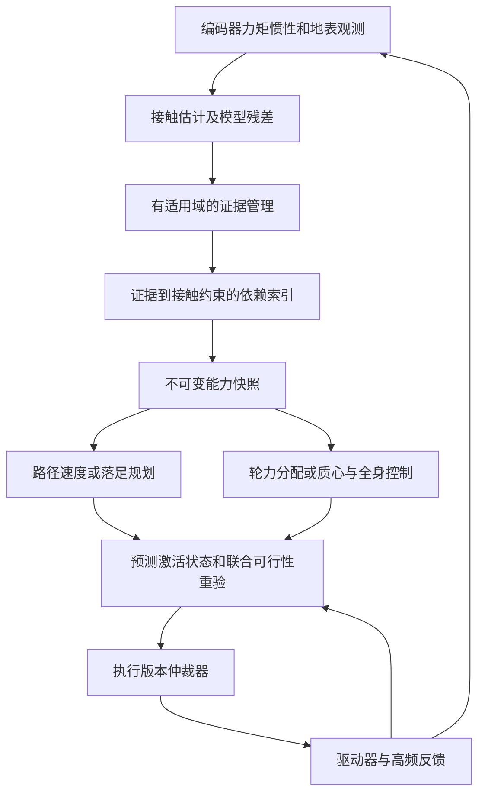
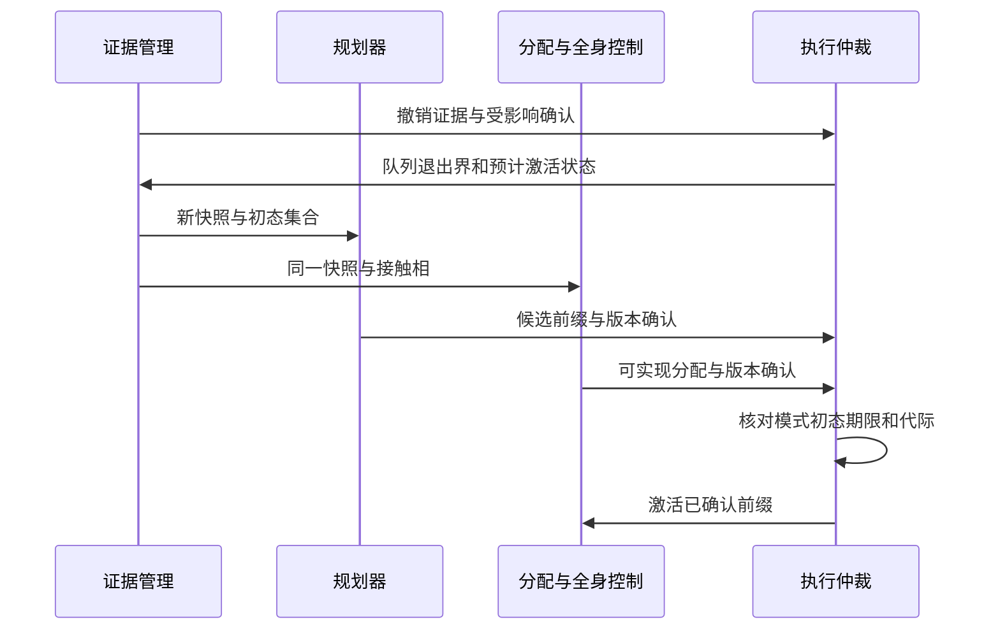

# B 案技术详解：接触能力证据如何改变规划、支撑与执行

> 版本：V2.0 配套说明，2026-10-15。
> 对应交底书：[02_patent_b_friction_evidence_consistent_planning_disclosure_20261015.md](02_patent_b_friction_evidence_consistent_planning_disclosure_20261015.md)。
> 本文独立给出来源、系统框架、动力学、实现过程和数值例。示例为假设参数；未实现本案控制器、未进行仿真或实机试验。
> 技术核心候选是证据至具体接触约束的撤销传播及执行一致性；摩擦估计、摩擦锥、MPC、全身控制和版本号均不是本案首创。

## 1. 用直观场景理解问题

一台配送机器人准备转弯，左轮即将经过湿瓷砖。规划器仍按干地速度过弯，控制器已把左轮可用力调低，两边各自“运行正常”，组合却可能不可行。另一台四足机器人准备落足，地面证据突然失效，直接把该脚抬走也可能破坏当前支撑。

本案处理的不是单一摩擦系数估计，而是：**哪一条接触能力判断支持了哪些轨迹段、哪些支撑相和哪些已确认指令；判断被推翻时，怎样撤销所有依赖并在同一能力下重新规划和执行。**

“证据”在这里是带来源和适用条件的记录，不是法律证据；“失效”可以是过期、接触地点不确定、载荷/轮胎变化、实际滑移或模式改变，不只表示摩擦数值变小。

### 1.1 平台范围

| 平台 | 接触对象 | 不能省略的差异 |
| --- | --- | --- |
| 差速 AMR、配送机器人、车辆 | 车轮与预计接触路径 | 轮速/力矩、横摆、载荷转移、制动能力 |
| 全向机器人 | 带滚子方向的轮地接触 | 摩擦各向异性，不可套普通轮横向不滑条件 |
| 履带/滑移转向机器人 | 分布接触片与滑移状态 | 正常转向就可能滑移；须有适用接触模型 |
| 四足/轮足机器人 | 足端、支撑相、地表法向 | 摆动足无支撑力，质心/角动量和关节能力 |
| 自由飞行无人机 | 无地面接触 | 本案地面摩擦证据方案不直接适用 |

## 2. 逐项来源依据与创新边界

| 技术要素 | 已有来源及读取层级 | 本案使用方式与区别候选 |
| --- | --- | --- |
| 自然事件估计附着、置信衰减、分轮动作 | P03，相关权利要求及说明书 | 作为证据来源；不主张首次自然激励或分轮估计 |
| 附着不确定性进入随机 MPC | L07，摘要 | 作为已有规划方法；区别不在 MPC 中出现 $\mu$ |
| 主动获取未知动力学信息 | L06，摘要 | 说明无激励不等于已识别极限；探测动作须先可行 |
| 残差均值修正、约束收缩及软约束 | L05，正文 II-IV、V-E、VI | 可作为能力估计辅助；软约束解不等于硬安全 |
| 附着分区、力椭圆、轴间分配及同步更新控制器 | P06，权利要求 1、4-7 | 很接近的专利先例；不能用“附着场＋同步控制”作为新组合 |
| 速度/转向/横摆输入改变稳定包络 | L09，摘要 | 将输入和执行器变化作为约束依赖的一部分 |
| 四足 SRBD、足端机会摩擦约束、摆动足力为零 | L14，正文 III、IV、V | 明确足式适配已有基础，不把摩擦锥 MPC 当新发明 |
| 在线残差学习与腿式 MPC | L15，摘要 | 可辅助估计；动态遗憾界不提供接触安全保证 |
| 低频 MPC、高频力矩反馈和带宽处理 | L16，摘要 | 采用分层实现，不把导航线程当高频力矩环 |

本案待检验的组合是：具有空间/时间/模式/激励适用域的证据，关联至具体接触段或支撑相；撤证后撤销受影响确认，向上游传播减速、向下游传播状态与接触重验；基于同一快照及激活状态再执行。

依赖图和版本一致性本身是常见计算方法。应通过真实物理反例说明，它们消除了哪些跨模块不一致，而不是只增加数据管理字段。机器人领域更近的证据地图、接触规划及全身控制专利尚需继续检索，当前没有完成新颖性或自由实施结论。

## 3. 系统框架与职责



证据管理模块不代替估计器；规划器不直接输出未经控制分配验证的动作；全身控制器不因为收到新快照就能瞬间消除旧力矩。驱动队列、总线及力矩响应必须进入过渡状态计算。

### 3.1 数据契约

| 对象 | 必需内容 | 实际作用 |
| --- | --- | --- |
| `ContactEvidence` | ID、来源、区域/帧、观测及到期时间、摩擦区间、激励域、配置/接触模型版本 | 决定证据能用于何处、何时、什么接触 |
| `ContactAssociation` | 计划/段/接触部位/支撑相 ID、到达时间区间、区域覆盖关系、关联误差 | 防止用左脚证据支持别处右脚或别时刻 |
| `ContactConstraint` | 力/力矩/滑移约束、地面法向集合、模式、证据 ID 集、模型版本 | 约束来源可追溯，不只是一个速度上限 |
| `CapabilitySnapshot` | 不可变版本、全部相关约束、接触模式、外形/载荷、输入与状态适用域 | 规划与分配共同读取的能力语义 |
| `PlanAllocationAck` | 计划/快照/接触相版本、初态有效集合、预计激活时间、首段可实现指令 | 对同一状态和能力作确认，而非只比较数字 |
| `ExecutionEpoch` | 生效时刻、代际、队列游标、实际执行反馈 | 防止迟到旧指令在撤销后重新进入 |

这些是建议接口，不是已落地标准。不同模块若只共享同一个版本数字，却对载荷、接触法向或初态理解不同，仍是不一致。

## 4. 证据从哪里来，哪些内容不能估出来

### 4.1 轮式证据

轮速与车体速度差可指示滑移，电机电流/力矩结合传动模型可估轮端纵向力，IMU 和轮力分配可提供侧向/横摆残差。但低激励直线匀速只说明“在已施加小力下未滑”，不能识别最大摩擦系数。

相机识别积水、冰雪或地材可形成先验，不能单凭类别给出未经校准的确定摩擦下界。主动试探需满足当前保守能力及任务约束，不应为了学附着先执行可能失稳的急转或急刹。

### 4.2 足式证据

通过足端力传感器、关节力矩、接触估计、IMU、足端速度和地形几何构造支撑置信与力能力范围。无直接力传感器时，观测器误差必须进入边界；期望力矩不是测得接触力。

落足点误差、地面法向、足垫材料和支撑/摆动相决定适用性。视觉判断“这是一块干地”也不能保证足垫能提供指定切向力。地面下陷、滚动石块及断裂属于接触模型变化，不能总用较小 $\mu$ 代替。

### 4.3 时效与相关性

若已标定缓慢变化速率，可用 $\underline\mu(t)=\max(0,\underline\mu(t_e)-L_\mu(t-t_e))$；$L_\mu$ 单位为 s⁻¹。突发积水、足垫换装或实际滑移应直接撤销，不能等衰减函数慢慢变小。

多个来源共享相机、训练集或运动估计时，不能当作独立概率相乘。区间融合须先检查覆盖假设与相关性；冲突证据可能意味着模型失效，应降级，而不是简单平均成看起来更精确的值。没有有效证据时使用经验证的保守默认域或拒绝该动作，不从“缺记录”推导高摩擦。

## 5. 从轮端证据到轨迹约束

### 5.1 摩擦圆与各向异性椭圆

对于滚动轮接触、有效法向载荷 $F_{z,i}>0$，一种必要约束为：

$$
\left(\frac{F_{x,i}}{\underline\mu_{x,i}\underline F_{z,i}}\right)^2+
\left(\frac{F_{y,i}}{\underline\mu_{y,i}\underline F_{z,i}}\right)^2
\le\eta_i^2,\qquad 0<\eta_i\le1.
$$

力单位 N，摩擦系数与裕量无量纲。使用载荷下界须确实覆盖当前工况，且下界为正；轮离地时应切换模式，不在分母放零。椭圆只描述合力必要范围，仍需轮胎/轮子模型、扭矩、轮速及接触条件。

各向同性时可得到给定侧向力下的纵向上界：

$$
|F_x|\le\sqrt{(\eta\underline\mu\underline F_z)^2-F_y^2}.
$$

根号内为负表示侧向需求本身不可行，不是把纵向力设为零就解决。各向异性时须保留两方向不同的系数，不能套该简化式。

### 5.2 力分配与底盘平衡

平面底盘需满足总力和横摆力矩需求，例如：

$$
\sum_iF_{x,i}=ma_x,\quad \sum_iF_{y,i}=ma_y,\quad
\sum_i(r_{x,i}F_{y,i}-r_{y,i}F_{x,i})=I_z\dot r.
$$

接触局部坐标力须先旋转到车体系求和，外力、坡度和阻力按模型加入。轮端力还受电机/制动器边界和速率约束；有些电机在低速或掉电时不能提供所需保持制动。理论 $T=RF_x$ 仅是理想轮端关系，不省略传动效率、滚动惯量及驱动器动态。

### 5.3 上游减速为何由下游证据触发

设段长 $\Delta s_j$，段内可保证减速为 $b_j>0$，忽略时延的必要反向筛查为：

$$
v_j\le\sqrt{v_{j+1}^2+2b_j\Delta s_j}.
$$

下游湿滑区域使允许进入速度下降，上游段也必须降低速度；不能只把坏段标成“慢行”而保留不可实现的进入状态。时延、转弯、加加速度及轮力耦合应在完整优化中再验，这个平方根不是最终通用规划器。

## 6. 足式机器人：从摩擦锥到全身控制

### 6.1 足端接触力锥

将接触力按地表单位法向分解为 $f_{n,i}$ 与切向二维向量 $f_{t,i}$。支撑足满足：

$$
\|f_{t,i}\|_2\le\eta_i\underline\mu_i f_{n,i},\qquad
0\le f_{n,i}\le f_{n,i}^{\max};\qquad f_i=0\ \text{于摆动相}.
$$

足端法向力通常是优化变量，不能把汽车载荷下界简单替代进所有足端约束。地面法向不确定时，应按法向集合做保守验证，或相应收缩力锥。

用 QP 时可选保守多面体内近似，例如 $|f_x|+|f_y|\le\eta\underline\mu f_n$。因为二维 $\|f_t\|_2\le\|f_t\|_1$，该约束足以落在圆锥内，但较保守。若用独立方形界 $|f_x|,|f_y|\le\eta\underline\mu f_n$，方形角点会超出圆锥；内近似须除以 $\sqrt2$ 或采用正确多边形。

### 6.2 质心动力学与角动量

点足示例中，质量 $m$、质心 $c$、质心角动量 $\ell$、足端位置 $p_i$ 满足：

$$
m\ddot c=\sum_i f_i+m\mathbf g,\qquad
\dot\ell=\sum_i(p_i-c)\times f_i.
$$

不能只检查总切向力够不够：相同总力但左右分配不同会产生不同角动量，可能导致倾覆；运动还须符合步态相位和可达落足。平足存在接触力矩时，在角动量方程中加入相应力矩，并约束压力中心及足底扭转能力。

### 6.3 全身关节可实现性

采用合适局部广义坐标的刚体动力学写为：

$$
M(q)\ddot q+h(q,\dot q)=S^{\mathsf T}\tau+J_c(q)^{\mathsf T}f.
$$

$q$ 含浮动基座及关节，$\tau$ 是有界关节力矩，$S$ 选择驱动关节，$J_c$ 是接触雅可比。使用四元数基座的软件应区分配置 $q$ 和广义速度 $\nu$，改用 $M(q)\dot\nu+h(q,\nu)$ 及相应运动映射，不能直接把不同维度向量相加。

持续不滑支撑还需 $J_c\ddot q+\dot J_c\dot q=0$，配合关节角/速度/力矩/速率、足端运动学和接触约束。只算出质心受力可行而未通过全身检查，不应确认执行。

撤销一个支撑足的证据，意味着重新评估这个接触的能力，不意味着立刻抬起该足。只有剩余支撑、可达落足和关节能力共同可行，才可改变接触安排；没有可行模式时进入平台已验证的稳定化/风险最小化，而不声称“强制四足停住”一定可行。

## 7. 确定区间与机会约束不是同一种保证

L14 以 SRBD 中的参数及加性不确定性构造足端力机会约束，再转为 QP；其支撑相和摆动足零力也是已有设计。本文不直接复刻该论文控制器，且不把它的硬件结果当作本案成果。

若 $f$ 在某近似模型下服从高斯分布，线性约束希望满足 $\Pr(a^{\mathsf T}f\le b)\ge1-\alpha$，标准确定等价式为：

$$
a^{\mathsf T}\bar f+
\Phi^{-1}(1-\alpha)\sqrt{a^{\mathsf T}\Sigma_f a}\le b.
$$

这里必须是标准差平方根，量纲与力相同；不是直接加方差。用联合概率时，各面、各足和必要时间点须分配风险，使 $\sum\alpha_j\le\delta$；该并集界不要求事件独立，但会保守。只对单时刻各足分配风险，不等于整个执行时域的违约概率也相同。

L14 的 HTML 转换在个别不等式/根号显示上有疑点，因此上述为按标准线性高斯推导重写的解释式，非照搬其网页公式；复现应核对原 PDF 与作者代码。对非高斯、相关误差、模式跳变及非线性近似，不能无说明套正态分位数。

本案可选择“有覆盖保证的区间＋鲁棒约束”或明确统计假设的机会约束，但证据消息必须标明语义。动态遗憾小、优化目标低或软约束有解都不能替代接触力约束真正满足。

## 8. 依赖图、失效传播与增量重验

### 8.1 从证据定位受影响动作

维护反向索引：

$$
D(e)=\{(\text{plan},\text{segment},\text{contact},\text{phase},\text{constraint})\mid
\text{该约束依赖证据 }e\}.
$$

轮式按预计轮迹扫掠区域与证据多边形相交；足式按落足不确定区域及支撑时间区间关联。跨出证据区域、到达时间超期、载荷/足垫版本或激励域不满足，均视为不能继续依赖，而非仅判断几何中心点是否在区内。

### 8.2 撤证后的顺序

1. 将证据标为失效，撤销关联约束及执行确认，阻止新的坏动作进入队列。
2. 读取不可撤销旧输入，预测新约束最早能生效时的状态集合。
3. 检查当前支撑/接触模式，必要时立即请求已验证稳定化；不要先等待全路线优化。
4. 在新能力下重验受影响段，反向更新上游速度或落足准备，正向更新状态及后续支撑。
5. 重新绑定其他仍有效证据；局部更新后，整条依赖链的动态连续性仍须成立。
6. 建立新快照，规划与分配分别确认同一快照、模式和激活初态，才允许新前缀执行。

“增量”只是避免重复重算无关约束，不能意味着后续初态改变却跳过后续段验证。无法证明更新局限时做完整重验。

## 9. 一致执行与实际时序



例如旧计划版本 12、分配版本 12 运行时，某证据失效产生快照 13。即便新计划 13 已到，但分配仍为 12，也不执行新计划；即便双方均为 13，若预计三足支撑实际变为两足，也不因版本相同而执行。到达期限不够时执行当前仍可验证的降级策略。

迟到旧消息须被代际屏障拒绝。已经下发并不可撤销的电机输入不能被软件删除，应计入过渡状态；若在接管前就会越出新能力，不再宣称可无滑移执行，应记录原条件失效并风险最小化。

## 10. 逐周期伪代码与实施过程

```text
OnEvidenceChange(changed_evidence, execution_feedback):
    affected = ReverseDependencies(changed_evidence)
    RevokeReleaseAndAllocationAcks(affected)
    activation_state = PropagateUncancelableCommands(execution_feedback)
    snapshot = BuildImmutableContactSnapshot(activation_state)
    if not CurrentContactModeRecoverable(snapshot):
        RequestPlatformSpecificStabilization()
    candidate = ReplanAffectedSegmentsAndPropagateStates(snapshot)
    allocation = ValidateContactAndActuatorFeasibility(candidate, snapshot)
    if not BothFeasible(candidate, allocation): return NO_NEW_RELEASE
    acknowledgments = BindPlanModeSnapshotAndActivation(candidate, allocation)
    ActivateOnlyIfEpochModeInitialStateAndDeadlineStillMatch(acknowledgments)
```

### 10.1 最小实现路线

先从可读轮速、实际电流/力矩及 IMU 的差速底盘开始，固定地表区域和保守能力表，不必先训练视觉模型。建立证据 ID、轮迹关联、分配器和队列仲裁；用一次撤证事件检验原计划是否真的被阻断。

足式版本以已有可稳定行走的控制器为前提：导入接触相/力/关节反馈，将快照输入落足规划、质心 MPC 与全身控制，先验证四足静态及低速步行，再尝试动态步态。不能只修改导航速度上限便声称完成足式方案。

轮式可用 QP/SOCP 或已有非线性 MPC；足式按接触模型选择质心 MPC 和全身 QP。线性化、求解容差与约束近似均需保守余量，超时不自动保留无限期旧解。建议频率是待测设计预算，不把论文 500 Hz 当作本案能达到的指标。

## 11. 数值实施例与反例

### 11.1 车辆轮端椭圆例

单轮载荷下界 4000 N，$\eta=0.8$，侧向力需求 500 N。摩擦下界 0.25 时，合力半径为 800 N，纵向上界 $\sqrt{800^2-500^2}=624.5$ N。若误用 0.70，得到 $\sqrt{2240^2-500^2}=2183.5$ N，会严重夸大能力；降至 0.15 时半径 480 N，侧向需求本身已超界。

20 m 内希望降至 8 m/s，若保证减速仅 2 m/s²，上游必要速度界为 $\sqrt{8^2+2\times2\times20}=12$ m/s；当前 15 m/s 时，即便不计时延也不可行，必须记录原目标无法保证，而不是只把目标标成 8 m/s。

### 11.2 差速配送 AMR 湿滑区域

假设总质量 160 kg，两只驱动轮法向载荷各 400 N，其余载荷由支撑轮承担；忽略可助力的阻力，每轮可用力仅来自驱动轮，轮半径 0.10 m，$\eta=0.8$。干地摩擦下界 0.50 时，每驱动轮必要能力上界 160 N；湿地降为 0.15 时变为 48 N。

请求 1 m/s² 直线加速度需总力 160 N，均分为每轮 80 N；旧能力筛查可行，新能力下不行。湿地总可用切向力上界 96 N，因此绝对加速度能力必要上界为 0.60 m/s²；实际可保证减速通常还要更小，不能把此上界当标定保证。

若速度 1 m/s，接管时延 0.12 s、附加余量 0.15 m，即便乐观使用全部 0.60 m/s² 减速，所需距离也至少 $0.12+1/(2\times0.60)+0.15=1.1033$ m。可用仅 1.00 m 时，新能力不足以维持原停止承诺，不能靠快照同步掩盖物理不可行。

### 11.3 四足机器人低摩擦支撑

假设 20 kg，水平地面四足均分法向载荷，每足 $20\times9.81/4=49.05$ N，裕量 0.8。摩擦下界 0.40 时每足切向上界 15.696 N，期望总水平力 40 N、均分每足 10 N 的摩擦必要检查通过。

四足所处区域证据均改为 0.15 后，每足仅 5.886 N，总力上界 23.544 N，对应质心水平加速度必要上界 1.1772 m/s²，原 2 m/s² 请求失效。维持原地支撑可能仍然可行，但原动态轨迹不再可行。

该例只验证力锥数量级；载荷均分、角动量平衡、关节扭矩、步态和地面接触仍须联合求解。三足/两足支撑不能沿用除以四的计算。

### 11.4 支撑相错配

足端 A 在版本 21 的计划中处于支撑，在版本 22 中已进入摆动。即便 A 所处地面的摩擦证据仍有效，也不能继续使用版本 21 给 A 的非零接触力。相位依赖改变即撤销确认，说明“证据数值没变”也会导致旧约束失效。

## 12. 验证计划、失效边界与验收

| 验证项目 | 必须观察的结果 | 不能替代它的指标 |
| --- | --- | --- |
| 证据过期/区域错配 | 所有依赖确认被撤销并可追踪 | 估计器均方误差较低 |
| 左右轮不同附着 | 总力/横摆/扭矩均可行或明确报告不可行 | 全车平均摩擦估得准 |
| 足端支撑转摆动 | 摆动足零力，剩余支撑与全身能力重验 | 只检查质心合力 |
| 新计划旧分配或初态错配 | 禁止跨版本/跨相位执行 | 双方版本字段都存在 |
| 旧队列不可撤销 | 记录过渡及最早生效，不虚构瞬间清零 | 软件原子变量替换成功 |
| 摩擦突降晚于可恢复界 | 报告保证丢失并风险最小化 | 命令名叫“安全停车” |

对照全局单一摩擦、仅更新局部约束不传播、传播但不做执行确认、完整方案。固定同一模型、估计误差与延迟，比较约束违反、滑移、支撑失稳、误放行、重算耗时和保守拒绝。若依赖图成本超过直接全量重验，应报告其不适用规模。

实机验证须使用平台允许载荷、低风险地面和保护措施，不能照搬文献中的超载或涂油实验。当前只有算术/文档检查，无任何本案跌倒、滑移或性能统计结果。

## 13. 本文参考文献与读取层级

访问日均为 2026-10-15。下表独立列出本案所需书目；编号与总台账一致。

| 编号 | 书目信息及原始链接 | 核验范围与限制 |
| --- | --- | --- |
| L05 | Bongsob Song. *Diffusion-Residual Model Predictive Steering Control for Vehicle Stabilization at the Limit of Handling under Model Uncertainty*. [arXiv:2607.10243](https://arxiv.org/abs/2607.10243)，2026-07-11，v1 | [正文](https://arxiv.org/html/2607.10243v1) II-IV、V-E、VI；投稿 TCST 不视为已录用；实测耗时不是硬界 |
| L06 | Alexander Davydov, Franck Djeumou, Marcus Greiff, Makoto Suminaka, Michael Thompson, John Subosits, Thomas Lew. *First, Learn What You Don't Know: Active Information Gathering for Driving at the Limits of Handling*. [arXiv:2411.00107](https://arxiv.org/abs/2411.00107)，2024-10-31；v2 2025-07-23 | 摘要；主动学习与适应背景 |
| L07 | Sean Vaskov, Rien Quirynen, Marcel Menner, Karl Berntorp. *Friction-Adaptive Stochastic Nonlinear Model Predictive Control for Autonomous Vehicles*. [arXiv:2305.03798](https://arxiv.org/abs/2305.03798)，2023-05-05，v1 | 摘要；基础先例，不是最新论文 |
| L09 | Yurun Gan, Ziyu Song, Jing Yang, Zheng Lin, Jianuo Zhang, Tongtong Gu, Haitao Ding, Nan Xu, Por Lip Yee, Wei Ni, Jun Luo. *Dual-Envelope Constrained Nonlinear MPC for Distributed Drive Electric Vehicles Drifting Under Bounded Steering and Direct Yaw-Moment Control*. [arXiv:2604.07342](https://arxiv.org/abs/2604.07342)，2026-04-08，v1 | 摘要；输入条件依赖，不假定正文未读机制不存在 |
| L14 | Ananya Trivedi, Sarvesh Prajapati, Mark Zolotas, Michael Everett, Taskin Padir. *Chance-Constrained Convex MPC for Robust Quadruped Locomotion Under Parametric and Additive Uncertainties*. [arXiv:2411.03481](https://arxiv.org/abs/2411.03481)，2024-11-05，v1 | [正文](https://arxiv.org/html/2411.03481v1) III-V；足端机会约束及 Go1 实验；V-C 的油面实验调整速度和摩擦参数，不能概括为所有地面无需调整 |
| L15 | Hongyu Zhou, Xiaoyu Zhang, Vasileios Tzoumas. *Adaptive Legged Locomotion via Online Learning for Model Predictive Control*. [arXiv:2510.15626](https://arxiv.org/abs/2510.15626)，2025-10-17；v2 2025-11-30 | 摘要；随机 Fourier 特征/最小二乘残差，Gazebo/MuJoCo 仿真；页面期刊说明未独立核发行记录 |
| L16 | Ruben Grandia, Farbod Farshidian, Rene Ranftl, Marco Hutter. *Feedback MPC for Torque-Controlled Legged Robots*. [arXiv:1905.06144](https://arxiv.org/abs/1905.06144)，2019-05-15；v2 2019-08-09；页面列 IROS 2019 | 摘要；摩擦约束、高频反馈和 ANYmal 验证为已有技术，不转作本案结果 |
| P03 | *Driving surface friction estimations for autonomous vehicles*. [US11427223B2](https://patents.google.com/patent/US11427223B2/en)，2022-08-30；US20200089243A1 2020-03-19；优先权 2018-09-14；页面列 UATC/Volvo | 权利要求 1-6、11-13、18-20 及相关说明；非现时权利人核验 |
| P06 | *基于多源数据融合的无人驾驶动态路径规划方法及系统*. [CN120552911B](https://patents.google.com/patent/CN120552911B/zh)，2026-02-06；CN120552911A 2025-08-29；申请/优先权 2025-05-20 | 权利要求 1、4-7 已读；索引列河南海融软件有限公司，英文主体 Henan Hisoft Software Co ltd，法定中文主体仍待官方核实 |

## 14. 学习结论与后续补证

理解本案应先掌握“接触可提供什么力”，再掌握“这项能力何时何地成立”，最后才是“撤证后如何阻断旧动作”。顺序颠倒会做成只有版本字段、没有真实动力学约束的数据系统。

申请前补齐机器人接触地图与执行一致性的更近先例；研发先验证轮式局部撤证链，再评估足式全身控制接口是否可获得。当前交付不能证明任何平台已达到给定频率、稳定性或安全等级，也不是专利授权保证。