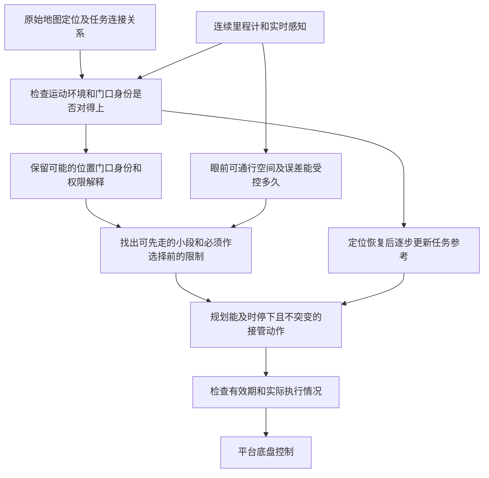

# C 案技术详解：地图位置跳变或认错门口时，怎样不突然转向、不走错入口

> 版本：V2.1 通俗说明修订，2026-10-16；不改变原方案的技术条件。
> 对应交底书：[03_patent_c_local_frame_route_handover_disclosure_20261015.md](03_patent_c_local_frame_route_handover_disclosure_20261015.md)。
> 本文独立说明来源、坐标约定、假设管理、控制原理、实施过程和算例；未实现算法或开展本案仿真、硬件验证。
> 地图与里程计分开管理、保留多种位置解释、证据不足时暂不选定结果，均有先例。待研究的是：怎样把“先做各解释都允许的动作”“选择前留足停车空间”“局部判断在全过程有效”一起落实到控制，不保证可专利性。

## 0. 阅读说明与交底书术语对照

**一句话概括：不知道自己到底在地图上的哪个门口时，先用眼前真实看到的空间控制运动，只做不会过早选错入口的动作，并保证来得及在必须作出选择前停下。** 定位恢复后，也要重新检查路线和控制，不能直接跳回旧路线。

可先看第 1 节场景、第 7 节“还不能选哪个门”及第 11.2 节医院算例，再读坐标变换和控制公式。来源表中的 L 表示论文、P 表示已有专利、D 表示规范，编号沿用组合台账。本次只改写说明，不新增文献核验或试验结果。

| 交底书/原说明用语 | 通俗含义 | 本案中的例子或限制 |
| --- | --- | --- |
| 定位失配、位姿 | 定位结果与实际环境对不上；位置和朝向的合称 | 车体没动，地图位置却跳了 1 m；也可能位置平滑但认错房间 |
| `map`、`odom`、`base_link` | 地图坐标系、连续里程计坐标系、固定在机器人机身上的坐标系 | 地图结果可突然校正；里程计结果通常连续，但误差会累计 |
| 帧、帧版本、TF | 此处“帧”指坐标系；版本区分坐标系定义变化；TF 是 ROS 中管理坐标关系的机制 | 里程计重置后，不能把重置前后的坐标直接拼起来；不是视频帧 |
| 帧权限、发布权威 | 哪个模块负责发布某一条坐标变换 | 同一条关系不能由两个模块分别发布新值和旧值；不是通行权限 |
| 任务对齐副本、冻结全局修正通道 | 单独保存供任务路线使用的地图到局部坐标换算关系；异常时暂停直接采用新定位来更新它 | 不冻结真实运动，不停止看障碍，也不覆盖原始定位输出 |
| 局部走廊 | 根据当前感知确认、扣除机身尺寸及误差后，允许机器人通过的空间 | 不是只指建筑物走廊，也不是一条没有宽度的中心线 |
| 拓扑节点、任务出口 | 地图中有连接关系的地点，以及当前任务可能要选的门口、岔路或工位入口 | “出口”不只指建筑物出口，也可以是目标房间入口 |
| 多位姿模式、多假设 | 同时保留几种尚有依据的位置和门口身份解释 | “这是目标病房”与“这是相似的限制进入房间”，不是取二者坐标平均 |
| 消歧、延迟提交 | 获取能区分解释的新信息；证据不足时暂不选定某个任务入口 | 可以等待标识或请求协助，不能只因某解释分数稍高就进门 |
| 共同前缀、共同可执行动作 | 当前先走的一小段动作，在每种仍合理解释下都不排除合法完成任务的选项 | 在门前走廊内减速等待；不要求各条完整路线相同 |
| 动作承诺边界、最早边界 | 再跨过去就无法保留其他合理选项的状态或位置限制；多个限制中最先要遵守的一个 | 未确认身份前不能越过单向门禁；普通可安全倒退的岔路不一定是这种边界 |
| 提交、提交记录 | 暂时选定任务入口，并记录依据和适用条件 | 是任务选择，不是提交代码或把命令发给驱动器；新反证可能使选择撤销 |
| 可回退、可恢复 | 能在当前空间、动力和规则限制下退回，或转入可行的停止/恢复行为 | 不只是几何上“能倒车”；已闯入禁区后倒回来不能抹去违规 |
| 接管、回切、连续性 | 改由局部控制处理；恢复全局任务参考；切换时控制变化满足底盘限制 | 不突然改轮速或转向，“连续”不只是画出的曲线光滑 |
| 终端、保持、完整局部有效时域 | 接管动作最终必须达到的状态、在其后维持状态，以及感知/误差条件能支持多久 | 必须覆盖切换、制动及要求的等待时间，不能只看眼前一秒 |
| 协方差、交叉项、相对误差 | 描述误差大小及关联的量；两个估计共享误差产生的项；机器人相对障碍的位置误差 | 同一里程计误差可能同时影响两者，不能无依据当成独立或直接抵消 |
| 初态集合、状态管、扫掠体 | 新控制开始时的可能状态范围、随时间变化的可能状态范围、机身运动经过的整个空间 | 初态要考虑仍在执行的旧指令，转弯要考虑货箱外角 |
| 有界更新、风险最小化 | 每步限制位置/朝向修正幅度；保证已丢失时采用当前可行的减风险动作并报告 | 小步修正也可能碰撞，仍须逐步检查；不承诺发出停车命令就一定安全 |

AMR 是自主移动机器人；SLAM 指机器人一边建图一边估计自身位置；“回环”是识别到曾经来过的地方后校正地图与定位。MPC（模型预测控制）指反复预测未来一小段运动，再求当前控制输入的方法。UAV 指无人机，相关论文的飞行结果不能直接当成本案地面机器人的验证结果。

## 1. 先理解一个室内场景

配送机器人看到一个门口。定位器认为它在目标房间前，但另一种仍合理的解释是：这是外观相似的限制进入房间。局部激光显示门口空闲，不代表进入这个门口就是正确任务动作。

同时，SLAM 回环让地图位姿横向跳了 1 m。机器人没有瞬间横移，若控制器直接追踪跳后的地图轨迹，可能突然转向墙边。只把跳变滤平也不够，因为平滑后的路线仍可能通向错误房间。

本案把问题拆成三层：**眼前空间能否通过、走进去是否符合任务与权限、当前还能前进多远且仍来得及停车等待。** 门口身份没弄清时，只执行在所有仍合理解释下都不排除合法任务选项的动作；空间或感知可靠时间不够，就必须提前安排停止，而不是等条件失效才刹车。

### 1.1 平台与边界

靠左右轮速差转向的差速机器人、可直接侧移的全向机器人，以及服务/配送/巡检机器人和车辆，可共用上述位置解释与任务参考管理，但要分别建立运动模型。足式机器人还需检查支撑和落足；无人机还需检查三维飞行及最终悬停/着陆的能量条件。本版最低可实现目标为低速地面机器人，不因写入平台名称就宣称具备跨平台控制保证。

## 2. 技术来源与逐项依据

| 技术要素 | 来源及核读层级 | 本案的使用与限制 |
| --- | --- | --- |
| `odom` 连续、`map` 可校正跳变、变换由谁发布、换地图时坐标如何解释 | D01，官方源文全文相关章节 | 直接采用公开约定；不能把局部/全局两套坐标系称为新发明 |
| 考虑误差的局部导航，只在可观测范围内安排路径 | L03，正文 III-VII | 说明相对误差与有限可观测空间；其静态室内 UAV 结果不证明本案动态地面导航 |
| 地图中各处几何位置的误差可能相互关联 | L08，正文 III-V | 不能随意当成独立误差；其离线预测指标不是闭环接管保证 |
| 保留多种位置解释，在选定地图关联结果前检查 | L10，摘要 | 与本案保留多假设、暂缓选择很接近；未读全文不能断言没有底盘动作限制 |
| 地图/现实差异及局部适应 | P04，权利要求 1-5、16 | 地图失配后使用局部感知已有披露 |
| 导航不确定、虚拟遮挡对象及横纵限制 | P05，权利要求 1、7、12-20 | 不把“不确定时减速”作为新机制 |
| 轨迹时效、状态一致性和能力验证 | P02，相关权利要求 | 支撑接管初态和执行连续性检查，非本案独创 |

### 2.1 本案合成设计与未知事项

对每一种仍合理的位置解释，列清它对应的门口、通行权限和可退回路线；把这些解释都对应到眼前同一个局部空间，找出现在可以先执行的一小段共同动作。动作必须保留在最早“再过去就选定某个入口”的限制之前停下并按要求等待的能力，且误差判断要覆盖全过程。改用局部控制和恢复全局路线时，都重新检查障碍、入口身份和底盘能否实现。

上述为本次提出的方案组合。共同前缀、多假设树和终端可达性都有基础；是否在单一文献或显而易见组合中已有披露尚不确定。需要进一步检索机器人任务导航、重定位容错、拓扑导航和混合模式监督的论文及专利，不将本次有限阅读当作穷尽查新。

## 3. 系统框架与消息契约



| 数据对象 | 必要内容 | 失败时如何处理 |
| --- | --- | --- |
| `LocalState`（局部运动状态） | `odom` 位置/朝向/速度、误差界、采集时刻、局部坐标系版本 | 无法监控漂移范围或版本不明则不继续批准 |
| `RawLocalization`（未经任务模块平滑的定位结果） | 原始地图位置/朝向、多种可能解释及其质量和匹配依据 | 不能用单个最高分结果覆盖其他合理解释 |
| `LocalCorridor`（眼前可通行空间） | 已确认空闲区、动态障碍范围、相关误差、可用时间、外形版本 | 失效后需重建，不无限复用旧点云 |
| `ExitHypothesis`（一种任务入口解释） | 可能位置、任务节点、对应的真实门口/出口、权限、判断来源、回退条件 | 不明项保留未知分支或拒绝越界 |
| `CommitRecord`（任务入口选择记录） | 出口身份、假设/连接关系/规则版本、几何边界、有效期 | 越界前有新反证则撤销；已越界则按真实当前状态重新处理 |
| `TransitionPlan`（切换过程的动作计划） | 接管时的可能初态、执行器状态、轨迹/结束状态要求/期限、关联数据版本 | 初态或模式变更则重验 |

这些为本案设计接口，不代表已有软件 API。版本应覆盖数据语义，不是任意自增计数就能确保一致。

## 4. 坐标框架：物理连续与全局正确是两回事

### 4.1 统一变换方向

规定 $T_{AB}$ 将 B 系坐标变换到 A 系。地图为 $M$、局部里程计为 $O$、基座为 $B$，则：

$$
T_{MB}=T_{MO}T_{OB},\qquad
T_{MO}=T_{MB}T_{OB}^{-1},\qquad T_{OM}=T_{MO}^{-1}.
$$

地图目标点转到局部时使用 $p_O=T_{OM}p_M$。不要把 `map -> odom` 的 TF 边名与相反方向矩阵混用；实现时明确库函数返回的目标/源帧语义。

可把变换理解为“同一个物理点换一种坐标记法”。$T_{AB}$ 的下标顺序固定为“从 B 换到 A”，$T^{-1}$ 表示反方向换算；$p_M,p_O$ 是同一目标点在地图和里程计坐标系中的坐标。第一式表示“先由机身坐标换到里程计坐标，再换到地图坐标”。这些矩阵改变的是坐标表示，不是让机器人真的移动。

D01 的定义是：`odom` 下位姿连续但可无界漂移，`map` 下长期参考可校正漂移但允许跳变。**连续不等于准确，有协方差也不等于协方差已校准。**

### 4.2 谁负责发布坐标关系，任务路线为什么另留一份对齐记录

负责里程计的模块发布 `odom -> base_link`，负责地图定位的模块发布 `map -> odom`；同一条坐标关系只由一个负责模块发布。任务参考管理器读取原始变换，另存内部副本 $\bar T_{OM}^{\rm task}$，专门把地图中的任务路线换算到局部坐标。横线和上标 task 用于区别这份副本与原始定位结果。

发现定位对不上环境时，暂停的是“用新全局定位直接改写任务对齐副本”，不是让真实里程计 $T_{OB}$ 停止更新，也不是让另一个节点抢着发布旧 TF。原始定位数据仍保留用于诊断和恢复，眼前障碍仍按采集时间换算到局部坐标 $O$。

每个引用副本的任务点需带对齐版本。旧任务对齐产生的点不能与新原始变换投影的地图障碍无说明混用；局部感知障碍始终代表物理位置，不为“平滑”跟着任务参考移动。

## 5. 怎样检测定位失配

### 5.1 比较相对运动而不只比较位置

定义同一对采集时刻的相对运动：

$$
\Delta T_M=T_{MB,t-1}^{-1}T_{MB,t},\qquad
\Delta T_O=T_{OB,t-1}^{-1}T_{OB,t},\qquad
r_\Delta=\operatorname{Log}(\Delta T_M^{-1}\Delta T_O).
$$

$t-1,t$ 表示相邻两次对齐后的观测时刻。$\Delta T_M,\Delta T_O$ 分别是地图定位、里程计认为机器人在这段时间移动和转动了多少。$\operatorname{Log}$ 在这里不是取普通数的对数，而是把两个刚体运动的差异转成便于比较的平移、转角分量；结果 $r_\Delta$ 就是两种运动估计的差值，称为残差。

例如车体几乎未动而全局位姿跳了 1.8 m，相对运动残差会显著增大。平移和转角不能直接用同一无量纲阈值比较；分别设 m/rad 界，或使用有效协方差加权统计量，并核对统计前提。

### 5.2 运动一致仍可能定位到错门口

相似走廊中，全局位姿可能平滑但关联到了错误节点。还应比较实际墙面/门框几何、语义或标识、通行连接与任务权限。连续多帧都来自同一误匹配，不是独立证据，不能把重复次数当作必然正确。

观测丢失、里程计重置、地面打滑或环境整体运动也可能破坏局部参考。此时不将所有异常归咎于地图；若无法继续建立相对误差界，停止授权，进入平台适用的风险最小化。

## 6. 局部走廊与误差如何进入控制

### 6.1 从当前感知构造局部自由空间

以激光/深度点云、障碍预测和通道边界构建局部可行走廊。只有观测覆盖且质量有效的区域可当自由空间，未知区域不自动通行；动态障碍还需时间相关占用。

将平台外形、载荷以及相对误差作用到走廊，得到允许参考点及姿态的集合。矩形 AMR 在弯曲窄通道中不能只检查中心线宽度，必须考虑姿态和扫掠体。

### 6.2 相关相对误差

障碍位置和平台位姿若共享里程计或地图误差，线性化后的相对协方差为：

$$
\Sigma_{\rm rel}=\Sigma_b+\Sigma_v-\Sigma_{bv}-\Sigma_{vb}.
$$

本式中 $\Sigma_b$ 表示障碍位置误差的协方差，$\Sigma_v$ 表示机器人位姿误差的协方差，$\Sigma_{bv},\Sigma_{vb}$ 表示两者共享误差产生的关联项。协方差矩阵用来描述各方向误差的大小及关联，不是直接以米表示的最坏误差距离。公式说明：相对位置误差既与各自误差有关，也与两者是否一起偏移有关。

以上要求先转到共同坐标及同一误差参数化，必要时含雅可比。交叉项未知时，不能假装知道它并人为抵消误差。可用相关性未知时有效的保守界，或改用经校准区间。

概率误差椭圆需说明覆盖率、分布和多时刻风险。本文停止判据中的 $e_\parallel,e_\perp$ 代表完整时域可监督的误差界，不是把一个标准差直接当最坏界。

### 6.3 完整有效时域

预测从现在经过接管、轨迹执行到停止/保持的误差增长和感知有效期。若即将失去纹理或里程计漂移将使走廊变空，应提前减速。不能等到走廊失效后才用已经无效的误差界证明停车可行。

## 7. 门口身份没确定时，哪些动作可以先做

### 7.1 假设的内容不只是几何曲线

一个假设包含：当前位置可能对应哪个拓扑节点、可见门口是什么身份、哪些权限适用、后续任务如何衔接、是否能在当前运行约束内回退。道路出口、工位入口和房间门口都可用这种结构。

保留所有在已验证证据下仍合理的模式，必要时有“未知出口”分支。分数低不等于物理不可能；删除模式须有足够的几何、时序、权限或任务证据。不要求永远保留全部模式，但须说明筛除依据及风险。

### 7.2 为什么平均两条路线可能撞墙

两条候选路线分别从立柱左侧和右侧经过，均可行；坐标平均的路线却可能穿过立柱。两条路线分别进不同门，平均位置即使在空旷区，也不代表任何正确任务动作。

本案把不同解释对应到眼前同一个真实空间，选它们都允许的动作，而不是平均路线。$H_i$ 表示第 $i$ 种解释，$\mathcal A_i$ 表示在这种解释下仍保留合法任务选项的动作集合。$\bigcap_i\mathcal A_i$ 是所有集合的交集，即“每一种仍合理解释都允许”的动作，再从中选符合实际空间和底盘能力的一小段。

例如两种解释都允许在门前走廊减速，却只有一种允许进门，那么可以减速，不能据此批准进门。若找不到继续通行的共同动作，应安排已验证的停止或获取新信息来区分解释；若连停止也已无法保证，则标记保证丢失，转入当前可行的减风险处理。

同一物理走廊在不同地图模式下可以有不同节点编号，不能要求字符串 ID 相同便判共同；应先建立各假设到实时物理走廊/门口的对应，再检查动作结果是否保留其合法任务选项。只取几何自由空间交集也不够，因为“可经过”和“有权进入”不同。

### 7.3 哪条限制之前必须停下或确认选择

边界表示在给定动力学、权限、可回退性及局部有效时域下，跨越后将无法保留其他合理任务选项的动作位置/状态。单向门禁、无回转空间的窄门、开始精确泊靠可能产生此类边界。

这里的“承诺”是控制决策意义上的“做了就排除了其他选项”，不是对人的口头保证，也不要求动作在物理上绝对不可逆。“最早”指当前动作可能遇到多个这类限制时，必须先遵守最先到达的那个。停止线还要留出制动和误差距离，不能把“到边界才刹车”当作满足要求。

普通岔路若允许安全倒退，不天然不可逆；应验证回退可达性后再求边界。无法可靠求出时，在第一个歧义入口前取保守等待线。越过错误门禁后“还能倒退”不能补救已经发生的权限越界。

足式机器人跨坎或换接触面时，承诺还包含落足/支撑变化；本版不把平面基座几何当作完整落足验证。

## 8. 根据剩余距离和可靠时间，计算现在最多能开多快

对沿共同走廊的直线必要筛查，设边界净距离 $d_c$，保证减速度 $b>0$，接管时延 $\tau$，完整停止时域纵向误差界 $e_\parallel$ 和附加裕量 $m_d$：

$$
v\tau+\frac{v^2}{2b}+e_\parallel+m_d\le d_c.
$$

左侧依次是：等待接管生效期间走的距离、真正制动后走的距离、纵向位置误差预留量、额外距离余量；右侧是距上述边界的可用净距离。$v$ 的单位为 m/s，$\tau$ 为 s，$b$ 为 m/s²，其余各项为 m。净距离须已经按所选碰撞表示考虑机身尺寸，不能重复扣除。符号 $\parallel$ 表示沿行进方向，后文 $\perp$ 表示横向。

由一元二次不等式求正根：

$$
v_{\max}=-b\tau+\sqrt{(b\tau)^2+2b(d_c-e_\parallel-m_d)}.
$$

仅当 $d_c-e_\parallel-m_d\ge0$、模型有效且转向/制动限制满足时使用；若净距离为负，不通过根号公式掩盖已无余量。该式只检查沿路线方向的停车距离，仍须检查动态障碍、弯道和加速度变化快慢（“加加速度”）等限制；这一项通过不代表整个动作都可行。

还要满足：

$$
T_{\rm local}\ge T_{\rm handover}+T_{\rm stop}+T_{\rm required\ hold},
$$

其中误差界覆盖相同完整时段。若只计划验证到停止，不对其后任意时长作保证；如果任务要求等待 2 s，还要验证该保持段和动态占用。

这里 $T_{\rm local}$ 是当前局部感知及误差条件还能支持的时间，右侧三项分别是切换生效时间、制动时间、要求的停车等待时间。例如停下来要 1.53 s，而局部判断只可靠到 1.40 s，空间够也不能批准原动作。

## 9. 接管控制与全局回切

### 9.1 连续性在优化内约束

接管初态取当前平台及驱动器状态集合，不是新轨迹理想起点。差速机器人约束左右轮速/加速度、线/角运动；车辆约束转角及变化率、加加速度和轮胎能力。接管段须位于共同走廊并满足边界前终端条件。

用已有局部 MPC 或约束优化构造过渡轨迹即可，不以使用 MPC 主张新颖。不能先求一条碰撞路线，再用低通滤波器“平滑”为可行；后处理改变轨迹也必须重验。

### 9.2 定位分数恢复后，为什么仍不能直接跳回旧路线

恢复需原始定位、实时几何、拓扑/权限、相对运动在时间窗内一致；相关重复误匹配不得当独立确认。若只有地图位置恢复而任务门口身份未解，仍不提交任务出口。

内部任务对齐副本可逐步向原始定位靠近，限制每步修正的距离与角度。专业上可写成下面的刚体变换更新（也称 Lie 群更新）：

$$
\bar T_{OM}^{k+1}=\bar T_{OM}^{k}
\operatorname{Exp}\!\left[\operatorname{clip}_{\mathcal V\Delta t}
\operatorname{Log}\!\left((\bar T_{OM}^{k})^{-1}T_{OM}^{\rm raw}\right)\right].
$$

$\operatorname{clip}$ 分别限制平移和转角增量，不能把 m 与 rad 混作一个无单位范数。每一步产生新的任务参考，须重新检查走廊、障碍、任务身份和执行器连续性。原始 TF 仍由原权威发布，不被该公式覆盖。

不熟悉矩阵时，可按四步读它：求“当前任务副本与原始定位差多少”→用 $\operatorname{Log}$ 换成平移/转角增量→按允许变化率 $\mathcal V$ 和本周期时长 $\Delta t$ 限制这次最多改多少→用 $\operatorname{Exp}$ 换回坐标变换并更新副本。$k$ 是更新次数，raw 表示原始结果。该式只生成候选任务参考，不能跳过下一步的碰撞与控制检查。

即使目标对齐最终落在旧地图路线，中间参考也可能穿过施工围栏；一旦某步不通过就暂停回切，保持已验证局部行为或停止。该公式是候选参考生成方式，不是安全性的充分条件。

### 9.3 已越过边界后怎么办

新证据推翻提交时，若尚未越界且可停止，撤销并重验；若已经越过，按真实新状态选择可行恢复，不为返回旧路线而危险倒车或跨越禁区。记录任务错误、权限事件与风险最小化，不回写历史让提交看起来从未发生。

## 10. 逐周期实现与工程步骤

以下是每周期的处理流程，不是已实现的软件。执行许可只覆盖下一个小段，而不是一次批准整条恢复路线。

```text
每个导航周期（局部状态、原始定位、任务、驱动反馈）：
    检查运动估计、实际几何、门口身份和坐标版本是否一致
    建立眼前可通行空间，并计算其误差随时间如何增长
    保留所有仍有依据的任务入口解释
    找出各解释都允许的小段动作，以及必须确认选择前的限制
    根据尚未执行完的旧指令，预测新控制真正生效时的状态
    若局部条件不能覆盖切换、停车和要求的等待全过程：
        请求已验证的停止；无法保证停止则报告并采用减风险措施
        本周期不批准继续通行
    在共同允许范围内规划满足停止和执行器限制的接管动作
    若动作或任务关联检查不通过：记录原因，不批准新动作
    只批准下一小段已检查的动作
    若全局定位恢复，且任务入口身份等也已核对一致：
        小步更新内部任务对齐副本，生成候选参考
        重新检查空间、通行连接和底盘控制，通过后才采用
```

### 10.1 从最小机器人原型开始

1. 固定单楼层地图和差速底盘，理清每条 TF 由哪个模块发布、观测时间及底层速度控制响应。
2. 使用已有 SLAM/重定位与里程计，记录原始结果；不先修改定位算法。
3. 以激光几何建立实时走廊，标定随时间/运动增长的相对误差界。
4. 构造两个外观相似门口和两个位姿模式，人工标注真实任务身份与权限作初始验证。
5. 在任务参考进入局部规划器之前加入副本管理，并在驱动前加入期限及版本监督。
6. 先验证停止不越界，再验证连续接管和逐步回切；每个阶段保留失败场景。

ROS 2/Nav2 可作为传感、TF 和导航组件框架；本案假设/承诺记录不是其默认功能，也不声称普通 ROS 回调满足硬实时截止时间。足式或三维平台必须另加入其物理控制器，而非只改 `base_link` 名称。

## 11. 完整数值例与反例

### 11.1 车辆分叉筛查

共同前缀至边界 9 m，保证减速度 2 m/s²，时延 0.25 s，误差及裕量合计 1 m。速度界为 $-0.5+\sqrt{0.25+32}=5.179$ m/s；5 m/s 需要 $1.25+6.25+1=8.5$ m，6 m/s 需要 $1.5+9+1=11.5$ m。

车道 3.6 m、车宽 1.9 m、横向误差 0.25 m、裕量 0.20 m，中心轨迹每侧余量 $(3.6-1.9)/2-0.25-0.20=0.40$ m。误差增为 0.70 m 时余量 -0.05 m，即使道路中心线仍清晰也不得继续沿用原走廊保证。

### 11.2 医院差速配送机器人

当前有两种合理模式：门口 D 是目标房间入口，或门口 D 是限制进入区域。局部几何都能解释，因此不能只选最高分模式进门。共同物理动作是在门前走廊内接近并保留停止能力。

假设速度 0.80 m/s，净距离 1.20 m，保证减速度 0.60 m/s²，接管时延 0.20 s，完整停止时域误差/裕量合计 0.25 m：

$$
d_{\rm need}=0.80\times0.20+
\frac{0.80^2}{2\times0.60}+0.25=0.9433\ \mathrm m.
$$

走廊 1.40 m、机身宽 0.60 m，横向误差与附加裕量各 0.10 m，每侧余量 0.20 m。一维距离与直行横向筛查均通过。

| 相对时刻 | 事件 | 速度/距离与决策 |
| --- | --- | --- |
| 0 s | 立即决定进入已验证停止策略 | 不再追加未经验证的进门动作 |
| 0.20 s | 最坏实际开始减速 | 前进 0.16 m，速度 0.80 m/s |
| 1.5333 s | 停止 | 制动再前进 0.5333 m；累计 0.6933 m，加误差裕量为 0.9433 m |

若局部有效时域只剩 1.40 s，虽然空间足够，完整停止时间却不够，此时无法签发带完整保证的原动作。正确监督应更早减速；若已经处于该状态，则执行可行的风险最小化并标记保证丢失，不能因为发出停车命令就声称安全条件成立。

### 11.3 错误恢复反例

地图定位恢复后，旧地图目标线位于新围栏另一侧。把局部轨迹和旧地图轨迹平滑插值可能穿过围栏。此时回切重验拒绝中间参考，机器人维持局部停止或另规划，不沿滤波结果穿越障碍。

## 12. 环境模式、失败处理与验证

### 12.1 跨楼层与移动参考环境

D01 已指出电梯和跨地图的语义问题。机器人进入电梯后，外部楼层变化；电梯内观测连续不能证明原楼层地图仍适用。本版要求环境/楼层模式确认后重建任务关联，未展开自动呼梯、门控权限或移动地板全套控制，不把它们写成已实现功能。

局部帧重置、更换地图或观测过久也须改变版本并重验。不同模式的走廊不可直接拼接为同一个惯性空间；需要明确坐标和时间关系，无法建立时不继续授权。

### 12.2 验证矩阵

| 测试 | 要区分的问题 | 观察量 |
| --- | --- | --- |
| 全局位姿突然跳变，物理未动 | 是否隔离直接参考突变 | 实际加速度、角速度/轮速变化及最小间距 |
| 位姿平滑但门口身份错误 | 是否仍保留合理假设 | 错误提交率、越权限边界次数 |
| 局部误差逐渐增长 | 是否提前覆盖停车时域 | 越界前触发时间和终端有效性 |
| 允许安全回退的普通岔路 | 是否误把所有分叉当不可逆 | 保守拒绝率及回退可达性记录 |
| 新反证发生在提交前后 | 是否正确撤销或转入新状态处理 | 提交/越界/撤销时间线 |
| 地图/楼层/帧版本改变 | 是否错误复用旧走廊 | 版本链和新模式确认记录 |

对照直接追踪全局、只做位姿低通、只选最高分出口、无完整时域误差预测和完整方案。相同场景需分别统计碰撞、任务错误、权限越界、不可行和过度停止，不能仅以位置误差或平均通行速度判断方案有效。

数值示例未提供统计覆盖或仿真成功率。由人造注入跳变开始，在封闭场地低速、软障碍和独立可接管条件下逐级测试；不在真实医院患者通行区直接验证未标定方案。

## 13. 本文参考文献与读取层级

统一访问日 2026-10-15；编号与总台账一致，下表独立列出可查来源。

| 编号 | 书目信息与原始链接 | 读取范围及局限 |
| --- | --- | --- |
| D01 | Wim Meeussen. *REP-105: Coordinate Frames for Mobile Platforms*. 创建 2010-10-27，Active/Informational。[官方源文本](https://raw.githubusercontent.com/ros-infrastructure/rep/master/rep-0105.rst) | 已读 Coordinate Frames、Frame Authorities、Transitions Between Maps；`master` 动态分支未固定提交。网页入口受防爬页限制，依据实际读到的官方源文，不声称读过被拦截网页正文 |
| L03 | Tommaso Faraci, Marco Camurri, Daniele Fontanelli, Luigi Palopoli. *UNSEEN: Uncertainty-aware Navigation via Sparse Estimation in Unknown Environments*. [arXiv:2606.20755](https://arxiv.org/abs/2606.20755)，2026-06-18，v1 | [正文](https://arxiv.org/html/2606.20755v1) III-VII；RGB-D、稀疏估计与可见域规划；静态室内飞行验证不等于机器人动态通行保证 |
| L08 | Pritom Gogoi, Faris Janjos, Bin Yang, Andreas Look. *Uncertainty Matters: Structured Probabilistic Online Mapping for Motion Prediction in Autonomous Driving*. [arXiv:2603.20076](https://arxiv.org/abs/2603.20076)，2026-03-20，v1 | [正文](https://arxiv.org/html/2603.20076v1) III-V；相关几何及离线建图/预测，未作为本案闭环实证 |
| L10 | Jiaming Wang, Jizhuo Chen, Diwen Liu, Atharva Ghotavadekar, Jiaxuan Da, Linh Kastner, Harold Soh. *Change-Robust Online Topological Memory for Long-Term Relocalization and Semantic Navigation*. [arXiv:2605.02227](https://arxiv.org/abs/2605.02227)，2026-05-04；v2 2026-10-02 | 摘要；RGB-D、连续位姿模式及提交前验证；作者页面接收说明未独立核会议记录，未全文比对不可排除更多重叠 |
| P02 | Zoox. *System and method for trajectory validation*. [US11407409B2](https://patents.google.com/patent/US11407409B2/en)，2022-08-09；US20210046923A1 2021-02-18；优先权 2019-08-13 | 已读相关权利要求/说明；不作现时法律状态判断 |
| P04 | Zoox. *Adaptive mapping to navigate autonomous vehicles responsive to physical environment changes*. [US9612123B1](https://patents.google.com/patent/US9612123B1/en)，2017-04-04；页面申请/优先权 2015-11-04，完整链未核实 | 权利要求 1-5、16；地图差异和局部适应为已有方向，不推断未经核实的 A 文本日期 |
| P05 | Nissan North America. *Navigational constraint control system*. [US12594960B2](https://patents.google.com/patent/US12594960B2/en)，2026-04-07；US20240149912A1 2024-05-09；优先权 2022-11-03 | 权利要求 1、7、12-20；导航不确定及横纵限制已有先例，仍需官方同族/审查档案 |

## 14. 学习结论与下一步

本案最重要的区分是：`odom` 不跳变不等于误差不增长，局部空闲不等于任务身份正确，路线平滑不等于过渡可行。三种检查必须共同约束实际下一段控制。

后续先补读 L10 全文及机器人拓扑任务/安全监督先例，明确动作承诺边界在可倒退平台上的定义；再实现单楼层两假设、一个歧义门口的最小闭环。当前成果为技术说明与假设算例，不是机器人已经具备医院通行、门禁或跨楼层自主能力的证明。