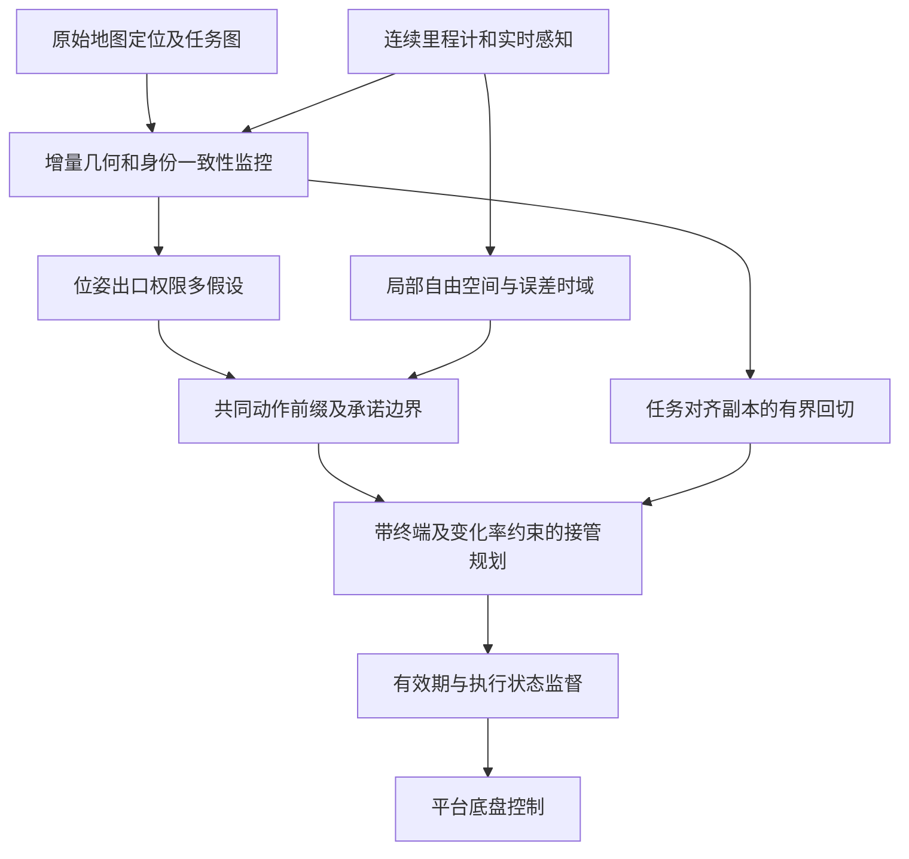

# C 案技术详解：定位失配时，如何保留任务选项并连续接管

> 版本：V2.0 配套说明，2026-10-15。
> 对应交底书：[03_patent_c_local_frame_route_handover_disclosure_20261015.md](03_patent_c_local_frame_route_handover_disclosure_20261015.md)。
> 本文独立说明来源、坐标约定、假设管理、控制原理、实施过程和算例；未实现算法或开展本案仿真、硬件验证。
> `map/odom` 分离、多假设和延迟提交均有先例。待研究的是任务出口共同前缀、动作承诺边界与完整局部有效时域的控制耦合，不保证可专利性。

## 1. 先理解一个室内场景

配送机器人看到一个门口。定位器认为它在目标房间前，但另一种仍合理的解释是：这是外观相似的限制进入房间。局部激光显示门口空闲，不代表进入这个门口就是正确任务动作。

同时，SLAM 回环让地图位姿横向跳了 1 m。机器人没有瞬间横移，若控制器直接追踪跳后的地图轨迹，可能突然转向墙边。只把跳变滤平也不够，因为平滑后的路线仍可能通向错误房间。

本案把问题拆成三层：**物理上还能去哪、任务上哪些选项仍合理、当前还能走多远且来得及进入可保持状态。** 歧义未解时只执行保留所有合理任务选项的共同动作；没有足够空间或局部有效时间则提前停止。

### 1.1 平台与边界

差速/全向 AMR、服务/配送/巡检机器人和车辆可共用假设与参考管理，但使用各自动力学。足式机器人还需支撑/落足验证；无人机还需三维飞行动力学与能量终端。本版最低可实现目标为低速地面机器人，不因写入平台名称就宣称具备跨平台控制保证。

## 2. 技术来源与逐项依据

| 技术要素 | 来源及核读层级 | 本案的使用与限制 |
| --- | --- | --- |
| 连续 `odom`、可跳变 `map`、帧权限及跨地图语义 | D01，官方源文全文相关章节 | 直接采用公开约定；不能将局部/全局双帧称为新发明 |
| 不确定性局部导航、可见域截断 | L03，正文 III-VII | 说明相对误差与有限可观测空间；其静态室内 UAV 结果不证明本案动态地面导航 |
| 相关地图几何不确定性 | L08，正文 III-V | 相对误差不能随意假设独立；其离线预测指标不是闭环接管保证 |
| 多位姿模式与地图提交前验证 | L10，摘要 | 作为很接近的多假设/延迟提交方向；未读全文不能断言无底盘动作约束 |
| 地图/现实差异及局部适应 | P04，权利要求 1-5、16 | 地图失配后使用局部感知已有披露 |
| 导航不确定、虚拟遮挡对象及横纵限制 | P05，权利要求 1、7、12-20 | 不把“不确定时减速”作为新机制 |
| 轨迹时效、状态一致性和能力验证 | P02，相关权利要求 | 支撑接管初态和执行连续性检查，非本案独创 |

### 2.1 本案合成设计与未知事项

将各合理位姿模式映射为任务出口、权限和可回退选项；在同一物理局部系中求共同可执行动作前缀，并使其满足最早动作承诺边界前的停止/保持及完整时域误差限制。接管与回切使用同样的几何、任务身份和执行器约束重验。

上述为本次提出的方案组合。共同前缀、多假设树和终端可达性都有基础；是否在单一文献或显而易见组合中已有披露尚不确定。需要进一步检索机器人任务导航、重定位容错、拓扑导航和混合模式监督的论文及专利，不将本次有限阅读当作穷尽查新。

## 3. 系统框架与消息契约



| 数据对象 | 必要内容 | 失败时如何处理 |
| --- | --- | --- |
| `LocalState` | `odom` 位姿/速度、误差界、采集时刻、局部帧版本 | 漂移/版本不可监督则不继续授权 |
| `RawLocalization` | 原始地图位姿、多个模式及质量/关联信息 | 不能用单个最高分覆盖其他合理模式 |
| `LocalCorridor` | 已确认自由区域、动态占用、相关误差、有效时域、外形版本 | 失效后需重建，不无限复用旧点云 |
| `ExitHypothesis` | 位姿模式、任务节点、物理门口/出口、权限、证据来源、回退条件 | 不明项保留未知分支或拒绝越界 |
| `CommitRecord` | 出口身份、假设/拓扑/规则版本、几何边界、有效期 | 新反证在越界前撤销；越界后进入新可行状态处理 |
| `TransitionPlan` | 接管初态集合、执行器状态、轨迹/终端/期限、绑定版本 | 初态或模式变更则重验 |

这些为本案设计接口，不代表已有软件 API。版本应覆盖数据语义，不是任意自增计数就能确保一致。

## 4. 坐标框架：物理连续与全局正确是两回事

### 4.1 统一变换方向

规定 $T_{AB}$ 将 B 系坐标变换到 A 系。地图为 $M$、局部里程计为 $O$、基座为 $B$，则：

$$
T_{MB}=T_{MO}T_{OB},\qquad
T_{MO}=T_{MB}T_{OB}^{-1},\qquad T_{OM}=T_{MO}^{-1}.
$$

地图目标点转到局部时使用 $p_O=T_{OM}p_M$。不要把 `map -> odom` 的 TF 边名与相反方向矩阵混用；实现时明确库函数返回的目标/源帧语义。

D01 的定义是：`odom` 下位姿连续但可无界漂移，`map` 下长期参考可校正漂移但允许跳变。**连续不等于准确，有协方差也不等于协方差已校准。**

### 4.2 TF 权限与任务参考副本

里程计权威发布 `odom -> base_link`，定位权威发布 `map -> odom`；同一边只由一个权威发布。参考管理器读取原始变换，内部保留 $\bar T_{OM}^{\rm task}$，用它将地图任务参考变换到局部。

检测失配时，隔离的是任务副本的直接更新，不是冻结真实 $T_{OB}$，也不是让第二个节点向相同 TF 边发送旧变换。原始定位数据仍保留用于诊断和恢复，局部实时障碍继续按其采集时间对齐至 $O$。

每个引用副本的任务点需带对齐版本。旧任务对齐产生的点不能与新原始变换投影的地图障碍无说明混用；局部感知障碍始终代表物理位置，不为“平滑”跟着任务参考移动。

## 5. 怎样检测定位失配

### 5.1 比较相对运动而不只比较位置

定义同一对采集时刻的相对运动：

$$
\Delta T_M=T_{MB,t-1}^{-1}T_{MB,t},\qquad
\Delta T_O=T_{OB,t-1}^{-1}T_{OB,t},\qquad
r_\Delta=\operatorname{Log}(\Delta T_M^{-1}\Delta T_O).
$$

例如车体几乎未动而全局位姿跳了 1.8 m，相对运动残差会显著增大。平移和转角不能直接用同一无量纲阈值比较；分别设 m/rad 界，或使用有效协方差加权统计量，并核对统计前提。

### 5.2 运动一致仍可能定位到错门口

相似走廊中，全局位姿可能平滑但关联到了错误节点。还应比较实际墙面/门框几何、语义或标识、通行连接与任务权限。连续多帧都来自同一误匹配，不是独立证据，不能把重复次数当作必然正确。

观测丢失、里程计重置、地面打滑或环境整体运动也可能破坏局部参考。此时不将所有异常归咎于地图；若无法继续建立相对误差界，停止授权，进入平台适用的风险最小化。

## 6. 局部走廊与误差如何进入控制

### 6.1 从当前感知构造局部自由空间

以激光/深度点云、障碍预测和通道边界构建局部可行走廊。只有观测覆盖且质量有效的区域可当自由空间，未知区域不自动通行；动态障碍还需时间相关占用。

将平台外形、载荷以及相对误差作用到走廊，得到允许参考点及姿态的集合。矩形 AMR 在弯曲窄通道中不能只检查中心线宽度，必须考虑姿态和扫掠体。

### 6.2 相关相对误差

障碍位置和平台位姿若共享里程计或地图误差，线性化后的相对协方差为：

$$
\Sigma_{\rm rel}=\Sigma_b+\Sigma_v-\Sigma_{bv}-\Sigma_{vb}.
$$

以上要求先转到共同坐标及同一误差参数化，必要时含雅可比。交叉项未知时，不能假装知道它并人为抵消误差。可用相关性未知时有效的保守界，或改用经校准区间。

概率误差椭圆需说明覆盖率、分布和多时刻风险。本文停止判据中的 $e_\parallel,e_\perp$ 代表完整时域可监督的误差界，不是把一个标准差直接当最坏界。

### 6.3 完整有效时域

预测从现在经过接管、轨迹执行到停止/保持的误差增长和感知有效期。若即将失去纹理或里程计漂移将使走廊变空，应提前减速。不能等到走廊失效后才用已经无效的误差界证明停车可行。

## 7. 多任务出口假设与共同前缀

### 7.1 假设的内容不只是几何曲线

一个假设包含：当前位置可能对应哪个拓扑节点、可见门口是什么身份、哪些权限适用、后续任务如何衔接、是否能在当前运行约束内回退。道路出口、工位入口和房间门口都可用这种结构。

保留所有在已验证证据下仍合理的模式，必要时有“未知出口”分支。分数低不等于物理不可能；删除模式须有足够的几何、时序、权限或任务证据。不要求永远保留全部模式，但须说明筛除依据及风险。

### 7.2 为什么平均两条路线可能撞墙

两条候选路线分别从立柱左侧和右侧经过，均可行；坐标平均的路线却可能穿过立柱。两条路线分别进不同门，平均位置即使在空旷区，也不代表任何正确任务动作。

本案选择在同一局部物理系中共同允许的动作，而非平均曲线。对各假设 $H_i$，求保留该假设任务选项的动作集合 $\mathcal A_i$，再在 $\bigcap_i\mathcal A_i$ 内寻找满足真实走廊和平台动力学的控制片段；交集空则停止或请求消歧。

同一物理走廊在不同地图模式下可以有不同节点编号，不能要求字符串 ID 相同便判共同；应先建立各假设到实时物理走廊/门口的对应，再检查动作结果是否保留其合法任务选项。只取几何自由空间交集也不够，因为“可经过”和“有权进入”不同。

### 7.3 最早动作承诺边界

边界表示在给定动力学、权限、可回退性及局部有效时域下，跨越后将无法保留其他合理任务选项的动作位置/状态。单向门禁、无回转空间的窄门、开始精确泊靠可能产生此类边界。

普通岔路若允许安全倒退，不天然不可逆；应验证回退可达性后再求边界。无法可靠求出时，在第一个歧义入口前取保守等待线。越过错误门禁后“还能倒退”不能补救已经发生的权限越界。

足式机器人跨坎或换接触面时，承诺还包含落足/支撑变化；本版不把平面基座几何当作完整落足验证。

## 8. 从边界推导速度与局部期限

对沿共同走廊的直线必要筛查，设边界净距离 $d_c$，保证减速度 $b>0$，接管时延 $\tau$，完整停止时域纵向误差界 $e_\parallel$ 和附加裕量 $m_d$：

$$
v\tau+\frac{v^2}{2b}+e_\parallel+m_d\le d_c.
$$

由一元二次不等式求正根：

$$
v_{\max}=-b\tau+\sqrt{(b\tau)^2+2b(d_c-e_\parallel-m_d)}.
$$

仅当 $d_c-e_\parallel-m_d\ge0$、模型有效且转向/制动限制满足时使用；若净距离为负，不通过根号公式掩盖已无余量。该式是必要的一维筛查，不替代动态障碍、弯道和加加速度约束。

还要满足：

$$
T_{\rm local}\ge T_{\rm handover}+T_{\rm stop}+T_{\rm required\ hold},
$$

其中误差界覆盖相同完整时段。若只计划验证到停止，不对其后任意时长作保证；如果任务要求等待 2 s，还要验证该保持段和动态占用。

## 9. 接管控制与全局回切

### 9.1 连续性在优化内约束

接管初态取当前平台及驱动器状态集合，不是新轨迹理想起点。差速机器人约束左右轮速/加速度、线/角运动；车辆约束转角及变化率、加加速度和轮胎能力。接管段须位于共同走廊并满足边界前终端条件。

用已有局部 MPC 或约束优化构造过渡轨迹即可，不以使用 MPC 主张新颖。不能先求一条碰撞路线，再用低通滤波器“平滑”为可行；后处理改变轨迹也必须重验。

### 9.2 恢复不是把置信分数升高就回切

恢复需原始定位、实时几何、拓扑/权限、相对运动在时间窗内一致；相关重复误匹配不得当独立确认。若只有地图位置恢复而任务门口身份未解，仍不提交任务出口。

内部任务对齐副本可作有界 Lie 群更新：

$$
\bar T_{OM}^{k+1}=\bar T_{OM}^{k}
\operatorname{Exp}\!\left[\operatorname{clip}_{\mathcal V\Delta t}
\operatorname{Log}\!\left((\bar T_{OM}^{k})^{-1}T_{OM}^{\rm raw}\right)\right].
$$

$\operatorname{clip}$ 分别限制平移和转角增量，不能把 m 与 rad 混作一个无单位范数。每一步产生新的任务参考，须重新检查走廊、障碍、任务身份和执行器连续性。原始 TF 仍由原权威发布，不被该公式覆盖。

即使目标对齐最终落在旧地图路线，中间参考也可能穿过施工围栏；一旦某步不通过就暂停回切，保持已验证局部行为或停止。该公式是候选参考生成方式，不是安全性的充分条件。

### 9.3 已越过边界后怎么办

新证据推翻提交时，若尚未越界且可停止，撤销并重验；若已经越过，按真实新状态选择可行恢复，不为返回旧路线而危险倒车或跨越禁区。记录任务错误、权限事件与风险最小化，不回写历史让提交看起来从未发生。

## 10. 逐周期实现与工程步骤

```text
NavigationTick(local_state, raw_localization, task, driver_feedback):
    integrity = CheckMotionGeometryIdentityAndFrameVersions()
    corridor = BuildObservedLocalCorridorWithTimeDependentErrorBounds()
    hypotheses = MaintainAllStillPlausibleTaskExitModes(task, integrity)
    action_prefix, commit_boundary = FindSharedPhysicalActions(hypotheses, corridor)
    activation_state = PropagateQueuedDriverInputs(driver_feedback)
    if not CompleteHandoverStopAndHoldHorizonValid(corridor, activation_state):
        RequestVerifiedStopOrRiskMinimization()
        return
    transition = PlanInsidePrefixWithTerminalAndActuatorConstraints()
    if not TransitionAndTaskBindingsValid(transition): return NO_NEW_RELEASE
    AuthorizeOnlyNextBoundedSlice(transition)
    if GlobalRecoveryAndTaskIdentityConsistent():
        proposal = BoundedUpdateOfPrivateTaskAlignment()
        ApplyOnlyAfterGeometryTopologyAndControlRevalidation(proposal)
```

### 10.1 从最小机器人原型开始

1. 固定单楼层地图和差速底盘，理清 TF 发布权威、观测时间及速度环响应。
2. 使用已有 SLAM/重定位与里程计，记录原始结果；不先修改定位算法。
3. 以激光几何建立实时走廊，标定随时间/运动增长的相对误差界。
4. 构造两个外观相似门口和两个位姿模式，人工标注真实任务身份与权限作初始验证。
5. 在任务参考进入局部规划器之前加入副本管理，并在驱动前加入期限及版本监督。
6. 先验证停止不越界，再验证连续接管和逐步回切；每个阶段保留失败场景。

ROS 2/Nav2 可作为传感、TF 和导航组件框架；本案假设/承诺记录不是其默认功能，也不声称普通 ROS 回调满足硬实时截止时间。足式或三维平台必须另加入其物理控制器，而非只改 `base_link` 名称。

## 11. 完整数值例与反例

### 11.1 车辆分叉筛查

共同前缀至边界 9 m，保证减速度 2 m/s²，时延 0.25 s，误差及裕量合计 1 m。速度界为 $-0.5+\sqrt{0.25+32}=5.179$ m/s；5 m/s 需要 $1.25+6.25+1=8.5$ m，6 m/s 需要 $1.5+9+1=11.5$ m。

车道 3.6 m、车宽 1.9 m、横向误差 0.25 m、裕量 0.20 m，中心轨迹每侧余量 $(3.6-1.9)/2-0.25-0.20=0.40$ m。误差增为 0.70 m 时余量 -0.05 m，即使道路中心线仍清晰也不得继续沿用原走廊保证。

### 11.2 医院差速配送机器人

当前有两种合理模式：门口 D 是目标房间入口，或门口 D 是限制进入区域。局部几何都能解释，因此不能只选最高分模式进门。共同物理动作是在门前走廊内接近并保留停止能力。

假设速度 0.80 m/s，净距离 1.20 m，保证减速度 0.60 m/s²，接管时延 0.20 s，完整停止时域误差/裕量合计 0.25 m：

$$
d_{\rm need}=0.80\times0.20+
\frac{0.80^2}{2\times0.60}+0.25=0.9433\ \mathrm m.
$$

走廊 1.40 m、机身宽 0.60 m，横向误差与附加裕量各 0.10 m，每侧余量 0.20 m。一维距离与直行横向筛查均通过。

| 相对时刻 | 事件 | 速度/距离与决策 |
| --- | --- | --- |
| 0 s | 立即决定进入已验证停止策略 | 不再追加未经验证的进门动作 |
| 0.20 s | 最坏实际开始减速 | 前进 0.16 m，速度 0.80 m/s |
| 1.5333 s | 停止 | 制动再前进 0.5333 m；累计 0.6933 m，加误差裕量为 0.9433 m |

若局部有效时域只剩 1.40 s，虽然空间足够，完整停止时间却不够，此时无法签发带完整保证的原动作。正确监督应更早减速；若已经处于该状态，则执行可行的风险最小化并标记保证丢失，不能因为发出停车命令就声称安全条件成立。

### 11.3 错误恢复反例

地图定位恢复后，旧地图目标线位于新围栏另一侧。把局部轨迹和旧地图轨迹平滑插值可能穿过围栏。此时回切重验拒绝中间参考，机器人维持局部停止或另规划，不沿滤波结果穿越障碍。

## 12. 环境模式、失败处理与验证

### 12.1 跨楼层与移动参考环境

D01 已指出电梯和跨地图的语义问题。机器人进入电梯后，外部楼层变化；电梯内观测连续不能证明原楼层地图仍适用。本版要求环境/楼层模式确认后重建任务关联，未展开自动呼梯、门控权限或移动地板全套控制，不把它们写成已实现功能。

局部帧重置、更换地图或观测过久也须改变版本并重验。不同模式的走廊不可直接拼接为同一个惯性空间；需要明确坐标和时间关系，无法建立时不继续授权。

### 12.2 验证矩阵

| 测试 | 要区分的问题 | 观察量 |
| --- | --- | --- |
| 全局位姿突然跳变，物理未动 | 是否隔离直接参考突变 | 实际加速度、角速度/轮速变化及最小间距 |
| 位姿平滑但门口身份错误 | 是否仍保留合理假设 | 错误提交率、越权限边界次数 |
| 局部误差逐渐增长 | 是否提前覆盖停车时域 | 越界前触发时间和终端有效性 |
| 允许安全回退的普通岔路 | 是否误把所有分叉当不可逆 | 保守拒绝率及回退可达性记录 |
| 新反证发生在提交前后 | 是否正确撤销或转入新状态处理 | 提交/越界/撤销时间线 |
| 地图/楼层/帧版本改变 | 是否错误复用旧走廊 | 版本链和新模式确认记录 |

对照直接追踪全局、只做位姿低通、只选最高分出口、无完整时域误差预测和完整方案。相同场景需分别统计碰撞、任务错误、权限越界、不可行和过度停止，不能仅以位置误差或平均通行速度判断方案有效。

数值示例未提供统计覆盖或仿真成功率。由人造注入跳变开始，在封闭场地低速、软障碍和独立可接管条件下逐级测试；不在真实医院患者通行区直接验证未标定方案。

## 13. 本文参考文献与读取层级

统一访问日 2026-10-15；编号与总台账一致，下表独立列出可查来源。

| 编号 | 书目信息与原始链接 | 读取范围及局限 |
| --- | --- | --- |
| D01 | Wim Meeussen. *REP-105: Coordinate Frames for Mobile Platforms*. 创建 2010-10-27，Active/Informational。[官方源文本](https://raw.githubusercontent.com/ros-infrastructure/rep/master/rep-0105.rst) | 已读 Coordinate Frames、Frame Authorities、Transitions Between Maps；`master` 动态分支未固定提交。网页入口受防爬页限制，依据实际读到的官方源文，不声称读过被拦截网页正文 |
| L03 | Tommaso Faraci, Marco Camurri, Daniele Fontanelli, Luigi Palopoli. *UNSEEN: Uncertainty-aware Navigation via Sparse Estimation in Unknown Environments*. [arXiv:2606.20755](https://arxiv.org/abs/2606.20755)，2026-06-18，v1 | [正文](https://arxiv.org/html/2606.20755v1) III-VII；RGB-D、稀疏估计与可见域规划；静态室内飞行验证不等于机器人动态通行保证 |
| L08 | Pritom Gogoi, Faris Janjos, Bin Yang, Andreas Look. *Uncertainty Matters: Structured Probabilistic Online Mapping for Motion Prediction in Autonomous Driving*. [arXiv:2603.20076](https://arxiv.org/abs/2603.20076)，2026-03-20，v1 | [正文](https://arxiv.org/html/2603.20076v1) III-V；相关几何及离线建图/预测，未作为本案闭环实证 |
| L10 | Jiaming Wang, Jizhuo Chen, Diwen Liu, Atharva Ghotavadekar, Jiaxuan Da, Linh Kastner, Harold Soh. *Change-Robust Online Topological Memory for Long-Term Relocalization and Semantic Navigation*. [arXiv:2605.02227](https://arxiv.org/abs/2605.02227)，2026-05-04；v2 2026-10-02 | 摘要；RGB-D、连续位姿模式及提交前验证；作者页面接收说明未独立核会议记录，未全文比对不可排除更多重叠 |
| P02 | Zoox. *System and method for trajectory validation*. [US11407409B2](https://patents.google.com/patent/US11407409B2/en)，2022-08-09；US20210046923A1 2021-02-18；优先权 2019-08-13 | 已读相关权利要求/说明；不作现时法律状态判断 |
| P04 | Zoox. *Adaptive mapping to navigate autonomous vehicles responsive to physical environment changes*. [US9612123B1](https://patents.google.com/patent/US9612123B1/en)，2017-04-04；页面申请/优先权 2015-11-04，完整链未核实 | 权利要求 1-5、16；地图差异和局部适应为已有方向，不推断未经核实的 A 文本日期 |
| P05 | Nissan North America. *Navigational constraint control system*. [US12594960B2](https://patents.google.com/patent/US12594960B2/en)，2026-04-07；US20240149912A1 2024-05-09；优先权 2022-11-03 | 权利要求 1、7、12-20；导航不确定及横纵限制已有先例，仍需官方同族/审查档案 |

## 14. 学习结论与下一步

本案最重要的区分是：`odom` 不跳变不等于误差不增长，局部空闲不等于任务身份正确，路线平滑不等于过渡可行。三种检查必须共同约束实际下一段控制。

后续先补读 L10 全文及机器人拓扑任务/安全监督先例，明确动作承诺边界在可倒退平台上的定义；再实现单楼层两假设、一个歧义门口的最小闭环。当前成果为技术说明与假设算例，不是机器人已经具备医院通行、门禁或跨楼层自主能力的证明。